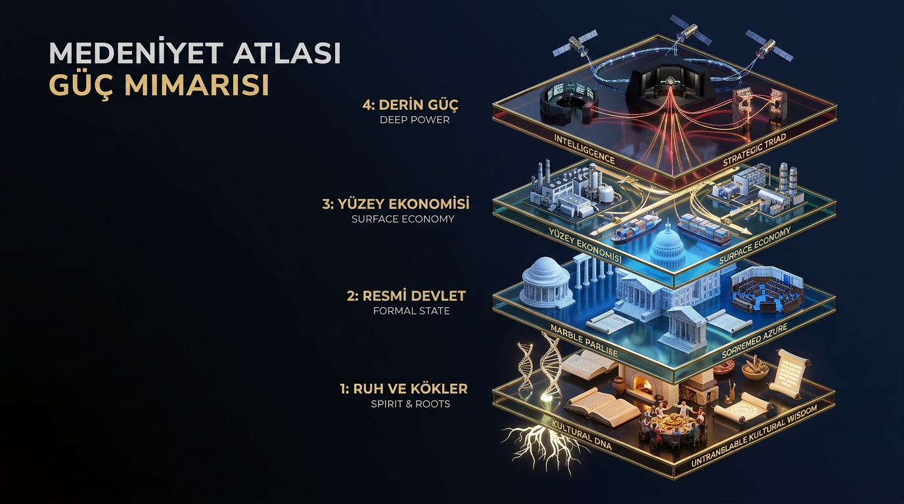
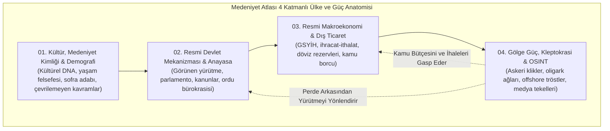
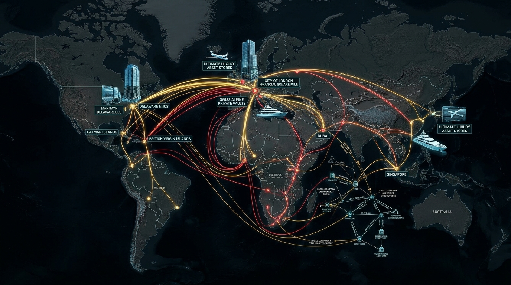
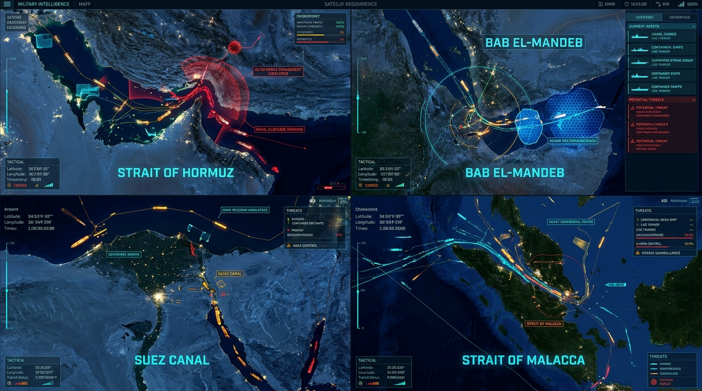

# 🏛️ MEDENİYET ATLASI
### *Dünya Uluslarının Kültürel Kodları, Yaşam Felsefeleri, Medeniyet Havzaları ve Gerçek Güç Anatomisi Ansiklopedisi*

<p align="center">
  
</p>

<p align="center">
  
  
  
  
  
  
  
  
  
  
  
</p>

---

## 📑 İÇİNDEKİLER TABLOSU

1. [🏛️ Giriş ve Medeniyet Atlası Manifestosu](#️-giriş-ve-medeniyet-atlasi-manifestosu)
2. [🎭 Dünya Medeniyetleri ve Kültürel Kodlar Rehberi (Cultural DNA)](#-dünya-medeniyetleri-ve-kültürel-kodlar-rehberi-cultural-dna)
   - [🌐 9 Büyük Küresel Medeniyet Havzası](#-9-büyük-küresel-medeniyet-havzasi)
   - [🧬 20 Örnek Medeniyet Çapası: Ulusal Karakterler ve Yaşam Adabı](#-20-örnek-medeniyet-çapasi-ulusal-karakterler-ve-yaşam-adabi)
   - [📖 Çevrilemeyen Ruh Kavramları Galerisi](#-çevrilemeyen-ruh-kavramlari-galerisi)
   - [🍲 Dünya Gastronomi Felsefeleri & Sofra Ritüelleri](#-dünya-gastronomi-felsefeleri--sofra-ritüelleri)
   - [🧭 Küresel Nezaket Kuralları, İletişim Kodları ve Sosyal Tabular](#-küresel-nezaket-kurallari-iletişim-kodlari-ve-sosyal-tabular)
   - [📚 Medeniyet & Kültür Kütüphanesi Arşivi (/culture)](#-medeniyet--kültür-kütüphanesi-arşivi-culture)
3. [📊 Ekonomik Modellere Göre 8 Küresel Güç Bloğu (/01_... - /08_...)](#-ekonomik-modellere-göre-8-küresel-güç-bloğu-01----08_)
4. [🏛️ Metodoloji: 4 Katmanlı Ülke ve Güç Mimarisi](#️-metodoloji-4-katmanli-ülke-ve-güç-mimarisi)
5. [🛡️ Doğrulama Standardı: NATO / Admiralty Kodu (B2+)](#️-doğrulama-standardi-nato--admiralty-kodu-b2)
6. [🌐 Gerçekçi Güç, Savunma ve İstihbarat Doktrini (/geopolitics_and_intelligence)](#-gerçekçi-güç-savunma-ve-istihbarat-doktrini-geopolitics_and_intelligence)
   - [🛰️ Küresel İstihbarat ve Stratejik Dosyalar Matrisi (11 Özel Rapor)](#️-küresel-istihbarat-ve-stratejik-dosyalar-matrisi-11-özel-rapor)
   - [💸 Kleptokrasi & Offshore Sermaye Kaçırma Döngüsü](#-kleptokrasi--offshore-sermaye-kaçirma-döngüsü)
   - [🧠 Bilişsel Savaş & Siber İstihbarat Matrisi (5GW)](#-bilişsel-savaş--siber-istihbarat-matrisi-5gw)
   - [🚢 Küresel Deniz Darboğazları & Jeopolitik Kilit Noktaları](#-küresel-deniz-darboğazlari--jeopolitik-kilit-noktalari)
7. [🗺️ Bölgesel Master Jeopolitik Güç Dosyaları (/regions)](#️-bölgesel-master-jeopolitik-güç-dosyalari-regions)
8. [📁 Derin Adli OSINT Vaka Analizleri (/dossiers)](#-derin-adli-osint-vaka-analizleri-dossiers)
9. [📚 Ansiklopedik Araştırma Dosyaları & Teori Külliyatı (/research)](#-ansiklopedik-araştirma-dosyalari--teori-külliyati-research)
10. [🗺️ 205 Ülkelik Küresel Atlas İndeksi (Ekonomik ve Kültürel Modelleriyle)](#️-205-ülkelik-küresel-atlas-indeksi-ekonomik-ve-kültürel-modelleriyle)
11. [🔬 Metodoloji ve OSINT Araştırma Kılavuzları (/methodology)](#-metodoloji-ve-osint-araştirma-kilavuzlari-methodology)
12. [🛠️ CLI Terminal Aracı ile Kullanım (xray_cli.py)](#️-cli-terminal-araci-ile-kullanim-xray_clipy)
13. [🧪 Bütünlük ve Veri Doğrulama Testleri](#-bütünlük-ve-veri-doğrulama-testleri)
14. [⚖️ Etik, Hukuki Beyan ve Açık Kültür Lisansı](#️-etik-hukuki-beyan-ve-açik-kültür-lisansi)

---

## 🏛️ GİRİŞ VE MEDENİYET ATLASI MANİFESTOSU

> *"Bir ulusu gerçekten tanımak; onun yalnızca sınırlarını, başkentini ve bayrağını bilmek değildir. Bir ulusu tanımak; bin yıllık kolektif hafızasını, sevinçlerini ve yaslarını, sofrasındaki ekmeği bölüşme adabını, başka hiçbir dile tam çevrilemeyen ruh kavramlarını (Gönül, Ikigai, Gemütlichkeit, Saudade, Ubuntu), selamlaşma inceliklerini ve dünyaya bakış felsefesini öğrenmektir."*

Bu projenin **birincil ve en temel varoluş gayesi**; dünya üzerindeki 205 egemen ve jeopolitik ülkeyi tüm kültürel derinlikleri, medeniyet kodları, yaşam tarzları, mutfak gelenekleri, edebi mirası ve toplumsal karakterleriyle tanıtan **muazzam bir açık kaynaklı dünya ansiklopedisi** sunmaktır.

Dünya ulusları birbirine düşman soyut bayraklardan ibaret değildir; her biri binlerce yıllık coğrafi sınavlardan, göçlerden ve felsefi arayışlardan süzülmüş eşsiz birer kültürel hazinedir. Bu atlas, okuyucusuna bir Japon'un *Wabi-sabi* estetiğindeki dinginliği, bir Türk'ün *Gönül* ve *İmece* dilindeki derin cömertliği, bir Alman'ın *Gemütlichkeit* huzurunu, bir Slav'ın *Toska* melankolisini ve bir Afrikalının *Ubuntu* ("Biz olduğumuz için benim") dayanışmasını anlama kapısını aralar.

### ⚖️ Gerçekçilik Dengesi: Neden Derin Güç ve İstihbarat Katmanı da Var?
Bir ülkeyi yalnızca masalsı turizm broşürleriyle anlatmak, o ülkenin halkına ve tarihsel gerçeğine haksızlık etmektir. Bir ulusun gündelik hayatı ve kültürel dokusu ne kadar zengin olursa olsun; o toplum aynı zamanda **derin devlet mekanizmaları, askeri ittifaklar, oligarşik sermaye konsorsiyumları, enerji darboğazları ve istihbarat savaşları** gerçeğiyle kuşatılmıştır.

Bu nedenle bu ansiklopedi; **kültürü ve insanı merkeze koyan ana gövdesini**, adli bilişim ve OSINT disipliniyle hazırlanmış **derin güç anatomisi** ile dengeler. Tüm detaylı istihbari ve askeri veri setleri [`geopolitics_and_intelligence/`](geopolitics_and_intelligence/README.md) dizininde bağımsız araştırma dosyalarında toplanmış; ana omurgada ise bu dinamiklerin kültürel ve insani izdüşümleri öne çıkarılmıştır.

---

## 🎭 DÜNYA MEDENİYETLERİ VE KÜLTÜREL KODLAR REHBERİ (CULTURAL DNA)

İnsanlık tarihi, belirli coğrafi ve manevi havzalarda şekillenen büyük medeniyetlerin etkileşimidir. Bu bölümde dünya toplumlarının temel kültürel kodları, yaşam felsefeleri ve müşterek değerleri incelenmektedir:

### 🌐 9 Büyük Küresel Medeniyet Havzası
> 📖 *Genişletilmiş medeniyet havzaları felsefesi ve tarihi için: [`culture/CIVILIZATION_REALMS_AND_PHILOSOPHIES.md`](culture/CIVILIZATION_REALMS_AND_PHILOSOPHIES.md)*

| Medeniyet Havzası | Temel Felsefe & Toplumsal Ethos | Temsilci Ülkeler | Müşterek Erdemler & Değerler |
| :--- | :--- | :--- | :--- |
| **Anadolu & Akdeniz Havzası (Kavşak Medeniyetleri)** | Kolektif misafirperverlik, kader birliği, 'Gönül' ve 'İmece' kültürü, yüksek bağlamlı iletişim, duygusal dışavurum ve derin tarihsel katmanlaşma. | `Turkey, Greece, Cyprus` | `` |
| **Doğu Asya & Konfüçyüsçü-Budist Havza** | Sosyal uyum (Wa/He), hiyerarşiye ve büyüklere hürmet, 'Yüz Kaybetmeme' (Mianzi/Menboku) hassasiyeti, dolaylı anlatım, disiplinli sabır ve uzun vadeli planlama. | `Japan, China, South Korea, Taiwan, Singapore` | `` |
| **Cermen & İskandinav Mutabakatı** | Kuralcılık, dakiklik (Pünktlichkeit), kamusal eşitlikçilik (Janteloven), doğayla iç içelik, düşük bağlamlı doğrudan iletişim ve rasyonel şeffaflık. | `Germany, Sweden, Norway, Denmark, Finland, Switzerland, Austria, Netherlands` | `` |
| **Anglo-Sakson Bireyciliği & Pragmatizm** | Bireysel özgürlük, girişimcilik, 'Fırsatlar Ülkesi' ethosu, pragmatik problem çözme, nezaket mesafesi (Privacy) ve liyakat odaklılık. | `United States, United Kingdom, Canada, Australia, New Zealand` | `` |
| **Slav & Avrasya Derinliği** | Kolektif 'Geniş Ruh' (Shirokaya Dusha), melankoli ve dayanıklılık (Stoykost), metafizik derinlik, zorluklar karşısında adanmışlık ve güçlü devlet algısı. | `Russia, Ukraine, Poland, Serbia, Bulgaria, Belarus` | `` |
| **Latin Amerika & Büyülü Gerçekçilik** | Aile odaklılık (Familismo), sıcak temas ve dans, 'Sobremesa' (yemek sonrası koyu sohbet), kutlama coşkusu ve kaderci neşe. | `Brazil, Mexico, Argentina, Colombia, Chile, Peru` | `` |
| **Orta Doğu & Fars İncelik Havzası** | Cömertlik ve ikram (Kerem), onur ve itibar (Şeref), nezaket inceliği (Ta'arof), sözlü edebiyat ve şiir tutkusu, kutsal mekan hürmeti. | `Iran, Egypt, Saudi Arabia, Morocco, Jordan, Iraq` | `` |
| **Güney Asya & Dharmik Çoğulculuk** | Dharma (Ödev ve Doğruluk), Karma (Sebep-Sonuç döngüsü), 'Jugaad' (yaratıcı doğaçlama), renkli bayramlar ve derin ruhani hoşgörü. | `India, Pakistan, Bangladesh, Sri Lanka, Nepal` | `` |
| **Sahra Altı Afrika & Ubuntu Kültürü** | 'Ben, biz olduğumuz için benim' (Ubuntu); kabile ve topluluk dayanışması, ritmik müzik, sözlü tarih anlatıcılığı (Griot) ve yaşlılara mutlak saygı. | `South Africa, Nigeria, Kenya, Ghana, Ethiopia, Senegal` | `` |

---

### 🧬 20 Örnek Medeniyet Çapası: Ulusal Karakterler ve Yaşam Adabı
> 💡 *Her ülkenin kendi klasöründe (`01_culture_demographics/society_history.md`) tüm kültürel kodları, ritüelleri ve tabuları detaylıca işlenmiştir.*

| Ülke | Ulusal Karakter & Temel Ethos | Çevrilemeyen Ruh Kavramları | İletişim Tarzı | Gastronomi & Sofra Felsefesi |
| :--- | :--- | :--- | :--- | :--- |
| **Türkiye** (`TUR`) | Misafirperverlik (Tanrı Misafiri inancı), 'Gönül' dili, hiyerarşide Devlet Baba ve... | • **Gönül** (*Kalp ve ruhun ötesinde; sevgi, kırılganlık, bağışlama ve derin manevi arzuların taht kurduğu içsel mekan.*)<br/>• **Hüzün** (*Bireysel kederden ziyade, geçmiş büyük medeniyetin kaybından ve hayatın geçiciliğinden doğan asil, kolektif ve şairane melankoli.*) | Yüksek Bağlamlı (High Context). Doğrudan 'Hayır' demek ay... | Bereket sofrası. Ekmek nimettir ve kutsaldır; sofra bir karın doyurma ar... |
| **Japonya** (`JPN`) | Toplumsal ahenk (Wa), başkalarına rahatsızlık vermeme (Meiwaku), mükemmeliyetçilik... | • **Mono no aware** (*Varlıkların ve mevsimlerin (özellikle kiraz çiçeklerinin / sakura) geçiciliğine duyulan derin, dokunaklı hüzün ve şefkat.*)<br/>• **Ikigai** (*Sabahları yataktan kalkmak için sebep; tutku, yetenek, dünya ihtiyacı ve mesleğin kesiştiği varoluş gayesi.*) | Aşırı Yüksek Bağlamlı. 'Honne' (gerçek kişisel duygu ve f... | Doğal lezzeti değiştirmeden sunma sanatı (Washoku / UNESCO Mirası). Malz... |
| **Almanya** (`DEU`) | Düzen ve planlama (Ordnung), güvenilirlik (Zuverlässigkeit), doğrudanlık (Direkthe... | • **Gemütlichkeit** (*Sıcak bir mekanda, dostlarla birlikte, telaştan uzak hissedilen dingin, samimi ve huzurlu aidiyet duygusu.*)<br/>• **Fernweh** (*Evde otururken bilinmeyen uzak diyarlara, yabancı coğrafyalara duyulan özlem ve seyahat arzusu (sıla hasretinin tersi).*) | Düşük Bağlamlı (Low Context). Düşünceler dolandırmadan, n... | Doyurucu, besleyici ve yerel. 3.000'den fazla ekmek çeşidi (Kültür Miras... |
| **İtalya** (`ITA`) | 'La Dolce Vita' (Tatlı Hayat), 'Bella Figura' (her ortamda estetik, şık ve kusursu... | • **Dolce far niente** (*Hiçbir şey yapmamanın, anın tadını telaşsızca çıkarmanın getirdiği tatlı tembellik zevki.*)<br/>• **Bella figura** (*Yalnızca güzel giyinmek değil; davranışlarda, konuşmada ve tavırda zarafeti, asaleti ve görgüyü koruma sanatı.*) | Çok Yüksek Bağlamlı ve Zengin Beden Dili. Konuşurken elle... | Kutsal gelenek. Her bölgenin, hatta her kasabanın kendine has makarna ke... |
| **Amerika Birleşik Devletleri** (`USA`) | Bireysel başarı (Self-made man), sınırsız fırsat inancı (Amerikan Rüyası), optimiz... | • **Underdog** (*Mücadelede şansı en az görülen, herkesin kaybedeceğini düşündüğü ancak azmiyle imkansızı başarıp herkesi kendine hayran bırakan taraf.*)<br/>• **Serendipity** (*Kişinin aslında aramadığı, tamamen tesadüf eseri karşısına çıkan ve hayatını değiştiren güzel keşif veya şans.*) | Düşük Bağlamlı, Doğrudan ve Rahat (Informal). Yabancılarl... | Hızlı, bol porsiyonlu ve füzyon. Dünyanın her mutfağından esinlenen, din... |
| **Birleşik Krallık** (`GBR`) | İğneleyici nükte (Dry Humour / Understatement), duygusal ölçülülük ve metanet (Sti... | • **Understatement** (*Dehşet verici veya harika bir durumu aşırı mütevazı ve önemsizmiş gibi ifade etme sanatı (örn. fırtına koparken 'Hava biraz serin gibi' demek).*)<br/>• **Banter** (*Dostlar arasında karşılıklı yapılan, incitici olmayan, son derece zeki, esprili ve iğneleyici atışma sohbeti.*) | Yüksek Düzeyde İroni ve Dolaylılık. Asla doğrudan kaba ve... | Geleneksel konfor yemekleri. Fish & Chips, Shepherd's Pie, scone ve reçe... |
| **Fransa** (`FRA`) | 'L'art de vivre' (Yaşama Sanatı), entelektüel münazara ve eleştirel sorgulama tutk... | • **Joie de vivre** (*Hayatın sunduğu en küçük zevklerden (bir parça peynir, güzel bir gün batımı, dost sohbeti) duyulan coşkulu yaşama sevinci.*)<br/>• **Flâneur** (*Şehir sokaklarında hiçbir hedef ve telaş olmadan, yalnızca çevreyi gözlemlemek ve atmosferi içine çekmek için aylakça dolaşan entelektüel gezgin.*) | Zarif, Münazaracı ve Entelektüel. Fikir ayrılıkları ve ha... | UNESCO Somut Olmayan Mirası listesindeki Fransız Gastronomi Yemeği. Yeme... |
| **Çin** (`CHN`) | Kolektif uyum, toplumsal hiyerarşi, 'Guanxi' (kişisel güvene dayalı derin ilişki a... | • **Guanxi** (*Resmi sözleşmelerin ötesinde; karşılıklı yükümlülük, sadakat ve lütuf alışverişine dayanan ömür boyu süren kişisel bağlantı ağı.*)<br/>• **Mianzi** (*Toplum içindeki itibar, haysiyet ve sosyal prestij; bir insanın 'yüzünü kaybetmesi' en büyük felakettir.*) | Aşırı Dolaylı ve Nezaket Odaklı. Asla muhatabı mahcup ede... | Yemek hem şifa hem felsefedir (Tıbbi Beslenme - Yin ve Yang dengesi). Se... |
| **Rusya** (`RUS`) | Geniş ruh (Shirokaya Dusha), acıya ve soğuğa karşı doğaüstü dayanıklılık (Stoykost... | • **Toska** (*Hiçbir belirgin sebebi olmayan, insanın göğsünü sıkıştıran, sonsuz bozkırlara ve ruhun derinliklerine bakan büyük manevi sızı ve metafizik hasret.*)<br/>• **Dusha** (*Bireyin vicdanını, dürüstlüğünü ve duygusal derinliğini barındıran kutsal 'Rus Ruhu'.*) | Yüzeyde Soğuk ve Ciddi, İçeride Tutkulu ve Fedakar. Sokak... | Kış şartlarına meydan okuyan doyurucu lezzetler. Borş çorbası, Pelmeni m... |
| **Hindistan** (`IND`) | Dharma (kozmik ahlaki nizam), Ahimsa (şiddetsizlik), derin hoşgörü, aile dayanışma... | • **Jugaad** (*Kıt kaynaklarla, hiçbir kurala takılmadan, anında yaratıcı ve pratik doğaçlama çözümler üretme dehası.*)<br/>• **Namaste** (*'İçimdeki ilahi kıvılcım, senin içindeki ilahi kıvılcımı selamlar ve ona saygıyla eğilir.'*) | Yüksek Bağlamlı ve Toleranslı. Başın iki yana sallanması ... | Baharatların simyası ve Ayurveda dengesi. Her baharatın bir sağlık ve ru... |
| **Güney Kore** (`KOR`) | Aşırı çalışkanlık ve hız (Ppalli-ppalli kültürü), büyüklere ve hiyerarşiye mutlak ... | • **Jeong** (*Zamanla birlikte yaşanan anlardan, iyiliklerden ve hatta çatışmalardan doğan, koparılması imkansız duygusal şefkat ve aidiyet bağı.*)<br/>• **Han** (*Kore halkının yüzyıllar boyu süren işgaller, bölünmeler ve trajedilerden süzülen; yenilgiye değil, yaratıcı bir azme ve sanata dönüşen kolektif hüzün tortusu.*) | Çok Yüksek Bağlamlı ve Hiyerarşik. Karşındakinin yaşı bir... | Fermantasyon ve şifa. Her öğünde sofrada yer alan Kimchi (UNESCO Mirası)... |
| **İspanya** (`ESP`) | Günü yaşama arzusu, sosyal sokak hayatı, 'Sobremesa' (yemek sonrası koyu sohbet), ... | • **Sobremesa** (*Yemek bittikten sonra saatlerce masadan kalkmadan, kahve veya içecek eşliğinde dostlarla yapılan derin, lezzetli ve kahkahalı sohbet dönemi.*)<br/>• **Duende** (*Flamenko dansında veya şarkısında sanatçının bedenine giren, izleyicinin tüylerini diken diken eden ilahi, karanlık ve büyüleyici esrime gücü.*) | Sıcak, Doğrudan ve Yüksek Sesli. Konuşurken söz kesmek bi... | Tazelik ve paylaşım. Büyük tavada pişirilip ortaya konan Paella, Jamón I... |
| **Brezilya** (`BRA`) | Coşku ve yaşama sevinci (Alegria), bedensel özgürlük, sıcak sarılmalar, esnek prob... | • **Saudade** (*Kaybedilen bir sevgiye, mekana, çocukluğa veya geçmişe duyulan; içinde hem tatlı bir sevgi hem de derin bir sızı barındıran nostaljik özlem.*)<br/>• **Jeitinho** (*Bürokrasinin ve katı kuralların tıkandığı anlarda güler yüz, sempati ve yaratıcılıkla gayriresmi kestirme bir çıkış yolu bulma zekası.*) | Son Derece Sıcak, Temas Odaklı ve Samimi. Konuşurken omuz... | Topraktan ve ateşten gelen bereket. Siyah fasulye ve tütsülenmiş etlerle... |
| **İran** (`IRN`) | Aşırı nezaket ve zarafet (Ta'arof), şiire ve edebi dile duyulan kutsal aşk, bahçe ... | • **Ta'arof** (*Kişinin kendi arzusunu bastırıp karşısındakine mutlak öncelik ve hürmet sunduğu, tekliflerin defalarca reddedilip ısrarla yinelendiği son derece karmaşık kültürel nezaket dansı.*)<br/>• **Del-tangi** (*Gönlün daralması, kalbin bir kafese sıkışmış gibi sevdiklerini ve manevi vatanı özlemesi hali.*) | Yüksek Düzeyde Metaforik, Şiirsel ve Dolaylı. Düşünceler ... | Safran, nar ekşisi ve ceviz ahengi. Tencerenin dibinde çıtırlaşan altın ... |
| **Mısır** (`EGY`) | Nil Nehri'nin getirdiği sonsuz sabır ve bereket inancı, mizah ve nükteye sığınma (... | • **Gad'ana** (*Zor durumdaki bir komşunun veya yabancının yardımına hiçbir menfaat beklemeden koşan, mert, cesur ve güvenilir sokak delikanlılığı ahlakı.*)<br/>• **Eish** (*Mısır Arapçasında hem 'Ekmek' hem de 'Hayat/Yaşamak' anlamına gelen, ekmeğin varoluşla bir tutulduğu kutsal kelime.*) | Canlı, Esprili ve Tiyatral. Mısırlılar en büyük kriz anla... | Halkın doyurucu konfor yemekleri. Pirinç, makarna, mercimek, nohut ve ka... |
| **Güney Afrika** (`ZAF`) | Ubuntu ('Ben, biz olduğumuz için benim'), affedicilik ve uzlaşma iradesi, kabile d... | • **Ubuntu** (*İnsanlığın birbirine bağlı olduğu inancı: 'Bir insan ancak başka insanlar aracılığıyla gerçek bir insandır.'*)<br/>• **Simunye** (*'Biz biriz'; farklı dillerden, ırklardan ve kökenlerden gelen insanların ortak bir kaderde kardeşleşmesi ideali.*) | Sıcak, Rahat ve 11 Resmi Dilin Zenginliğiyle Harmanlanmış... | Kültürlerin füzyonu. Biltong (kurutulmuş baharatlı et), Bobotie (baharat... |
| **Meksika** (`MEX`) | Ölümle barışık olma ve onu hayatın kardeşi sayma, aileye mutlak bağlılık (Familism... | • **Apapachar** (*Nahuatl dilinden gelen ve 'Ruhu kucaklamak, bedenin ötesinde bir insanın kalbini şefkatle okşamak' anlamına gelen en derin sevgi sözcüğü.*)<br/>• **Sobremesa** (*Zengin yemek sonrası masada kalarak aileyle ve dostlarla saatlerce süren tatlı dedikodu ve sohbet zamanı.*) | Dolaylı, Nezaket Yüklü ve Küçültme Ekleriyle (Diminutivos... | UNESCO İnsanlık Mirası Meksika Mutfağı. Mısır (Maiz) kutsal varoluş unsu... |
| **İsveç** (`SWE`) | Denge ve itidal (Lagom), eşitlikçilik ve kimsenin kendini kimseden üstün görmemesi... | • **Lagom** (*Ne çok fazla, ne çok az; tam kararında, yeterli, dengeli ve ölçülü olma erdemi.*)<br/>• **Fika** (*Günde en az bir-iki kez işi bırakıp kahve ve taze fırından çıkmış tarçınlı çörek (Kanelbulle) eşliğinde dostlarla yapılan dinlendirici sosyal mola.*) | Düşük Bağlamlı, Aşırı Sakin, Ölçülü ve Mütevazı. Övünmek ... | Kuzey doğasının sade lezzetleri. Yaban mersini reçeliyle sunulan İsveç k... |
| **Yunanistan** (`GRC`) | Şeref, haysiyet ve dostuna karşı görev bilinci (Philotimo), yaşama aşkı ve coşku (... | • **Philotimo** (*Kelime anlamıyla 'onur sevgisi'; kişinin ailesine, dostlarına ve topluma karşı hiçbir karşılık beklemeden hissettiği derin fedakarlık, asalet ve şeref duygusu.*)<br/>• **Meraki** (*Bir yemeği pişirirken, bir resmi yaparken veya bir işi icra ederken içine ruhunu, sevgini ve benliğini katma tutkusu.*) | Yüksek Bağlamlı, Hararetli, Samimi ve Jestlerle Dolu. Pol... | Güneşin ve zeytinin bereketi. Sızma zeytinyağı, Feta peyniri, Yunan sala... |
| **Arjantin** (`ARG`) | Derin melankoli ve nostalji, dostluk kültü (Amistad), retorik ve ikna sanatı (Cham... | • **Chamuyo** (*Bir insanı etkilemek, ikna etmek veya büyülemek için kullanılan son derece tatlı, edebi, esprili ve akıcı laf cambazlığı.*)<br/>• **Bronca** (*Haksızlığa, yolsuzluğa veya hayal kırıklığına karşı insanın içini kavuran, isyana dönüşen yoğun öfke ve hırs patlaması.*) | İtalyan Tarzı Teatral El Hareketleri, Yüksek Özgüven ve F... | Ateş ve etin mükemmel dansı. Pampa sığırlarının odun kömüründe piştiği A... |

---

### 📖 ÇEVRİLEMEYEN RUH KAVRAMLARI GALERİSİ
> 📚 *50'den fazla küresel kavramın kökenbilimsel ve sosyolojik tahlili için: [`culture/UNTRANSLATABLE_CONCEPTS_ENCYCLOPEDIA.md`](culture/UNTRANSLATABLE_CONCEPTS_ENCYCLOPEDIA.md)*

Bir dilin sözlüğünde tek kelimeyle yer alıp başka hiçbir dünya diline doğrudan tercüme edilemeyen kavramlar, o milletin bin yıllık kolektif şuurunun ve yaşam tecrübesinin en saf kristalleridir:

* **Gönül** (🇹🇷 Türk (Anadolu)): Akıl ile kalbin, sevgi ile merhametin birleştiği; fiziki kalbin ötesindeki manevi, kırılgan ve sınırsız insan cevheri.  
  > *«Gönül Çalab'ın tahtı, Çalap gönüle baktı / İki cihan bedbahtı, kim gönül yıkar ise» — Yunus Emre*

* **Ikigai (生きがい)** (🇯🇵 Japon (Okinawa)): Sabah yataktan uyanma sebebi; tutku, misyon, meslek ve yeteneğin kesiştiği varoluşsal yaşam gayesi.  
  > *«Küçük şeylerde derin anlam bulmak, acele etmeden akışta kalmak.»*

* **Wabi-Sabi (侘寂)** (🇯🇵 Japon): Kusurlu, eksik, geçici ve mütevazı olanın içindeki dingin güzelliği ve hüznü kabul etme estetiği.  
  > *«Kırılan çanağın altınla onarılması (Kintsugi); yara izleri kusur değil, tarihin şeref madalyasıdır.»*

* **Gemütlichkeit** (🇩🇪 Alman & Avusturya): Sıcak, huzurlu, telaşsız, dostlarla paylaşılan ve mekanla kurulan güven dolu dingin aidiyet hali.  
  > *«Zamanın durduğu, samimi bir sofra ve güvende hissedilen bir dost meclisi.»*

* **Saudade** (🇵🇹 Portekiz & Brezilya): Bir daha asla geri dönmeyecek olan bir insana, mekana veya hatıraya duyulan tatlı-acı derin melankoli.  
  > *«Fado müziğinin can damarı: Sevilenin yokluğunun bizzat varlık haline gelmesi.»*

* **Ubuntu** (🇿🇦 Sahra Altı Afrika (Bantu)): «Biz olduğumuz için ben varım»; bireyin varlığını toplumun refahı ve ortak merhametiyle tanımlayan hümanizma.  
  > *«Bir insanın insanlığı diğer insanların insanlığına bağlıdır.» — Desmond Tutu*

* **Toska (Тоска)** (🇷🇺 Rus & Doğu Slav): Herhangi bir somut sebebi olmayan, ruhun derinliklerinden gelen varoluşsal hüzün ve sonsuz manevi açlık.  
  > *«Nabokov'un ifadesiyle: 'Hiçbir dile tek kelimeyle çevrilemeyen, ruhun sebepsiz sızısı.'»*

* **Hygge** (🇩🇰 Danimarka & İskandinav): Mum ışığında, dostlarla, kasmadan, gösterişsiz ve sıcacık bir atmosferde anın huzurunu yakalama sanatı.  
  > *«Kuzey soğuğuna inat, evin sıcaklığında samimiyet ve sükunet.»*

* **Meraki (Μεράκι)** (🇬🇷 Yunan & Akdeniz): Bir işi, yemeği veya sanatı icra ederken içine ruhunu, tutkusunu ve sevgisini bütünüyle katmak.  
  > *«Sıradan bir zeytinyağlı tabağına dahi aşkını üflemek.»*

* **Guanxi (关系)** (🇨🇳 Çin): Sözleşmelerin ötesinde; karşılıklı ahlaki yükümlülük, güven, vefa ve derin ilişkiler ağı.  
  > *«Hukuktan önce gelen bin yıllık ahlaki güven dokusu.»*

* **Sisu** (🇫🇮 Fin): Tüm umutlar tükendiğinde, imkansız şartlar altında dahi pes etmeden sessizce direnme ve dayanma gücü.  
  > *«Fin kışının dondurucu karanlığında bile geri adım atmayan irade.»*

* **Tarab (طرب)** (🇪🇬 Arap & Yakın Doğu): Müziğin ve şiirin etkisiyle kendinden geçme, duygu fırtınasıyla ruhani vecd ve mest olma hali.  
  > *«Ümmü Gülsüm'ün sesinde kitlelerin gözyaşlarıyla buluştuğu kolektif esrime.»*

---

### 🍲 DÜNYA GASTRONOMİ FELSEFELERİ & SOFRA RİTÜELLERİ
> 🍷 *Dünya mutfaklarının ritüelistik ve felsefi anatomisi için: [`culture/GLOBAL_GASTRONOMY_AND_TABLE_RITUALS.md`](culture/GLOBAL_GASTRONOMY_AND_TABLE_RITUALS.md)*

Yemek, biyolojik bir ihtiyaçtan öte, bir medeniyetin doğayla kurduğu barışın, inanç sisteminin ve insani yakınlığının en somut ayinidir:

| Mutfak Kültürü | Temel Felsefe | Kutsal Sofra Ritüeli & Adabı | Ekmek / Karbonhidrat Kodu |
| :--- | :--- | :--- | :--- |
| 🇹🇷 **Türk & Anadolu** | Bereket, misafirperverlik ve Tanrı misafiri hakkı; nimete şükür. | Sofradan misafir doymadan kalkılmaz; ekmek yere düşerse öpülüp alına konur; çay ikramı sohbetin mührüdür. | Somun, Pide, Lavaş: Yeryüzünün bereketi |
| 🇯🇵 **Japon (Washoku)** | *Shun* (mevsimsellik), doğaya saygı, *Itadakimasu* (hayatını feda eden canlılara şükran). | Yemekten önce eller birleştirilip eğilinir; çubuklar asla dik batırılmaz (*Tsukitate-bashi* cenaze adetidir); çorba höpürdetilerek içilir (aşçıya saygı). | Gohan (Pirinç): Her tanesi bir emek |
| 🇫🇷 **Fransız (Haute & Terroir)** | *Art de Vivre* (Yaşama sanatı), *Terroir* (toprağın kimliği), gastronomi bir entelektüel eylemdir. | Yemek bir performans ve törendir; şarap ile yemek eşleşmesi zorunludur; sofra en az 2-3 saat sürer; ekmek tabağın soluna konur. | Baguette: Fransız cumhuriyet mirası |
| 🇮🇹 **İtalyan (Cucina Povera)** | Malzemenin saflığı, sadelik, aile birliği ve mevsiminde taze ürün. | Saat 11:00'den sonra Asla Cappuccino içilmez; makarnanın üzerine asla ketçap sıkılmaz; balıklı makarnaya peynir serpilmez; sofra kutsal aile meclisidir. | Ciabatta, Focaccia: Aile ocağının sıcaklığı |
| 🇨🇳 **Çin (Yin-Yang & Uyum)** | Yiyecek ilaçtır (*Shi Liao*); tatların dengesi (tatlı, ekşi, acı, tuzlu, umami); ortak paylaşılan döner masa. | Balığın başı masadaki en kıdemli veya onur konuğuna çevrilir; kase göğse yakın tutularak çubukla yenir; tabak tamamen temizlenmez (aşçı yetersiz doyurdu sanmasın diye). | Fan (Pirinç) & Mantou (Buharda Ekmek) |
| 🇮🇳 **Hint (Ayurvedik Denge)** | *Sattvik*, *Rajasik*, *Tamasik* enerji dengesi; yemek prana (yaşam gücü) taşır. | Yemek sağ el ile yenir (sol el temiz kabul edilmez); tabaktaki tüm lezzetler parmak uçlarıyla hissedilerek vücuda alınır (*Thali* geleneği). | Roti, Naan, Chapati: Ateşin kutsal bereketi |
| 🇲🇽 **Meksika (Mısır & Ata Ruhu)** | Mısır insanın özüdür (Maya Popol Vuh efsanesi); yemek atalarla kurulan canlı köprüdür. | Ölüler Günü'nde (*Día de los Muertos*) mezarlar ziyafet sofrasına çevrilir; yemek paylaşılmadan yenmez; sokak taquería'sı eşitlik alanıdır. | Tortilla: Bin yıllık kutsal mısır döngüsü |

---

### 🧭 KÜRESEL NEZAKET KURALLARI, İLETİŞİM KODLARI VE SOSYAL TABULAR
> 🤝 *Kültürlerarası iletişim ve protokol rehberi için: [`culture/WORLD_ETIQUETTE_AND_TABOOS_GUIDE.md`](culture/WORLD_ETIQUETTE_AND_TABOOS_GUIDE.md)*

Farklı kültürlerde saygı ve hakaret kavramları taban tabana zıt şekillerde tezahür edebilir. Dünyayı doğru anlamak, bu görünmez kültürel sınırları bilmeyi gerektirir:

| Kültürel Parametre | Yüksek Bağlamlı Kültürler (High-Context)<br/>*(Japonya, Çin, Türkiye, Arap Dünyası, Latin Amerika)* | Düşük Bağlamlı Kültürler (Low-Context)<br/>*(Almanya, İsviçre, ABD, İskandinavya, Hollanda)* |
| :--- | :--- | :--- |
| **İletişim Üslubu** | İmalı, zarif, satır araları yüklü, söylenmeyenler söylenenlerden daha mühimdir (*Haragei*). | Net, dolaysız, şeffaf, kelimeler lafzi anlamıyla anlaşılır; imaya yer yoktur. |
| **Hayır Deme Sanatı** | Doğrudan «Hayır» demek kabalık sayılır; «Düşünelim», «Bir bakalım», sessizlik veya tebessüm tercih edilir. | Doğrudan ve tereddütsüz «Nein» veya «No» denir; profesyonellik ve dürüstlük sayılır. |
| **Zaman Algısı (P-Time vs M-Time)** | Polikronik: İlişkiler ve insani muhabbet saatten önemlidir; esnek zaman anlayışı vardır. | Monokronik: Dakiklik kutsaldır; 5 dakika geç kalmak bile derin bir saygısızlık kabul edilir. |
| **Sosyal Mesafe (Proxemics)** | Yakın temas, sarılma, öpüşme ve samimi fiziksel temas normdur; mesafe sıcaklığı gösterir. | Geniş kişisel alan (1.5m); fiziksel temas profesyonel veya kamusal alanda hoş karşılanmaz. |
| **Kartvizit / Selamlaşma** | Kartvizit iki elle saygıyla tutulur ve incelenir (*Meishi*); selamlaşma statüye göre derinleşir. | Hızlıca cebe atılabilir; sıkı ve kuru bir el sıkışma kafidir. |

---

### 📚 MEDENİYET & KÜLTÜR KÜTÜPHANESİ ARŞİVİ (/culture)

Kültürel zenginliğin derinlemesine tahlil edildiği özel araştırma dosyalarımız:

* 🏛️ [`culture/CIVILIZATION_REALMS_AND_PHILOSOPHIES.md`](culture/CIVILIZATION_REALMS_AND_PHILOSOPHIES.md): 9 büyük küresel havzanın tarihi, antropolojik gelişimi ve dünya görüşü.
* 📖 [`culture/UNTRANSLATABLE_CONCEPTS_ENCYCLOPEDIA.md`](culture/UNTRANSLATABLE_CONCEPTS_ENCYCLOPEDIA.md): 50+ küresel çevrilemeyen kavramın kökeni, anlamı ve günlük hayattaki yansıması.
* 🍲 [`culture/GLOBAL_GASTRONOMY_AND_TABLE_RITUALS.md`](culture/GLOBAL_GASTRONOMY_AND_TABLE_RITUALS.md): Sofra adabı, kutsal ekmek kültleri, çay/kahve seremonileri ve paylaşma ahlakı.
* 🧭 [`culture/WORLD_ETIQUETTE_AND_TABOOS_GUIDE.md`](culture/WORLD_ETIQUETTE_AND_TABOOS_GUIDE.md): Vücut dili, jestler, hediyeleşme adabı, sessizlik kültürü ve ölümcül sosyal tabular.
* 📚 [`culture/README.md`](culture/README.md): Kültür araştırmaları merkezi indeksi ve kaynakçası.

---

## 📊 EKONOMİK MODELLERE GÖRE 8 KÜRESEL GÜÇ BLOĞU (/01_... - /08_...)

Klasik kıta ve coğrafi bölge tasnifleri, modern küresel sermaye birikim dinamiklerini açıklamada yetersiz kalmaktadır. Bu repoda dünyadaki 205 egemen ülke ve de-facto entite, **küresel işbölümündeki yapısal rolleri, hammadde bağımlılıkları ve sermaye transfer modellerine göre 8 temel ekonomik bloğa** ayrılmıştır:

| Blok Kodu & Arketip | Yapısal Ekonomik Rolü | Kapsam | Tahmini Blok GSYİH | Gölge Ekonomi | Kök Klasör Bağlantısı |
| :--- | :--- | :---: | :---: | :---: | :--- |
| 🏭 **01. İleri Sanayi ve G7** | Küresel rezerv para, patent tekelleri, ileri yarı iletken ve savunma sanayisi | 28 Ülke | ~$56.4T | %11.5 | [**01_ileri_sanayi_g7/**](01_ileri_sanayi_g7/README.md) |
| 🛢️ **02. Petro-Devletler ve Enerji** | Hidrokarbon rantı, OPEC+ kotası, egemen varlık fonları (SWF), boru hatları | 23 Ülke | ~$5.8T | %29.4 | [**02_petro_ve_enerji_devleri/**](02_petro_ve_enerji_devleri/README.md) |
| 🚀 **03. BRICS & Gelişen Devler** | Küresel imalat tabanı, tedarik zinciri omurgası, demografik işgücü gücü | 21 Ülke | ~$32.6T | %28.5 | [**03_gelismekte_olan_devler_ve_brics/**](03_gelismekte_olan_devler_ve_brics/README.md) |
| 🏦 **04. Offshore & Vergi Cennetleri** | Katı bankacılık gizliliği, sıfır vergi, shell company kabuk ağları, kara para aklama | 14 Ülke | ~$2.1T | %16.2 | [**04_offshore_ve_finansal_merkezler/**](04_offshore_ve_finansal_merkezler/README.md) |
| ⛏️ **05. Kritik Maden & Emtia** | Kobalt, lityum, bakır, altın ve nadir toprak elementleri; emtia süper kartelleri | 22 Ülke | ~$1.9T | %38.1 | [**05_kritik_maden_ve_hammadde/**](05_kritik_maden_ve_hammadde/README.md) |
| 🚜 **06. Orta Gelir & Üreticiler** | Tarım, tekstil, bölgesel sanayi ve tüketim pazarı; orta gelir tuzağı dinamikleri | 39 Ülke | ~$3.4T | %31.7 | [**06_orta_gelir_ve_ureticiler/**](06_orta_gelir_ve_ureticiler/README.md) |
| ⚠️ **07. Kırılgan & Yaptırım Altındakiler** | Borç krizi, hiperenflasyon, uluslararası yaptırımlar, vekil savaşları ve devlet zaafiyeti | 32 Ülke | ~$0.6T | %46.3 | [**07_kirilgan_ve_borc_krizindekiler/**](07_kirilgan_ve_borc_krizindekiler/README.md) |
| 🏝️ **08. Küçük Ada & Turizm** | Turizm gelirleri, devasa açık deniz MEB alanları, bayrak kiralama ve iklim riski | 26 Ülke | ~$0.2T | %26.9 | [**08_kucuk_ada_ve_turizm_ekonomileri/**](08_kucuk_ada_ve_turizm_ekonomileri/README.md) |

> 💡 *Ayrıca tüm grupların karşılaştırmalı analitik dökümü ve metodolojisi [`economies/README.md`](economies/README.md) dosyasında yer almaktadır.*

---

## 🏛️ METODOLOJİ: 4 KATMANLI ÜLKE VE GÜÇ MİMARİSİ

<p align="center">
  
</p>

Repodaki istisnasız her ülke klasörü, birbirine bağlı ve disiplinlerarası **4 derin katmandan** meydana gelir:

### 🧩 Katmanların Analitik Ayrımı:
* **01. Medeniyet Kimliği, Kültür & Demografi (`01_culture_demographics/`):** Toplumun kültürel DNA'sı, çevrilemeyen ruh kavramları, yaşam ritüelleri, mutfak felsefesi, tabuları ve demografik yapısı (`society_history.md`, `demographics.csv`).
* **02. Resmi Devlet Mekanizması & Anayasa (`02_official_state/`):** Görünen yürütme, parlamenter veya başkanlık yapısı, anayasal kuvvetler ayrılığı illüzyonu, yargı teşkilatı ve resmi silahlı kuvvetler doktrini (`constitution_gov.md`).
* **03. Resmi Makroekonomi & Dış Ticaret (`03_official_economy/`):** Nominal ve SAGP GSYİH, cari denge, döviz rezervleri, dış borç stoku, bütçe açığı ve en büyük dış ticaret ortakları (`macroeconomics.json`).
* **04. Gölge Güç, Kleptokrasi & OSINT (`04_shadow_power_osint/`):** Gerçek güç odakları, askeri-istihbarat klikleri, oligark konsorsiyumları, hanedan tröstleri, offshore sermaye kaçış kanalları, basın sansür filtreleri ve algoritmik kontrol mekanizmaları (`real_power_dynamics.md`, `oligarch_network.csv`, `media_censorship_matrix.md`).



---

## 🛡️ DOĞRULAMA STANDARDI: NATO / ADMİRALTY KODU (B2+)

Medeniyet Atlası bünyesinde yer alan tüm istihbarat ve araştırma verileri, uluslararası askeri ve istihbarat doktrinlerinde kabul gören **Admiralty Kod (Stanag 2097)** metodolojisine göre çapraz kontrolden geçirilir. Projenin kabul eşiği **B2 (Genellikle Güvenilir / Muhtemelen Doğru)** düzeyidir:

| Kaynak Güvenilirliği (Harf) | Bilgi Doğruluğu (Rakam) | Medeniyet Atlası Kabul Eşiği |
| :--- | :--- | :---: |
| **A - Tamamen Güvenilir:** Şüpheye yer bırakmayan resmi tutanaklar, adli iddianameler, sızdırılmış orijinal belgeler. | **1 - Teyit Edilmiş:** Bağımsız birden fazla doğrulanabilir kaynak ve çapraz log kayıtları ile kanıtlanmış. | ✅ **A1** (Mutlak Delil) |
| **B - Genellikle Güvenilir:** Uluslararası denetim raporları (FATF, ICIJ, OCCRP), akademik araştırmalar, saygın araştırma merkezleri. | **2 - Muhtemelen Doğru:** En az iki bağımsız açık kaynak ve lojistik/finansal veriyle teyit edilmiş. | ✅ **B2** (Minimum Standart) |
| **C - Oldukça Güvenilir:** Yerel gazetecilik araştırmaları, sektörel raporlar. | **3 - Mümkün:** Mantıksal çıkarımlarla uyumlu fakat doğrudan adli belgesi olmayan. | ⚠️ Ek Teyit Gerekir |
| **D - Genellikle Güvenilmez:** Taraflı siyasi beyanlar, anonim sosyal medya iddiaları. | **4 - Şüpheli:** Doğrulanamayan veya çelişkili iddialar. | ❌ Reddedilir |

---

## 🌐 GERÇEKÇİ GÜÇ, SAVUNMA VE İSTİHBARAT DOKTRİNİ (/geopolitics_and_intelligence)

> *"Görünen hükümetin arkasında, halka karşı hiçbir bağlılığı olmayan ve hiçbir sorumluluk kabul etmeyen görünmez bir hükümet taht kurmuştur."*  
> — **Theodore Roosevelt** (ABD 26. Başkanı, 1912)

> *"Ticaret ve imalat dünyasında öyle bazı adamlar var ki, bir şeyden korkuyorlar. Biliyorlar ki bir yerlerde öyle organize, öyle sinsi, öyle uyanık, öyle kilitli ve öyle yaygın bir güç var ki, onu kınarken fısıltıyla bile konuşmamak en iyisi."*  
> — **Woodrow Wilson** (ABD 28. Başkanı, 1913)

> *"Washington'daki gerçek yöneticiler görünmezdir ve güçlerini perde arkasından kullanırlar."*  
> — **Felix Frankfurter** (ABD Yüksek Mahkeme Yargıcı, 1952)

> *"Derin siyaset, resmi siyasal sistemin kurallarını çiğneyen, ulusal güvenlik devleti bürokrasisi, organize suç örgütleri ve uluslararası finans konsorsiyumlarının gizli ittifakından doğan örtülü iktidardır."*  
> — **Prof. Peter Dale Scott** (*The Road to 9/11*)

Ulusların kaderini belirleyen gerçek güç odakları; resmi kabinelerden ziyade örtülü istihbarat paktlarında, hanedan varlık tröstlerinde, askeri-endüstriyel tedarik zincirlerinde, nükleer caydırıcılık doktrinlerinde ve denizaltı fiber hatlarında düğümlenmektedir.

Bu devasa veri külliyatı, projenin okunabilirliğini ve kültürel odağını korumak amacıyla [`geopolitics_and_intelligence/`](geopolitics_and_intelligence/README.md) dizini altındaki **11 derin araştırma dosyasına** paylaştırılmıştır:

### 🛰️ KÜRESEL İSTİHBARAT VE STRATEJİK DOSYALAR MATRİSİ (11 ÖZEL RAPOR)

| Stratejik Güç Alanı | Kapsam & Öne Çıkan Göstergeler | Özel Araştırma Raporu |
| :--- | :--- | :--- |
| ☢️ **Nükleer Cephanelikler & Triad** | 12,121 Nükleer Başlık, 9 Nükleer Güç, Kıtalararası Balistik Füzeler (ICBM), SSBN ve Stratejik Bombardıman Mimarisi | [`geopolitics_and_intelligence/NUCLEAR_TRIAD_AND_STRATEGIC_ARSENALS.md`](geopolitics_and_intelligence/NUCLEAR_TRIAD_AND_STRATEGIC_ARSENALS.md) |
| ⚔️ **Küresel Silah Ticareti & MIC Oligopolü** | $2.4+ Trilyonluk Askeri Harcama, Lockheed, Raytheon, BAE Systems, Rostec; Demir Üçgen ve Döner Kapı Mekanizması | [`geopolitics_and_intelligence/GLOBAL_ARMS_TRADE_AND_MIC_OLIGOPOLY.md`](geopolitics_and_intelligence/GLOBAL_ARMS_TRADE_AND_MIC_OLIGOPOLY.md) |
| 🛡️ **Savunma Paktları & Askeri İttifaklar** | NATO (Madde 5), CSTO (Madde 4), AUKUS, Quad, Rio Paktı, ANZUS; Müşterek Savunma Harcamaları ve Nükleer Şemsiye | [`geopolitics_and_intelligence/DEFENSE_ALLIANCES_AND_SECURITY_PACTS.md`](geopolitics_and_intelligence/DEFENSE_ALLIANCES_AND_SECURITY_PACTS.md) |
| ⚠️ **Finansal Yaptırımlar & Bypass Koridorları** | Dondurulan $300B+ Rus Rezervi, OFAC Yaptırımları, İran/Venezuela/Kuzey Kore Ambargoları ve SPFS/CIPS/Takas Hatları | [`geopolitics_and_intelligence/SANCTIONS_REGIMES_AND_BYPASS_CORRIDORS.md`](geopolitics_and_intelligence/SANCTIONS_REGIMES_AND_BYPASS_CORRIDORS.md) |
| ⛏️ **Kritik Madenler & Rafinaj Tekelleri** | Kobalt, Lityum, Nadir Toprak Elementleri (REE), Nikel, Galyum; Çin'in %70-90 Rafinaj Monopolü ve İhracat Kısıtlamaları | [`geopolitics_and_intelligence/CRITICAL_RAW_MATERIALS_AND_REFINING_MONOPOLIES.md`](geopolitics_and_intelligence/CRITICAL_RAW_MATERIALS_AND_REFINING_MONOPOLIES.md) |
| 🌐 **Denizaltı Kabloları & SIGINT İstasyonları** | Dünya İnternetinin %99'u, 10 Kritik Boğaz Koridoru; FVEY Dinleme Merkezleri (Bude, Diego Garcia, Menwith Hill) | [`geopolitics_and_intelligence/SUBSEA_CABLES_AND_GLOBAL_SIGINT_STATIONS.md`](geopolitics_and_intelligence/SUBSEA_CABLES_AND_GLOBAL_SIGINT_STATIONS.md) |
| 💰 **Egemen Varlık Fonları (SWF) & Devlet Sermayesi** | $12+ Trilyonluk Egemen Sermaye; Norveç NBIM, Çin CIC, BAE ADIA, Suudi PIF; Finansal Kaldıraç ve Ulusal Güvenlik Yatırımları | [`geopolitics_and_intelligence/SOVEREIGN_WEALTH_FUNDS_AND_STATE_CAPITALISM.md`](geopolitics_and_intelligence/SOVEREIGN_WEALTH_FUNDS_AND_STATE_CAPITALISM.md) |
| 🚢 **Küresel Gölge Tanker Filosu (Dark Fleet)** | ~850 Hayalet Petrol Tankeri; Gabon, Cook Adaları, Liberya Bayrakları; STS Denizde Aktarma Sahaları ve Sahte AIS Manipülasyonu | [`geopolitics_and_intelligence/SHADOW_FLEET_MARITIME_AND_STS_HUBS.md`](geopolitics_and_intelligence/SHADOW_FLEET_MARITIME_AND_STS_HUBS.md) |
| ⚓ **Deniz Darboğazları & Jeopolitik Kilit Noktaları** | Hürmüz (21M v/g), Malakka (17M v/g), Babülmendep, Süveyş, Türk Boğazları, Panama; Küresel Ticaretin 8 Kırılgan Noktası | [`geopolitics_and_intelligence/MARITIME_CHOKEPOINTS_AND_TRANSIT_VULNERABILITIES.md`](geopolitics_and_intelligence/MARITIME_CHOKEPOINTS_AND_TRANSIT_VULNERABILITIES.md) |
| ⚔️ **Özel Askeri Şirketler (PMC) & Paramiliter Güçler** | Wagner / Afrika Kolordusu, Constellis (Blackwater), Sadat, Executive Outcomes; Gri Bölge Harp Doktrini ve İnkar Edilebilirlik | [`geopolitics_and_intelligence/PMC_MERCENARY_GROUPS_AND_PROXY_WARFARE.md`](geopolitics_and_intelligence/PMC_MERCENARY_GROUPS_AND_PROXY_WARFARE.md) |
| 🕵️ **Küresel İstihbarat Teşkilatları & Kara Bütçeler** | CIA, MI6, MİT, Mossad, SVR, MSS, BND, RAW; HUMINT/SIGINT Teşkilat Mimarisi, Kara Bütçeler ve Gizli Operasyon Yetkileri | [`geopolitics_and_intelligence/GLOBAL_INTELLIGENCE_AGENCIES_AND_BLACK_BUDGETS.md`](geopolitics_and_intelligence/GLOBAL_INTELLIGENCE_AGENCIES_AND_BLACK_BUDGETS.md) |

> 📁 *Tüm istihbari dosyaların detaylı indeks ve kaynakçası için: [`geopolitics_and_intelligence/README.md`](geopolitics_and_intelligence/README.md)*

---

### 💸 KLEPTOKRASİ & OFFSHORE SERMAYE KAÇIRMA DÖNGÜSÜ

<p align="center">
  
</p>

Küresel kleptokrasi; kamu kaynaklarının ve maden imtiyazlarının siyasi elitler ve oligarklar tarafından gasp edilerek BVI, Delaware, İsviçre ve Lüksemburg üzerinden Batı finans merkezlerine (Londra, New York, Dubai) aktarılması döngüsüdür:

1. **Yerleştirme (Placement):** İhale komisyonları ve kaynak rantı paravan yerel şirketlere aktarılır.
2. **Katmanlama (Layering):** Shell şirketler, trust fonları ve sahte ticaret faturalarıyla (TBML) para onlarca ülkeye dağıtılarak izi kaybettirilir.
3. **Bütünleştirme (Integration):** Sermaye Batı borsalarındaki tahvillere, lüks gayrimenkullere ve özel jetlere dönüştürülerek meşrulaştırılır.

---

### 🧠 BİLİŞSEL SAVAŞ & SİBER İSTİHBARAT MATRİSİ (5GW)

<p align="center">
  
</p>

5. Nesil Harp (5GW), insan zihnini, algoritmik akışları ve küresel dijital haberleşme altyapısını hedef alır:
* **Denizaltı Kablo Dinleme:** Dünya internet trafiğinin %99'u denizaltı fiber optik hatlarından akar; FVEY paktı küresel trafiği stratejik iniş istasyonlarında filtreler.
* **Sıfır-Tıklama Casus Yazılımlar (Zero-Click):** Pegasus ve Predator gibi askeri araçlar kullanıcı hiçbir linke tıklamadan cihazın mikrofon, kamera ve şifreli yazışmalarını gerçek zamanlı çeker.
* **Algoritmik Kitle Manipülasyonu:** Sosyal medya bot orduları ve psikometrik hedeflemeler kitlelerin duygusal tepkilerini polarize etmek için kullanılır.

---

### 🚢 KÜRESEL DENİZ DARBOĞAZLARI & JEOPOLİTİK KİLİT NOKTALARI

<p align="center">
  
</p>

Dünya ticaretinin ve deniz yoluyla taşınan petrolün %60'ından fazlası daracık birkaç su yolundan (Hürmüz, Malakka, Babülmendep, Süveyş, Türk Boğazları, Panama, Danimarka Boğazları) geçmek zorundadır. Bu kilit geçitlerin herhangi birinde yaşanacak bir kriz, dünya ekonomisinde anında enflasyonist şok ve tedarik felci yaratır.

---

## 🗺️ BÖLGESEL MASTER JEOPOLİTİK GÜÇ DOSYALARI (/regions)

Kıtalar bazında güç mimarisi, askeri ittifaklar ve derin çatışma hatları:

| Bölge | Jeostratejik Kapsam & Çatışma Fay Hatları | Dosya Bağlantısı |
| :--- | :--- | :--- |
| 🕌 **Ortadoğu** | Hürmüz ve Babülmendep hakimiyeti, Direniş Ekseni, İbrahim Paktı, Körfez Hanedan Tröstleri ve Şii-Sünni vekalet savaşları | [**regions/middle_east/README.md**](regions/middle_east/README.md) |
| 🏰 **Avrupa** | NATO Kuzey Kanadı, Suwalki Boşluğu, Rusya enerji ayrışması, City of London & Lüksemburg offshore sermaye kanalları | [**regions/europe/README.md**](regions/europe/README.md) |
| ⛩️ **Asya & Hint-Pasifik** | ABD-Çin süper güç rekabeti, Birinci Ada Zinciri, Tayvan yarı iletken tekeli, Malakka ikilemi ve Güney Çin Denizi yapay adaları | [**regions/asia/README.md**](regions/asia/README.md) |
| 🌎 **Amerika Kıtası** | Monroe Doktrini, Narko-Kartel kartografyası (CJNG/Sinaloa), Lityum Üçgeni, Panama Kanalı kontrolü ve ABD yaptırım rejimleri | [**regions/americas/README.md**](regions/americas/README.md) |
| 🌍 **Afrika** | Yeni Afrika Paylaşım Savaşı, Françafrique çöküşü, Sahel Darbeler Kuşağı, Wagner / Afrika Kolordusu ve kritik maden imtiyazları | [**regions/africa/README.md**](regions/africa/README.md) |
| 🏝️ **Okyanusya** | AUKUS Nükleer Paktı, Pasifik Ada Devletleri MEB Hakimiyeti, Çin Güvenlik Anlaşmaları ve denizaltı kablo rekabeti | [**regions/oceania/README.md**](regions/oceania/README.md) |

---

## 📁 DERİN ADLİ OSINT VAKA ANALİZLERİ (/dossiers)

Tarihin en büyük kleptokratik, yolsuzluk, derin devlet ve siber istihbarat operasyonlarının adli bilişim ve finansal akış analizleri:

| Vaka Dosyası | Konu | Temel Bulgular & Metodoloji |
| :--- | :--- | :--- |
| 💸 [**CASE_STUDY_1MDB.md**](dossiers/CASE_STUDY_1MDB.md) | 1MDB Egemen Varlık Fonu Soygunu | $4.5 Milyar kamu kaynağının Goldman Sachs tahvil ihraçları ve BVI paravan şirketleri üzerinden aklanması; Hollywood filmleri ve mega yat alımları. |
| ⚖️ [**CASE_STUDY_MAGNITSKY_AND_TROIKA_LAUNDROMAT.md**](dossiers/CASE_STUDY_MAGNITSKY_AND_TROIKA_LAUNDROMAT.md) | Magnitsky & Rus Çamaşırhanesi | Moldova mahkeme sahte ilamları ve Danske Bank Estonya şubesi üzerinden $20+ milyar oligark parasının Avrupa'ya kaçırılması. |
| 🏗️ [**CASE_STUDY_ODEBRECHT_LAVA_JATO.md**](dossiers/CASE_STUDY_ODEBRECHT_LAVA_JATO.md) | Odebrecht & Lava Jato Rüşvet Karteli | 12 Latin Amerika ülkesinde devlet başkanlarına ve bakanlara $788M rüşvet dağıtmak için kurulan resmi "Yapılandırılmış Operasyonlar Bölümü". |
| 📱 [**CASE_STUDY_PEGASUS_PROJECT.md**](dossiers/CASE_STUDY_PEGASUS_PROJECT.md) | Pegasus Sıfır-Tıklama Siber Casusluk | NSO Group casus yazılımının Cemal Kaşıkçı cinayeti, 14 devlet başkanı ve 189 gazeteciye karşı adli telemetri analizi. |
| 🗄️ [**CASE_STUDY_PANDORA_PAPERS_AND_OFFSHORE_SECRECY.md**](dossiers/CASE_STUDY_PANDORA_PAPERS_AND_OFFSHORE_SECRECY.md) | Pandora Belgeleri & ABD Vergi Cennetleri | 11.9 Milyon belgenin analizi; South Dakota trust yasaları, Ürdün Kralı, Tony Blair ve küresel liderlerin $32 Trilyonluk gizli servet mimarisi. |
| 💥 [**CASE_STUDY_NORD_STREAM_SABOTAGE_AND_ENERGY_WARFARE.md**](dossiers/CASE_STUDY_NORD_STREAM_SABOTAGE_AND_ENERGY_WARFARE.md) | Kuzey Akım Boru Hattı Sabotajı | 26 Eylül 2022 Bornholm patlamaları; 2.3 Richter sismik analizi, saturasyon dalışı zorlukları, BALTOPS tatbikatı ve Almanya'nın sanayisizleşmesi. |
| 🗡️ [**CASE_STUDY_OPERATION_GLADIO_AND_STAY_BEHIND_NETWORKS.md**](dossiers/CASE_STUDY_OPERATION_GLADIO_AND_STAY_BEHIND_NETWORKS.md) | Gladio & NATO Gizli Orduları | 1990 Andreotti itirafı; Gerginlik Stratejisi (Strategia della tensione), Bologna katliamı, P2 Mason Locası, Banco Ambrosiano ve Kontrgerilla. |
| 🏦 [**CASE_STUDY_BCCI_THE_BANK_OF_CROOKS_AND_CLINICS.md**](dossiers/CASE_STUDY_BCCI_THE_BANK_OF_CROOKS_AND_CLINICS.md) | BCCI: İstihbarat & Suç Bankası | 78 ülkede faaliyet gösteren $20B'lık bankanın çöküşü; CIA Afganistan/Kontra örtülü fonları, Noriega kokain aklaması ve A.Q. Khan nükleer ağı. |
| 💻 [**CASE_STUDY_STUXNET_OLYMPIC_GAMES_CYBER_SABOTAGE.md**](dossiers/CASE_STUDY_STUXNET_OLYMPIC_GAMES_CYBER_SABOTAGE.md) | Stuxnet: İlk Askeri Siber Silah | NSA ve Unit 8200'ün Natanz nükleer tesisine sabotajı; 4 sıfır-gün açığı, Siemens PLC manipülasyonu ve 1.000 gaz santrifüjünün rezonansla imhası. |
| 🧠 [**CASE_STUDY_CAMBRIDGE_ANALYTICA_AND_PSYCHOGRAPHIC_WARFARE.md**](dossiers/CASE_STUDY_CAMBRIDGE_ANALYTICA_AND_PSYCHOGRAPHIC_WARFARE.md) | Cambridge Analytica & Psikografik Harp | SCL Group, 87 milyon Facebook profili izinsiz hasadı, OCEAN psikometrik puanlaması, Brexit ve 2016 ABD Seçimleri mikro hedefli karanlık reklamları. |
| 🐙 [**CASE_STUDY_PROMIS_SOFTWARE_AND_INSLAW_AFFAIR.md**](dossiers/CASE_STUDY_PROMIS_SOFTWARE_AND_INSLAW_AFFAIR.md) | PROMIS Yazılımı & Inslaw Skandalı ("The Octopus") | Inslaw yazılımının Adalet Bakanlığı tarafından gasp edilmesi; Michael Riconosciuto, Robert Maxwell & Mossad üzerinden 80+ ülkeye arka kapılı casus yazılım satışı; Danny Casolaro cinayeti. |
| 🦅 [**CASE_STUDY_OPERATION_CYBERSCOOP_AND_PROJECT_RAVEN.md**](dossiers/CASE_STUDY_OPERATION_CYBERSCOOP_AND_PROJECT_RAVEN.md) | Proje Raven (Project Raven) & DarkMatter | Eski NSA siber savaşçılarının BAE petro-monarşisine transferi; "Karma" sıfır-tık iPhone casusluk platformu, Katar Emiri, Türk bürokratlar ve Amerikalı gazetecilerin yasa dışı dinlenmesi. |

---

## 📚 ANSİKLOPEDİK ARAŞTIRMA DOSYALARI & TEORİ KÜLLİYATI (/research)

Projenin entelektüel ve metodolojik omurgasını oluşturan derin araştırma tezleri:

| Araştırma Dosyası | Tematik Alan | Kapsam & Temel Vurgular |
| :--- | :--- | :--- |
| 📑 [**THEORETICAL_FRAMEWORKS.md**](research/THEORETICAL_FRAMEWORKS.md) | Derin Devlet & Güç Seçkinleri Teorisi | C. Wright Mills, Peter Dale Scott, Carl Schmitt, Michael Glennon; NATO Gladio operasyonu ve Susurluk skandalı analizi. |
| 💰 [**SHADOW_BANKING_AND_OFFSHORE_FLOWS.md**](research/SHADOW_BANKING_AND_OFFSHORE_FLOWS.md) | Küresel Kleptokrasi & Vergi Cennetleri | City of London, Delaware, Panama/Pandora Papers ifşaatları, TBML (Ticaret Temelli Kara Para) ve Mirror Trading mekanizmaları. |
| 🧠 [**PROPAGANDA_AND_INFORMATION_WARFARE.md**](research/PROPAGANDA_AND_INFORMATION_WARFARE.md) | Bilişsel Savaş & Algoritmik Manipülasyon | Chomsky Propaganda Modeli, Operation Mockingbird, Rus Maskirovka doktrini, Pegasus/Predator mobil casusluk araçları. |
| 🚢 [**GEOPOLITICAL_CHOKEPOINTS_AND_CORRIDORS.md**](research/GEOPOLITICAL_CHOKEPOINTS_AND_CORRIDORS.md) | Jeopolitik Darboğazlar & Deniz Hakimiyeti | Hürmüz, Malakka, Süveyş; denizaltı fiber optik kabloları ve küresel SIGINT dinleme istasyonlarının haritası. |
| ⚔️ [**MILITARY_INDUSTRIAL_COMPLEX_AND_PMCS.md**](research/MILITARY_INDUSTRIAL_COMPLEX_AND_PMCS.md) | Askeri-Endüstriyel Kompleks & Paralı Askerler | Savunma ihaleleri Demir Üçgeni, Pentagon Döner Kapı mekanizması, yapay zeka güdümlü algoritmik harp ve dron doygunluğu. |
| 🕵️ [**INTELLIGENCE_AGENCIES_AND_BLACK_OPS.md**](research/INTELLIGENCE_AGENCIES_AND_BLACK_OPS.md) | İstihbarat Teşkilatları & Örtülü Operasyonlar | Operation Ajax (İran 1953), Condor Planı (Latin Amerika), Church Komitesi ifşaatları, Five Eyes (FVEY) küresel paktı. |
| ⛏️ [**RESOURCE_WARS_AND_COMMODITY_SUPER_CARTELS.md**](research/RESOURCE_WARS_AND_COMMODITY_SUPER_CARTELS.md) | Kritik Madenler & Emtia Kartelleri | Lityum üçgeni, Kongo Kobalt tekeli, Glencore/Trafigura/Vitol emtia tröstleri, Petrodolar sisteminden Petroyuan'a geçiş sancıları. |
| 🔓 [**WHISTLEBLOWERS_LEAKS_AND_FORENSIC_STANDARDS.md**](research/WHISTLEBLOWERS_LEAKS_AND_FORENSIC_STANDARDS.md) | İfşaatçılar, Kriptografi & Adli Standartlar | Pentagon Belgeleri'nden Vault 7'ye sızıntı analizi, metadata bilişimi ve NATO Admiralty Kod (B2+) doğrulama matrisi. |
| 💵 [**DE_DOLLARIZATION_AND_GEOECONOMIC_CURRENCY_WARS.md**](research/DE_DOLLARIZATION_AND_GEOECONOMIC_CURRENCY_WARS.md) | Dedolarizasyon & Bretton Woods III | Rezervlerin dondurulması ($300B CBR), Zoltan Pozsar Dış Para (Outside Money) tezi, mBridge multi-CBDC ağı ve Petroyuan. |
| 🤖 [**AI_SURVEILLANCE_ALGORITHMIC_WARFARE_AND_PALANTIR_NEXUS.md**](research/AI_SURVEILLANCE_ALGORITHMIC_WARFARE_AND_PALANTIR_NEXUS.md) | Algoritmik Harp & Palantir Ağı | Project Maven, Palantir Gotham/AIP, İsrail Unit 8200 Lavender ve Habsora hedef üretim sistemleri, Clearview AI ve biyometri. |
| 💊 [**NARCO_KLEPTOCRACY_CARTEL_STATE_CONVERGENCE_AND_DRY_CORRIDORS.md**](research/NARCO_KLEPTOCRACY_CARTEL_STATE_CONVERGENCE_AND_DRY_CORRIDORS.md) | Narko-Devlet & Kartel Yakınsaması | Fentanil sentetik devrimi, Suriye Kaptagon rejimi (Mahir Esad), Venezuela Güneşler Karteli ve Çin Yeraltı Bankacılığı (CUBS). |
| 🧬 [**BIOLOGICAL_WARFARE_GENOMICS_AND_DEEP_BIOSECURITY.md**](research/BIOLOGICAL_WARFARE_GENOMICS_AND_DEEP_BIOSECURITY.md) | Biyolojik Harp & Genomik İstihbarat | Dual-Use (DURC) ikilemi, BSL-4 laboratuvarları (Fort Detrick, Wuhan, Vector), CRISPR patojen sentezi, BGI Group ve GENINT. |

---

## 🗺️ 205 ÜLKELİK KÜRESEL ATLAS İNDEKSİ (EKONOMİK VE KÜLTÜREL MODELLERİYLE)

Aşağıdaki tabloda projedeki tüm bağımsız ülkeler listelenmiştir. Her bağlantı doğrudan kök dizindeki ilgili **ekonomik blok klasörü** altındaki detaylı profile yönlendirir:

| Ülke | Ekonomik Model | ISO | Başkent | Rapor Bağlantısı | GSYİH (USD) | Kayıt Dışı (%) |
| :--- | :--- | :---: | :--- | :--- | :---: | :---: |
| **Afganistan** | ⚠️ Kırılgan / Yaptırım | `AFG` | Kabil | [Afganistan Dosyası](07_kirilgan_ve_borc_krizindekiler/afghanistan/README.md) | $14.5B | %50.0 |
| **Almanya** | 🏭 İleri Sanayi / G7 | `DEU` | Berlin | [Almanya Dosyası](01_ileri_sanayi_g7/germany/README.md) | $4,456.0B | %9.8 |
| **Amerika Birleşik Devletleri** | 🏭 İleri Sanayi / G7 | `USA` | Washington, D.C. | [Amerika Birleşik Devletleri Dosyası](01_ileri_sanayi_g7/united_states/README.md) | $27,360.0B | %8.5 |
| **Andorra** | 🏦 Offshore / Sığınak | `AND` | Andorra la Vella | [Andorra Dosyası](04_offshore_ve_finansal_merkezler/andorra/README.md) | $3.7B | %11.5 |
| **Angola** | 🛢️ Petro-Devlet | `AGO` | Luanda | [Angola Dosyası](02_petro_ve_enerji_devleri/angola/README.md) | $93.8B | %38.0 |
| **Antigua ve Barbuda** | 🏝️ Ada & Turizm | `ATG` | Saint John's | [Antigua ve Barbuda Dosyası](08_kucuk_ada_ve_turizm_ekonomileri/antigua_and_barbuda/README.md) | $1.8B | %15.0 |
| **Arjantin** | 🚀 BRICS & İmalat | `ARG` | Buenos Aires | [Arjantin Dosyası](03_gelismekte_olan_devler_ve_brics/argentina/README.md) | $640.0B | %27.2 |
| **Arnavutluk** | 🚜 Orta Gelir / Bölgesel | `ALB` | Tiran | [Arnavutluk Dosyası](06_orta_gelir_ve_ureticiler/albania/README.md) | $23.0B | %31.0 |
| **Avustralya** | 🏭 İleri Sanayi / G7 | `AUS` | Canberra | [Avustralya Dosyası](01_ileri_sanayi_g7/australia/README.md) | $1,724.0B | %9.2 |
| **Avusturya** | 🏭 İleri Sanayi / G7 | `AUT` | Viyana | [Avusturya Dosyası](01_ileri_sanayi_g7/austria/README.md) | $516.0B | %8.5 |
| **Azerbaycan** | 🛢️ Petro-Devlet | `AZE` | Bakü | [Azerbaycan Dosyası](02_petro_ve_enerji_devleri/azerbaijan/README.md) | $78.7B | %38.0 |
| **Bahamalar** | 🏦 Offshore / Sığınak | `BHS` | Nassau | [Bahamalar Dosyası](04_offshore_ve_finansal_merkezler/bahamas/README.md) | $14.0B | %12.0 |
| **Bahreyn** | 🛢️ Petro-Devlet | `BHR` | Manama | [Bahreyn Dosyası](02_petro_ve_enerji_devleri/bahrain/README.md) | $44.0B | %19.0 |
| **Bangladeş** | 🚀 BRICS & İmalat | `BGD` | Dakka | [Bangladeş Dosyası](03_gelismekte_olan_devler_ve_brics/bangladesh/README.md) | $460.0B | %32.0 |
| **Barbados** | 🏝️ Ada & Turizm | `BRB` | Bridgetown | [Barbados Dosyası](08_kucuk_ada_ve_turizm_ekonomileri/barbados/README.md) | $6.2B | %14.0 |
| **Batı Sahra** | 🚜 Orta Gelir / Bölgesel | `ESH` | El Aaiun (Tifariti) | [Batı Sahra Dosyası](06_orta_gelir_ve_ureticiler/western_sahara/README.md) | $0.9B | %45.0 |
| **Belarus** | 🚜 Orta Gelir / Bölgesel | `BLR` | Minsk | [Belarus Dosyası](06_orta_gelir_ve_ureticiler/belarus/README.md) | $72.0B | %31.0 |
| **Belize** | 🏝️ Ada & Turizm | `BLZ` | Belmopan | [Belize Dosyası](08_kucuk_ada_ve_turizm_ekonomileri/belize/README.md) | $3.2B | %25.0 |
| **Belçika** | 🏭 İleri Sanayi / G7 | `BEL` | Brüksel | [Belçika Dosyası](01_ileri_sanayi_g7/belgium/README.md) | $632.0B | %12.0 |
| **Benin** | ⚠️ Kırılgan / Yaptırım | `BEN` | Porto-Novo (Cotonou) | [Benin Dosyası](07_kirilgan_ve_borc_krizindekiler/benin/README.md) | $19.5B | %40.0 |
| **Bhutan** | 🚜 Orta Gelir / Bölgesel | `BTN` | Thimphu | [Bhutan Dosyası](06_orta_gelir_ve_ureticiler/bhutan/README.md) | $2.9B | %15.0 |
| **Birleşik Arap Emirlikleri** | 🛢️ Petro-Devlet | `ARE` | Abu Dabi | [Birleşik Arap Emirlikleri Dosyası](02_petro_ve_enerji_devleri/united_arab_emirates/README.md) | $504.0B | %18.0 |
| **Birleşik Krallık** | 🏭 İleri Sanayi / G7 | `GBR` | Londra | [Birleşik Krallık Dosyası](01_ileri_sanayi_g7/united_kingdom/README.md) | $3,332.0B | %11.2 |
| **Bolivya** | ⛏️ Maden & Emtia | `BOL` | Sucre (La Paz hükümet) | [Bolivya Dosyası](05_kritik_maden_ve_hammadde/bolivia/README.md) | $46.0B | %55.0 |
| **Bosna-Hersek** | 🚜 Orta Gelir / Bölgesel | `BIH` | Saraybosna | [Bosna-Hersek Dosyası](06_orta_gelir_ve_ureticiler/bosnia_and_herzegovina/README.md) | $27.0B | %33.0 |
| **Botsvana** | ⛏️ Maden & Emtia | `BWA` | Gaborone | [Botsvana Dosyası](05_kritik_maden_ve_hammadde/botswana/README.md) | $21.4B | %18.0 |
| **Brezilya** | 🚀 BRICS & İmalat | `BRA` | Brasilia | [Brezilya Dosyası](03_gelismekte_olan_devler_ve_brics/brazil/README.md) | $2,173.0B | %33.5 |
| **Brunei** | 🛢️ Petro-Devlet | `BRN` | Bandar Seri Begavan | [Brunei Dosyası](02_petro_ve_enerji_devleri/brunei/README.md) | $16.7B | %12.0 |
| **Bulgaristan** | 🚜 Orta Gelir / Bölgesel | `BGR` | Sofya | [Bulgaristan Dosyası](06_orta_gelir_ve_ureticiler/bulgaria/README.md) | $101.0B | %22.0 |
| **Burkina Faso** | ⚠️ Kırılgan / Yaptırım | `BFA` | Ouagadougou | [Burkina Faso Dosyası](07_kirilgan_ve_borc_krizindekiler/burkina_faso/README.md) | $20.3B | %45.0 |
| **Burundi** | ⚠️ Kırılgan / Yaptırım | `BDI` | Gitega (Bujumbura) | [Burundi Dosyası](07_kirilgan_ve_borc_krizindekiler/burundi/README.md) | $3.8B | %50.0 |
| **Cezayir** | 🛢️ Petro-Devlet | `DZA` | Cezayir | [Cezayir Dosyası](02_petro_ve_enerji_devleri/algeria/README.md) | $239.0B | %32.0 |
| **Cibuti** | ⚠️ Kırılgan / Yaptırım | `DJI` | Cibuti | [Cibuti Dosyası](07_kirilgan_ve_borc_krizindekiler/djibouti/README.md) | $4.1B | %30.0 |
| **Danimarka** | 🏭 İleri Sanayi / G7 | `DNK` | Kopenhag | [Danimarka Dosyası](01_ileri_sanayi_g7/denmark/README.md) | $400.0B | %8.0 |
| **Demokratik Kongo Cumhuriyeti** | ⛏️ Maden & Emtia | `COD` | Kinşasa | [Demokratik Kongo Cumhuriyeti Dosyası](05_kritik_maden_ve_hammadde/democratic_republic_of_the_congo/README.md) | $67.5B | %55.0 |
| **Dominik Cumhuriyeti** | 🚜 Orta Gelir / Bölgesel | `DOM` | Santo Domingo | [Dominik Cumhuriyeti Dosyası](06_orta_gelir_ve_ureticiler/dominican_republic/README.md) | $121.0B | %30.0 |
| **Dominika** | 🏝️ Ada & Turizm | `DMA` | Roseau | [Dominika Dosyası](08_kucuk_ada_ve_turizm_ekonomileri/dominica/README.md) | $0.7B | %20.0 |
| **Doğu Timor** | ⚠️ Kırılgan / Yaptırım | `TLS` | Dili | [Doğu Timor Dosyası](07_kirilgan_ve_borc_krizindekiler/timor_leste/README.md) | $3.2B | %30.0 |
| **Ekvador** | ⛏️ Maden & Emtia | `ECU` | Quito | [Ekvador Dosyası](05_kritik_maden_ve_hammadde/ecuador/README.md) | $118.0B | %35.0 |
| **Ekvator Ginesi** | 🛢️ Petro-Devlet | `GNQ` | Malabo | [Ekvator Ginesi Dosyası](02_petro_ve_enerji_devleri/equatorial_guinea/README.md) | $12.0B | %45.0 |
| **El Salvador** | 🚜 Orta Gelir / Bölgesel | `SLV` | San Salvador | [El Salvador Dosyası](06_orta_gelir_ve_ureticiler/el_salvador/README.md) | $35.0B | %28.0 |
| **Endonezya** | 🚀 BRICS & İmalat | `IDN` | Cakarta | [Endonezya Dosyası](03_gelismekte_olan_devler_ve_brics/indonesia/README.md) | $1,371.0B | %20.8 |
| **Eritre** | ⚠️ Kırılgan / Yaptırım | `ERI` | Asmara | [Eritre Dosyası](07_kirilgan_ve_borc_krizindekiler/eritrea/README.md) | $2.6B | %60.0 |
| **Ermenistan** | 🚜 Orta Gelir / Bölgesel | `ARM` | Erivan | [Ermenistan Dosyası](06_orta_gelir_ve_ureticiler/armenia/README.md) | $24.2B | %28.0 |
| **Estonya** | 🏭 İleri Sanayi / G7 | `EST` | Tallinn | [Estonya Dosyası](01_ileri_sanayi_g7/estonia/README.md) | $41.0B | %11.0 |
| **Esvatini** | ⚠️ Kırılgan / Yaptırım | `SWZ` | Mbabane (Lobamba) | [Esvatini Dosyası](07_kirilgan_ve_borc_krizindekiler/eswatini/README.md) | $4.8B | %30.0 |
| **Etiyopya** | 🚜 Orta Gelir / Bölgesel | `ETH` | Addis Ababa | [Etiyopya Dosyası](06_orta_gelir_ve_ureticiler/ethiopia/README.md) | $163.0B | %35.0 |
| **Fas** | ⛏️ Maden & Emtia | `MAR` | Rabat | [Fas Dosyası](05_kritik_maden_ve_hammadde/morocco/README.md) | $147.0B | %27.0 |
| **Fiji** | 🏝️ Ada & Turizm | `FJI` | Suva | [Fiji Dosyası](08_kucuk_ada_ve_turizm_ekonomileri/fiji/README.md) | $5.5B | %25.0 |
| **Fildişi Sahili** | ⛏️ Maden & Emtia | `CIV` | Yamoussoukro (Abidjan) | [Fildişi Sahili Dosyası](05_kritik_maden_ve_hammadde/ivory_coast/README.md) | $86.0B | %35.0 |
| **Filipinler** | 🚀 BRICS & İmalat | `PHL` | Manila | [Filipinler Dosyası](03_gelismekte_olan_devler_ve_brics/philippines/README.md) | $437.0B | %28.0 |
| **Filistin** | ⚠️ Kırılgan / Yaptırım | `PSE` | Kudüs (Ramallah idari merkez) | [Filistin Dosyası](07_kirilgan_ve_borc_krizindekiler/palestine/README.md) | $18.0B | %38.0 |
| **Finlandiya** | 🏭 İleri Sanayi / G7 | `FIN` | Helsinki | [Finlandiya Dosyası](01_ileri_sanayi_g7/finland/README.md) | $300.0B | %8.5 |
| **Fransa** | 🏭 İleri Sanayi / G7 | `FRA` | Paris | [Fransa Dosyası](01_ileri_sanayi_g7/france/README.md) | $3,052.0B | %13.8 |
| **Gabon** | 🛢️ Petro-Devlet | `GAB` | Libreville | [Gabon Dosyası](02_petro_ve_enerji_devleri/gabon/README.md) | $21.0B | %30.0 |
| **Gambiya** | ⚠️ Kırılgan / Yaptırım | `GMB` | Banjul | [Gambiya Dosyası](07_kirilgan_ve_borc_krizindekiler/gambia/README.md) | $2.3B | %35.0 |
| **Gana** | ⛏️ Maden & Emtia | `GHA` | Accra | [Gana Dosyası](05_kritik_maden_ve_hammadde/ghana/README.md) | $76.0B | %35.0 |
| **Gine** | ⛏️ Maden & Emtia | `GIN` | Konakri | [Gine Dosyası](05_kritik_maden_ve_hammadde/guinea/README.md) | $23.0B | %40.0 |
| **Gine-Bissau** | ⛏️ Maden & Emtia | `GNB` | Bissau | [Gine-Bissau Dosyası](05_kritik_maden_ve_hammadde/guinea_bissau/README.md) | $2.0B | %45.0 |
| **Grenada** | 🏝️ Ada & Turizm | `GRD` | Saint George's | [Grenada Dosyası](08_kucuk_ada_ve_turizm_ekonomileri/grenada/README.md) | $1.3B | %22.0 |
| **Grönland** | 🏝️ Ada & Turizm | `GRL` | Nuuk | [Grönland Dosyası](08_kucuk_ada_ve_turizm_ekonomileri/greenland/README.md) | $3.2B | %10.0 |
| **Guatemala** | 🚜 Orta Gelir / Bölgesel | `GTM` | Guatemala City | [Guatemala Dosyası](06_orta_gelir_ve_ureticiler/guatemala/README.md) | $102.0B | %40.0 |
| **Guyana** | 🛢️ Petro-Devlet | `GUY` | Georgetown | [Guyana Dosyası](02_petro_ve_enerji_devleri/guyana/README.md) | $17.0B | %30.0 |
| **Güney Afrika** | 🚀 BRICS & İmalat | `ZAF` | Pretoria (İdari), Cape Town (Yasama), Bloemfontein (Yargı) | [Güney Afrika Dosyası](03_gelismekte_olan_devler_ve_brics/south_africa/README.md) | $377.0B | %24.1 |
| **Güney Kore** | 🏭 İleri Sanayi / G7 | `KOR` | Seul | [Güney Kore Dosyası](01_ileri_sanayi_g7/south_korea/README.md) | $1,712.0B | %21.3 |
| **Güney Sudan** | ⚠️ Kırılgan / Yaptırım | `SSD` | Juba | [Güney Sudan Dosyası](07_kirilgan_ve_borc_krizindekiler/south_sudan/README.md) | $6.5B | %65.0 |
| **Gürcistan** | 🚜 Orta Gelir / Bölgesel | `GEO` | Tiflis | [Gürcistan Dosyası](06_orta_gelir_ve_ureticiler/georgia/README.md) | $30.5B | %22.0 |
| **Haiti** | ⚠️ Kırılgan / Yaptırım | `HTI` | Port-au-Prince | [Haiti Dosyası](07_kirilgan_ve_borc_krizindekiler/haiti/README.md) | $20.0B | %70.0 |
| **Hindistan** | 🚀 BRICS & İmalat | `IND` | Yeni Delhi | [Hindistan Dosyası](03_gelismekte_olan_devler_ve_brics/india/README.md) | $3,937.0B | %22.4 |
| **Hollanda** | 🏭 İleri Sanayi / G7 | `NLD` | Amsterdam (Lahey hükümet merkezi) | [Hollanda Dosyası](01_ileri_sanayi_g7/netherlands/README.md) | $1,118.0B | %7.8 |
| **Honduras** | 🚜 Orta Gelir / Bölgesel | `HND` | Tegucigalpa | [Honduras Dosyası](06_orta_gelir_ve_ureticiler/honduras/README.md) | $34.0B | %35.0 |
| **Hong Kong** | 🏦 Offshore / Sığınak | `HKG` | Hong Kong | [Hong Kong Dosyası](04_offshore_ve_finansal_merkezler/hong_kong/README.md) | $382.0B | %14.0 |
| **Hırvatistan** | 🚜 Orta Gelir / Bölgesel | `HRV` | Zagreb | [Hırvatistan Dosyası](06_orta_gelir_ve_ureticiler/croatia/README.md) | $82.0B | %18.0 |
| **Irak** | 🛢️ Petro-Devlet | `IRQ` | Bağdat | [Irak Dosyası](02_petro_ve_enerji_devleri/iraq/README.md) | $250.8B | %38.0 |
| **Jamaika** | 🏝️ Ada & Turizm | `JAM` | Kingston | [Jamaika Dosyası](08_kucuk_ada_ve_turizm_ekonomileri/jamaica/README.md) | $19.5B | %25.0 |
| **Japonya** | 🏭 İleri Sanayi / G7 | `JPN` | Tokyo | [Japonya Dosyası](01_ileri_sanayi_g7/japan/README.md) | $4,210.0B | %9.1 |
| **Kamboçya** | 🚜 Orta Gelir / Bölgesel | `KHM` | Phnom Penh | [Kamboçya Dosyası](06_orta_gelir_ve_ureticiler/cambodia/README.md) | $31.8B | %40.0 |
| **Kamerun** | 🚜 Orta Gelir / Bölgesel | `CMR` | Yaounde | [Kamerun Dosyası](06_orta_gelir_ve_ureticiler/cameroon/README.md) | $49.0B | %38.0 |
| **Kanada** | 🏭 İleri Sanayi / G7 | `CAN` | Ottawa | [Kanada Dosyası](01_ileri_sanayi_g7/canada/README.md) | $2,140.0B | %10.5 |
| **Karadağ** | 🚜 Orta Gelir / Bölgesel | `MNE` | Podgorica | [Karadağ Dosyası](06_orta_gelir_ve_ureticiler/montenegro/README.md) | $7.4B | %26.0 |
| **Katar** | 🛢️ Petro-Devlet | `QAT` | Doha | [Katar Dosyası](02_petro_ve_enerji_devleri/qatar/README.md) | $235.5B | %12.5 |
| **Kazakistan** | 🛢️ Petro-Devlet | `KAZ` | Astana | [Kazakistan Dosyası](02_petro_ve_enerji_devleri/kazakhstan/README.md) | $261.0B | %28.5 |
| **Kenya** | 🚜 Orta Gelir / Bölgesel | `KEN` | Nairobi | [Kenya Dosyası](06_orta_gelir_ve_ureticiler/kenya/README.md) | $115.0B | %33.0 |
| **Kiribati** | 🏝️ Ada & Turizm | `KIR` | Tarawa | [Kiribati Dosyası](08_kucuk_ada_ve_turizm_ekonomileri/kiribati/README.md) | $0.3B | %20.0 |
| **Kolombiya** | 🚀 BRICS & İmalat | `COL` | Bogota | [Kolombiya Dosyası](03_gelismekte_olan_devler_ve_brics/colombia/README.md) | $363.0B | %33.0 |
| **Komorlar** | 🏝️ Ada & Turizm | `COM` | Moroni | [Komorlar Dosyası](08_kucuk_ada_ve_turizm_ekonomileri/comoros/README.md) | $1.4B | %35.0 |
| **Kongo Cumhuriyeti (Brazzaville)** | 🛢️ Petro-Devlet | `COG` | Brazzaville | [Kongo Cumhuriyeti (Brazzaville) Dosyası](02_petro_ve_enerji_devleri/republic_of_the_congo/README.md) | $15.0B | %45.0 |
| **Kosova** | 🚜 Orta Gelir / Bölgesel | `XKX` | Priştine | [Kosova Dosyası](06_orta_gelir_ve_ureticiler/kosovo/README.md) | $10.4B | %30.0 |
| **Kosta Rika** | 🚜 Orta Gelir / Bölgesel | `CRI` | San Jose | [Kosta Rika Dosyası](06_orta_gelir_ve_ureticiler/costa_rica/README.md) | $86.0B | %15.0 |
| **Kuveyt** | 🛢️ Petro-Devlet | `KWT` | Kuveyt | [Kuveyt Dosyası](02_petro_ve_enerji_devleri/kuwait/README.md) | $160.0B | %14.2 |
| **Kuzey Kore** | ⚠️ Kırılgan / Yaptırım | `PRK` | Pyongyang | [Kuzey Kore Dosyası](07_kirilgan_ve_borc_krizindekiler/north_korea/README.md) | $18.0B | %65.0 |
| **Kuzey Kıbrıs** | 🚜 Orta Gelir / Bölgesel | `TRNC` | Lefkoşa | [Kuzey Kıbrıs Dosyası](06_orta_gelir_ve_ureticiler/northern_cyprus/README.md) | $4.2B | %42.0 |
| **Kuzey Makedonya** | 🚜 Orta Gelir / Bölgesel | `MKD` | Üsküp | [Kuzey Makedonya Dosyası](06_orta_gelir_ve_ureticiler/north_macedonia/README.md) | $15.8B | %28.0 |
| **Küba** | ⚠️ Kırılgan / Yaptırım | `CUB` | Havana | [Küba Dosyası](07_kirilgan_ve_borc_krizindekiler/cuba/README.md) | $107.0B | %45.0 |
| **Kıbrıs Rum Kesimi** | 🏦 Offshore / Sığınak | `CYP` | Lefkoşa | [Kıbrıs Rum Kesimi Dosyası](04_offshore_ve_finansal_merkezler/cyprus/README.md) | $32.2B | %24.0 |
| **Kırgızistan** | ⛏️ Maden & Emtia | `KGZ` | Bişkek | [Kırgızistan Dosyası](05_kritik_maden_ve_hammadde/kyrgyzstan/README.md) | $14.0B | %30.0 |
| **Laos** | 🚜 Orta Gelir / Bölgesel | `LAO` | Vientiane | [Laos Dosyası](06_orta_gelir_ve_ureticiler/laos/README.md) | $15.8B | %35.0 |
| **Lesoto** | ⚠️ Kırılgan / Yaptırım | `LSO` | Maseru | [Lesoto Dosyası](07_kirilgan_ve_borc_krizindekiler/lesotho/README.md) | $2.6B | %30.0 |
| **Letonya** | 🏭 İleri Sanayi / G7 | `LVA` | Riga | [Letonya Dosyası](01_ileri_sanayi_g7/latvia/README.md) | $43.6B | %18.0 |
| **Liberya** | ⚠️ Kırılgan / Yaptırım | `LBR` | Monrovia | [Liberya Dosyası](07_kirilgan_ve_borc_krizindekiler/liberia/README.md) | $4.3B | %45.0 |
| **Libya** | 🛢️ Petro-Devlet | `LBY` | Trablus | [Libya Dosyası](02_petro_ve_enerji_devleri/libya/README.md) | $45.0B | %50.0 |
| **Lihtenştayn** | 🏦 Offshore / Sığınak | `LIE` | Vaduz | [Lihtenştayn Dosyası](04_offshore_ve_finansal_merkezler/liechtenstein/README.md) | $7.7B | %8.0 |
| **Litvanya** | 🏭 İleri Sanayi / G7 | `LTU` | Vilnius | [Litvanya Dosyası](01_ileri_sanayi_g7/lithuania/README.md) | $77.8B | %17.0 |
| **Lübnan** | 🚜 Orta Gelir / Bölgesel | `LBN` | Beyrut | [Lübnan Dosyası](06_orta_gelir_ve_ureticiler/lebanon/README.md) | $17.9B | %45.0 |
| **Lüksemburg** | 🏦 Offshore / Sığınak | `LUX` | Lüksemburg | [Lüksemburg Dosyası](04_offshore_ve_finansal_merkezler/luxembourg/README.md) | $86.0B | %7.0 |
| **Macaristan** | 🚀 BRICS & İmalat | `HUN` | Budapeşte | [Macaristan Dosyası](03_gelismekte_olan_devler_ve_brics/hungary/README.md) | $212.0B | %19.0 |
| **Madagaskar** | ⚠️ Kırılgan / Yaptırım | `MDG` | Antananarivo | [Madagaskar Dosyası](07_kirilgan_ve_borc_krizindekiler/madagascar/README.md) | $16.0B | %40.0 |
| **Makao** | 🏦 Offshore / Sığınak | `MAC` | Makao | [Makao Dosyası](04_offshore_ve_finansal_merkezler/macau/README.md) | $47.0B | %15.0 |
| **Malavi** | ⚠️ Kırılgan / Yaptırım | `MWI` | Lilongwe | [Malavi Dosyası](07_kirilgan_ve_borc_krizindekiler/malawi/README.md) | $13.0B | %42.0 |
| **Maldivler** | 🏝️ Ada & Turizm | `MDV` | Male | [Maldivler Dosyası](08_kucuk_ada_ve_turizm_ekonomileri/maldives/README.md) | $6.6B | %22.0 |
| **Malezya** | 🚀 BRICS & İmalat | `MYS` | Kuala Lumpur | [Malezya Dosyası](03_gelismekte_olan_devler_ve_brics/malaysia/README.md) | $430.0B | %18.0 |
| **Mali** | ⚠️ Kırılgan / Yaptırım | `MLI` | Bamako | [Mali Dosyası](07_kirilgan_ve_borc_krizindekiler/mali/README.md) | $21.0B | %45.0 |
| **Malta** | 🏦 Offshore / Sığınak | `MLT` | Valletta | [Malta Dosyası](04_offshore_ve_finansal_merkezler/malta/README.md) | $20.4B | %22.0 |
| **Marshall Adaları** | 🏝️ Ada & Turizm | `MHL` | Majuro | [Marshall Adaları Dosyası](08_kucuk_ada_ve_turizm_ekonomileri/marshall_islands/README.md) | $0.3B | %15.0 |
| **Mauritius** | 🏦 Offshore / Sığınak | `MUS` | Port Louis | [Mauritius Dosyası](04_offshore_ve_finansal_merkezler/mauritius/README.md) | $14.5B | %15.0 |
| **Meksika** | 🚀 BRICS & İmalat | `MEX` | Mexico City | [Meksika Dosyası](03_gelismekte_olan_devler_ve_brics/mexico/README.md) | $1,788.0B | %29.8 |
| **Mikronezya Federal Devletleri** | 🏝️ Ada & Turizm | `FSM` | Palikir | [Mikronezya Federal Devletleri Dosyası](08_kucuk_ada_ve_turizm_ekonomileri/micronesia/README.md) | $0.5B | %18.0 |
| **Moldova** | 🚜 Orta Gelir / Bölgesel | `MDA` | Kişinev | [Moldova Dosyası](06_orta_gelir_ve_ureticiler/moldova/README.md) | $16.5B | %28.0 |
| **Monako** | 🏦 Offshore / Sığınak | `MCO` | Monako | [Monako Dosyası](04_offshore_ve_finansal_merkezler/monaco/README.md) | $8.8B | %10.0 |
| **Moritanya** | ⚠️ Kırılgan / Yaptırım | `MRT` | Nuakşot | [Moritanya Dosyası](07_kirilgan_ve_borc_krizindekiler/mauritania/README.md) | $10.5B | %35.0 |
| **Mozambik** | ⛏️ Maden & Emtia | `MOZ` | Maputo | [Mozambik Dosyası](05_kritik_maden_ve_hammadde/mozambique/README.md) | $20.6B | %42.0 |
| **Moğolistan** | ⛏️ Maden & Emtia | `MNG` | Ulanbatur | [Moğolistan Dosyası](05_kritik_maden_ve_hammadde/mongolia/README.md) | $19.9B | %28.0 |
| **Myanmar** | ⚠️ Kırılgan / Yaptırım | `MMR` | Naypyidaw | [Myanmar Dosyası](07_kirilgan_ve_borc_krizindekiler/myanmar/README.md) | $65.0B | %50.0 |
| **Mısır** | 🚀 BRICS & İmalat | `EGY` | Kahire | [Mısır Dosyası](03_gelismekte_olan_devler_ve_brics/egypt/README.md) | $395.0B | %34.8 |
| **Namibya** | ⛏️ Maden & Emtia | `NAM` | Windhoek | [Namibya Dosyası](05_kritik_maden_ve_hammadde/namibia/README.md) | $12.6B | %22.0 |
| **Nauru** | 🏝️ Ada & Turizm | `NRU` | Yaren | [Nauru Dosyası](08_kucuk_ada_ve_turizm_ekonomileri/nauru/README.md) | $0.1B | %20.0 |
| **Nepal** | 🚜 Orta Gelir / Bölgesel | `NPL` | Katmandu | [Nepal Dosyası](06_orta_gelir_ve_ureticiler/nepal/README.md) | $40.8B | %34.0 |
| **Nijer** | ⚠️ Kırılgan / Yaptırım | `NER` | Niamey | [Nijer Dosyası](07_kirilgan_ve_borc_krizindekiler/niger/README.md) | $16.6B | %48.0 |
| **Nijerya** | 🛢️ Petro-Devlet | `NGA` | Abuja | [Nijerya Dosyası](02_petro_ve_enerji_devleri/nigeria/README.md) | $375.0B | %52.4 |
| **Nikaragua** | 🚜 Orta Gelir / Bölgesel | `NIC` | Managua | [Nikaragua Dosyası](06_orta_gelir_ve_ureticiler/nicaragua/README.md) | $17.0B | %42.0 |
| **Norveç** | 🏭 İleri Sanayi / G7 | `NOR` | Oslo | [Norveç Dosyası](01_ileri_sanayi_g7/norway/README.md) | $485.0B | %8.2 |
| **Orta Afrika Cumhuriyeti** | ⚠️ Kırılgan / Yaptırım | `CAF` | Bangui | [Orta Afrika Cumhuriyeti Dosyası](07_kirilgan_ve_borc_krizindekiler/central_african_republic/README.md) | $2.7B | %65.0 |
| **Pakistan** | 🚀 BRICS & İmalat | `PAK` | İslamabad | [Pakistan Dosyası](03_gelismekte_olan_devler_ve_brics/pakistan/README.md) | $338.0B | %35.6 |
| **Palau** | 🏝️ Ada & Turizm | `PLW` | Ngerulmud | [Palau Dosyası](08_kucuk_ada_ve_turizm_ekonomileri/palau/README.md) | $0.3B | %15.0 |
| **Panama** | 🏦 Offshore / Sığınak | `PAN` | Panama City | [Panama Dosyası](04_offshore_ve_finansal_merkezler/panama/README.md) | $83.0B | %25.0 |
| **Papua Yeni Gine** | ⛏️ Maden & Emtia | `PNG` | Port Moresby | [Papua Yeni Gine Dosyası](05_kritik_maden_ve_hammadde/papua_new_guinea/README.md) | $31.0B | %38.0 |
| **Paraguay** | ⛏️ Maden & Emtia | `PRY` | Asuncion | [Paraguay Dosyası](05_kritik_maden_ve_hammadde/paraguay/README.md) | $44.0B | %38.0 |
| **Peru** | ⛏️ Maden & Emtia | `PER` | Lima | [Peru Dosyası](05_kritik_maden_ve_hammadde/peru/README.md) | $268.0B | %45.0 |
| **Polonya** | 🚀 BRICS & İmalat | `POL` | Varşova | [Polonya Dosyası](03_gelismekte_olan_devler_ve_brics/poland/README.md) | $842.0B | %19.2 |
| **Portekiz** | 🚜 Orta Gelir / Bölgesel | `PRT` | Lizbon | [Portekiz Dosyası](06_orta_gelir_ve_ureticiler/portugal/README.md) | $287.0B | %16.0 |
| **Porto Riko** | 🏝️ Ada & Turizm | `PRI` | San Juan | [Porto Riko Dosyası](08_kucuk_ada_ve_turizm_ekonomileri/puerto_rico/README.md) | $113.0B | %18.0 |
| **Romanya** | 🚀 BRICS & İmalat | `ROU` | Bükreş | [Romanya Dosyası](03_gelismekte_olan_devler_ve_brics/romania/README.md) | $350.0B | %26.0 |
| **Ruanda** | ⚠️ Kırılgan / Yaptırım | `RWA` | Kigali | [Ruanda Dosyası](07_kirilgan_ve_borc_krizindekiler/rwanda/README.md) | $14.1B | %28.0 |
| **Rusya** | 🛢️ Petro-Devlet | `RUS` | Moskova | [Rusya Dosyası](02_petro_ve_enerji_devleri/russia/README.md) | $2,021.0B | %38.2 |
| **Saint Kitts ve Nevis** | 🏝️ Ada & Turizm | `KNA` | Basseterre | [Saint Kitts ve Nevis Dosyası](08_kucuk_ada_ve_turizm_ekonomileri/saint_kitts_and_nevis/README.md) | $1.1B | %15.0 |
| **Saint Lucia** | 🏝️ Ada & Turizm | `LCA` | Castries | [Saint Lucia Dosyası](08_kucuk_ada_ve_turizm_ekonomileri/saint_lucia/README.md) | $2.4B | %18.0 |
| **Saint Vincent ve Grenadinler** | 🏝️ Ada & Turizm | `VCT` | Kingstown | [Saint Vincent ve Grenadinler Dosyası](08_kucuk_ada_ve_turizm_ekonomileri/saint_vincent_and_the_grenadines/README.md) | $1.0B | %20.0 |
| **Samoa** | 🏝️ Ada & Turizm | `WSM` | Apia | [Samoa Dosyası](08_kucuk_ada_ve_turizm_ekonomileri/samoa/README.md) | $0.9B | %22.0 |
| **San Marino** | 🏦 Offshore / Sığınak | `SMR` | San Marino | [San Marino Dosyası](04_offshore_ve_finansal_merkezler/san_marino/README.md) | $1.8B | %12.0 |
| **Sao Tome ve Principe** | 🏝️ Ada & Turizm | `STP` | Sao Tome | [Sao Tome ve Principe Dosyası](08_kucuk_ada_ve_turizm_ekonomileri/sao_tome_and_principe/README.md) | $0.6B | %30.0 |
| **Senegal** | 🚜 Orta Gelir / Bölgesel | `SEN` | Dakar | [Senegal Dosyası](06_orta_gelir_ve_ureticiler/senegal/README.md) | $31.0B | %30.0 |
| **Seyşeller** | 🏦 Offshore / Sığınak | `SYC` | Victoria | [Seyşeller Dosyası](04_offshore_ve_finansal_merkezler/seychelles/README.md) | $2.1B | %12.0 |
| **Sierra Leone** | ⚠️ Kırılgan / Yaptırım | `SLE` | Freetown | [Sierra Leone Dosyası](07_kirilgan_ve_borc_krizindekiler/sierra_leone/README.md) | $4.2B | %45.0 |
| **Singapur** | 🏭 İleri Sanayi / G7 | `SGP` | Singapur | [Singapur Dosyası](01_ileri_sanayi_g7/singapore/README.md) | $501.0B | %8.0 |
| **Slovakya** | 🚜 Orta Gelir / Bölgesel | `SVK` | Bratislava | [Slovakya Dosyası](06_orta_gelir_ve_ureticiler/slovakia/README.md) | $132.0B | %15.0 |
| **Slovenya** | 🏭 İleri Sanayi / G7 | `SVN` | Ljubljana | [Slovenya Dosyası](01_ileri_sanayi_g7/slovenia/README.md) | $68.0B | %11.0 |
| **Solomon Adaları** | 🏝️ Ada & Turizm | `SLB` | Honiara | [Solomon Adaları Dosyası](08_kucuk_ada_ve_turizm_ekonomileri/solomon_islands/README.md) | $1.6B | %30.0 |
| **Somali** | ⚠️ Kırılgan / Yaptırım | `SOM` | Mogadişu | [Somali Dosyası](07_kirilgan_ve_borc_krizindekiler/somalia/README.md) | $11.6B | %70.0 |
| **Somaliland** | 🚜 Orta Gelir / Bölgesel | `SOMX` | Hargeisa | [Somaliland Dosyası](06_orta_gelir_ve_ureticiler/somaliland/README.md) | $3.4B | %55.0 |
| **Sri Lanka** | 🚜 Orta Gelir / Bölgesel | `LKA` | Kolombo | [Sri Lanka Dosyası](06_orta_gelir_ve_ureticiler/sri_lanka/README.md) | $84.4B | %32.0 |
| **Sudan** | ⚠️ Kırılgan / Yaptırım | `SDN` | Hartum (Port Sudan) | [Sudan Dosyası](07_kirilgan_ve_borc_krizindekiler/sudan/README.md) | $30.0B | %65.0 |
| **Surinam** | ⛏️ Maden & Emtia | `SUR` | Paramaribo | [Surinam Dosyası](05_kritik_maden_ve_hammadde/suriname/README.md) | $3.6B | %35.0 |
| **Suriye** | ⚠️ Kırılgan / Yaptırım | `SYR` | Şam | [Suriye Dosyası](07_kirilgan_ve_borc_krizindekiler/syria/README.md) | $12.5B | %65.0 |
| **Suudi Arabistan** | 🛢️ Petro-Devlet | `SAU` | Riyad | [Suudi Arabistan Dosyası](02_petro_ve_enerji_devleri/saudi_arabia/README.md) | $1,069.0B | %16.2 |
| **Sırbistan** | 🚜 Orta Gelir / Bölgesel | `SRB` | Belgrad | [Sırbistan Dosyası](06_orta_gelir_ve_ureticiler/serbia/README.md) | $75.0B | %27.0 |
| **Tacikistan** | ⛏️ Maden & Emtia | `TJK` | Duşanbe | [Tacikistan Dosyası](05_kritik_maden_ve_hammadde/tajikistan/README.md) | $12.0B | %35.0 |
| **Tanzanya** | 🚜 Orta Gelir / Bölgesel | `TZA` | Dodoma (Darüsselam) | [Tanzanya Dosyası](06_orta_gelir_ve_ureticiler/tanzania/README.md) | $79.1B | %30.0 |
| **Tayland** | 🚀 BRICS & İmalat | `THA` | Bangkok | [Tayland Dosyası](03_gelismekte_olan_devler_ve_brics/thailand/README.md) | $514.0B | %42.0 |
| **Tayvan** | 🏭 İleri Sanayi / G7 | `TWN` | Taipei | [Tayvan Dosyası](01_ileri_sanayi_g7/taiwan/README.md) | $756.0B | %18.0 |
| **Togo** | ⚠️ Kırılgan / Yaptırım | `TGO` | Lome | [Togo Dosyası](07_kirilgan_ve_borc_krizindekiler/togo/README.md) | $9.1B | %38.0 |
| **Tonga** | 🏝️ Ada & Turizm | `TON` | Nukuʻalofa | [Tonga Dosyası](08_kucuk_ada_ve_turizm_ekonomileri/tonga/README.md) | $0.5B | %25.0 |
| **Transdinyester** | 🚜 Orta Gelir / Bölgesel | `PMR` | Tiraspol | [Transdinyester Dosyası](06_orta_gelir_ve_ureticiler/transnistria/README.md) | $1.1B | %55.0 |
| **Trinidad ve Tobago** | 🛢️ Petro-Devlet | `TTO` | Port of Spain | [Trinidad ve Tobago Dosyası](02_petro_ve_enerji_devleri/trinidad_and_tobago/README.md) | $28.0B | %18.0 |
| **Tunus** | 🚜 Orta Gelir / Bölgesel | `TUN` | Tunus | [Tunus Dosyası](06_orta_gelir_ve_ureticiler/tunisia/README.md) | $51.2B | %35.0 |
| **Tuvalu** | 🏝️ Ada & Turizm | `TUV` | Funafuti | [Tuvalu Dosyası](08_kucuk_ada_ve_turizm_ekonomileri/tuvalu/README.md) | $0.1B | %15.0 |
| **Türkiye** | 🚀 BRICS & İmalat | `TUR` | Ankara | [Türkiye Dosyası](03_gelismekte_olan_devler_ve_brics/turkey/README.md) | $1,154.0B | %28.4 |
| **Türkmenistan** | 🛢️ Petro-Devlet | `TKM` | Aşkabat | [Türkmenistan Dosyası](02_petro_ve_enerji_devleri/turkmenistan/README.md) | $81.8B | %45.0 |
| **Uganda** | ⚠️ Kırılgan / Yaptırım | `UGA` | Kampala | [Uganda Dosyası](07_kirilgan_ve_borc_krizindekiler/uganda/README.md) | $49.3B | %35.0 |
| **Ukrayna** | 🚜 Orta Gelir / Bölgesel | `UKR` | Kiev | [Ukrayna Dosyası](06_orta_gelir_ve_ureticiler/ukraine/README.md) | $178.0B | %32.6 |
| **Umman** | 🛢️ Petro-Devlet | `OMN` | Maskat | [Umman Dosyası](02_petro_ve_enerji_devleri/oman/README.md) | $108.0B | %17.5 |
| **Uruguay** | ⛏️ Maden & Emtia | `URY` | Montevideo | [Uruguay Dosyası](05_kritik_maden_ve_hammadde/uruguay/README.md) | $77.0B | %12.0 |
| **Vanuatu** | 🏝️ Ada & Turizm | `VUT` | Port Vila | [Vanuatu Dosyası](08_kucuk_ada_ve_turizm_ekonomileri/vanuatu/README.md) | $1.1B | %28.0 |
| **Vatikan** | 🏦 Offshore / Sığınak | `VAT` | Vatikan | [Vatikan Dosyası](04_offshore_ve_finansal_merkezler/vatican_city/README.md) | $0.1B | %15.0 |
| **Venezuela** | 🛢️ Petro-Devlet | `VEN` | Karakas | [Venezuela Dosyası](02_petro_ve_enerji_devleri/venezuela/README.md) | $102.0B | %60.0 |
| **Vietnam** | 🚀 BRICS & İmalat | `VNM` | Hanoi | [Vietnam Dosyası](03_gelismekte_olan_devler_ve_brics/vietnam/README.md) | $430.0B | %25.0 |
| **Yemen** | ⚠️ Kırılgan / Yaptırım | `YEM` | Sana (Aden geçici başkent) | [Yemen Dosyası](07_kirilgan_ve_borc_krizindekiler/yemen/README.md) | $21.0B | %60.0 |
| **Yeni Zelanda** | 🏭 İleri Sanayi / G7 | `NZL` | Wellington | [Yeni Zelanda Dosyası](01_ileri_sanayi_g7/new_zealand/README.md) | $253.0B | %8.0 |
| **Yeşil Burun Adaları** | 🏝️ Ada & Turizm | `CPV` | Praia | [Yeşil Burun Adaları Dosyası](08_kucuk_ada_ve_turizm_ekonomileri/cabo_verde/README.md) | $2.6B | %15.0 |
| **Yunanistan** | 🚜 Orta Gelir / Bölgesel | `GRC` | Atina | [Yunanistan Dosyası](06_orta_gelir_ve_ureticiler/greece/README.md) | $238.0B | %21.4 |
| **Zambiya** | ⛏️ Maden & Emtia | `ZMB` | Lusaka | [Zambiya Dosyası](05_kritik_maden_ve_hammadde/zambia/README.md) | $29.5B | %35.0 |
| **Zimbabve** | ⛏️ Maden & Emtia | `ZWE` | Harare | [Zimbabve Dosyası](05_kritik_maden_ve_hammadde/zimbabwe/README.md) | $26.5B | %65.0 |
| **Çad** | ⚠️ Kırılgan / Yaptırım | `TCD` | N'Djamena | [Çad Dosyası](07_kirilgan_ve_borc_krizindekiler/chad/README.md) | $13.0B | %50.0 |
| **Çekya** | 🚀 BRICS & İmalat | `CZE` | Prag | [Çekya Dosyası](03_gelismekte_olan_devler_ve_brics/czech_republic/README.md) | $330.0B | %13.5 |
| **Çin** | 🚀 BRICS & İmalat | `CHN` | Pekin | [Çin Dosyası](03_gelismekte_olan_devler_ve_brics/china/README.md) | $17,794.0B | %12.7 |
| **Özbekistan** | ⛏️ Maden & Emtia | `UZB` | Taşkent | [Özbekistan Dosyası](05_kritik_maden_ve_hammadde/uzbekistan/README.md) | $90.8B | %33.0 |
| **Ürdün** | 🚜 Orta Gelir / Bölgesel | `JOR` | Amman | [Ürdün Dosyası](06_orta_gelir_ve_ureticiler/jordan/README.md) | $50.8B | %26.0 |
| **İran** | 🛢️ Petro-Devlet | `IRN` | Tahran | [İran Dosyası](02_petro_ve_enerji_devleri/iran/README.md) | $403.5B | %36.5 |
| **İrlanda** | 🏭 İleri Sanayi / G7 | `IRL` | Dublin | [İrlanda Dosyası](01_ileri_sanayi_g7/ireland/README.md) | $545.0B | %9.5 |
| **İspanya** | 🏭 İleri Sanayi / G7 | `ESP` | Madrid | [İspanya Dosyası](01_ileri_sanayi_g7/spain/README.md) | $1,580.0B | %17.2 |
| **İsrail** | 🏭 İleri Sanayi / G7 | `ISR` | Kudüs (Tel Aviv idari/uluslararası) | [İsrail Dosyası](01_ileri_sanayi_g7/israel/README.md) | $509.9B | %18.5 |
| **İsveç** | 🏭 İleri Sanayi / G7 | `SWE` | Stockholm | [İsveç Dosyası](01_ileri_sanayi_g7/sweden/README.md) | $593.0B | %7.8 |
| **İsviçre** | 🏭 İleri Sanayi / G7 | `CHE` | Bern | [İsviçre Dosyası](01_ileri_sanayi_g7/switzerland/README.md) | $905.0B | %6.4 |
| **İtalya** | 🏭 İleri Sanayi / G7 | `ITA` | Roma | [İtalya Dosyası](01_ileri_sanayi_g7/italy/README.md) | $2,255.0B | %20.5 |
| **İzlanda** | 🏭 İleri Sanayi / G7 | `ISL` | Reykjavik | [İzlanda Dosyası](01_ileri_sanayi_g7/iceland/README.md) | $31.0B | %7.5 |
| **Şili** | 🚀 BRICS & İmalat | `CHL` | Santiago | [Şili Dosyası](03_gelismekte_olan_devler_ve_brics/chile/README.md) | $340.0B | %18.0 |

---

## 🔬 METODOLOJİ VE OSINT ARAŞTIRMA KILAVUZLARI (/methodology)

Araştırmacılar, antropologlar, gazeteciler ve analistler için hazırlanan teknik kılavuzlar:

* 🏢 [**CORP_REGISTRY_RECONNAISSANCE.md**](methodology/CORP_REGISTRY_RECONNAISSANCE.md): BVI, Delaware, İngiltere Companies House, Lüksemburg RCS ve İsviçre ticaret sicillerinde paravan şirket sahipliği ve UBO (Nihai Faydalanıcı Mülkiyet) tespiti.
* 🌐 [**DATA_COLLECTION_GUIDE.md**](methodology/DATA_COLLECTION_GUIDE.md): Çok kaynaklı istihbarat toplama, uydu görüntüleri (Sentinel/Planet), gemi takip (AIS/MarineTraffic) ve uçuş radarı (ADS-B Exchange) entegrasyonu.
* 🛡️ [**OSINT_VERIFICATION.md**](methodology/OSINT_VERIFICATION.md): NATO Admiralty Kod standardı, dijital görüntü adli bilişimi, EXIF metadata analizi ve tersine görsel arama ile dezenformasyon filtreleme.

---

## 🛠️ CLI TERMİNAL ARACI İLE KULLANIM (xray_cli.py)

Tüm repoyu komut satırından hızlıca sorgulamak, kültürel kodları incelemek ve istihbarat analizi yapmak için `scripts/xray_cli.py` geliştirilmiştir:

```bash
# Bir ülkenin 4 katmanlı tam kültür ve güç profilini terminalde görüntüle
python scripts/xray_cli.py country turkey

# Bir ülkenin kültürel kodlarını, çevrilemeyen kavramlarını ve yaşam tarzını incele
python scripts/xray_cli.py culture turkey

# Küresel 9 büyük medeniyet havzasını listele
python scripts/xray_cli.py culture

# İki ülkeyi jeopolitik, kültürel ve makroekonomik olarak karşılaştır
python scripts/xray_cli.py compare turkey japan

# Ekonomik güç bloğuna göre ülkeleri filtrele ve analiz et
python scripts/xray_cli.py economy 01_ileri_sanayi_g7

# Küresel savunma paktları ve askeri ittifakları incele
python scripts/xray_cli.py alliances nato

# Yaptırım rejimleri ve bypass koridorlarını sorgula
python scripts/xray_cli.py sanctions rus

# Kritik hammadde ve maden rafinaj tekellerini listele
python scripts/xray_cli.py minerals ree

# Denizaltı fiber kabloları ve SIGINT istasyonlarını incele
python scripts/xray_cli.py cables bude

# Özel askeri şirketleri (PMC) ve faaliyet alanlarını listele
python scripts/xray_cli.py pmc

# Küresel deniz darboğazları ve transit risklerini listele
python scripts/xray_cli.py chokepoints

# İstihbarat teşkilatlarını ara ve bütçelerini incele
python scripts/xray_cli.py intel mossad

# Egemen varlık fonlarını (SWF) listele veya filtrele
python scripts/xray_cli.py swf norway

# Küresel gölge tanker filosunu (Dark Fleet) ve STS aktarma bölgelerini incele
python scripts/xray_cli.py darkfleet

# Nükleer cephanelikler, stratejik triad ve caydırıcılık sistemlerini sorgula
python scripts/xray_cli.py nuclear rus

# Silah ticareti pazarını ve savunma sanayii devlerini sorgula
python scripts/xray_cli.py armstrade lockheed

# Otomatik çok katmanlı derin keşif raporu üret ve dışa aktar
python scripts/deep_recon.py turkey --export

# 12 derin adli vaka analizini listele
python scripts/xray_cli.py cases

# 12 derin araştırma tezini ve doktrin dosyalarını listele
python scripts/xray_cli.py research
```

---

## 🧪 BÜTÜNLÜK VE VERİ DOĞRULAMA TESTLERİ

Repodaki 205 ülkenin dosya yapısı, veri tutarlılığı, ekonomik gruplandırması, kültürel atlas kayıtları ve jeopolitik/istihbarat dosyaları otomatik birim testleriyle korunur:

```bash
python tests/test_integrity.py
```

---

## ⚖️ ETİK, HUKUKİ BEYAN VE AÇIK KÜLTÜR LİSANSI

1. **Açık Kaynak ve Kültürel Miras Güvencesi:** Bu repodaki tüm kültürel analizler, antropolojik tahliller ve istihbarat verileri; kamuya açık resmi hükümet kayıtları, uluslararası denetim raporları (BM, UNESCO, Dünya Bankası, IMF, FATF), mahkeme iddianameleri ve bağımsız uluslararası araştırmacı gazetecilik konsorsiyumları (ICIJ, OCCRP) tarafından yayımlanmış belgelere dayanır.
2. **Akademik & Eğitsel Amaç:** Bu çalışma, dünya halklarını kültürel zenginlikleriyle tanıtmayı, ulusların derin felsefi kodlarını aktarmayı ve egemen devletlerin örtülü güç dinamiklerini anlamayı amaçlayan bağımsız bir açık ansiklopedidir.
3. **Telif & Lisans:** Bu veritabanı, küresel barış, kültürlerarası anlayış ve şeffaflık amacıyla **Creative Commons Attribution-ShareAlike 4.0 International (CC BY-SA 4.0)** lisansı altında açık kaynak olarak sunulmuştur.

---

<p align="center">
  <b>MEDENİYET ATLASI (CIVILIZATION ATLAS)</b> &copy; 2026 &bull; <i>Dünya uluslarını ruhlarıyla tanımak, gerçeği tüm katmanlarıyla anlamak.</i><br/>
  <i>«İnsan bilmediğinin düşmanıdır; tanıdıkça sever ve anlar.»</i>
</p>
