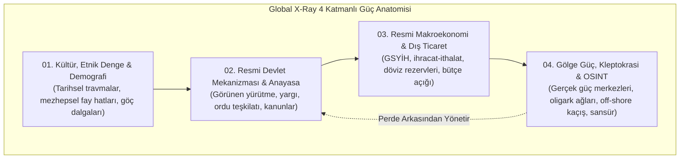
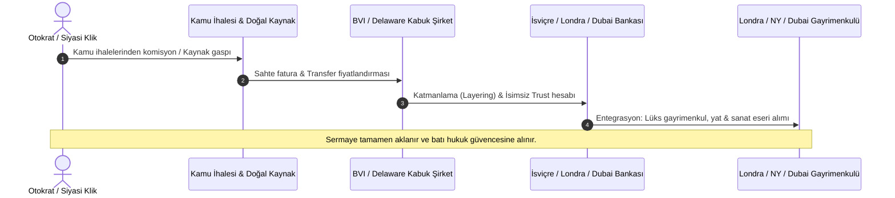

# 🌍 KÜRESEL RÖNTGEN (GLOBAL X-RAY)
### *Açık Kaynak İstihbarat (OSINT), Derin Devlet Ağları, Oligarşik Sermaye & Kleptokrasi Haritalandırma Atlası*

<p align="center">
  
</p>

<p align="center">
  
  
  
  
  
  
  
  
  
</p>

---

## 🏛️ GİRİŞ VE İKTİDARIN FELSEFESİ: KÜRESEL İSTİHBARAT KÜLLİYATI

> *"Görünen hükümetin arkasında, halka karşı hiçbir bağlılığı olmayan ve hiçbir sorumluluk kabul etmeyen görünmez bir hükümet taht kurmuştur. Bu görünmez hükümeti yok etmek, yozlaşmış iş dünyası ile yozlaşmış siyaset arasındaki kirli ittifakı bozmak, günümüzün ilk görevidir."*  
> — **Theodore Roosevelt** (ABD 26. Başkanı, 1912 İlerleme Partisi Platformu)

> *"Ticaret ve imalat dünyasında öyle bazı adamlar var ki, bir şeyden korkuyorlar. Biliyorlar ki bir yerlerde öyle organize, öyle sinsi, öyle uyanık, öyle kilitli ve öyle yaygın bir güç var ki, onu kınarken fısıltıyla bile konuşmamak en iyisi."*  
> — **Woodrow Wilson** (ABD 28. Başkanı, *The New Freedom*, 1913)

> *"Kitlelerin organize alışkanlıklarının ve kanaatlerinin bilinçli ve akıllıca manipülasyonu, demokratik bir toplumun önemli bir unsurudur. Toplumun bu görülmeyen mekanizmasını manipüle edenler, ülkemizin gerçek yönetici gücü olan görünmez bir hükümet teşkil ederler."*  
> — **Edward L. Bernays** (*Propaganda*, 1928)

> *"Washington'daki gerçek yöneticiler görünmezdir ve güçlerini perde arkasından kullanırlar."*  
> — **Felix Frankfurter** (ABD Yüksek Mahkeme Yargıcı, 1952)

> *"Gölge bankacılık ve offshore cennetleri küresel kapitalizmin kara deliğidir. Egemen yasalar bu çekim alanında bükülür."*  
> — **Küresel Röntgen Finansal İstihbarat Doktrini**

---

## 📊 EKONOMİK MODELLERE GÖRE KÜRESEL GÜÇ BLOKLARI (/economies)

Bu repoda ülkeler klasik coğrafi kıtalara göre değil, **küresel sermaye birikim modelleri, hammadde bağımlılıkları ve jeo-ekonomik işlevlerine göre 8 temel blokta** gruplandırılmıştır. Her grup klasörü doğrudan proje kök dizininde ve `economies/` arşivinde yer almaktadır:

| Blok Kodu & Arketip | Yapısal Ekonomik Rolü | Kapsam | Tahmini Blok GSYİH | Gölge Ekonomi | Kök Klasör Bağlantısı |
| :--- | :--- | :---: | :---: | :---: | :--- |
| 🏭 **01. İleri Sanayi ve G7** | Küresel rezerv para, patent tekelleri, ileri savunma/yarı iletken sanayisi | 28 Ülke | ~$56.4T | %11.5 | [**01_ileri_sanayi_g7/**](01_ileri_sanayi_g7/README.md) |
| 🛢️ **02. Petro-Devletler ve Enerji** | Hidrokarbon rantı, OPEC+ kotası, egemen varlık fonları (SWF), jeopolitik boru hatları | 23 Ülke | ~$5.8T | %29.4 | [**02_petro_ve_enerji_devleri/**](02_petro_ve_enerji_devleri/README.md) |
| 🚀 **03. BRICS & Gelişen Devler** | Küresel imalat tabanı, tedarik zinciri omurgası, demografik işgücü devi | 21 Ülke | ~$32.6T | %28.5 | [**03_gelismekte_olan_devler_ve_brics/**](03_gelismekte_olan_devler_ve_brics/README.md) |
| 🏦 **04. Offshore & Vergi Cennetleri** | Katı bankacılık gizliliği, sıfır vergi, shell company kabuk ağları, kleptokrasi aklama | 14 Ülke | ~$2.1T | %16.2 | [**04_offshore_ve_finansal_merkezler/**](04_offshore_ve_finansal_merkezler/README.md) |
| ⛏️ **05. Kritik Maden & Emtia** | Kobalt, lityum, bakır, altın ve nadir toprak elementleri; emtia oligopolleri | 22 Ülke | ~$1.9T | %38.1 | [**05_kritik_maden_ve_hammadde/**](05_kritik_maden_ve_hammadde/README.md) |
| 🚜 **06. Orta Gelir & Üreticiler** | Tarım, tekstil, bölgesel sanayi ve tüketim pazarı; orta gelir tuzağı kırılganlığı | 39 Ülke | ~$3.4T | %31.7 | [**06_orta_gelir_ve_ureticiler/**](06_orta_gelir_ve_ureticiler/README.md) |
| ⚠️ **07. Kırılgan & Yaptırım Altındakiler** | Borç krizi, hiperenflasyon, uluslararası ambargolar, sıcak çatışma ve devlet zaafiyeti | 32 Ülke | ~$0.6T | %46.3 | [**07_kirilgan_ve_borc_krizindekiler/**](07_kirilgan_ve_borc_krizindekiler/README.md) |
| 🏝️ **08. Küçük Ada & Turizm** | Turizm gelirleri, açık deniz MEB alanları, bayrak kiralama ve iklim kırılganlığı | 26 Ülke | ~$0.2T | %26.9 | [**08_kucuk_ada_ve_turizm_ekonomileri/**](08_kucuk_ada_ve_turizm_ekonomileri/README.md) |

---

## 🏛️ 4 KATMANLI DERİN DEVLET METODOLOJİSİ

<p align="center">
  
</p>



---

## 💸 KLEPTOKRASİ & OFF-SHORE SERMAYE KAÇIRMA DÖNGÜSÜ

<p align="center">
  
</p>



---

## 🧠 BİLİŞSEL SAVAŞ & SİBER İSTİHBARAT MATRİSİ

<p align="center">
  
</p>

Küresel sinyal istihbaratı (SIGINT), denizaltı fiber optik hat dinleme istasyonları, sıfır-tıklama mobil casus yazılımlar (Pegasus, Predator) ve kitlelerin algısını yöneten algoritmik sosyal medya filtreleri, 5. Nesil Harp (5GW) doktrininin temelini oluşturur.

---

## 🚢 KÜRESEL DENİZ DARBOĞAZLARI & TRANSİT KİLİTLERİ

<p align="center">
  
</p>

Dünya deniz petrolünün ve ticaretinin aktığı kilit boğazlar (`global_datasets/chokepoints_registry.json`):

| Boğaz / Kanal | Tip | Kıyıdaş Devletler | Günlük Petrol Transiti | Jeopolitik Risk Seviyesi |
| :--- | :--- | :--- | :--- | :--- |
| **Hürmüz Boğazı** (Strait of Hormuz) | Doğal Deniz Boğazı | İran, Umman | 21,000,000 v/g (%21.0) | Aşırı Yüksek (Critical) |
| **Malakka Boğazı** (Strait of Malacca) | Doğal Deniz Boğazı | Endonezya, Malezya, Singapur | 16,000,000 v/g (%16.0) | Yüksek (High) |
| **Süveyş Kanalı** (Suez Canal) | Yapay Su Yolu | Mısır | 5,500,000 v/g (%9.0) | Yüksek (High) |
| **Babülmendep Boğazı** (Bab el-Mandeb Strait) | Doğal Deniz Boğazı | Yemen, Cibuti, Eritre | 4,800,000 v/g (%8.0) | Kritik Savaş Alanı (Hostile) |
| **Panama Kanalı** (Panama Canal) | Yapay Su Yolu (Kademeli Havuz Sistemi) | Panama | 1,000,000 v/g (%3.0) | Orta / Ekolojik Risk (Moderate) |
| **İstanbul ve Çanakkale Boğazları** (Turkish Straits (Bosporus & Dardanelles)) | Doğal Deniz Boğazları (Montrö Rejimi) | Türkiye | 3,000,000 v/g (%3.5) | Stratejik & Hukuki Kilit (Strategic) |

---

## 🗺️ BÖLGESEL MASTER JEOPOLİTİK DOSYALARI (/regions)

Kıtalar bazında güç mimarisi, güvenlik paktları ve çatışma hatları:

| Bölge | Jeostratejik Kapsam | Dosya Bağlantısı |
| :--- | :--- | :--- |
| 🕌 **Ortadoğu** | Hürmüz ve Babülmendep, Direniş Ekseni, İbrahim Paktı, Körfez Hanedan Tröstleri | [**regions/middle_east/README.md**](regions/middle_east/README.md) |
| 🏰 **Avrupa** | NATO Kuzey Kanadı, Suwalki Koridoru, Rusya Enerji Ayrışması, City of London & Lüksemburg | [**regions/europe/README.md**](regions/europe/README.md) |
| ⛩️ **Asya & Hint-Pasifik** | ABD-Çin Rekabeti, Birinci Ada Zinciri, Tayvan Yarı İletken Tekeli, Malakka İkilemi | [**regions/asia/README.md**](regions/asia/README.md) |
| 🌎 **Amerika** | Monroe Doktrini, Narko-Kartel Kartografyası (CJNG/Sinaloa), Lityum Üçgeni, Panama Kanalı | [**regions/americas/README.md**](regions/americas/README.md) |
| 🌍 **Afrika** | Yeni Afrika Paylaşım Savaşı, Françafrique Çöküşü, Sahel Darbeler Kuşağı, Wagner / Afrika Kolordusu | [**regions/africa/README.md**](regions/africa/README.md) |
| 🏝️ **Okyanusya** | AUKUS Paktı, Pasifik Ada Devletleri MEB Hakimiyeti, Çin Güvenlik Anlaşmaları | [**regions/oceania/README.md**](regions/oceania/README.md) |

---

## 📁 DERİN ADLİ OSINT VAKA ANALİZLERİ (/dossiers)

Tarihin en büyük kleptokratik ve siber istihbarat operasyonlarının adli bilişim ve finansal akış analizleri:

| Vaka Dosyası | Konu | Temel Bulgular & Yöntem |
| :--- | :--- | :--- |
| 💸 [**CASE_STUDY_1MDB.md**](dossiers/CASE_STUDY_1MDB.md) | 1MDB Egemen Varlık Fonu Soygunu | $4.5 Milyar kamu kaynağının Goldman Sachs ve BVI paravan şirketleri üzerinden aklanması. |
| ⚖️ [**CASE_STUDY_MAGNITSKY_AND_TROIKA_LAUNDROMAT.md**](dossiers/CASE_STUDY_MAGNITSKY_AND_TROIKA_LAUNDROMAT.md) | Magnitsky & Rus Çamaşırhanesi | Moldova mahkeme ilamları ve Danske Bank üzerinden $20+ milyar oligark parasının Avrupa'ya kaçırılması. |
| 🏗️ [**CASE_STUDY_ODEBRECHT_LAVA_JATO.md**](dossiers/CASE_STUDY_ODEBRECHT_LAVA_JATO.md) | Odebrecht & Lava Jato Rüşvet Karteli | 12 ülkede başkanlara rüşvet dağıtmak için kurulan resmi "Yapılandırılmış Operasyonlar Bölümü". |
| 📱 [**CASE_STUDY_PEGASUS_PROJECT.md**](dossiers/CASE_STUDY_PEGASUS_PROJECT.md) | Pegasus Sıfır-Tıklama Siber Casusluk | NSO Group casus yazılımının Kaşıkçı cinayeti, 14 devlet başkanı ve 189 gazeteciye karşı kullanımı. |

---

## ⚔️ ÖZEL ASKERİ ŞİRKETLER (PMC) & PARAMİLİTERLER

Devletlerin örtülü operasyon ve vekil savaşlarında kullandığı askeri yükleniciler (`global_datasets/pmc_mercenary_groups.json`):

| Şirket / Şebeke | Menşei | Tahmini İnsan Gücü | Aktif Harekât Sahaları | Hukuki Statü |
| :--- | :--- | :---: | :--- | :--- |
| **Wagner Group / Afrika Kolordusu (Africa Corps)** | Rusya | 35,000 - 50,000 | Mali, Burkina Faso, Nijer, Orta Afrika Cumhuriyeti, Suriye, Libya | Savunma Bakanlığı (GRU) bağlı gayriresmi paramiliter güç |
| **Constellis (Eski Blackwater / Academi)** | Amerika Birleşik Devletleri | 16,000+ | Irak, Afganistan, Körfez Ülkeleri, Afrika | Kayıtlı ABD Savunma ve Güvenlik Yüklenicisi |
| **Frontier Services Group (FSG)** | Hong Kong / Çin (Kurucu: Erik Prince) | 3,000+ | Kuşak-Yol güzergahı, Demokratik Kongo Cumhuriyeti, Sudan, Pakistan | Hong Kong Borsası kotasyonlu lojistik ve güvenlik şirketi |
| **SADAT Uluslararası Savunma Danışmanlık** | Türkiye | 1,000+ (Yedek eğitim havuzu) | Suriye, Libya, Kafkaslar | Özel Savunma ve Stratejik Danışmanlık Şirketi |

---

## 📚 ANSİKLOPEDİK ARAŞTIRMA DOSYALARI (/research)

| Araştırma Dosyası | Tematik Alan | Kapsam & Temel Vurgular |
| :--- | :--- | :--- |
| 📑 [**THEORETICAL_FRAMEWORKS.md**](research/THEORETICAL_FRAMEWORKS.md) | Derin Devlet & Güç Seçkinleri Teorisi | C. Wright Mills, Peter Dale Scott, Carl Schmitt, Michael Glennon, Gladio ve Susurluk. |
| 💰 [**SHADOW_BANKING_AND_OFFSHORE_FLOWS.md**](research/SHADOW_BANKING_AND_OFFSHORE_FLOWS.md) | Küresel Kleptokrasi & Vergi Cennetleri | City of London, Delaware, Panama/Pandora Papers, TBML ve Mirror Trading. |
| 🧠 [**PROPAGANDA_AND_INFORMATION_WARFARE.md**](research/PROPAGANDA_AND_INFORMATION_WARFARE.md) | Bilişsel Savaş & Algoritmik Manipülasyon | Chomsky Propaganda Modeli, Operation Mockingbird, Maskirovka, Pegasus/Predator siber araçları. |
| 🚢 [**GEOPOLITICAL_CHOKEPOINTS_AND_CORRIDORS.md**](research/GEOPOLITICAL_CHOKEPOINTS_AND_CORRIDORS.md) | Jeopolitik Darboğazlar & Deniz Hakimiyeti | Hürmüz, Malakka, Süveyş; denizaltı fiber optik kabloları ve SIGINT dinleme istasyonları. |
| ⚔️ [**MILITARY_INDUSTRIAL_COMPLEX_AND_PMCS.md**](research/MILITARY_INDUSTRIAL_COMPLEX_AND_PMCS.md) | Askeri-Endüstriyel Kompleks & Paralı Askerler | Savunma ihale Demir Üçgeni, Döner Kapı mekanizması, algoritmik harp ve dron doygunluğu. |
| 🕵️ [**INTELLIGENCE_AGENCIES_AND_BLACK_OPS.md**](research/INTELLIGENCE_AGENCIES_AND_BLACK_OPS.md) | İstihbarat Teşkilatları & Örtülü Operasyonlar | Operation Ajax (1953), Condor Planı, Church Komitesi ifşaatları, Five Eyes (FVEY) paktı. |
| ⛏️ [**RESOURCE_WARS_AND_COMMODITY_SUPER_CARTELS.md**](research/RESOURCE_WARS_AND_COMMODITY_SUPER_CARTELS.md) | Kritik Madenler & Emtia Kartelleri | Lityum üçgeni, Kongo Kobaltı, Glencore/Trafigura/Vitol emtia oligopolü, Petrodolar/Petroyuan. |
| 🔓 [**WHISTLEBLOWERS_LEAKS_AND_FORENSIC_STANDARDS.md**](research/WHISTLEBLOWERS_LEAKS_AND_FORENSIC_STANDARDS.md) | İfşaatçılar, Kriptografi & Adli Standartlar | Pentagon Belgeleri'nden Vault 7'ye sızıntı analizi, metadata bilişimi ve Admiralty Kod (B2+). |

---

## 🕵️ KÜRESEL İSTİHBARAT TEŞKİLATLARI & GÜÇ MİMARİSİ

| Ülke | Dış İstihbarat (HUMINT) | Sinyal İstihbaratı (SIGINT) | İç Güvenlik / Karşı İstihbarat | Tahmini Yıllık Bütçe | Operasyonel Sınıflandırma |
| :--- | :--- | :--- | :--- | :--- | :--- |
| **United States** | Central Intelligence Agency (CIA) | National Security Agency (NSA) | Federal Bureau of Investigation (FBI) | `85,000,000,000 (Combined Black Budget)` | Global Tier 1 SIGINT/HUMINT/Covert Action |
| **United Kingdom** | Secret Intelligence Service (SIS / MI6) | Government Communications Headquarters (GCHQ) | Security Service (MI5) | `4,200,000,000` | Global Tier 1 Five-Eyes Core |
| **Russia** | Foreign Intelligence Service (SVR) | Federal Guard Service (FSO) / 16th Center FSB | Federal Security Service (FSB) | `12,000,000,000 (Opaque Security Allocation)` | Global Tier 1 Hybrid Warfare & HUMINT |
| **China** | Ministry of State Security (MSS - Guoanbu) | PLA Strategic Support Force / Cyberspace Force | Ministry of Public Security (MPS - Gonganbu) | `15,000,000,000 (Extrapolated)` | Global Tier 1 Cyber Espionage & Economic Intelligence |
| **Israel** | Institute for Intelligence and Special Operations (Mossad) | Unit 8200 (ISNU) | General Security Service (Shin Bet / Shabak) | `3,800,000,000` | Global Tier 1 Targeted Lethal Action & Cyber Capability |
| **France** | General Directorate for External Security (DGSE) | DGSE Technical Directorate (Boulevard Mortier) | General Directorate for Internal Security (DGSI) | `3,200,000,000` | European Sovereign Autonomous Intelligence Tier |
| **Germany** | Federal Intelligence Service (BND) | BND Department VI (Technical Intelligence / Bad Aibling) | Federal Office for the Protection of the Constitution (BfV) | `1,600,000,000` | Major European SIGINT & Technical Intelligence |
| **Turkey** | National Intelligence Organization (MİT) | MİT Electronic and Technical Intelligence Directorate (GES Command integration) | MİT Domestic Intelligence Directorate / EGM Security Branch | `1,400,000,000 (Excluding autonomous operational assets)` | Dominant Regional Armed Drone & Paramilitary Intelligence Actor |
| **Iran** | IRGC Quds Force Intelligence | Basij Cyber Command / IRGC Electronic Warfare Unit | Ministry of Intelligence and Security (VAJA / MOIS) | `2,800,000,000 (Combined Conventional & Revolutionary Guard allocations)` | Asymmetric Proxy Network & Regional Covert Power |
| **Saudi Arabia** | General Intelligence Presidency (GIP - Al-Mukhabarat al-A'amah) | State Security Cyber Warfare Center | Presidency of State Security (Mabahith) | `3,000,000,000` | Resource-Backed Authoritarian Intelligence & Covert Slush Fund Hub |

---

## 🌐 PROJE AMACI VE VİZYONU

**Küresel Röntgen (Global X-Ray)**, ulus devletlerin görünen resmi anayasal yapılarının ötesine geçerek; arka planda işleyen **derin güç odaklarını, askeri klikleri, istihbarat oligarşilerini, hanedan servetlerini, mafya-sermaye konsorsiyumlarını ve kayıt dışı para akışlarını** bilimsel ve doğrulanabilir OSINT (Open Source Intelligence) metodolojisi ile belgeleyen küresel bir araştırma ve istihbarat atlasıdır.

Proje, Birleşmiş Milletler üyesi tüm egemen devletler ile de-facto tanınan kritik jeopolitik bölgeler dahil olmak üzere **tam 205 ülkeyi ve bölgeyi** analiz kapsamına alır.

---

## 🛡️ DOĞRULAMA STANDARDI: ADMİRALTY CODE (B2+)

Bu repoda yer alan tüm iddialar, NATO / Admiralty Kod doğrulama standardına göre derecelendirilmiştir. Minimum kabul eşiğimiz **B2** düzeyidir:

* **Kaynak Güvenilirliği (B):** Genellikle güvenilir (Resmi belgeler, araştırma komisyonu raporları, uluslararası denetim sızıntıları, ICIJ, OCCRP verileri).
* **Bilgi Doğruluğu (2):** Muhtemelen doğru (En az iki bağımsız açık kaynak ve çapraz lojistik/finansal veriyle teyit edilmiş).

---

## 🗺️ 205 ÜLKELİK KÜRESEL ATLAS İNDEKSİ (EKONOMİK MODELLERİYLE)

Aşağıdaki tabloda projedeki tüm bağımsız ülkeler listelenmiştir. Her bağlantı doğrudan kök dizindeki ilgili **ekonomik blok klasörü** altındaki detaylı istihbarat profiline yönlendirir:

| Ülke | Ekonomik Model | ISO | Başkent | Rapor Bağlantısı | GSYİH (USD) | Kayıt Dışı (%) |
| :--- | :--- | :---: | :--- | :--- | :---: | :---: |
| **Afganistan** | ⚠️ Kırılgan / Yaptırım | `AFG` | Kabil | [Afganistan Raporu](07_kirilgan_ve_borc_krizindekiler/afghanistan/README.md) | $14.5B | %50.0 |
| **Almanya** | 🏭 İleri Sanayi / G7 | `DEU` | Berlin | [Almanya Raporu](01_ileri_sanayi_g7/germany/README.md) | $4,456.0B | %9.8 |
| **Amerika Birleşik Devletleri** | 🏭 İleri Sanayi / G7 | `USA` | Washington, D.C. | [Amerika Birleşik Devletleri Raporu](01_ileri_sanayi_g7/united_states/README.md) | $27,360.0B | %8.5 |
| **Andorra** | 🏦 Offshore / Sığınak | `AND` | Andorra la Vella | [Andorra Raporu](04_offshore_ve_finansal_merkezler/andorra/README.md) | $3.7B | %11.5 |
| **Angola** | 🛢️ Petro-Devletler | `AGO` | Luanda | [Angola Raporu](02_petro_ve_enerji_devleri/angola/README.md) | $93.8B | %38.0 |
| **Antigua ve Barbuda** | 🏝️ Ada & Turizm | `ATG` | Saint John's | [Antigua ve Barbuda Raporu](08_kucuk_ada_ve_turizm_ekonomileri/antigua_and_barbuda/README.md) | $1.8B | %15.0 |
| **Arjantin** | 🚀 BRICS & İmalat | `ARG` | Buenos Aires | [Arjantin Raporu](03_gelismekte_olan_devler_ve_brics/argentina/README.md) | $640.0B | %27.2 |
| **Arnavutluk** | 🚜 Orta Gelir / Bölgesel | `ALB` | Tiran | [Arnavutluk Raporu](06_orta_gelir_ve_ureticiler/albania/README.md) | $23.0B | %31.0 |
| **Avustralya** | 🏭 İleri Sanayi / G7 | `AUS` | Canberra | [Avustralya Raporu](01_ileri_sanayi_g7/australia/README.md) | $1,724.0B | %9.2 |
| **Avusturya** | 🏭 İleri Sanayi / G7 | `AUT` | Viyana | [Avusturya Raporu](01_ileri_sanayi_g7/austria/README.md) | $516.0B | %8.5 |
| **Azerbaycan** | 🛢️ Petro-Devletler | `AZE` | Bakü | [Azerbaycan Raporu](02_petro_ve_enerji_devleri/azerbaijan/README.md) | $78.7B | %38.0 |
| **Bahamalar** | 🏦 Offshore / Sığınak | `BHS` | Nassau | [Bahamalar Raporu](04_offshore_ve_finansal_merkezler/bahamas/README.md) | $14.0B | %12.0 |
| **Bahreyn** | 🛢️ Petro-Devletler | `BHR` | Manama | [Bahreyn Raporu](02_petro_ve_enerji_devleri/bahrain/README.md) | $44.0B | %19.0 |
| **Bangladeş** | 🚀 BRICS & İmalat | `BGD` | Dakka | [Bangladeş Raporu](03_gelismekte_olan_devler_ve_brics/bangladesh/README.md) | $460.0B | %32.0 |
| **Barbados** | 🏝️ Ada & Turizm | `BRB` | Bridgetown | [Barbados Raporu](08_kucuk_ada_ve_turizm_ekonomileri/barbados/README.md) | $6.2B | %14.0 |
| **Batı Sahra** | 🚜 Orta Gelir / Bölgesel | `ESH` | El Aaiun (Tifariti) | [Batı Sahra Raporu](06_orta_gelir_ve_ureticiler/western_sahara/README.md) | $0.9B | %45.0 |
| **Belarus** | 🚜 Orta Gelir / Bölgesel | `BLR` | Minsk | [Belarus Raporu](06_orta_gelir_ve_ureticiler/belarus/README.md) | $72.0B | %31.0 |
| **Belize** | 🏝️ Ada & Turizm | `BLZ` | Belmopan | [Belize Raporu](08_kucuk_ada_ve_turizm_ekonomileri/belize/README.md) | $3.2B | %25.0 |
| **Belçika** | 🏭 İleri Sanayi / G7 | `BEL` | Brüksel | [Belçika Raporu](01_ileri_sanayi_g7/belgium/README.md) | $632.0B | %12.0 |
| **Benin** | ⚠️ Kırılgan / Yaptırım | `BEN` | Porto-Novo (Cotonou) | [Benin Raporu](07_kirilgan_ve_borc_krizindekiler/benin/README.md) | $19.5B | %40.0 |
| **Bhutan** | 🚜 Orta Gelir / Bölgesel | `BTN` | Thimphu | [Bhutan Raporu](06_orta_gelir_ve_ureticiler/bhutan/README.md) | $2.9B | %15.0 |
| **Birleşik Arap Emirlikleri** | 🛢️ Petro-Devletler | `ARE` | Abu Dabi | [Birleşik Arap Emirlikleri Raporu](02_petro_ve_enerji_devleri/united_arab_emirates/README.md) | $504.0B | %18.0 |
| **Birleşik Krallık** | 🏭 İleri Sanayi / G7 | `GBR` | Londra | [Birleşik Krallık Raporu](01_ileri_sanayi_g7/united_kingdom/README.md) | $3,332.0B | %11.2 |
| **Bolivya** | ⛏️ Kritik Maden / Emtia | `BOL` | Sucre (La Paz hükümet) | [Bolivya Raporu](05_kritik_maden_ve_hammadde/bolivia/README.md) | $46.0B | %55.0 |
| **Bosna-Hersek** | 🚜 Orta Gelir / Bölgesel | `BIH` | Saraybosna | [Bosna-Hersek Raporu](06_orta_gelir_ve_ureticiler/bosnia_and_herzegovina/README.md) | $27.0B | %33.0 |
| **Botsvana** | ⛏️ Kritik Maden / Emtia | `BWA` | Gaborone | [Botsvana Raporu](05_kritik_maden_ve_hammadde/botswana/README.md) | $21.4B | %18.0 |
| **Brezilya** | 🚀 BRICS & İmalat | `BRA` | Brasilia | [Brezilya Raporu](03_gelismekte_olan_devler_ve_brics/brazil/README.md) | $2,173.0B | %33.5 |
| **Brunei** | 🛢️ Petro-Devletler | `BRN` | Bandar Seri Begavan | [Brunei Raporu](02_petro_ve_enerji_devleri/brunei/README.md) | $16.7B | %12.0 |
| **Bulgaristan** | 🚜 Orta Gelir / Bölgesel | `BGR` | Sofya | [Bulgaristan Raporu](06_orta_gelir_ve_ureticiler/bulgaria/README.md) | $101.0B | %22.0 |
| **Burkina Faso** | ⚠️ Kırılgan / Yaptırım | `BFA` | Ouagadougou | [Burkina Faso Raporu](07_kirilgan_ve_borc_krizindekiler/burkina_faso/README.md) | $20.3B | %45.0 |
| **Burundi** | ⚠️ Kırılgan / Yaptırım | `BDI` | Gitega (Bujumbura) | [Burundi Raporu](07_kirilgan_ve_borc_krizindekiler/burundi/README.md) | $3.8B | %50.0 |
| **Cezayir** | 🛢️ Petro-Devletler | `DZA` | Cezayir | [Cezayir Raporu](02_petro_ve_enerji_devleri/algeria/README.md) | $239.0B | %32.0 |
| **Cibuti** | ⚠️ Kırılgan / Yaptırım | `DJI` | Cibuti | [Cibuti Raporu](07_kirilgan_ve_borc_krizindekiler/djibouti/README.md) | $4.1B | %30.0 |
| **Danimarka** | 🏭 İleri Sanayi / G7 | `DNK` | Kopenhag | [Danimarka Raporu](01_ileri_sanayi_g7/denmark/README.md) | $400.0B | %8.0 |
| **Demokratik Kongo Cumhuriyeti** | ⛏️ Kritik Maden / Emtia | `COD` | Kinşasa | [Demokratik Kongo Cumhuriyeti Raporu](05_kritik_maden_ve_hammadde/democratic_republic_of_the_congo/README.md) | $67.5B | %55.0 |
| **Dominik Cumhuriyeti** | 🚜 Orta Gelir / Bölgesel | `DOM` | Santo Domingo | [Dominik Cumhuriyeti Raporu](06_orta_gelir_ve_ureticiler/dominican_republic/README.md) | $121.0B | %30.0 |
| **Dominika** | 🏝️ Ada & Turizm | `DMA` | Roseau | [Dominika Raporu](08_kucuk_ada_ve_turizm_ekonomileri/dominica/README.md) | $0.7B | %20.0 |
| **Doğu Timor** | ⚠️ Kırılgan / Yaptırım | `TLS` | Dili | [Doğu Timor Raporu](07_kirilgan_ve_borc_krizindekiler/timor_leste/README.md) | $3.2B | %30.0 |
| **Ekvador** | ⛏️ Kritik Maden / Emtia | `ECU` | Quito | [Ekvador Raporu](05_kritik_maden_ve_hammadde/ecuador/README.md) | $118.0B | %35.0 |
| **Ekvator Ginesi** | 🛢️ Petro-Devletler | `GNQ` | Malabo | [Ekvator Ginesi Raporu](02_petro_ve_enerji_devleri/equatorial_guinea/README.md) | $12.0B | %45.0 |
| **El Salvador** | 🚜 Orta Gelir / Bölgesel | `SLV` | San Salvador | [El Salvador Raporu](06_orta_gelir_ve_ureticiler/el_salvador/README.md) | $35.0B | %28.0 |
| **Endonezya** | 🚀 BRICS & İmalat | `IDN` | Cakarta | [Endonezya Raporu](03_gelismekte_olan_devler_ve_brics/indonesia/README.md) | $1,371.0B | %20.8 |
| **Eritre** | ⚠️ Kırılgan / Yaptırım | `ERI` | Asmara | [Eritre Raporu](07_kirilgan_ve_borc_krizindekiler/eritrea/README.md) | $2.6B | %60.0 |
| **Ermenistan** | 🚜 Orta Gelir / Bölgesel | `ARM` | Erivan | [Ermenistan Raporu](06_orta_gelir_ve_ureticiler/armenia/README.md) | $24.2B | %28.0 |
| **Estonya** | 🏭 İleri Sanayi / G7 | `EST` | Tallinn | [Estonya Raporu](01_ileri_sanayi_g7/estonia/README.md) | $41.0B | %11.0 |
| **Esvatini** | ⚠️ Kırılgan / Yaptırım | `SWZ` | Mbabane (Lobamba) | [Esvatini Raporu](07_kirilgan_ve_borc_krizindekiler/eswatini/README.md) | $4.8B | %30.0 |
| **Etiyopya** | 🚜 Orta Gelir / Bölgesel | `ETH` | Addis Ababa | [Etiyopya Raporu](06_orta_gelir_ve_ureticiler/ethiopia/README.md) | $163.0B | %35.0 |
| **Fas** | ⛏️ Kritik Maden / Emtia | `MAR` | Rabat | [Fas Raporu](05_kritik_maden_ve_hammadde/morocco/README.md) | $147.0B | %27.0 |
| **Fiji** | 🏝️ Ada & Turizm | `FJI` | Suva | [Fiji Raporu](08_kucuk_ada_ve_turizm_ekonomileri/fiji/README.md) | $5.5B | %25.0 |
| **Fildişi Sahili** | ⛏️ Kritik Maden / Emtia | `CIV` | Yamoussoukro (Abidjan) | [Fildişi Sahili Raporu](05_kritik_maden_ve_hammadde/ivory_coast/README.md) | $86.0B | %35.0 |
| **Filipinler** | 🚀 BRICS & İmalat | `PHL` | Manila | [Filipinler Raporu](03_gelismekte_olan_devler_ve_brics/philippines/README.md) | $437.0B | %28.0 |
| **Filistin** | ⚠️ Kırılgan / Yaptırım | `PSE` | Kudüs (Ramallah idari merkez) | [Filistin Raporu](07_kirilgan_ve_borc_krizindekiler/palestine/README.md) | $18.0B | %38.0 |
| **Finlandiya** | 🏭 İleri Sanayi / G7 | `FIN` | Helsinki | [Finlandiya Raporu](01_ileri_sanayi_g7/finland/README.md) | $300.0B | %8.5 |
| **Fransa** | 🏭 İleri Sanayi / G7 | `FRA` | Paris | [Fransa Raporu](01_ileri_sanayi_g7/france/README.md) | $3,052.0B | %13.8 |
| **Gabon** | 🛢️ Petro-Devletler | `GAB` | Libreville | [Gabon Raporu](02_petro_ve_enerji_devleri/gabon/README.md) | $21.0B | %30.0 |
| **Gambiya** | ⚠️ Kırılgan / Yaptırım | `GMB` | Banjul | [Gambiya Raporu](07_kirilgan_ve_borc_krizindekiler/gambia/README.md) | $2.3B | %35.0 |
| **Gana** | ⛏️ Kritik Maden / Emtia | `GHA` | Accra | [Gana Raporu](05_kritik_maden_ve_hammadde/ghana/README.md) | $76.0B | %35.0 |
| **Gine** | ⛏️ Kritik Maden / Emtia | `GIN` | Konakri | [Gine Raporu](05_kritik_maden_ve_hammadde/guinea/README.md) | $23.0B | %40.0 |
| **Gine-Bissau** | ⛏️ Kritik Maden / Emtia | `GNB` | Bissau | [Gine-Bissau Raporu](05_kritik_maden_ve_hammadde/guinea_bissau/README.md) | $2.0B | %45.0 |
| **Grenada** | 🏝️ Ada & Turizm | `GRD` | Saint George's | [Grenada Raporu](08_kucuk_ada_ve_turizm_ekonomileri/grenada/README.md) | $1.3B | %22.0 |
| **Grönland** | 🏝️ Ada & Turizm | `GRL` | Nuuk | [Grönland Raporu](08_kucuk_ada_ve_turizm_ekonomileri/greenland/README.md) | $3.2B | %10.0 |
| **Guatemala** | 🚜 Orta Gelir / Bölgesel | `GTM` | Guatemala City | [Guatemala Raporu](06_orta_gelir_ve_ureticiler/guatemala/README.md) | $102.0B | %40.0 |
| **Guyana** | 🛢️ Petro-Devletler | `GUY` | Georgetown | [Guyana Raporu](02_petro_ve_enerji_devleri/guyana/README.md) | $17.0B | %30.0 |
| **Güney Afrika** | 🚀 BRICS & İmalat | `ZAF` | Pretoria (İdari), Cape Town (Yasama), Bloemfontein (Yargı) | [Güney Afrika Raporu](03_gelismekte_olan_devler_ve_brics/south_africa/README.md) | $377.0B | %24.1 |
| **Güney Kore** | 🏭 İleri Sanayi / G7 | `KOR` | Seul | [Güney Kore Raporu](01_ileri_sanayi_g7/south_korea/README.md) | $1,712.0B | %21.3 |
| **Güney Sudan** | ⚠️ Kırılgan / Yaptırım | `SSD` | Juba | [Güney Sudan Raporu](07_kirilgan_ve_borc_krizindekiler/south_sudan/README.md) | $6.5B | %65.0 |
| **Gürcistan** | 🚜 Orta Gelir / Bölgesel | `GEO` | Tiflis | [Gürcistan Raporu](06_orta_gelir_ve_ureticiler/georgia/README.md) | $30.5B | %22.0 |
| **Haiti** | ⚠️ Kırılgan / Yaptırım | `HTI` | Port-au-Prince | [Haiti Raporu](07_kirilgan_ve_borc_krizindekiler/haiti/README.md) | $20.0B | %70.0 |
| **Hindistan** | 🚀 BRICS & İmalat | `IND` | Yeni Delhi | [Hindistan Raporu](03_gelismekte_olan_devler_ve_brics/india/README.md) | $3,937.0B | %22.4 |
| **Hollanda** | 🏭 İleri Sanayi / G7 | `NLD` | Amsterdam (Lahey hükümet merkezi) | [Hollanda Raporu](01_ileri_sanayi_g7/netherlands/README.md) | $1,118.0B | %7.8 |
| **Honduras** | 🚜 Orta Gelir / Bölgesel | `HND` | Tegucigalpa | [Honduras Raporu](06_orta_gelir_ve_ureticiler/honduras/README.md) | $34.0B | %35.0 |
| **Hong Kong** | 🏦 Offshore / Sığınak | `HKG` | Hong Kong | [Hong Kong Raporu](04_offshore_ve_finansal_merkezler/hong_kong/README.md) | $382.0B | %14.0 |
| **Hırvatistan** | 🚜 Orta Gelir / Bölgesel | `HRV` | Zagreb | [Hırvatistan Raporu](06_orta_gelir_ve_ureticiler/croatia/README.md) | $82.0B | %18.0 |
| **Irak** | 🛢️ Petro-Devletler | `IRQ` | Bağdat | [Irak Raporu](02_petro_ve_enerji_devleri/iraq/README.md) | $250.8B | %38.0 |
| **Jamaika** | 🏝️ Ada & Turizm | `JAM` | Kingston | [Jamaika Raporu](08_kucuk_ada_ve_turizm_ekonomileri/jamaica/README.md) | $19.5B | %25.0 |
| **Japonya** | 🏭 İleri Sanayi / G7 | `JPN` | Tokyo | [Japonya Raporu](01_ileri_sanayi_g7/japan/README.md) | $4,210.0B | %9.1 |
| **Kamboçya** | 🚜 Orta Gelir / Bölgesel | `KHM` | Phnom Penh | [Kamboçya Raporu](06_orta_gelir_ve_ureticiler/cambodia/README.md) | $31.8B | %40.0 |
| **Kamerun** | 🚜 Orta Gelir / Bölgesel | `CMR` | Yaounde | [Kamerun Raporu](06_orta_gelir_ve_ureticiler/cameroon/README.md) | $49.0B | %38.0 |
| **Kanada** | 🏭 İleri Sanayi / G7 | `CAN` | Ottawa | [Kanada Raporu](01_ileri_sanayi_g7/canada/README.md) | $2,140.0B | %10.5 |
| **Karadağ** | 🚜 Orta Gelir / Bölgesel | `MNE` | Podgorica | [Karadağ Raporu](06_orta_gelir_ve_ureticiler/montenegro/README.md) | $7.4B | %26.0 |
| **Katar** | 🛢️ Petro-Devletler | `QAT` | Doha | [Katar Raporu](02_petro_ve_enerji_devleri/qatar/README.md) | $235.5B | %12.5 |
| **Kazakistan** | 🛢️ Petro-Devletler | `KAZ` | Astana | [Kazakistan Raporu](02_petro_ve_enerji_devleri/kazakhstan/README.md) | $261.0B | %28.5 |
| **Kenya** | 🚜 Orta Gelir / Bölgesel | `KEN` | Nairobi | [Kenya Raporu](06_orta_gelir_ve_ureticiler/kenya/README.md) | $115.0B | %33.0 |
| **Kiribati** | 🏝️ Ada & Turizm | `KIR` | Tarawa | [Kiribati Raporu](08_kucuk_ada_ve_turizm_ekonomileri/kiribati/README.md) | $0.3B | %20.0 |
| **Kolombiya** | 🚀 BRICS & İmalat | `COL` | Bogota | [Kolombiya Raporu](03_gelismekte_olan_devler_ve_brics/colombia/README.md) | $363.0B | %33.0 |
| **Komorlar** | 🏝️ Ada & Turizm | `COM` | Moroni | [Komorlar Raporu](08_kucuk_ada_ve_turizm_ekonomileri/comoros/README.md) | $1.4B | %35.0 |
| **Kongo Cumhuriyeti (Brazzaville)** | 🛢️ Petro-Devletler | `COG` | Brazzaville | [Kongo Cumhuriyeti (Brazzaville) Raporu](02_petro_ve_enerji_devleri/republic_of_the_congo/README.md) | $15.0B | %45.0 |
| **Kosova** | 🚜 Orta Gelir / Bölgesel | `XKX` | Priştine | [Kosova Raporu](06_orta_gelir_ve_ureticiler/kosovo/README.md) | $10.4B | %30.0 |
| **Kosta Rika** | 🚜 Orta Gelir / Bölgesel | `CRI` | San Jose | [Kosta Rika Raporu](06_orta_gelir_ve_ureticiler/costa_rica/README.md) | $86.0B | %15.0 |
| **Kuveyt** | 🛢️ Petro-Devletler | `KWT` | Kuveyt | [Kuveyt Raporu](02_petro_ve_enerji_devleri/kuwait/README.md) | $160.0B | %14.2 |
| **Kuzey Kore** | ⚠️ Kırılgan / Yaptırım | `PRK` | Pyongyang | [Kuzey Kore Raporu](07_kirilgan_ve_borc_krizindekiler/north_korea/README.md) | $18.0B | %65.0 |
| **Kuzey Kıbrıs** | 🚜 Orta Gelir / Bölgesel | `TRNC` | Lefkoşa | [Kuzey Kıbrıs Raporu](06_orta_gelir_ve_ureticiler/northern_cyprus/README.md) | $4.2B | %42.0 |
| **Kuzey Makedonya** | 🚜 Orta Gelir / Bölgesel | `MKD` | Üsküp | [Kuzey Makedonya Raporu](06_orta_gelir_ve_ureticiler/north_macedonia/README.md) | $15.8B | %28.0 |
| **Küba** | ⚠️ Kırılgan / Yaptırım | `CUB` | Havana | [Küba Raporu](07_kirilgan_ve_borc_krizindekiler/cuba/README.md) | $107.0B | %45.0 |
| **Kıbrıs Rum Kesimi** | 🏦 Offshore / Sığınak | `CYP` | Lefkoşa | [Kıbrıs Rum Kesimi Raporu](04_offshore_ve_finansal_merkezler/cyprus/README.md) | $32.2B | %24.0 |
| **Kırgızistan** | ⛏️ Kritik Maden / Emtia | `KGZ` | Bişkek | [Kırgızistan Raporu](05_kritik_maden_ve_hammadde/kyrgyzstan/README.md) | $14.0B | %30.0 |
| **Laos** | 🚜 Orta Gelir / Bölgesel | `LAO` | Vientiane | [Laos Raporu](06_orta_gelir_ve_ureticiler/laos/README.md) | $15.8B | %35.0 |
| **Lesoto** | ⚠️ Kırılgan / Yaptırım | `LSO` | Maseru | [Lesoto Raporu](07_kirilgan_ve_borc_krizindekiler/lesotho/README.md) | $2.6B | %30.0 |
| **Letonya** | 🏭 İleri Sanayi / G7 | `LVA` | Riga | [Letonya Raporu](01_ileri_sanayi_g7/latvia/README.md) | $43.6B | %18.0 |
| **Liberya** | ⚠️ Kırılgan / Yaptırım | `LBR` | Monrovia | [Liberya Raporu](07_kirilgan_ve_borc_krizindekiler/liberia/README.md) | $4.3B | %45.0 |
| **Libya** | 🛢️ Petro-Devletler | `LBY` | Trablus | [Libya Raporu](02_petro_ve_enerji_devleri/libya/README.md) | $45.0B | %50.0 |
| **Lihtenştayn** | 🏦 Offshore / Sığınak | `LIE` | Vaduz | [Lihtenştayn Raporu](04_offshore_ve_finansal_merkezler/liechtenstein/README.md) | $7.7B | %8.0 |
| **Litvanya** | 🏭 İleri Sanayi / G7 | `LTU` | Vilnius | [Litvanya Raporu](01_ileri_sanayi_g7/lithuania/README.md) | $77.8B | %17.0 |
| **Lübnan** | 🚜 Orta Gelir / Bölgesel | `LBN` | Beyrut | [Lübnan Raporu](06_orta_gelir_ve_ureticiler/lebanon/README.md) | $17.9B | %45.0 |
| **Lüksemburg** | 🏦 Offshore / Sığınak | `LUX` | Lüksemburg | [Lüksemburg Raporu](04_offshore_ve_finansal_merkezler/luxembourg/README.md) | $86.0B | %7.0 |
| **Macaristan** | 🚀 BRICS & İmalat | `HUN` | Budapeşte | [Macaristan Raporu](03_gelismekte_olan_devler_ve_brics/hungary/README.md) | $212.0B | %19.0 |
| **Madagaskar** | ⚠️ Kırılgan / Yaptırım | `MDG` | Antananarivo | [Madagaskar Raporu](07_kirilgan_ve_borc_krizindekiler/madagascar/README.md) | $16.0B | %40.0 |
| **Makao** | 🏦 Offshore / Sığınak | `MAC` | Makao | [Makao Raporu](04_offshore_ve_finansal_merkezler/macau/README.md) | $47.0B | %15.0 |
| **Malavi** | ⚠️ Kırılgan / Yaptırım | `MWI` | Lilongwe | [Malavi Raporu](07_kirilgan_ve_borc_krizindekiler/malawi/README.md) | $13.0B | %42.0 |
| **Maldivler** | 🏝️ Ada & Turizm | `MDV` | Male | [Maldivler Raporu](08_kucuk_ada_ve_turizm_ekonomileri/maldives/README.md) | $6.6B | %22.0 |
| **Malezya** | 🚀 BRICS & İmalat | `MYS` | Kuala Lumpur | [Malezya Raporu](03_gelismekte_olan_devler_ve_brics/malaysia/README.md) | $430.0B | %18.0 |
| **Mali** | ⚠️ Kırılgan / Yaptırım | `MLI` | Bamako | [Mali Raporu](07_kirilgan_ve_borc_krizindekiler/mali/README.md) | $21.0B | %45.0 |
| **Malta** | 🏦 Offshore / Sığınak | `MLT` | Valletta | [Malta Raporu](04_offshore_ve_finansal_merkezler/malta/README.md) | $20.4B | %22.0 |
| **Marshall Adaları** | 🏝️ Ada & Turizm | `MHL` | Majuro | [Marshall Adaları Raporu](08_kucuk_ada_ve_turizm_ekonomileri/marshall_islands/README.md) | $0.3B | %15.0 |
| **Mauritius** | 🏦 Offshore / Sığınak | `MUS` | Port Louis | [Mauritius Raporu](04_offshore_ve_finansal_merkezler/mauritius/README.md) | $14.5B | %15.0 |
| **Meksika** | 🚀 BRICS & İmalat | `MEX` | Mexico City | [Meksika Raporu](03_gelismekte_olan_devler_ve_brics/mexico/README.md) | $1,788.0B | %29.8 |
| **Mikronezya Federal Devletleri** | 🏝️ Ada & Turizm | `FSM` | Palikir | [Mikronezya Federal Devletleri Raporu](08_kucuk_ada_ve_turizm_ekonomileri/micronesia/README.md) | $0.5B | %18.0 |
| **Moldova** | 🚜 Orta Gelir / Bölgesel | `MDA` | Kişinev | [Moldova Raporu](06_orta_gelir_ve_ureticiler/moldova/README.md) | $16.5B | %28.0 |
| **Monako** | 🏦 Offshore / Sığınak | `MCO` | Monako | [Monako Raporu](04_offshore_ve_finansal_merkezler/monaco/README.md) | $8.8B | %10.0 |
| **Moritanya** | ⚠️ Kırılgan / Yaptırım | `MRT` | Nuakşot | [Moritanya Raporu](07_kirilgan_ve_borc_krizindekiler/mauritania/README.md) | $10.5B | %35.0 |
| **Mozambik** | ⛏️ Kritik Maden / Emtia | `MOZ` | Maputo | [Mozambik Raporu](05_kritik_maden_ve_hammadde/mozambique/README.md) | $20.6B | %42.0 |
| **Moğolistan** | ⛏️ Kritik Maden / Emtia | `MNG` | Ulanbatur | [Moğolistan Raporu](05_kritik_maden_ve_hammadde/mongolia/README.md) | $19.9B | %28.0 |
| **Myanmar** | ⚠️ Kırılgan / Yaptırım | `MMR` | Naypyidaw | [Myanmar Raporu](07_kirilgan_ve_borc_krizindekiler/myanmar/README.md) | $65.0B | %50.0 |
| **Mısır** | 🚀 BRICS & İmalat | `EGY` | Kahire | [Mısır Raporu](03_gelismekte_olan_devler_ve_brics/egypt/README.md) | $395.0B | %34.8 |
| **Namibya** | ⛏️ Kritik Maden / Emtia | `NAM` | Windhoek | [Namibya Raporu](05_kritik_maden_ve_hammadde/namibia/README.md) | $12.6B | %22.0 |
| **Nauru** | 🏝️ Ada & Turizm | `NRU` | Yaren | [Nauru Raporu](08_kucuk_ada_ve_turizm_ekonomileri/nauru/README.md) | $0.1B | %20.0 |
| **Nepal** | 🚜 Orta Gelir / Bölgesel | `NPL` | Katmandu | [Nepal Raporu](06_orta_gelir_ve_ureticiler/nepal/README.md) | $40.8B | %34.0 |
| **Nijer** | ⚠️ Kırılgan / Yaptırım | `NER` | Niamey | [Nijer Raporu](07_kirilgan_ve_borc_krizindekiler/niger/README.md) | $16.6B | %48.0 |
| **Nijerya** | 🛢️ Petro-Devletler | `NGA` | Abuja | [Nijerya Raporu](02_petro_ve_enerji_devleri/nigeria/README.md) | $375.0B | %52.4 |
| **Nikaragua** | 🚜 Orta Gelir / Bölgesel | `NIC` | Managua | [Nikaragua Raporu](06_orta_gelir_ve_ureticiler/nicaragua/README.md) | $17.0B | %42.0 |
| **Norveç** | 🏭 İleri Sanayi / G7 | `NOR` | Oslo | [Norveç Raporu](01_ileri_sanayi_g7/norway/README.md) | $485.0B | %8.2 |
| **Orta Afrika Cumhuriyeti** | ⚠️ Kırılgan / Yaptırım | `CAF` | Bangui | [Orta Afrika Cumhuriyeti Raporu](07_kirilgan_ve_borc_krizindekiler/central_african_republic/README.md) | $2.7B | %65.0 |
| **Pakistan** | 🚀 BRICS & İmalat | `PAK` | İslamabad | [Pakistan Raporu](03_gelismekte_olan_devler_ve_brics/pakistan/README.md) | $338.0B | %35.6 |
| **Palau** | 🏝️ Ada & Turizm | `PLW` | Ngerulmud | [Palau Raporu](08_kucuk_ada_ve_turizm_ekonomileri/palau/README.md) | $0.3B | %15.0 |
| **Panama** | 🏦 Offshore / Sığınak | `PAN` | Panama City | [Panama Raporu](04_offshore_ve_finansal_merkezler/panama/README.md) | $83.0B | %25.0 |
| **Papua Yeni Gine** | ⛏️ Kritik Maden / Emtia | `PNG` | Port Moresby | [Papua Yeni Gine Raporu](05_kritik_maden_ve_hammadde/papua_new_guinea/README.md) | $31.0B | %38.0 |
| **Paraguay** | ⛏️ Kritik Maden / Emtia | `PRY` | Asuncion | [Paraguay Raporu](05_kritik_maden_ve_hammadde/paraguay/README.md) | $44.0B | %38.0 |
| **Peru** | ⛏️ Kritik Maden / Emtia | `PER` | Lima | [Peru Raporu](05_kritik_maden_ve_hammadde/peru/README.md) | $268.0B | %45.0 |
| **Polonya** | 🚀 BRICS & İmalat | `POL` | Varşova | [Polonya Raporu](03_gelismekte_olan_devler_ve_brics/poland/README.md) | $842.0B | %19.2 |
| **Portekiz** | 🚜 Orta Gelir / Bölgesel | `PRT` | Lizbon | [Portekiz Raporu](06_orta_gelir_ve_ureticiler/portugal/README.md) | $287.0B | %16.0 |
| **Porto Riko** | 🏝️ Ada & Turizm | `PRI` | San Juan | [Porto Riko Raporu](08_kucuk_ada_ve_turizm_ekonomileri/puerto_rico/README.md) | $113.0B | %18.0 |
| **Romanya** | 🚀 BRICS & İmalat | `ROU` | Bükreş | [Romanya Raporu](03_gelismekte_olan_devler_ve_brics/romania/README.md) | $350.0B | %26.0 |
| **Ruanda** | ⚠️ Kırılgan / Yaptırım | `RWA` | Kigali | [Ruanda Raporu](07_kirilgan_ve_borc_krizindekiler/rwanda/README.md) | $14.1B | %28.0 |
| **Rusya** | 🛢️ Petro-Devletler | `RUS` | Moskova | [Rusya Raporu](02_petro_ve_enerji_devleri/russia/README.md) | $2,021.0B | %38.2 |
| **Saint Kitts ve Nevis** | 🏝️ Ada & Turizm | `KNA` | Basseterre | [Saint Kitts ve Nevis Raporu](08_kucuk_ada_ve_turizm_ekonomileri/saint_kitts_and_nevis/README.md) | $1.1B | %15.0 |
| **Saint Lucia** | 🏝️ Ada & Turizm | `LCA` | Castries | [Saint Lucia Raporu](08_kucuk_ada_ve_turizm_ekonomileri/saint_lucia/README.md) | $2.4B | %18.0 |
| **Saint Vincent ve Grenadinler** | 🏝️ Ada & Turizm | `VCT` | Kingstown | [Saint Vincent ve Grenadinler Raporu](08_kucuk_ada_ve_turizm_ekonomileri/saint_vincent_and_the_grenadines/README.md) | $1.0B | %20.0 |
| **Samoa** | 🏝️ Ada & Turizm | `WSM` | Apia | [Samoa Raporu](08_kucuk_ada_ve_turizm_ekonomileri/samoa/README.md) | $0.9B | %22.0 |
| **San Marino** | 🏦 Offshore / Sığınak | `SMR` | San Marino | [San Marino Raporu](04_offshore_ve_finansal_merkezler/san_marino/README.md) | $1.8B | %12.0 |
| **Sao Tome ve Principe** | 🏝️ Ada & Turizm | `STP` | Sao Tome | [Sao Tome ve Principe Raporu](08_kucuk_ada_ve_turizm_ekonomileri/sao_tome_and_principe/README.md) | $0.6B | %30.0 |
| **Senegal** | 🚜 Orta Gelir / Bölgesel | `SEN` | Dakar | [Senegal Raporu](06_orta_gelir_ve_ureticiler/senegal/README.md) | $31.0B | %30.0 |
| **Seyşeller** | 🏦 Offshore / Sığınak | `SYC` | Victoria | [Seyşeller Raporu](04_offshore_ve_finansal_merkezler/seychelles/README.md) | $2.1B | %12.0 |
| **Sierra Leone** | ⚠️ Kırılgan / Yaptırım | `SLE` | Freetown | [Sierra Leone Raporu](07_kirilgan_ve_borc_krizindekiler/sierra_leone/README.md) | $4.2B | %45.0 |
| **Singapur** | 🏭 İleri Sanayi / G7 | `SGP` | Singapur | [Singapur Raporu](01_ileri_sanayi_g7/singapore/README.md) | $501.0B | %8.0 |
| **Slovakya** | 🚜 Orta Gelir / Bölgesel | `SVK` | Bratislava | [Slovakya Raporu](06_orta_gelir_ve_ureticiler/slovakia/README.md) | $132.0B | %15.0 |
| **Slovenya** | 🏭 İleri Sanayi / G7 | `SVN` | Ljubljana | [Slovenya Raporu](01_ileri_sanayi_g7/slovenia/README.md) | $68.0B | %11.0 |
| **Solomon Adaları** | 🏝️ Ada & Turizm | `SLB` | Honiara | [Solomon Adaları Raporu](08_kucuk_ada_ve_turizm_ekonomileri/solomon_islands/README.md) | $1.6B | %30.0 |
| **Somali** | ⚠️ Kırılgan / Yaptırım | `SOM` | Mogadişu | [Somali Raporu](07_kirilgan_ve_borc_krizindekiler/somalia/README.md) | $11.6B | %70.0 |
| **Somaliland** | 🚜 Orta Gelir / Bölgesel | `SOMX` | Hargeisa | [Somaliland Raporu](06_orta_gelir_ve_ureticiler/somaliland/README.md) | $3.4B | %55.0 |
| **Sri Lanka** | 🚜 Orta Gelir / Bölgesel | `LKA` | Kolombo | [Sri Lanka Raporu](06_orta_gelir_ve_ureticiler/sri_lanka/README.md) | $84.4B | %32.0 |
| **Sudan** | ⚠️ Kırılgan / Yaptırım | `SDN` | Hartum (Port Sudan) | [Sudan Raporu](07_kirilgan_ve_borc_krizindekiler/sudan/README.md) | $30.0B | %65.0 |
| **Surinam** | ⛏️ Kritik Maden / Emtia | `SUR` | Paramaribo | [Surinam Raporu](05_kritik_maden_ve_hammadde/suriname/README.md) | $3.6B | %35.0 |
| **Suriye** | ⚠️ Kırılgan / Yaptırım | `SYR` | Şam | [Suriye Raporu](07_kirilgan_ve_borc_krizindekiler/syria/README.md) | $12.5B | %65.0 |
| **Suudi Arabistan** | 🛢️ Petro-Devletler | `SAU` | Riyad | [Suudi Arabistan Raporu](02_petro_ve_enerji_devleri/saudi_arabia/README.md) | $1,069.0B | %16.2 |
| **Sırbistan** | 🚜 Orta Gelir / Bölgesel | `SRB` | Belgrad | [Sırbistan Raporu](06_orta_gelir_ve_ureticiler/serbia/README.md) | $75.0B | %27.0 |
| **Tacikistan** | ⛏️ Kritik Maden / Emtia | `TJK` | Duşanbe | [Tacikistan Raporu](05_kritik_maden_ve_hammadde/tajikistan/README.md) | $12.0B | %35.0 |
| **Tanzanya** | 🚜 Orta Gelir / Bölgesel | `TZA` | Dodoma (Darüsselam) | [Tanzanya Raporu](06_orta_gelir_ve_ureticiler/tanzania/README.md) | $79.1B | %30.0 |
| **Tayland** | 🚀 BRICS & İmalat | `THA` | Bangkok | [Tayland Raporu](03_gelismekte_olan_devler_ve_brics/thailand/README.md) | $514.0B | %42.0 |
| **Tayvan** | 🏭 İleri Sanayi / G7 | `TWN` | Taipei | [Tayvan Raporu](01_ileri_sanayi_g7/taiwan/README.md) | $756.0B | %18.0 |
| **Togo** | ⚠️ Kırılgan / Yaptırım | `TGO` | Lome | [Togo Raporu](07_kirilgan_ve_borc_krizindekiler/togo/README.md) | $9.1B | %38.0 |
| **Tonga** | 🏝️ Ada & Turizm | `TON` | Nukuʻalofa | [Tonga Raporu](08_kucuk_ada_ve_turizm_ekonomileri/tonga/README.md) | $0.5B | %25.0 |
| **Transdinyester** | 🚜 Orta Gelir / Bölgesel | `PMR` | Tiraspol | [Transdinyester Raporu](06_orta_gelir_ve_ureticiler/transnistria/README.md) | $1.1B | %55.0 |
| **Trinidad ve Tobago** | 🛢️ Petro-Devletler | `TTO` | Port of Spain | [Trinidad ve Tobago Raporu](02_petro_ve_enerji_devleri/trinidad_and_tobago/README.md) | $28.0B | %18.0 |
| **Tunus** | 🚜 Orta Gelir / Bölgesel | `TUN` | Tunus | [Tunus Raporu](06_orta_gelir_ve_ureticiler/tunisia/README.md) | $51.2B | %35.0 |
| **Tuvalu** | 🏝️ Ada & Turizm | `TUV` | Funafuti | [Tuvalu Raporu](08_kucuk_ada_ve_turizm_ekonomileri/tuvalu/README.md) | $0.1B | %15.0 |
| **Türkiye** | 🚀 BRICS & İmalat | `TUR` | Ankara | [Türkiye Raporu](03_gelismekte_olan_devler_ve_brics/turkey/README.md) | $1,154.0B | %28.4 |
| **Türkmenistan** | 🛢️ Petro-Devletler | `TKM` | Aşkabat | [Türkmenistan Raporu](02_petro_ve_enerji_devleri/turkmenistan/README.md) | $81.8B | %45.0 |
| **Uganda** | ⚠️ Kırılgan / Yaptırım | `UGA` | Kampala | [Uganda Raporu](07_kirilgan_ve_borc_krizindekiler/uganda/README.md) | $49.3B | %35.0 |
| **Ukrayna** | 🚜 Orta Gelir / Bölgesel | `UKR` | Kiev | [Ukrayna Raporu](06_orta_gelir_ve_ureticiler/ukraine/README.md) | $178.0B | %32.6 |
| **Umman** | 🛢️ Petro-Devletler | `OMN` | Maskat | [Umman Raporu](02_petro_ve_enerji_devleri/oman/README.md) | $108.0B | %17.5 |
| **Uruguay** | ⛏️ Kritik Maden / Emtia | `URY` | Montevideo | [Uruguay Raporu](05_kritik_maden_ve_hammadde/uruguay/README.md) | $77.0B | %12.0 |
| **Vanuatu** | 🏝️ Ada & Turizm | `VUT` | Port Vila | [Vanuatu Raporu](08_kucuk_ada_ve_turizm_ekonomileri/vanuatu/README.md) | $1.1B | %28.0 |
| **Vatikan** | 🏦 Offshore / Sığınak | `VAT` | Vatikan | [Vatikan Raporu](04_offshore_ve_finansal_merkezler/vatican_city/README.md) | $0.1B | %15.0 |
| **Venezuela** | 🛢️ Petro-Devletler | `VEN` | Karakas | [Venezuela Raporu](02_petro_ve_enerji_devleri/venezuela/README.md) | $102.0B | %60.0 |
| **Vietnam** | 🚀 BRICS & İmalat | `VNM` | Hanoi | [Vietnam Raporu](03_gelismekte_olan_devler_ve_brics/vietnam/README.md) | $430.0B | %25.0 |
| **Yemen** | ⚠️ Kırılgan / Yaptırım | `YEM` | Sana (Aden geçici başkent) | [Yemen Raporu](07_kirilgan_ve_borc_krizindekiler/yemen/README.md) | $21.0B | %60.0 |
| **Yeni Zelanda** | 🏭 İleri Sanayi / G7 | `NZL` | Wellington | [Yeni Zelanda Raporu](01_ileri_sanayi_g7/new_zealand/README.md) | $253.0B | %8.0 |
| **Yeşil Burun Adaları** | 🏝️ Ada & Turizm | `CPV` | Praia | [Yeşil Burun Adaları Raporu](08_kucuk_ada_ve_turizm_ekonomileri/cabo_verde/README.md) | $2.6B | %15.0 |
| **Yunanistan** | 🚜 Orta Gelir / Bölgesel | `GRC` | Atina | [Yunanistan Raporu](06_orta_gelir_ve_ureticiler/greece/README.md) | $238.0B | %21.4 |
| **Zambiya** | ⛏️ Kritik Maden / Emtia | `ZMB` | Lusaka | [Zambiya Raporu](05_kritik_maden_ve_hammadde/zambia/README.md) | $29.5B | %35.0 |
| **Zimbabve** | ⛏️ Kritik Maden / Emtia | `ZWE` | Harare | [Zimbabve Raporu](05_kritik_maden_ve_hammadde/zimbabwe/README.md) | $26.5B | %65.0 |
| **Çad** | ⚠️ Kırılgan / Yaptırım | `TCD` | N'Djamena | [Çad Raporu](07_kirilgan_ve_borc_krizindekiler/chad/README.md) | $13.0B | %50.0 |
| **Çekya** | 🚀 BRICS & İmalat | `CZE` | Prag | [Çekya Raporu](03_gelismekte_olan_devler_ve_brics/czech_republic/README.md) | $330.0B | %13.5 |
| **Çin** | 🚀 BRICS & İmalat | `CHN` | Pekin | [Çin Raporu](03_gelismekte_olan_devler_ve_brics/china/README.md) | $17,794.0B | %12.7 |
| **Özbekistan** | ⛏️ Kritik Maden / Emtia | `UZB` | Taşkent | [Özbekistan Raporu](05_kritik_maden_ve_hammadde/uzbekistan/README.md) | $90.8B | %33.0 |
| **Ürdün** | 🚜 Orta Gelir / Bölgesel | `JOR` | Amman | [Ürdün Raporu](06_orta_gelir_ve_ureticiler/jordan/README.md) | $50.8B | %26.0 |
| **İran** | 🛢️ Petro-Devletler | `IRN` | Tahran | [İran Raporu](02_petro_ve_enerji_devleri/iran/README.md) | $403.5B | %36.5 |
| **İrlanda** | 🏭 İleri Sanayi / G7 | `IRL` | Dublin | [İrlanda Raporu](01_ileri_sanayi_g7/ireland/README.md) | $545.0B | %9.5 |
| **İspanya** | 🏭 İleri Sanayi / G7 | `ESP` | Madrid | [İspanya Raporu](01_ileri_sanayi_g7/spain/README.md) | $1,580.0B | %17.2 |
| **İsrail** | 🏭 İleri Sanayi / G7 | `ISR` | Kudüs (Tel Aviv idari/uluslararası) | [İsrail Raporu](01_ileri_sanayi_g7/israel/README.md) | $509.9B | %18.5 |
| **İsveç** | 🏭 İleri Sanayi / G7 | `SWE` | Stockholm | [İsveç Raporu](01_ileri_sanayi_g7/sweden/README.md) | $593.0B | %7.8 |
| **İsviçre** | 🏭 İleri Sanayi / G7 | `CHE` | Bern | [İsviçre Raporu](01_ileri_sanayi_g7/switzerland/README.md) | $905.0B | %6.4 |
| **İtalya** | 🏭 İleri Sanayi / G7 | `ITA` | Roma | [İtalya Raporu](01_ileri_sanayi_g7/italy/README.md) | $2,255.0B | %20.5 |
| **İzlanda** | 🏭 İleri Sanayi / G7 | `ISL` | Reykjavik | [İzlanda Raporu](01_ileri_sanayi_g7/iceland/README.md) | $31.0B | %7.5 |
| **Şili** | 🚀 BRICS & İmalat | `CHL` | Santiago | [Şili Raporu](03_gelismekte_olan_devler_ve_brics/chile/README.md) | $340.0B | %18.0 |

---

## 🛠️ CLI İLE KULLANIM

Projeyi komut satırından hızlıca sorgulamak için `scripts/xray_cli.py` aracını kullanabilirsiniz:

```bash
# Türkiye profilini terminalde aç
python scripts/xray_cli.py turkey

# İki ülkeyi jeopolitik olarak karşılaştır
python scripts/xray_cli.py compare turkey iran

# Ekonomik bloğa göre ülkeleri listele
python scripts/xray_cli.py economy 01_ileri_sanayi_g7

# Boğazlar ve transit koridorlarını incele
python scripts/xray_cli.py chokepoints

# Özel askeri şirketleri (PMC) listele
python scripts/xray_cli.py pmc

# Vaka analizlerini görüntüle
python scripts/xray_cli.py cases
```

## 🧪 BÜTÜNLÜK TESTLERİ

```bash
python tests/test_integrity.py
```

---

<p align="center">
  <b>Global X-Ray</b> &copy; 2026 &bull; <i>Hakikat, gizlenenlerin toplamıdır.</i>
</p>
