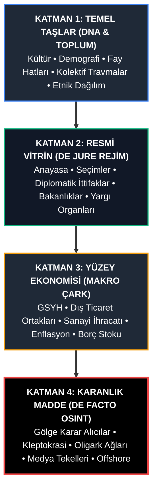
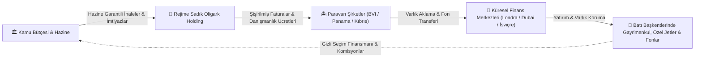

# 🌍 KÜRESEL RÖNTGEN (GLOBAL X-RAY)
### *Açık Kaynak İstihbarat (OSINT), Derin Devlet Ağları, Oligarşik Sermaye & Kleptokrasi Haritalandırma Atlası*

<p align="center">
  
  
  
  
  
  
</p>

---

## 🏛️ GİRİŞ VE İKTİDARIN FELSEFESİ: EPİGRAFLAR

> *"Görünen hükümetin arkasında, halka karşı hiçbir bağlılığı olmayan ve hiçbir sorumluluk kabul etmeyen görünmez bir hükümet taht kurmuştur. Bu görünmez hükümeti yok etmek, yozlaşmış iş dünyası ile yozlaşmış siyaset arasındaki kirli ittifakı bozmak, günümüzün ilk görevidir."*  
> — **Theodore Roosevelt** (ABD 26. Başkanı, 1912 İlerleme Partisi Platformu)

> *"Ticaret ve imalat dünyasında öyle bazı adamlar var ki, bir şeyden korkuyorlar. Biliyorlar ki bir yerlerde öyle organize, öyle sinsi, öyle uyanık, öyle kilitli ve öyle yaygın bir güç var ki, onu kınarken fısıltıyla bile konuşmamak en iyisi."*  
> — **Woodrow Wilson** (ABD 28. Başkanı, *The New Freedom*, 1913)

> *"Washington'daki gerçek yöneticiler görünmezdir ve güçlerini perde arkasından kullanırlar."*  
> — **Felix Frankfurter** (ABD Yüksek Mahkemesi Yargıcı)

> *"Siyaset; kimin neyi, ne zaman ve nasıl aldığını belirleme sanatıdır."*  
> — **Harold Lasswell** (Siyaset Bilimci, 1936)

> *"Büyük bir servetin arkasında mutlaka büyük bir suç gizlidir."*  
> — **Honoré de Balzac** (Goriot Baba)

> *"Aynı ticaret kolundaki insanlar nadiren bir araya gelirler; ancak eğlence için bile toplansalar, konuşmaları mutlaka halka karşı bir komployla veya fiyatları artırmaya yönelik bir düzenbazlıkla sonuçlanır."*  
> — **Adam Smith** (Milletlerin Zenginliği, 1776)

> *"Güç yozlaştırır; mutlak güç ise mutlaka yozlaştırır. Büyük adamlar neredeyse her zaman kötü adamlardır."*  
> — **Lord Acton** (1887)

> *"Hükümet konseylerinde, askeri-endüstriyel kompleksin haksız nüfuz kazanmasına karşı uyanık olmalıyız. Yanlış ellere geçmiş gücün yarattığı felaket potansiyeli mevcuttur ve sürecektir. Bu askeri ve endüstriyel devasa mekanizmanın demokratik süreçlerimizi tehlikeye atmasına asla izin vermemeliyiz."*  
> — **Dwight D. Eisenhower** (ABD 34. Başkanı, 1961 Başkanlık Veda Konuşması)

> *"Savaş, politikanın başka araçlarla devamından başka bir şey değildir."*  
> — **Carl von Clausewitz** (Savaş Üzerine, 1832)

> *"Güçlü olan yapabildiğini yapar, zayıf olan ise çekmek zorunda olduğunu çeker."*  
> — **Thucydides** (Peloponnesos Savaşı, M.Ö. 416, Melian Diyaloğu)

> *"Kitle iletişim araçları, halkı eğlendirmek, bilgilendirmek ve onlara değerleri aşılamak için bir sistem olarak işlev görür; ancak asıl görevi, onları kurumsal devletin ve ayrıcalıklı elitlerin çıkarlarına entegre etmektir."*  
> — **Noam Chomsky & Edward S. Herman** (Rızanın İmalatı: Kitle Medyasının Ekonomi Politiği, 1988)

> *"Herkes aynı şeyi düşünüyorsa, hiç kimse çok fazla düşünmüyor demektir."*  
> — **Walter Lippmann** (Kamuoyu, 1922)

> *"Geçmişi kontrol eden geleceği kontrol eder; bugünü kontrol eden geçmişi kontrol eder."*  
> — **George Orwell** (1984 Romanı)

> *"Eğer savaşlar yalanlarla başlatılabiliyorsa, barış da gerçeklerle inşa edilebilir."*  
> — **Julian Assange** (WikiLeaks Kurucusu)

> *"Hükümetlerin gizliliği halktan korunmak için kullandığı bir dünyada, gerçeği söylemek bir suç haline gelir."*  
> — **Edward Snowden** (Eski CIA/NSA Analisti, 2013)

> *"İnsanlar o kadar saftır ve o anki ihtiyaçlarına o kadar bağımlıdır ki, aldatmak isteyen her zaman aldatılmaya hazır birilerini bulur."*  
> — **Niccolò Machiavelli** (Prens, 1532)

---

## 📌 PROJE MANİFESTOSU VE VİZYON

**Küresel Röntgen (Global X-Ray)**; dünya üzerindeki **205 egemen devlet, de facto bağımsız cumhuriyet ve stratejik özerk bölgenin** kültürel genetiğinden gölge ekonomisine, resmi anayasasından derin sermaye tekellerine kadar her hücresini haritalandırmak için kurulmuş, **bağımsız, kitle kaynaklı ve açık kaynak istihbarat (OSINT)** veri ambarıdır.

Wikipedia size bir ülkenin anayasasını, CIA World Factbook makroekonomik istatistiklerini, turizm portalları ise folklorik ögelerini sunar. **Küresel Röntgen** ise tüm bunları tek bir koordinat sisteminde birleştirir ve üzerine uluslararası ilişkilerin eksik olan en hayati parçasını ekler: **Gerçek Güç Ağı (The De Facto Power Architecture).**

Bu repo; devletlerin resmi sınır çizgileri veya parlamento koltuklarıyla yetinmez. Bir cerrah titizliğiyle bürokratik perdenin arkasına geçer ve şu 4 kritik sorunun cevabını belgeler:
1. **Bu ülkeyi resmiyette kim yönetiyor, masanın arkasında kararları kim alıyor?** (De Jure vs. De Facto İktidar)
2. **Kamu kaynakları ve ulusal zenginlik hangi oligark holdingler ve offshore hesaplar üzerinden paylaşılıyor?** (Kleptokrasi Döngüsü)
3. **Medyayı, sansür mekanizmalarını ve kamuoyunu hangi çıkar grupları finanse ediyor?** (Bilgi Tekelleri ve Algı Operasyonları)
4. **Devlet, küresel arenada hangi süper gücün ekonomik, teknolojik veya askeri vesayeti altında?** (Borç Diplomasisi ve Dış Güvenlik Paktları)

---

## 🔬 4 KATMANLI DEVLET ANATOMİSİ (THE 4-LAYER OSINT FRAMEWORK)

Projenin metodolojik omurgası, yüzeyden merkeze doğru derinleşen 4 analitik katmandan oluşur. Bu katmanlama, araştırmacı gazetecilerin, istihbarat analistlerinin ve yapay zeka ajanlarının bilgiyi modüler ve doğrulanabilir biçimde sorgulayabilmesini sağlar.



### 🔹 Katman 1: Temel Taşlar (Kültür, Coğrafya ve Demografik Kırılmalar)
*Devlet mekanizmasının üzerinde yükseldiği fiziki, sosyolojik ve psikolojik zemin.*
* **Etnografya ve Demografik Piramit:** Nüfus yapısı, kentsel yığılmalar, azınlık oranları ve göç dinamikleri.
* **Kültürel DNA ve Kolektif Travmalar:** Ulusal kuruluş mitleri, savaş yenilgileri, sömürge geçmişi ve toplumsal fay hatları (laik-dindar, merkez-çevre, etnik ayrılıkçılık).
* **Jeostratejik Zemin:** Kritik boğazlar, boru hatları, tatlı su kaynakları, mineral yatakları ve sınır ihtilafları.

### 🔹 Katman 2: Resmi Vitrin (The De Jure State)
*Dünyanın tanıdığı, BM kürsülerinde konuşan ve kanun kitaplarında yazan resmi aygıt.*
* **Siyasi İşletim Sistemi:** Başkanlık, parlamenter, mutlak monarşi, hibrit veya askeri cunta yasal statüleri.
* **Vitrin Aktörleri:** Devlet başkanı, başbakan, kabine, yüksek yargı organları ve sistem içi yasal muhalefet.
* **Resmi Dış Politika:** İmzalanan ikili güvenlik paktları, uluslararası üyelikler (NATO, ŞİÖ, AB, Afrika Birliği vb.).

### 🔹 Katman 3: Yüzey Ekonomisi (The Official Economy)
*IMF, Dünya Bankası ve resmi istatistik enstitülerinin raporladığı makroekonomik çark.*
* **Makro Göstergeler:** Nominal ve SAGP GSYH, kişi başına düşen gelir, enflasyon, işsizlik, kamu borç stoku.
* **Tedarik ve Dış Ticaret Ağı:** Ülkenin ana ihracat lokomotifleri, stratejik hammadde bağımlılıkları ve en büyük ticaret ortakları.
* **Kritik Altyapı:** Elektrik şebekesi, rafineriler, derin deniz liman kapasiteleri ve telekomünikasyon altyapısı.

### 🔹 Katman 4: Karanlık Madde (OSINT & The De Facto Power)
*Reponun kalbi. Vitrinin arkasındaki gerçek güç ekseni.*
* **Gölge Karar Alıcılar & Kukla İpleri:** Resmi liderlerin arkasındaki aile meclisleri, derin güvenlik elitleri, istihbarat klikleri veya dini konsorsiyumlar.
* **Kleptokrasi Ağı & Oligarklar:** Kamu ihalelerinin düzenli olarak aktarıldığı imtiyazlı holdingler, offshore vergi cenneti transferleri ve stratejik tekeller.
* **Bilgi Otomasyonu & Algı Yönetimi:** Medya mülkiyetinin kime ait olduğu, gazetecilere yönelik idari/yargısal baskılar, casus yazılım (Pegasus vb.) gözetimleri.
* **Küresel Uydu & Vesayet Statüsü:** Ülkenin bağımsızlık derecesi; büyük güçlerin (ABD, Çin, Rusya) ülkedeki askeri üs, liman ve borç diplomasisi nüfuzu.

---

## 💸 KLEPTOKRASİ VE OFFSHORE SERMAYE KAÇIŞ MODELİ

Modern otoriter ve hibrit rejimlerde kamu kaynaklarının gaspı tesadüfi rüşvetlerle değil, **sistematik ve kurumsallaşmış bir çarkla** yürütülür:



---

## 🔍 DOĞRULAMA VE İSTİHBARAT PROTOKOLÜ (ADMIRALTY STANDARDI)

Küresel Röntgen bir spekülasyon veya komplo teorisi platformu **değildir**. Tüm Katman 4 analizleri, NATO ve uluslararası istihbarat servislerinin kullandığı **Admiralty Kodu** doğrulama sistemine tabidir:

| Güvenilirlik Kodu | Kaynak Niteliği | Kabul Edilen Referanslar |
| :---: | :--- | :--- |
| **A1** | **Tamamen Güvenilir & Teyitli** | Resmi mahkeme kararları, Sayıştay raporları, FinCEN kayıtları, SEC/Borsa dosyaları, ICIJ sızıntıları (Panama/Pandora Papers). |
| **B2** | **Genellikle Güvenilir & Muhtemelen Doğru** | OCCRP (Organized Crime and Corruption Reporting Project), Bellingcat, Transparency International, SIPRI, hakemli akademik araştırmalar. |
| **C3** | **Kısmen Güvenilir** | Bağımsız yerel araştırmacı gazetecilik portalları (ikincil kaynak teyidi zorunludur). |
| ❌ | **Kabul Edilmeyen** | Anonim sosyal medya iddiaları, teyitsiz bloglar, devlet propaganda bültenleri, dedikodu kanalları. |

---

## 🌐 KÜRESEL GÖSTERGELER VE GENEL BAKIŞ (205 ÜLKE)

Global X-Ray projesi dünya nüfusunun ve ekonomisinin neredeyse tamamını kapsar:

| Bölge | Haritalanan Ülke / Fiili Yönetim Sayısı | Temsil Edilen Nüfus | Nominal GSYH Toplamı | Ortalama Gölge Ekonomi |
| :--- | :---: | :---: | :---: | :---: |
| **Avrupa** | 47 Ülke | ~745 Milyon | $24.8 Trilyon | %16.8 |
| **Asya** | 35 Ülke | ~4.65 Milyar | $38.2 Trilyon | %27.4 |
| **Amerika** | 37 Ülke | ~1.04 Milyar | $34.1 Trilyon | %26.5 |
| **Afrika** | 56 Ülke | ~1.43 Milyar | $3.1 Trilyon | %41.2 |
| **Ortadoğu** | 16 Ülke | ~395 Milyon | $4.2 Trilyon | %31.5 |
| **Okyanusya** | 14 Ülke | ~44 Milyon | $2.1 Trilyon | %18.4 |
| **DÜNYA TOPLAMI** | **205 ÜLKE** | **~7.98 MİLYAR** | **$105.5 TRİLYON** | **%28.7** |

---

## 📂 STANDARTLAŞTIRILMIŞ DEPO DİZİN MİMARİSİ

Proje kapsamında **205 ülke ve fiili yönetimin tamamı**, hem doğrudan **ana dizindeki bağımsız klasörler** (`./<ülke>/`) hem de `countries/<ülke>/` ve `regions/<bölge>/<ülke>/` hiyerarşisi üzerinden inşa edilmiştir:

```text
📦 Global-X-Ray (Ana Kök Dizin)
 ┣ 📂 turkey/                            # 🇹🇷 205 Ülkenin Her Biri İçin Kök Dizinde Doğrudan Klasör
 ┃ ┣ 📜 README.md                       # 8 Bölümlü Kapsamlı İstihbarat & Güç Raporu (~10 KB)
 ┃ ┣ 📂 01_culture_demographics/
 ┃ ┃ ┣ 📜 society_history.md            # Sosyolojik kırılmalar & fay hatları
 ┃ ┃ ┗ 📊 demographics.csv             # Nüfus, yaş ve kentleşme verileri (CSV)
 ┃ ┣ 📂 02_official_state/
 ┃ ┃ ┗ 📜 constitution_gov.md          # Yasal hükümet sistemi, bakanlıklar & yargı
 ┃ ┣ 📂 03_official_economy/
 ┃ ┃ ┗ 📊 macroeconomics.json          # GSYH, enflasyon, ihracat/ithalat (JSON)
 ┃ ┗ 📂 04_shadow_power_osint/
 ┃   ┣ 📜 real_power_dynamics.md        # Fiili güç odakları & kleptokrasi analizi
 ┃   ┣ 📊 oligarch_network.csv          # Oligark-holding ilişkileri & tahmini servet (CSV)
 ┃   ┗ 📜 media_censorship_matrix.md    # Medya tekelleri & sansür analizi
 ┣ 📂 germany/                           # 🇩🇪 Almanya Klasörü & README.md
 ┣ 📂 united_states/                     # 🇺🇸 ABD Klasörü & README.md
 ┣ 📂 china/                             # 🇨🇳 Çin Klasörü & README.md
 ┣ 📂 russia/                            # 🇷🇺 Rusya Klasörü & README.md
 ┣ 📂 ...                                # 205 Ülke Klasörünün Tamamı Doğrudan Kök Dizinde!
 ┣ 📂 countries/                         # 🌍 205 Ülkenin Alternatif Alfabetik İndeks Dizinleri
 ┣ 📂 regions/                           # 🗺️ 6 Kıtaya Göre Hiyerarşik Bölge Arşivi
 ┣ 📂 global_datasets/                   # 📊 Küresel Makro Veri Setleri
 ┃ ┣ 📊 countries_registry.json         # 205 Ülkenin JSON indeks kataloğu
 ┃ ┣ 📊 global_shadow_economy.csv       # 205 Ülkenin kayıt dışı ekonomi endeksi
 ┃ ┗ 📊 press_freedom_real_index.json   # 205 Ülkenin basın özgürlüğü endeksi
 ┣ 📂 scripts/                           # 🛠️ İstihbarat ve Analiz Motoru
 ┃ ┣ 🐍 build_full_repository.py        # Tüm veri ambarını inşa eden çekirdek motor
 ┃ ┣ 🐍 xray_cli.py                     # Komut satırı analiz ve sorgu terminali
 ┃ ┣ 🐍 network_graph_gen.py            # Oligark ağlarını Mermaid grafiğine dönüştürücü
 ┃ ┗ 📂 data/                           # 6 Kıtaya ait modüler zengin veri ambarı
 ┣ 📂 methodology/                       # 📜 OSINT Metodoloji Kılavuzları
 ┃ ┣ 📜 DATA_COLLECTION_GUIDE.md        # 4 Katmanlı veri toplama kılavuzu
 ┃ ┗ 📜 OSINT_VERIFICATION.md           # Admiralty Code B2+ doğrulama protokolü
 ┣ 📂 tests/                             # 🧪 Otomatik Veri Bütünlüğü Testleri
 ┣ 📜 CONTRIBUTING.md                   # Katkı sağlama yönergeleri
 ┗ 📜 README.md                         # Bu master dosya
```

---

## 🗺️ 205 ÜLKE VE FİİLİ YÖNETİM ATLASI (A-Z DOĞRUDAN ERİŞİM DİZİNİ)

> *Aşağıdaki tabloda dünya üzerindeki 205 egemen devlet ve fiili yönetimin tamamı listelenmiştir. Herhangi bir ülkenin rapor linkine tıklayarak doğrudan kök dizindeki detaylı 8 bölümlü istihbarat ve derin güç dosyasına (`<ülke>/README.md`) ulaşabilirsiniz.*

| Ülke | Bayrak / Bölge | ISO Kodu | Başkent | Doğrudan İstihbarat Raporu | Nominal GSYH | Gölge Ekonomi Payı |
| :--- | :--- | :---: | :--- | :--- | :---: | :---: |
| **Afganistan** | ⛩️ Asya | `AFG` | Kabil | [Afganistan İstihbarat Raporu](afghanistan/README.md) | $14.5B | %50.0 |
| **Almanya** | 🏰 Avrupa | `DEU` | Berlin | [Almanya İstihbarat Raporu](germany/README.md) | $4,456.0B | %9.8 |
| **Amerika Birleşik Devletleri** | 🌎 Amerika | `USA` | Washington, D.C. | [Amerika Birleşik Devletleri İstihbarat Raporu](united_states/README.md) | $27,360.0B | %8.5 |
| **Andorra** | 🏰 Avrupa | `AND` | Andorra la Vella | [Andorra İstihbarat Raporu](andorra/README.md) | $3.7B | %11.5 |
| **Angola** | 🌍 Afrika | `AGO` | Luanda | [Angola İstihbarat Raporu](angola/README.md) | $93.8B | %38.0 |
| **Antigua ve Barbuda** | 🌎 Amerika | `ATG` | Saint John's | [Antigua ve Barbuda İstihbarat Raporu](antigua_and_barbuda/README.md) | $1.8B | %15.0 |
| **Arjantin** | 🌎 Amerika | `ARG` | Buenos Aires | [Arjantin İstihbarat Raporu](argentina/README.md) | $640.0B | %27.2 |
| **Arnavutluk** | 🏰 Avrupa | `ALB` | Tiran | [Arnavutluk İstihbarat Raporu](albania/README.md) | $23.0B | %31.0 |
| **Avustralya** | 🏝️ Okyanusya | `AUS` | Canberra | [Avustralya İstihbarat Raporu](australia/README.md) | $1,724.0B | %9.2 |
| **Avusturya** | 🏰 Avrupa | `AUT` | Viyana | [Avusturya İstihbarat Raporu](austria/README.md) | $516.0B | %8.5 |
| **Azerbaycan** | ⛩️ Asya | `AZE` | Bakü | [Azerbaycan İstihbarat Raporu](azerbaijan/README.md) | $78.7B | %38.0 |
| **Bahamalar** | 🌎 Amerika | `BHS` | Nassau | [Bahamalar İstihbarat Raporu](bahamas/README.md) | $14.0B | %12.0 |
| **Bahreyn** | 🕌 Ortadoğu | `BHR` | Manama | [Bahreyn İstihbarat Raporu](bahrain/README.md) | $44.0B | %19.0 |
| **Bangladeş** | ⛩️ Asya | `BGD` | Dakka | [Bangladeş İstihbarat Raporu](bangladesh/README.md) | $460.0B | %32.0 |
| **Barbados** | 🌎 Amerika | `BRB` | Bridgetown | [Barbados İstihbarat Raporu](barbados/README.md) | $6.2B | %14.0 |
| **Batı Sahra** | 🌍 Afrika | `ESH` | El Aaiun (Tifariti) | [Batı Sahra İstihbarat Raporu](western_sahara/README.md) | $0.9B | %45.0 |
| **Belarus** | 🏰 Avrupa | `BLR` | Minsk | [Belarus İstihbarat Raporu](belarus/README.md) | $72.0B | %31.0 |
| **Belize** | 🌎 Amerika | `BLZ` | Belmopan | [Belize İstihbarat Raporu](belize/README.md) | $3.2B | %25.0 |
| **Belçika** | 🏰 Avrupa | `BEL` | Brüksel | [Belçika İstihbarat Raporu](belgium/README.md) | $632.0B | %12.0 |
| **Benin** | 🌍 Afrika | `BEN` | Porto-Novo (Cotonou) | [Benin İstihbarat Raporu](benin/README.md) | $19.5B | %40.0 |
| **Bhutan** | ⛩️ Asya | `BTN` | Thimphu | [Bhutan İstihbarat Raporu](bhutan/README.md) | $2.9B | %15.0 |
| **Birleşik Arap Emirlikleri** | 🕌 Ortadoğu | `ARE` | Abu Dabi | [Birleşik Arap Emirlikleri İstihbarat Raporu](united_arab_emirates/README.md) | $504.0B | %18.0 |
| **Birleşik Krallık** | 🏰 Avrupa | `GBR` | Londra | [Birleşik Krallık İstihbarat Raporu](united_kingdom/README.md) | $3,332.0B | %11.2 |
| **Bolivya** | 🌎 Amerika | `BOL` | Sucre (La Paz hükümet) | [Bolivya İstihbarat Raporu](bolivia/README.md) | $46.0B | %55.0 |
| **Bosna-Hersek** | 🏰 Avrupa | `BIH` | Saraybosna | [Bosna-Hersek İstihbarat Raporu](bosnia_and_herzegovina/README.md) | $27.0B | %33.0 |
| **Botsvana** | 🌍 Afrika | `BWA` | Gaborone | [Botsvana İstihbarat Raporu](botswana/README.md) | $21.4B | %18.0 |
| **Brezilya** | 🌎 Amerika | `BRA` | Brasilia | [Brezilya İstihbarat Raporu](brazil/README.md) | $2,173.0B | %33.5 |
| **Brunei** | ⛩️ Asya | `BRN` | Bandar Seri Begavan | [Brunei İstihbarat Raporu](brunei/README.md) | $16.7B | %12.0 |
| **Bulgaristan** | 🏰 Avrupa | `BGR` | Sofya | [Bulgaristan İstihbarat Raporu](bulgaria/README.md) | $101.0B | %22.0 |
| **Burkina Faso** | 🌍 Afrika | `BFA` | Ouagadougou | [Burkina Faso İstihbarat Raporu](burkina_faso/README.md) | $20.3B | %45.0 |
| **Burundi** | 🌍 Afrika | `BDI` | Gitega (Bujumbura) | [Burundi İstihbarat Raporu](burundi/README.md) | $3.8B | %50.0 |
| **Cezayir** | 🌍 Afrika | `DZA` | Cezayir | [Cezayir İstihbarat Raporu](algeria/README.md) | $239.0B | %32.0 |
| **Cibuti** | 🌍 Afrika | `DJI` | Cibuti | [Cibuti İstihbarat Raporu](djibouti/README.md) | $4.1B | %30.0 |
| **Danimarka** | 🏰 Avrupa | `DNK` | Kopenhag | [Danimarka İstihbarat Raporu](denmark/README.md) | $400.0B | %8.0 |
| **Demokratik Kongo Cumhuriyeti** | 🌍 Afrika | `COD` | Kinşasa | [Demokratik Kongo Cumhuriyeti İstihbarat Raporu](democratic_republic_of_the_congo/README.md) | $67.5B | %55.0 |
| **Dominik Cumhuriyeti** | 🌎 Amerika | `DOM` | Santo Domingo | [Dominik Cumhuriyeti İstihbarat Raporu](dominican_republic/README.md) | $121.0B | %30.0 |
| **Dominika** | 🌎 Amerika | `DMA` | Roseau | [Dominika İstihbarat Raporu](dominica/README.md) | $0.7B | %20.0 |
| **Doğu Timor** | ⛩️ Asya | `TLS` | Dili | [Doğu Timor İstihbarat Raporu](timor_leste/README.md) | $3.2B | %30.0 |
| **Ekvador** | 🌎 Amerika | `ECU` | Quito | [Ekvador İstihbarat Raporu](ecuador/README.md) | $118.0B | %35.0 |
| **Ekvator Ginesi** | 🌍 Afrika | `GNQ` | Malabo | [Ekvator Ginesi İstihbarat Raporu](equatorial_guinea/README.md) | $12.0B | %45.0 |
| **El Salvador** | 🌎 Amerika | `SLV` | San Salvador | [El Salvador İstihbarat Raporu](el_salvador/README.md) | $35.0B | %28.0 |
| **Endonezya** | ⛩️ Asya | `IDN` | Cakarta | [Endonezya İstihbarat Raporu](indonesia/README.md) | $1,371.0B | %20.8 |
| **Eritre** | 🌍 Afrika | `ERI` | Asmara | [Eritre İstihbarat Raporu](eritrea/README.md) | $2.6B | %60.0 |
| **Ermenistan** | ⛩️ Asya | `ARM` | Erivan | [Ermenistan İstihbarat Raporu](armenia/README.md) | $24.2B | %28.0 |
| **Estonya** | 🏰 Avrupa | `EST` | Tallinn | [Estonya İstihbarat Raporu](estonia/README.md) | $41.0B | %11.0 |
| **Esvatini** | 🌍 Afrika | `SWZ` | Mbabane (Lobamba) | [Esvatini İstihbarat Raporu](eswatini/README.md) | $4.8B | %30.0 |
| **Etiyopya** | 🌍 Afrika | `ETH` | Addis Ababa | [Etiyopya İstihbarat Raporu](ethiopia/README.md) | $163.0B | %35.0 |
| **Fas** | 🌍 Afrika | `MAR` | Rabat | [Fas İstihbarat Raporu](morocco/README.md) | $147.0B | %27.0 |
| **Fiji** | 🏝️ Okyanusya | `FJI` | Suva | [Fiji İstihbarat Raporu](fiji/README.md) | $5.5B | %25.0 |
| **Fildişi Sahili** | 🌍 Afrika | `CIV` | Yamoussoukro (Abidjan) | [Fildişi Sahili İstihbarat Raporu](ivory_coast/README.md) | $86.0B | %35.0 |
| **Filipinler** | ⛩️ Asya | `PHL` | Manila | [Filipinler İstihbarat Raporu](philippines/README.md) | $437.0B | %28.0 |
| **Filistin** | 🕌 Ortadoğu | `PSE` | Kudüs (Ramallah idari merkez) | [Filistin İstihbarat Raporu](palestine/README.md) | $18.0B | %38.0 |
| **Finlandiya** | 🏰 Avrupa | `FIN` | Helsinki | [Finlandiya İstihbarat Raporu](finland/README.md) | $300.0B | %8.5 |
| **Fransa** | 🏰 Avrupa | `FRA` | Paris | [Fransa İstihbarat Raporu](france/README.md) | $3,052.0B | %13.8 |
| **Gabon** | 🌍 Afrika | `GAB` | Libreville | [Gabon İstihbarat Raporu](gabon/README.md) | $21.0B | %30.0 |
| **Gambiya** | 🌍 Afrika | `GMB` | Banjul | [Gambiya İstihbarat Raporu](gambia/README.md) | $2.3B | %35.0 |
| **Gana** | 🌍 Afrika | `GHA` | Accra | [Gana İstihbarat Raporu](ghana/README.md) | $76.0B | %35.0 |
| **Gine** | 🌍 Afrika | `GIN` | Konakri | [Gine İstihbarat Raporu](guinea/README.md) | $23.0B | %40.0 |
| **Gine-Bissau** | 🌍 Afrika | `GNB` | Bissau | [Gine-Bissau İstihbarat Raporu](guinea_bissau/README.md) | $2.0B | %45.0 |
| **Grenada** | 🌎 Amerika | `GRD` | Saint George's | [Grenada İstihbarat Raporu](grenada/README.md) | $1.3B | %22.0 |
| **Grönland** | 🌎 Amerika | `GRL` | Nuuk | [Grönland İstihbarat Raporu](greenland/README.md) | $3.2B | %10.0 |
| **Guatemala** | 🌎 Amerika | `GTM` | Guatemala City | [Guatemala İstihbarat Raporu](guatemala/README.md) | $102.0B | %40.0 |
| **Guyana** | 🌎 Amerika | `GUY` | Georgetown | [Guyana İstihbarat Raporu](guyana/README.md) | $17.0B | %30.0 |
| **Güney Afrika** | 🌍 Afrika | `ZAF` | Pretoria (İdari), Cape Town (Yasama), Bloemfontein (Yargı) | [Güney Afrika İstihbarat Raporu](south_africa/README.md) | $377.0B | %24.1 |
| **Güney Kore** | ⛩️ Asya | `KOR` | Seul | [Güney Kore İstihbarat Raporu](south_korea/README.md) | $1,712.0B | %21.3 |
| **Güney Sudan** | 🌍 Afrika | `SSD` | Juba | [Güney Sudan İstihbarat Raporu](south_sudan/README.md) | $6.5B | %65.0 |
| **Gürcistan** | ⛩️ Asya | `GEO` | Tiflis | [Gürcistan İstihbarat Raporu](georgia/README.md) | $30.5B | %22.0 |
| **Haiti** | 🌎 Amerika | `HTI` | Port-au-Prince | [Haiti İstihbarat Raporu](haiti/README.md) | $20.0B | %70.0 |
| **Hindistan** | ⛩️ Asya | `IND` | Yeni Delhi | [Hindistan İstihbarat Raporu](india/README.md) | $3,937.0B | %22.4 |
| **Hollanda** | 🏰 Avrupa | `NLD` | Amsterdam (Lahey hükümet merkezi) | [Hollanda İstihbarat Raporu](netherlands/README.md) | $1,118.0B | %7.8 |
| **Honduras** | 🌎 Amerika | `HND` | Tegucigalpa | [Honduras İstihbarat Raporu](honduras/README.md) | $34.0B | %35.0 |
| **Hong Kong** | ⛩️ Asya | `HKG` | Hong Kong | [Hong Kong İstihbarat Raporu](hong_kong/README.md) | $382.0B | %14.0 |
| **Hırvatistan** | 🏰 Avrupa | `HRV` | Zagreb | [Hırvatistan İstihbarat Raporu](croatia/README.md) | $82.0B | %18.0 |
| **Irak** | 🕌 Ortadoğu | `IRQ` | Bağdat | [Irak İstihbarat Raporu](iraq/README.md) | $250.8B | %38.0 |
| **Jamaika** | 🌎 Amerika | `JAM` | Kingston | [Jamaika İstihbarat Raporu](jamaica/README.md) | $19.5B | %25.0 |
| **Japonya** | ⛩️ Asya | `JPN` | Tokyo | [Japonya İstihbarat Raporu](japan/README.md) | $4,210.0B | %9.1 |
| **Kamboçya** | ⛩️ Asya | `KHM` | Phnom Penh | [Kamboçya İstihbarat Raporu](cambodia/README.md) | $31.8B | %40.0 |
| **Kamerun** | 🌍 Afrika | `CMR` | Yaounde | [Kamerun İstihbarat Raporu](cameroon/README.md) | $49.0B | %38.0 |
| **Kanada** | 🌎 Amerika | `CAN` | Ottawa | [Kanada İstihbarat Raporu](canada/README.md) | $2,140.0B | %10.5 |
| **Karadağ** | 🏰 Avrupa | `MNE` | Podgorica | [Karadağ İstihbarat Raporu](montenegro/README.md) | $7.4B | %26.0 |
| **Katar** | 🕌 Ortadoğu | `QAT` | Doha | [Katar İstihbarat Raporu](qatar/README.md) | $235.5B | %12.5 |
| **Kazakistan** | ⛩️ Asya | `KAZ` | Astana | [Kazakistan İstihbarat Raporu](kazakhstan/README.md) | $261.0B | %28.5 |
| **Kenya** | 🌍 Afrika | `KEN` | Nairobi | [Kenya İstihbarat Raporu](kenya/README.md) | $115.0B | %33.0 |
| **Kiribati** | 🏝️ Okyanusya | `KIR` | Tarawa | [Kiribati İstihbarat Raporu](kiribati/README.md) | $0.3B | %20.0 |
| **Kolombiya** | 🌎 Amerika | `COL` | Bogota | [Kolombiya İstihbarat Raporu](colombia/README.md) | $363.0B | %33.0 |
| **Komorlar** | 🌍 Afrika | `COM` | Moroni | [Komorlar İstihbarat Raporu](comoros/README.md) | $1.4B | %35.0 |
| **Kongo Cumhuriyeti (Brazzaville)** | 🌍 Afrika | `COG` | Brazzaville | [Kongo Cumhuriyeti (Brazzaville) İstihbarat Raporu](republic_of_the_congo/README.md) | $15.0B | %45.0 |
| **Kosova** | 🏰 Avrupa | `XKX` | Priştine | [Kosova İstihbarat Raporu](kosovo/README.md) | $10.4B | %30.0 |
| **Kosta Rika** | 🌎 Amerika | `CRI` | San Jose | [Kosta Rika İstihbarat Raporu](costa_rica/README.md) | $86.0B | %15.0 |
| **Kuveyt** | 🕌 Ortadoğu | `KWT` | Kuveyt | [Kuveyt İstihbarat Raporu](kuwait/README.md) | $160.0B | %14.2 |
| **Kuzey Kore** | ⛩️ Asya | `PRK` | Pyongyang | [Kuzey Kore İstihbarat Raporu](north_korea/README.md) | $18.0B | %65.0 |
| **Kuzey Kıbrıs** | 🕌 Ortadoğu | `TRNC` | Lefkoşa | [Kuzey Kıbrıs İstihbarat Raporu](northern_cyprus/README.md) | $4.2B | %42.0 |
| **Kuzey Makedonya** | 🏰 Avrupa | `MKD` | Üsküp | [Kuzey Makedonya İstihbarat Raporu](north_macedonia/README.md) | $15.8B | %28.0 |
| **Küba** | 🌎 Amerika | `CUB` | Havana | [Küba İstihbarat Raporu](cuba/README.md) | $107.0B | %45.0 |
| **Kıbrıs Rum Kesimi** | 🏰 Avrupa | `CYP` | Lefkoşa | [Kıbrıs Rum Kesimi İstihbarat Raporu](cyprus/README.md) | $32.2B | %24.0 |
| **Kırgızistan** | ⛩️ Asya | `KGZ` | Bişkek | [Kırgızistan İstihbarat Raporu](kyrgyzstan/README.md) | $14.0B | %30.0 |
| **Laos** | ⛩️ Asya | `LAO` | Vientiane | [Laos İstihbarat Raporu](laos/README.md) | $15.8B | %35.0 |
| **Lesoto** | 🌍 Afrika | `LSO` | Maseru | [Lesoto İstihbarat Raporu](lesotho/README.md) | $2.6B | %30.0 |
| **Letonya** | 🏰 Avrupa | `LVA` | Riga | [Letonya İstihbarat Raporu](latvia/README.md) | $43.6B | %18.0 |
| **Liberya** | 🌍 Afrika | `LBR` | Monrovia | [Liberya İstihbarat Raporu](liberia/README.md) | $4.3B | %45.0 |
| **Libya** | 🌍 Afrika | `LBY` | Trablus | [Libya İstihbarat Raporu](libya/README.md) | $45.0B | %50.0 |
| **Lihtenştayn** | 🏰 Avrupa | `LIE` | Vaduz | [Lihtenştayn İstihbarat Raporu](liechtenstein/README.md) | $7.7B | %8.0 |
| **Litvanya** | 🏰 Avrupa | `LTU` | Vilnius | [Litvanya İstihbarat Raporu](lithuania/README.md) | $77.8B | %17.0 |
| **Lübnan** | 🕌 Ortadoğu | `LBN` | Beyrut | [Lübnan İstihbarat Raporu](lebanon/README.md) | $17.9B | %45.0 |
| **Lüksemburg** | 🏰 Avrupa | `LUX` | Lüksemburg | [Lüksemburg İstihbarat Raporu](luxembourg/README.md) | $86.0B | %7.0 |
| **Macaristan** | 🏰 Avrupa | `HUN` | Budapeşte | [Macaristan İstihbarat Raporu](hungary/README.md) | $212.0B | %19.0 |
| **Madagaskar** | 🌍 Afrika | `MDG` | Antananarivo | [Madagaskar İstihbarat Raporu](madagascar/README.md) | $16.0B | %40.0 |
| **Makao** | ⛩️ Asya | `MAC` | Makao | [Makao İstihbarat Raporu](macau/README.md) | $47.0B | %15.0 |
| **Malavi** | 🌍 Afrika | `MWI` | Lilongwe | [Malavi İstihbarat Raporu](malawi/README.md) | $13.0B | %42.0 |
| **Maldivler** | ⛩️ Asya | `MDV` | Male | [Maldivler İstihbarat Raporu](maldives/README.md) | $6.6B | %22.0 |
| **Malezya** | ⛩️ Asya | `MYS` | Kuala Lumpur | [Malezya İstihbarat Raporu](malaysia/README.md) | $430.0B | %18.0 |
| **Mali** | 🌍 Afrika | `MLI` | Bamako | [Mali İstihbarat Raporu](mali/README.md) | $21.0B | %45.0 |
| **Malta** | 🏰 Avrupa | `MLT` | Valletta | [Malta İstihbarat Raporu](malta/README.md) | $20.4B | %22.0 |
| **Marshall Adaları** | 🏝️ Okyanusya | `MHL` | Majuro | [Marshall Adaları İstihbarat Raporu](marshall_islands/README.md) | $0.3B | %15.0 |
| **Mauritius** | 🌍 Afrika | `MUS` | Port Louis | [Mauritius İstihbarat Raporu](mauritius/README.md) | $14.5B | %15.0 |
| **Meksika** | 🌎 Amerika | `MEX` | Mexico City | [Meksika İstihbarat Raporu](mexico/README.md) | $1,788.0B | %29.8 |
| **Mikronezya Federal Devletleri** | 🏝️ Okyanusya | `FSM` | Palikir | [Mikronezya Federal Devletleri İstihbarat Raporu](micronesia/README.md) | $0.5B | %18.0 |
| **Moldova** | 🏰 Avrupa | `MDA` | Kişinev | [Moldova İstihbarat Raporu](moldova/README.md) | $16.5B | %28.0 |
| **Monako** | 🏰 Avrupa | `MCO` | Monako | [Monako İstihbarat Raporu](monaco/README.md) | $8.8B | %10.0 |
| **Moritanya** | 🌍 Afrika | `MRT` | Nuakşot | [Moritanya İstihbarat Raporu](mauritania/README.md) | $10.5B | %35.0 |
| **Mozambik** | 🌍 Afrika | `MOZ` | Maputo | [Mozambik İstihbarat Raporu](mozambique/README.md) | $20.6B | %42.0 |
| **Moğolistan** | ⛩️ Asya | `MNG` | Ulanbatur | [Moğolistan İstihbarat Raporu](mongolia/README.md) | $19.9B | %28.0 |
| **Myanmar** | ⛩️ Asya | `MMR` | Naypyidaw | [Myanmar İstihbarat Raporu](myanmar/README.md) | $65.0B | %50.0 |
| **Mısır** | 🌍 Afrika | `EGY` | Kahire | [Mısır İstihbarat Raporu](egypt/README.md) | $395.0B | %34.8 |
| **Namibya** | 🌍 Afrika | `NAM` | Windhoek | [Namibya İstihbarat Raporu](namibia/README.md) | $12.6B | %22.0 |
| **Nauru** | 🏝️ Okyanusya | `NRU` | Yaren | [Nauru İstihbarat Raporu](nauru/README.md) | $0.1B | %20.0 |
| **Nepal** | ⛩️ Asya | `NPL` | Katmandu | [Nepal İstihbarat Raporu](nepal/README.md) | $40.8B | %34.0 |
| **Nijer** | 🌍 Afrika | `NER` | Niamey | [Nijer İstihbarat Raporu](niger/README.md) | $16.6B | %48.0 |
| **Nijerya** | 🌍 Afrika | `NGA` | Abuja | [Nijerya İstihbarat Raporu](nigeria/README.md) | $375.0B | %52.4 |
| **Nikaragua** | 🌎 Amerika | `NIC` | Managua | [Nikaragua İstihbarat Raporu](nicaragua/README.md) | $17.0B | %42.0 |
| **Norveç** | 🏰 Avrupa | `NOR` | Oslo | [Norveç İstihbarat Raporu](norway/README.md) | $485.0B | %8.2 |
| **Orta Afrika Cumhuriyeti** | 🌍 Afrika | `CAF` | Bangui | [Orta Afrika Cumhuriyeti İstihbarat Raporu](central_african_republic/README.md) | $2.7B | %65.0 |
| **Pakistan** | ⛩️ Asya | `PAK` | İslamabad | [Pakistan İstihbarat Raporu](pakistan/README.md) | $338.0B | %35.6 |
| **Palau** | 🏝️ Okyanusya | `PLW` | Ngerulmud | [Palau İstihbarat Raporu](palau/README.md) | $0.3B | %15.0 |
| **Panama** | 🌎 Amerika | `PAN` | Panama City | [Panama İstihbarat Raporu](panama/README.md) | $83.0B | %25.0 |
| **Papua Yeni Gine** | 🏝️ Okyanusya | `PNG` | Port Moresby | [Papua Yeni Gine İstihbarat Raporu](papua_new_guinea/README.md) | $31.0B | %38.0 |
| **Paraguay** | 🌎 Amerika | `PRY` | Asuncion | [Paraguay İstihbarat Raporu](paraguay/README.md) | $44.0B | %38.0 |
| **Peru** | 🌎 Amerika | `PER` | Lima | [Peru İstihbarat Raporu](peru/README.md) | $268.0B | %45.0 |
| **Polonya** | 🏰 Avrupa | `POL` | Varşova | [Polonya İstihbarat Raporu](poland/README.md) | $842.0B | %19.2 |
| **Portekiz** | 🏰 Avrupa | `PRT` | Lizbon | [Portekiz İstihbarat Raporu](portugal/README.md) | $287.0B | %16.0 |
| **Porto Riko** | 🌎 Amerika | `PRI` | San Juan | [Porto Riko İstihbarat Raporu](puerto_rico/README.md) | $113.0B | %18.0 |
| **Romanya** | 🏰 Avrupa | `ROU` | Bükreş | [Romanya İstihbarat Raporu](romania/README.md) | $350.0B | %26.0 |
| **Ruanda** | 🌍 Afrika | `RWA` | Kigali | [Ruanda İstihbarat Raporu](rwanda/README.md) | $14.1B | %28.0 |
| **Rusya** | 🏰 Avrupa | `RUS` | Moskova | [Rusya İstihbarat Raporu](russia/README.md) | $2,021.0B | %38.2 |
| **Saint Kitts ve Nevis** | 🌎 Amerika | `KNA` | Basseterre | [Saint Kitts ve Nevis İstihbarat Raporu](saint_kitts_and_nevis/README.md) | $1.1B | %15.0 |
| **Saint Lucia** | 🌎 Amerika | `LCA` | Castries | [Saint Lucia İstihbarat Raporu](saint_lucia/README.md) | $2.4B | %18.0 |
| **Saint Vincent ve Grenadinler** | 🌎 Amerika | `VCT` | Kingstown | [Saint Vincent ve Grenadinler İstihbarat Raporu](saint_vincent_and_the_grenadines/README.md) | $1.0B | %20.0 |
| **Samoa** | 🏝️ Okyanusya | `WSM` | Apia | [Samoa İstihbarat Raporu](samoa/README.md) | $0.9B | %22.0 |
| **San Marino** | 🏰 Avrupa | `SMR` | San Marino | [San Marino İstihbarat Raporu](san_marino/README.md) | $1.8B | %12.0 |
| **Sao Tome ve Principe** | 🌍 Afrika | `STP` | Sao Tome | [Sao Tome ve Principe İstihbarat Raporu](sao_tome_and_principe/README.md) | $0.6B | %30.0 |
| **Senegal** | 🌍 Afrika | `SEN` | Dakar | [Senegal İstihbarat Raporu](senegal/README.md) | $31.0B | %30.0 |
| **Seyşeller** | 🌍 Afrika | `SYC` | Victoria | [Seyşeller İstihbarat Raporu](seychelles/README.md) | $2.1B | %12.0 |
| **Sierra Leone** | 🌍 Afrika | `SLE` | Freetown | [Sierra Leone İstihbarat Raporu](sierra_leone/README.md) | $4.2B | %45.0 |
| **Singapur** | ⛩️ Asya | `SGP` | Singapur | [Singapur İstihbarat Raporu](singapore/README.md) | $501.0B | %8.0 |
| **Slovakya** | 🏰 Avrupa | `SVK` | Bratislava | [Slovakya İstihbarat Raporu](slovakia/README.md) | $132.0B | %15.0 |
| **Slovenya** | 🏰 Avrupa | `SVN` | Ljubljana | [Slovenya İstihbarat Raporu](slovenia/README.md) | $68.0B | %11.0 |
| **Solomon Adaları** | 🏝️ Okyanusya | `SLB` | Honiara | [Solomon Adaları İstihbarat Raporu](solomon_islands/README.md) | $1.6B | %30.0 |
| **Somali** | 🌍 Afrika | `SOM` | Mogadişu | [Somali İstihbarat Raporu](somalia/README.md) | $11.6B | %70.0 |
| **Somaliland** | 🌍 Afrika | `SOMX` | Hargeisa | [Somaliland İstihbarat Raporu](somaliland/README.md) | $3.4B | %55.0 |
| **Sri Lanka** | ⛩️ Asya | `LKA` | Kolombo | [Sri Lanka İstihbarat Raporu](sri_lanka/README.md) | $84.4B | %32.0 |
| **Sudan** | 🌍 Afrika | `SDN` | Hartum (Port Sudan) | [Sudan İstihbarat Raporu](sudan/README.md) | $30.0B | %65.0 |
| **Surinam** | 🌎 Amerika | `SUR` | Paramaribo | [Surinam İstihbarat Raporu](suriname/README.md) | $3.6B | %35.0 |
| **Suriye** | 🕌 Ortadoğu | `SYR` | Şam | [Suriye İstihbarat Raporu](syria/README.md) | $12.5B | %65.0 |
| **Suudi Arabistan** | 🕌 Ortadoğu | `SAU` | Riyad | [Suudi Arabistan İstihbarat Raporu](saudi_arabia/README.md) | $1,069.0B | %16.2 |
| **Sırbistan** | 🏰 Avrupa | `SRB` | Belgrad | [Sırbistan İstihbarat Raporu](serbia/README.md) | $75.0B | %27.0 |
| **Tacikistan** | ⛩️ Asya | `TJK` | Duşanbe | [Tacikistan İstihbarat Raporu](tajikistan/README.md) | $12.0B | %35.0 |
| **Tanzanya** | 🌍 Afrika | `TZA` | Dodoma (Darüsselam) | [Tanzanya İstihbarat Raporu](tanzania/README.md) | $79.1B | %30.0 |
| **Tayland** | ⛩️ Asya | `THA` | Bangkok | [Tayland İstihbarat Raporu](thailand/README.md) | $514.0B | %42.0 |
| **Tayvan** | ⛩️ Asya | `TWN` | Taipei | [Tayvan İstihbarat Raporu](taiwan/README.md) | $756.0B | %18.0 |
| **Togo** | 🌍 Afrika | `TGO` | Lome | [Togo İstihbarat Raporu](togo/README.md) | $9.1B | %38.0 |
| **Tonga** | 🏝️ Okyanusya | `TON` | Nukuʻalofa | [Tonga İstihbarat Raporu](tonga/README.md) | $0.5B | %25.0 |
| **Transdinyester** | 🏰 Avrupa | `PMR` | Tiraspol | [Transdinyester İstihbarat Raporu](transnistria/README.md) | $1.1B | %55.0 |
| **Trinidad ve Tobago** | 🌎 Amerika | `TTO` | Port of Spain | [Trinidad ve Tobago İstihbarat Raporu](trinidad_and_tobago/README.md) | $28.0B | %18.0 |
| **Tunus** | 🌍 Afrika | `TUN` | Tunus | [Tunus İstihbarat Raporu](tunisia/README.md) | $51.2B | %35.0 |
| **Tuvalu** | 🏝️ Okyanusya | `TUV` | Funafuti | [Tuvalu İstihbarat Raporu](tuvalu/README.md) | $0.1B | %15.0 |
| **Türkiye** | 🕌 Ortadoğu | `TUR` | Ankara | [Türkiye İstihbarat Raporu](turkey/README.md) | $1,154.0B | %28.4 |
| **Türkmenistan** | ⛩️ Asya | `TKM` | Aşkabat | [Türkmenistan İstihbarat Raporu](turkmenistan/README.md) | $81.8B | %45.0 |
| **Uganda** | 🌍 Afrika | `UGA` | Kampala | [Uganda İstihbarat Raporu](uganda/README.md) | $49.3B | %35.0 |
| **Ukrayna** | 🏰 Avrupa | `UKR` | Kiev | [Ukrayna İstihbarat Raporu](ukraine/README.md) | $178.0B | %32.6 |
| **Umman** | 🕌 Ortadoğu | `OMN` | Maskat | [Umman İstihbarat Raporu](oman/README.md) | $108.0B | %17.5 |
| **Uruguay** | 🌎 Amerika | `URY` | Montevideo | [Uruguay İstihbarat Raporu](uruguay/README.md) | $77.0B | %12.0 |
| **Vanuatu** | 🏝️ Okyanusya | `VUT` | Port Vila | [Vanuatu İstihbarat Raporu](vanuatu/README.md) | $1.1B | %28.0 |
| **Vatikan** | 🏰 Avrupa | `VAT` | Vatikan | [Vatikan İstihbarat Raporu](vatican_city/README.md) | $0.1B | %15.0 |
| **Venezuela** | 🌎 Amerika | `VEN` | Karakas | [Venezuela İstihbarat Raporu](venezuela/README.md) | $102.0B | %60.0 |
| **Vietnam** | ⛩️ Asya | `VNM` | Hanoi | [Vietnam İstihbarat Raporu](vietnam/README.md) | $430.0B | %25.0 |
| **Yemen** | 🕌 Ortadoğu | `YEM` | Sana (Aden geçici başkent) | [Yemen İstihbarat Raporu](yemen/README.md) | $21.0B | %60.0 |
| **Yeni Zelanda** | 🏝️ Okyanusya | `NZL` | Wellington | [Yeni Zelanda İstihbarat Raporu](new_zealand/README.md) | $253.0B | %8.0 |
| **Yeşil Burun Adaları** | 🌍 Afrika | `CPV` | Praia | [Yeşil Burun Adaları İstihbarat Raporu](cabo_verde/README.md) | $2.6B | %15.0 |
| **Yunanistan** | 🏰 Avrupa | `GRC` | Atina | [Yunanistan İstihbarat Raporu](greece/README.md) | $238.0B | %21.4 |
| **Zambiya** | 🌍 Afrika | `ZMB` | Lusaka | [Zambiya İstihbarat Raporu](zambia/README.md) | $29.5B | %35.0 |
| **Zimbabve** | 🌍 Afrika | `ZWE` | Harare | [Zimbabve İstihbarat Raporu](zimbabwe/README.md) | $26.5B | %65.0 |
| **Çad** | 🌍 Afrika | `TCD` | N'Djamena | [Çad İstihbarat Raporu](chad/README.md) | $13.0B | %50.0 |
| **Çekya** | 🏰 Avrupa | `CZE` | Prag | [Çekya İstihbarat Raporu](czech_republic/README.md) | $330.0B | %13.5 |
| **Çin** | ⛩️ Asya | `CHN` | Pekin | [Çin İstihbarat Raporu](china/README.md) | $17,794.0B | %12.7 |
| **Özbekistan** | ⛩️ Asya | `UZB` | Taşkent | [Özbekistan İstihbarat Raporu](uzbekistan/README.md) | $90.8B | %33.0 |
| **Ürdün** | 🕌 Ortadoğu | `JOR` | Amman | [Ürdün İstihbarat Raporu](jordan/README.md) | $50.8B | %26.0 |
| **İran** | 🕌 Ortadoğu | `IRN` | Tahran | [İran İstihbarat Raporu](iran/README.md) | $403.5B | %36.5 |
| **İrlanda** | 🏰 Avrupa | `IRL` | Dublin | [İrlanda İstihbarat Raporu](ireland/README.md) | $545.0B | %9.5 |
| **İspanya** | 🏰 Avrupa | `ESP` | Madrid | [İspanya İstihbarat Raporu](spain/README.md) | $1,580.0B | %17.2 |
| **İsrail** | 🕌 Ortadoğu | `ISR` | Kudüs (Tel Aviv idari/uluslararası) | [İsrail İstihbarat Raporu](israel/README.md) | $509.9B | %18.5 |
| **İsveç** | 🏰 Avrupa | `SWE` | Stockholm | [İsveç İstihbarat Raporu](sweden/README.md) | $593.0B | %7.8 |
| **İsviçre** | 🏰 Avrupa | `CHE` | Bern | [İsviçre İstihbarat Raporu](switzerland/README.md) | $905.0B | %6.4 |
| **İtalya** | 🏰 Avrupa | `ITA` | Roma | [İtalya İstihbarat Raporu](italy/README.md) | $2,255.0B | %20.5 |
| **İzlanda** | 🏰 Avrupa | `ISL` | Reykjavik | [İzlanda İstihbarat Raporu](iceland/README.md) | $31.0B | %7.5 |
| **Şili** | 🌎 Amerika | `CHL` | Santiago | [Şili İstihbarat Raporu](chile/README.md) | $340.0B | %18.0 |

---

## 🛠️ OTOMASYON, TERMİNAL VE GRAFİK ÜRETİMİ (CLI TOOLING)

Küresel Röntgen, komut satırından dinamik olarak sorgulanabilen entegre bir analiz terminali içerir:

### 1. Ülke İstihbarat Raporu Sorgulama
Herhangi bir ülkenin özet kimlik kartını, makro göstergelerini ve oligark ağını terminalden görüntüleyin:
```bash
python scripts/xray_cli.py country turkey
python scripts/xray_cli.py country kuwait
python scripts/xray_cli.py country united_states
```

### 2. İki Ülkeyi Jeopolitik Olarak Karşılaştırma
İki ülkenin nüfus, GSYH, gölge ekonomi oranı ve güç parametrelerini yan yana kıyaslayın:
```bash
python scripts/xray_cli.py compare turkey greece
python scripts/xray_cli.py compare united_states china
python scripts/xray_cli.py compare saudi_arabia iran
```

### 3. Oligark ve Siyaset Güç Ağı Grafiği Üretme
Herhangi bir ülkenin `oligarch_network.csv` dosyasını okuyarak Markdown/Mermaid ilişkiler şeması üretin:
```bash
python scripts/xray_cli.py graph turkey
python scripts/network_graph_gen.py turkey/04_shadow_power_osint/oligarch_network.csv
```

### 4. Küresel Özet İstatistikleri Listeleme
```bash
python scripts/xray_cli.py stats
```

### 5. Anahtar Kelime ile İstihbarat Taraması
```bash
python scripts/xray_cli.py search "offshore"
python scripts/xray_cli.py search "liman"
```

---

## 🧪 OTOMATİK VERİ BÜTÜNLÜĞÜ TESTLERİ

Projedeki 205 ülkenin ve 1.640'ı aşkın dosyanın bozulmadığını, JSON sözdizimlerinin geçerli olduğunu ve tüm README'lerin standartlara uyduğunu doğrulamak için:
```bash
python tests/test_integrity.py
```

---

## 🤝 KATKI SAĞLAMA VE ETİK İLKELER

Küresel Röntgen, araştırmacı gazetecilerin, OSINT analistlerinin ve veri bilimcilerinin kolektif katkılarıyla büyümektedir. 
* Yeni bir oligark bağlantısı, ihale yolsuzluğu veya medya mülkiyeti eklemek istiyorsanız lütfen [`methodology/OSINT_VERIFICATION.md`](methodology/OSINT_VERIFICATION.md) kılavuzunu inceleyin.
* Tüm Katman 4 iddiaları için **çift birincil kaynak teyidi (Mahkeme kararı, Sayıştay raporu, ICIJ/OCCRP veri tabanı)** eklemek zorunludur.
* Ayrıntılı katkı kuralları için [`CONTRIBUTING.md`](CONTRIBUTING.md) belgesine bakın.

---

## ⚖️ YASAL SORUMLULUK REDDİ (LEGAL DISCLAIMER)

*Bu veri ambarındaki tüm bilgiler; Birleşmiş Milletler, Dünya Bankası, IMF, Transparency International, RSF, ulusal ticaret sicil gazeteleri, Sayıştay raporları ve kamuya açık uluslararası sızıntılar (ICIJ / OCCRP) gibi açık kaynak istihbaratı (OSINT) yöntemleriyle derlenmiştir. Proje tarafsız, bağımsız ve kamusal denetim amacıyla yürütülmektedir; hiçbir hükümet, siyasi parti veya istihbarat teşkilatıyla organik bağı bulunmamaktadır.*
