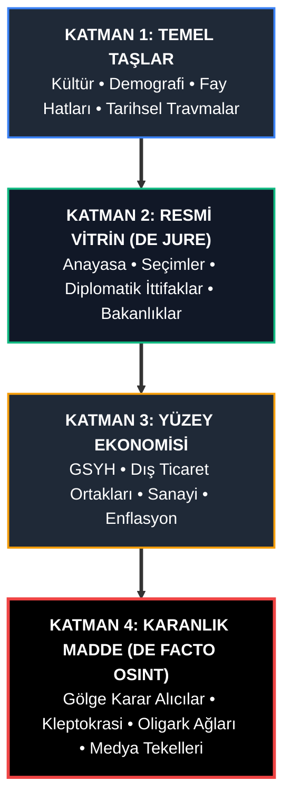
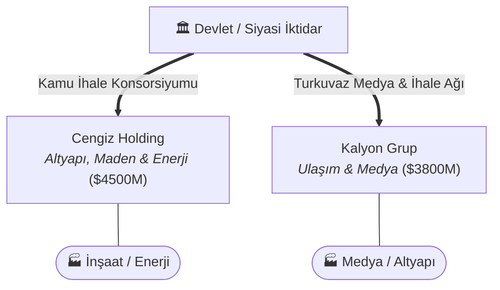

# 🌍 KÜRESEL RÖNTGEN (GLOBAL X-RAY)
### *Açık Kaynak İstihbarat (OSINT) & Derin Devlet / Oligarşi Haritalandırma Atlası*

<p align="center">
  
  
  
  
  
</p>

---

> *"Görünen hükümetin arkasında, halka karşı hiçbir bağlılığı olmayan ve hiçbir sorumluluk kabul etmeyen görünmez bir hükümet taht kurmuştur. Bu görünmez hükümeti yok etmek, yozlaşmış iş dünyası ile yozlaşmış siyaset arasındaki kirli ittifakı bozmak, günümüzün ilk görevidir."*  
> — **Theodore Roosevelt** (ABD 26. Başkanı)

> *"Bir ulusun karakterini anlamak istiyorsanız halk türkülerine kulak verin; ancak o ulusun asıl sahibini bulmak istiyorsanız, devlet ihalelerinin ve vergi muafiyetlerinin kimlere verildiğine bakın."*

> *"Siyaset, kimin neyi, ne zaman ve nasıl aldığıdır."*  
> — **Harold Lasswell**

---

## 📌 PROJE MANİFESTOSU VE VİZYON

**Küresel Röntgen**, dünya üzerindeki 192 egemen ülkenin ve kritik jeopolitik bölgelerin kültürel genetiğinden gölge ekonomisine, resmi anayasasından derin sermaye tekellerine kadar her hücresini haritalandırmak için kurulmuş, **bağımsız, kitle kaynaklı ve açık kaynak istihbarat (OSINT)** veri ambarıdır.

Wikipedia size bir ülkenin anayasasını, CIA World Factbook makroekonomik istatistiklerini, turizm portalları ise folklorik ögelerini sunar. **Küresel Röntgen** ise tüm bunları tek bir koordinat sisteminde birleştirir ve üzerine uluslararası ilişkilerin eksik olan en hayati parçasını ekler: **Gerçek Güç Ağı (The De Facto Power Architecture).** 

Bu repo; devletlerin resmi sınır çizgileri veya parlamento koltuklarıyla yetinmez. Bir cerrah titizliğiyle bürokratik perdenin arkasına geçer ve şu 4 kritik sorunun cevabını belgeler:
1. **Bu ülkeyi resmiyette kim yönetiyor, masanın arkasında kararları kim alıyor?**
2. **Kamu kaynakları ve ulusal zenginlik hangi oligark holdingler ve offshore hesaplar üzerinden paylaşılıyor?**
3. **Medyayı, sansür mekanizmalarını ve kamuoyunu hangi çıkar grupları finanse ediyor?**
4. **Devlet, küresel arenada hangi süper gücün ekonomik, teknolojik veya askeri vesayeti altında?

---

## 🏛️ 4 KATMANLI DEVLET ANATOMİSİ (THE 4-LAYER ARCHITECTURE)

Projenin omurgası, yüzeyden merkeze doğru derinleşen 4 analitik katmandan oluşur. Bu katmanlama, yapay zeka ajanlarının, araştırmacı gazetecilerin ve veri analistlerinin bilgiyi modüler biçimde sorgulayabilmesini sağlar.



### 🔹 Katman 1: Temel Taşlar (Kültür, Coğrafya ve Demografi)
*Devlet mekanizmasının üzerinde yükseldiği fiziki, sosyolojik ve psikolojik zemin.*
* **Etnografya ve Demografik Piramit:** Nüfus yapısı, kentsel yığılmalar, azınlık oranları ve göç dinamikleri.
* **Kültürel DNA ve Kolektif Travmalar:** Ulusal kuruluş mitleri, savaş yenilgileri, sömürge geçmişi ve toplumsal fay hatları (laik-dindar, etnik ayrışmalar).
* **Jeostratejik Zemin:** Kritik boğazlar, boru hatları, tatlı su kaynakları ve çözülmemiş sınır ihtilafları.

### 🔹 Katman 2: Resmi Vitrin (The De Jure State)
*Dünyanın tanıdığı, BM kürsülerinde konuşan ve kanun kitaplarında yazan resmi aygıt.*
* **Siyasi İşletim Sistemi:** Başkanlık, parlamenter, hibrit veya askeri cunta yasal statüleri.
* **Vitrin Aktörleri:** Devlet başkanı, başbakan, kabine, yüksek yargı organları ve sistem içi muhalefet.
* **Resmi Dış Politika:** İmzalanan ikili güvenlik paktları, uluslararası üyelikler (NATO, ŞİÖ, AB vb.).

### 🔹 Katman 3: Yüzey Ekonomisi (The Official Economy)
*IMF, Dünya Bankası ve resmi istatistik enstitülerinin raporladığı makroekonomik çark.*
* **Makro Göstergeler:** Nominal ve SAGP GSYH, kişi başına düşen gelir, enflasyon, kamu borç stoku.
* **Tedarik ve Dış Ticaret Ağı:** Ülkenin ana ihracat kalemleri, stratejik hammadde bağımlılıkları ve en büyük ticaret ortakları.
* **Kritik Altyapı:** Elektrik şebekesi, rafineriler, liman kapasiteleri ve telekom altyapısı.

### 🔹 Katman 4: Karanlık Madde (OSINT & The De Facto Power)
*Reponun kalbi. Vitrinin arkasındaki gerçek güç ekseni.*
* **Gölge Karar Alıcılar & Kukla İpleri:** Resmi liderlerin arkasındaki aile meclisleri, derin güvenlik elitleri, istihbarat klikleri veya dini konsorsiyumlar.
* **Kleptokrasi Ağı & Oligarklar:** Kamu ihalelerinin düzenli olarak aktarıldığı imtiyazlı holdingler, offshore vergi cenneti transferleri ve stratejik tekeller.
* **Bilgi Otomasyonu & Algı Yönetimi:** Medya mülkiyetinin kime ait olduğu, gazetecilere yönelik idari/yargısal baskılar, casus yazılım (Pegasus vb.) gözetimleri.
* **Küresel Uydu & Vesayet Statüsü:** Ülkenin bağımsızlık derecesi; büyük güçlerin (ABD, Çin, Rusya) ülkedeki askeri üs, liman ve borç diplomasisi nüfuzu.

---

## 📂 STANDARTLAŞTIRILMIŞ DEPO DİZİN MİMARİSİ

Proje kapsamında **192 ülkenin tamamı**, aşağıdaki hiyerarşik klasör yapısına göre bağımsız dosya setleriyle inşa edilmiştir:

```text
📦 Global-X-Ray
 ┣ 📂 regions
 ┃ ┣ 📂 middle_east
 ┃ ┃ ┣ 📂 turkey
 ┃ ┃ ┃ ┣ 📜 README.md                     # Ülke Yönetici Özeti & Risk Skoru
 ┃ ┃ ┃ ┣ 📂 01_culture_demographics
 ┃ ┃ ┃ ┃ ┣ 📜 society_history.md          # Sosyolojik kırılmalar & fay hatları
 ┃ ┃ ┃ ┃ ┗ 📊 demographics.csv           # Nüfus & kentsel veriler (CSV)
 ┃ ┃ ┃ ┣ 📂 02_official_state
 ┃ ┃ ┃ ┃ ┗ 📜 constitution_gov.md        # Yasal hükümet sistemi & resmi liderler
 ┃ ┃ ┃ ┣ 📂 03_official_economy
 ┃ ┃ ┃ ┃ ┗ 📊 macroeconomics.json        # Makroekonomik göstergeler (JSON)
 ┃ ┃ ┃ ┗ 📂 04_shadow_power_osint
 ┃ ┃ ┃   ┣ 📜 real_power_dynamics.md      # Fiili güç odakları & kleptokrasi
 ┃ ┃ ┃   ┣ 📊 oligarch_network.csv        # Oligark-siyaset bağlantıları (CSV)
 ┃ ┃ ┃   ┗ 📜 media_censorship_matrix.md  # Medya tekelleri & sansür analizi
 ┃ ┃ ┗ 📂 iran, saudi_arabia, israel ...
 ┃ ┣ 📂 asia
 ┃ ┃ ┗ 📂 china, turkmenistan, india, japan, russia ...
 ┃ ┣ 📂 europe
 ┃ ┃ ┗ 📂 germany, united_kingdom, france, ukraine ...
 ┃ ┣ 📂 americas
 ┃ ┃ ┗ 📂 united_states, brazil, mexico ...
 ┃ ┣ 📂 africa
 ┃ ┃ ┗ 📂 egypt, nigeria, south_africa ...
 ┃ ┗ 📂 oceania
 ┃   ┗ 📂 australia, new_zealand ...
 ┣ 📂 global_datasets
 ┃ ┣ 📊 countries_registry.json           # 192 ülkenin indeks kataloğu
 ┃ ┣ 📊 global_shadow_economy.csv         # Küresel kayıt dışı ekonomi endeksi
 ┃ ┗ 📊 press_freedom_real_index.json     # Gerçek medya tekelleşme endeksi
 ┣ 📂 scripts
 ┃ ┣ 🐍 build_full_repository.py          # Tüm repo veri ambarını inşa eden motor
 ┃ ┣ 🐍 network_graph_gen.py              # Oligark ağlarını Mermaid grafiğine dönüştürücü
 ┃ ┗ 🐍 data_scraper.py                  # Açık API'lerden dinamik veri çekici
 ┣ 📂 methodology
 ┃ ┣ 📜 DATA_COLLECTION_GUIDE.md          # 4 Katmanlı veri toplama kılavuzu
 ┃ ┗ 📜 OSINT_VERIFICATION.md             # Admiralty Code B2+ doğrulama protokolü
 ┣ 📂 templates
 ┃ ┗ 📜 country_template.md               # Yeni ülke ekleme şablonu
 ┣ 📜 CONTRIBUTING.md                     # Katkı sağlama yönergeleri
 ┗ 📜 README.md
```

---

## 🔍 DOĞRULAMA VE İSTİHBARAT PROTOKOLÜ (ADMIRALTY STANDARDI)

Küresel Röntgen bir spekülasyon veya komplo teorisi platformu **değildir**. Tüm Katman 4 analizleri, NATO ve istihbarat servislerinin kullandığı **Admiralty Kodu** doğrulama sistemine tabidir:

| Güvenilirlik Kodu | Kaynak Niteliği | Kabul Edilen Referanslar |
| :---: | :--- | :--- |
| **A1** | **Tamamen Güvenilir & Teyitli** | Resmi mahkeme kararları, Sayıştay raporları, FinCEN kayıtları, ICIJ sızıntıları (Panama / Pandora Papers). |
| **B2** | **Genellikle Güvenilir & Muhtemelen Doğru** | OCCRP (Organized Crime and Corruption Reporting Project), Bellingcat, Transparency International, akademik hakemli araştırmalar. |
| **C3** | **Kısmen Güvenilir** | Bağımsız yerel araştırmacı gazetecilik portalları (ikincil kaynak teyidi zorunludur). |
| ❌ | **Kabul Edilmeyen** | Anonim sosyal medya iddiaları, teyitsiz bloglar, devlet propaganda bültenleri. |

---

## 🛠️ OTOMASYON VE GRAFİK ÜRETİMİ (TOOLING)

### 1. Oligark ve Siyaset Güç Ağı Grafiği Üretme
Herhangi bir ülkenin `oligarch_network.csv` dosyasını otomatik olarak Mermaid formatında bir güç şemasına dönüştürebilirsiniz:

```bash
python scripts/network_graph_gen.py "regions/middle_east/turkey/04_shadow_power_osint/oligarch_network.csv"
```

*Örnek Üretilen Çıktı:*


### 2. Canlı Veri Sorgulama (Data Scraper)
```bash
python scripts/data_scraper.py TUR
```

---

## 🗺️ YOL HARİTASI (ROADMAP)

- [x] **Faz 1:** 4 Katmanlı analitik çerçevenin ve metodoloji kılavuzlarının kurulması.
- [x] **Faz 2:** 192 egemen ülkenin klasör ve veri yapısının oluşturulması (1.536 dosya).
- [x] **Faz 3:** Temel küresel datasetlerin (`global_shadow_economy.csv`, `countries_registry.json`) yayına alınması.
- [ ] **Faz 4:** İnteraktif Web Atlası (Mapbox & D3.js tabanlı küresel oligarşi görselleştirme arayüzü).
- [ ] **Faz 5:** Otomatik yaptırım listesi (OFAC, AB, BM) API senkronizasyonu.
- [ ] **Faz 6:** Bağımsız OSINT araştırmacıları için merkezi teyit ve peer-review komitesi.

---

## ⚖️ YASAL UYARI VE ETİK DEKLARASYON

> *"Gerçeği aramak, hiçbir kanuna ve hiçbir devlete karşı suç olamaz."*

**Küresel Röntgen**, evrensel bilgi edinme hakkı ve kamu yararı ilkeleri gözetilerek, yalnızca kamuya açık açık kaynak istihbarat (OSINT) verilerinin derlenmesiyle oluşturulmuştur. Projenin hiçbir devletle, istihbarat teşkilatıyla veya siyasi partiyle organik bağı bulunmamaktadır. Amacımız; dünyayı illüzyonlardan arındırılmış, ham ve gerçek haliyle belgelemektir.

**Proje Lideri & Mimarı:** [@bahattinyunus](https://github.com/bahattinyunus)
