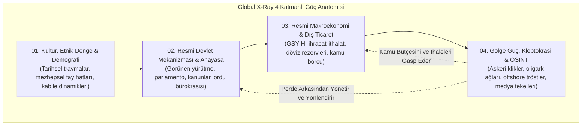
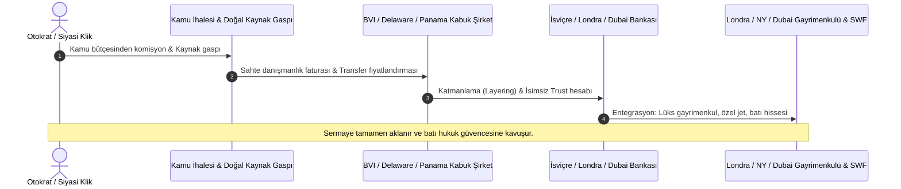

# 🌍 KÜRESEL RÖNTGEN (GLOBAL X-RAY)
### *Açık Kaynak İstihbarat (OSINT), Derin Devlet Ağları, Oligarşik Sermaye & Kleptokrasi Haritalandırma Atlası*

<p align="center">
  
</p>

<p align="center">
  
  
  
  
  
  
  
  
  
  
  
  
  
</p>

---

## 📑 İÇİNDEKİLER TABLOSU

1. [🏛️ Giriş ve İktidarın Felsefesi: Görünmeyen Hükümet](#️-giriş-ve-iktidarin-felsefesi-görünmeyen-hükümet)
2. [🌐 Küresel Röntgen Manifestosu ve Doktrini](#-küresel-röntgen-manifestosu-ve-doktrini)
3. [📊 Ekonomik Modellere Göre 8 Küresel Güç Bloğu (/01_... - /08_...)](#-ekonomik-modellere-göre-8-küresel-güç-bloğu-01----08_)
4. [🏛️ Metodoloji: 4 Katmanlı Derin Devlet Mimarisi](#️-metodoloji-4-katmanli-derin-devlet-mimarisi)
5. [🛡️ Doğrulama Standardı: NATO / Admiralty Kodu (B2+)](#️-doğrulama-standardi-nato--admiralty-kodu-b2)
6. [💸 Kleptokrasi & Offshore Sermaye Kaçırma Döngüsü](#-kleptokrasi--offshore-sermaye-kaçirma-döngüsü)
7. [🧠 Bilişsel Savaş & Siber İstihbarat Matrisi (5GW)](#-bilişsel-savaş--siber-istihbarat-matrisi-5gw)
8. [🚢 Küresel Deniz Darboğazları & Jeopolitik Kilit Noktaları](#-küresel-deniz-darboğazlari--jeopolitik-kilit-noktalari)
9. [🌐 Küresel Denizaltı Fiber Kablolar & SIGINT İstasyonları](#-küresel-denizalti-fiber-kablolar--sigint-istasyonlari)
10. [🛡️ Savunma Paktları, Askeri İttifaklar & Nükleer Şemsiye](#️-savunma-paktlari-askeri-ittifaklar--nükleer-şemsiye)
11. [⚠️ Finansal Yaptırım Rejimleri & Bypass Koridorları](#️-finansal-yaptirim-rejimleri--bypass-koridorlari)
12. [⛏️ Kritik Madenler & Küresel Rafinaj Tekelleri](#️-kritik-madenler--küresel-rafinaj-tekelleri)
13. [💰 Küresel Egemen Varlık Fonları (SWF) & Devlet Sermayesi](#-küresel-egemen-varlik-fonlari-swf--devlet-sermayesi)
14. [🚢 Küresel Gölge Tanker Filosu (Dark Fleet) & Yaptırım Kaçırma](#-küresel-gölge-tanker-filosu-dark-fleet--yaptirim-kaçirma)
15. [🗺️ Bölgesel Master Jeopolitik Güç Dosyaları (/regions)](#️-bölgesel-master-jeopolitik-güç-dosyalari-regions)
16. [📁 Derin Adli OSINT Vaka Analizleri (/dossiers)](#-derin-adli-osint-vaka-analizleri-dossiers)
17. [⚔️ Özel Askeri Şirketler (PMC) & Paramiliter Şebekeler](#️-özel-askeri-şirketler-pmc--paramiliter-şebekeler)
18. [🕵️ Küresel İstihbarat Teşkilatları & Güç Mimarisi](#️-küresel-istihbarat-teşkilatlari--güç-mimarisi)
19. [📚 Ansiklopedik Araştırma Dosyaları & Teori Külliyatı (/research)](#-ansiklopedik-araştirma-dosyalari--teori-külliyati-research)
20. [🗺️ 205 Ülkelik Küresel Atlas İndeksi (Ekonomik Modelleriyle)](#️-205-ülkelik-küresel-atlas-indeksi-ekonomik-modelleriyle)
21. [🔬 Metodoloji ve OSINT Araştırma Kılavuzları (/methodology)](#-metodoloji-ve-osint-araştirma-kilavuzlari-methodology)
22. [🛠️ CLI Terminal Aracı ile Kullanım (xray_cli.py)](#️-cli-terminal-araci-ile-kullanim-xray_clipy)
23. [🧪 Bütünlük ve Veri Doğrulama Testleri](#-bütünlük-ve-veri-doğrulama-testleri)
24. [⚖️ Etik, Hukuki Beyan ve Açık İstihbarat Lisansı](#️-etik-hukuki-beyan-ve-açik-istihbarat-lisansi)

---

## 🏛️ GİRİŞ VE İKTİDARIN FELSEFESİ: GÖRÜNMEYEN HÜKÜMET

> *"Görünen hükümetin arkasında, halka karşı hiçbir bağlılığı olmayan ve hiçbir sorumluluk kabul etmeyen görünmez bir hükümet taht kurmuştur. Bu görünmez hükümeti yok etmek, yozlaşmış iş dünyası ile yozlaşmış siyaset arasındaki kirli ittifakı bozmak, günümüzün ilk görevidir."*  
> — **Theodore Roosevelt** (ABD 26. Başkanı, 1912 İlerleme Partisi Platformu)

> *"Ticaret ve imalat dünyasında öyle bazı adamlar var ki, bir şeyden korkuyorlar. Biliyorlar ki bir yerlerde öyle organize, öyle sinsi, öyle uyanık, öyle kilitli ve öyle yaygın bir güç var ki, onu kınarken fısıltıyla bile konuşmamak en iyisi."*  
> — **Woodrow Wilson** (ABD 28. Başkanı, *The New Freedom*, 1913)

> *"Kitlelerin organize alışkanlıklarının ve kanaatlerinin bilinçli ve akıllıca manipülasyonu, demokratik bir toplumun önemli bir unsurudur. Toplumun bu görülmeyen mekanizmasını manipüle edenler, ülkemizin gerçek yönetici gücü olan görünmez bir hükümet teşkil ederler."*  
> — **Edward L. Bernays** (*Propaganda*, 1928)

> *"Washington'daki gerçek yöneticiler görünmezdir ve güçlerini perde arkasından kullanırlar."*  
> — **Felix Frankfurter** (ABD Yüksek Mahkeme Yargıcı, 1952)

> *"Egemen, olağanüstü hale karar verendir. Hukuk düzeni, anayasanın askıya alındığı gri alanda doğar ve korunur."*  
> — **Carl Schmitt** (*Siyasi İlahiyat*, 1922)

> *"Derin siyaset, resmi siyasal sistemin kurallarını çiğneyen, ulusal güvenlik devleti bürokrasisi, organize suç örgütleri ve uluslararası finans konsorsiyumlarının gizli ittifakından doğan örtülü iktidardır."*  
> — **Prof. Peter Dale Scott** (*The Road to 9/11: Wealth, Empire, and the Future of America*)

> *"İktidar seçkinleri; dev şirketlerin, askeri kliklerin ve federal yürütmenin zirvesindeki yöneticilerden oluşur. Bunlar sıradan insanların hayatını doğrudan belirleyen kararları kapalı kapılar ardında alır."*  
> — **C. Wright Mills** (*The Power Elite*, 1956)

> *"Eğer savaşlar yalanlarla başlatılabiliyorsa, barış gerçeklerle inşa edilebilir."*  
> — **Julian Assange** (WikiLeaks Kurucusu, 2011)

---

## 🌐 KÜRESEL RÖNTGEN MANİFESTOSU VE DOKTRİNİ

Geleneksel ansiklopediler, diplomatik bültenler ve ana akım medya; devletleri resmi anayasaları, meclis tutanakları, seçim bültenleri ve kamuya açıklanan makroekonomik göstergeleri üzerinden resmeder. Ancak tarihsel gerçeklik şudur: **Egemen devletlerin kaderini belirleyen gerçek güç odakları; resmi kabinelerden ziyade örtülü istihbarat paktlarında, hanedan varlık tröstlerinde, askeri-endüstriyel tedarik zincirlerinde ve offshore bankacılık ağlarında kümelenmiştir.**

**Küresel Röntgen (Global X-Ray)**; devletlerin anayasal maskelerini kaldırarak gerçek güç anatomilerini ortaya koyan, **205 egemen ve jeopolitik entiteyi** 4 derin katmanda adli bilişim ve OSINT disipliniyle haritalandıran **dünyanın en kapsamlı açık kaynak istihbarat atlasıdır**.

### 🔍 Doktrinin 3 Temel İlkesi:
1. **İllüzyonun Yıkımı (Constitutional Decoupling):** Resmi anayasa ile fiili iktidar mekanizması arasındaki uçurumu belgelemek; yürütmenin arkasındaki derin klikleri somut kanıtlarla görünür kılmak.
2. **Finansal İz Sürme (Follow the Forensic Ledger):** Kleptokratik sermaye kaçışını, paravan kabuk şirketleri (shell companies), vergi cennetlerini ve kayıt dışı para transferlerini şeffaflaştırmak.
3. **Bilişsel Bağımsızlık (Cognitive Sovereignty):** Devletlerin ve küresel tröstlerin kitleleri yönlendirmek için kurduğu algoritmik ve medyatik sansür mimarisini deşifre etmek.

---

## 📊 EKONOMİK MODELLERE GÖRE 8 KÜRESEL GÜÇ BLOĞU (/01_... - /08_...)

Klasik kıta ve coğrafi bölge tasnifleri, modern küresel sermaye birikim dinamiklerini açıklamada yetersiz kalmaktadır. Bu repoda dünyadaki 205 egemen ülke ve de-facto entite, **küresel işbölümündeki yapısal rolleri, hammadde bağımlılıkları ve sermaye transfer modellerine göre 8 temel ekonomik bloğa** ayrılmıştır:

| Blok Kodu & Arketip | Yapısal Ekonomik Rolü | Kapsam | Tahmini Blok GSYİH | Gölge Ekonomi | Kök Klasör Bağlantısı |
| :--- | :--- | :---: | :---: | :---: | :--- |
| 🏭 **01. İleri Sanayi ve G7** | Küresel rezerv para, patent tekelleri, ileri yarı iletken ve savunma sanayisi | 28 Ülke | ~$56.4T | %11.5 | [**01_ileri_sanayi_g7/**](01_ileri_sanayi_g7/README.md) |
| 🛢️ **02. Petro-Devletler ve Enerji** | Hidrokarbon rantı, OPEC+ kotası, egemen varlık fonları (SWF), boru hatları | 23 Ülke | ~$5.8T | %29.4 | [**02_petro_ve_enerji_devleri/**](02_petro_ve_enerji_devleri/README.md) |
| 🚀 **03. BRICS & Gelişen Devler** | Küresel imalat tabanı, tedarik zinciri omurgası, demografik işgücü gücü | 21 Ülke | ~$32.6T | %28.5 | [**03_gelismekte_olan_devler_ve_brics/**](03_gelismekte_olan_devler_ve_brics/README.md) |
| 🏦 **04. Offshore & Vergi Cennetleri** | Katı bankacılık gizliliği, sıfır vergi, shell company kabuk ağları, kara para aklama | 14 Ülke | ~$2.1T | %16.2 | [**04_offshore_ve_finansal_merkezler/**](04_offshore_ve_finansal_merkezler/README.md) |
| ⛏️ **05. Kritik Maden & Emtia** | Kobalt, lityum, bakır, altın ve nadir toprak elementleri; emtia süper kartelleri | 22 Ülke | ~$1.9T | %38.1 | [**05_kritik_maden_ve_hammadde/**](05_kritik_maden_ve_hammadde/README.md) |
| 🚜 **06. Orta Gelir & Üreticiler** | Tarım, tekstil, bölgesel sanayi ve tüketim pazarı; orta gelir tuzağı dinamikleri | 39 Ülke | ~$3.4T | %31.7 | [**06_orta_gelir_ve_ureticiler/**](06_orta_gelir_ve_ureticiler/README.md) |
| ⚠️ **07. Kırılgan & Yaptırım Altındakiler** | Borç krizi, hiperenflasyon, uluslararası yaptırımlar, vekil savaşları ve devlet zaafiyeti | 32 Ülke | ~$0.6T | %46.3 | [**07_kirilgan_ve_borc_krizindekiler/**](07_kirilgan_ve_borc_krizindekiler/README.md) |
| 🏝️ **08. Küçük Ada & Turizm** | Turizm gelirleri, devasa açık deniz MEB alanları, bayrak kiralama ve iklim riski | 26 Ülke | ~$0.2T | %26.9 | [**08_kucuk_ada_ve_turizm_ekonomileri/**](08_kucuk_ada_ve_turizm_ekonomileri/README.md) |

> 💡 *Ayrıca tüm grupların karşılaştırmalı analitik dökümü ve metodolojisi [`economies/README.md`](economies/README.md) dosyasında yer almaktadır.*

---

## 🏛️ METODOLOJİ: 4 KATMANLI DERİN DEVLET MİMARİSİ

<p align="center">
  
</p>

Repodaki istisnasız her ülke klasörü, birbirine bağlı ve disiplinlerarası **4 derin katmandan** meydana gelir:

### 🧩 Katmanların Analitik Ayrımı:
* **01. Kültür, Etnik Denge & Demografi (`01_culture_demographics/`):** Toplumun tarihsel travmaları, mezhepsel ve kabilevi fay hatları, göç dalgaları ve demografik kırılganlıklar (`society_history.md`, `demographics.csv`).
* **02. Resmi Devlet Mekanizması & Anayasa (`02_official_state/`):** Görünen yürütme, parlamenter veya başkanlık yapısı, anayasal kuvvetler ayrılığı illüzyonu, yargı teşkilatı ve resmi silahlı kuvvetler doktrini (`constitution_gov.md`).
* **03. Resmi Makroekonomi & Dış Ticaret (`03_official_economy/`):** Nominal ve SAGP GSYİH, cari denge, döviz rezervleri, dış borç stoku, bütçe açığı ve en büyük dış ticaret ortakları (`macroeconomics.json`).
* **04. Gölge Güç, Kleptokrasi & OSINT (`04_shadow_power_osint/`):** Gerçek güç odakları, askeri-istihbarat cuntaları, oligark konsorsiyumları, hanedan tröstleri, offshore sermaye kaçış kanalları, basın sansür filtreleri ve algoritmik kontrol mekanizmaları (`real_power_dynamics.md`, `oligarch_network.csv`, `media_censorship_matrix.md`).



---

## 🛡️ DOĞRULAMA STANDARDI: NATO / ADMİRALTY KODU (B2+)

Global X-Ray bünyesinde yer alan tüm istihbarat ve araştırma verileri, uluslararası askeri ve istihbarat doktrinlerinde kabul gören **Admiralty Kod (Stanag 2097)** metodolojisine göre çapraz kontrolden geçirilir. Projenin kabul eşiği **B2 (Genellikle Güvenilir / Muhtemelen Doğru)** düzeyidir:

| Kaynak Güvenilirliği (Harf) | Bilgi Doğruluğu (Rakam) | Global X-Ray Kabul Eşiği |
| :--- | :--- | :---: |
| **A - Tamamen Güvenilir:** Şüpheye yer bırakmayan resmi tutanaklar, adli iddianameler, sızdırılmış orijinal belgeler. | **1 - Teyit Edilmiş:** Bağımsız birden fazla doğrulanabilir kaynak ve çapraz log kayıtları ile kanıtlanmış. | ✅ **A1** (Mutlak Delil) |
| **B - Genellikle Güvenilir:** Uluslararası denetim raporları (FATF, ICIJ, OCCRP), akademik araştırmalar, saygın araştırma merkezleri. | **2 - Muhtemelen Doğru:** En az iki bağımsız açık kaynak ve lojistik/finansal veriyle teyit edilmiş. | ✅ **B2** (Minimum Standart) |
| **C - Oldukça Güvenilir:** Yerel gazetecilik araştırmaları, sektörel raporlar. | **3 - Mümkün:** Mantıksal çıkarımlarla uyumlu fakat doğrudan adli belgesi olmayan. | ⚠️ Ek Teyit Gerekir |
| **D - Genellikle Güvenilmez:** Taraflı siyasi beyanlar, anonim sosyal medya iddiaları. | **4 - Şüpheli:** Doğrulanamayan veya çelişkili iddialar. | ❌ Reddedilir |

---

## 💸 KLEPTOKRASİ & OFFSHORE SERMAYE KAÇIRMA DÖNGÜSÜ

<p align="center">
  
</p>

Küresel kleptokrasi; az gelişmiş ve gelişmekte olan ülkelerdeki kamu kaynaklarının, maden ve enerji imtiyazlarının siyasi elitler ve oligarklar tarafından gasp edilerek batı finans merkezlerine aktarılması döngüsüdür:

1. **Yerleştirme (Placement):** Kamu ihalelerinden alınan rüşvetler, gümrük kaçakçılığı ve enerji imtiyaz komisyonları paravan yerel şirketler üzerinden sisteme sokulur.
2. **Katmanlama (Layering):** British Virgin Islands (BVI), Cayman Adaları, Panama, Seyşeller ve Delaware'de kurulan iç içe geçmiş kabuk şirketler (shell companies) ve isimsiz trust fonları üzerinden para onlarca ülkeye transfer edilir (Ticaret Temelli Para Aklama - TBML, Sahte Faturalandırma, Mirror Trading).
3. **Bütünleştirme (Integration):** Aklanmış ve kaynağı gizlenmiş sermaye; Londra, New York, Cenevre ve Dubai'de lüks gayrimenkullere, mega yatlara, futbol kulüplerine ve batı borsalarındaki tahvillere dönüştürülerek meşrulaştırılır.



---

## 🧠 BİLİŞSEL SAVAŞ & SİBER İSTİHBARAT MATRİSİ (5GW)

<p align="center">
  
</p>

5. Nesil Harp (5GW), fiziksel sınırlardan ziyade insan zihnini, algoritmik akışları ve küresel dijital haberleşme altyapısını hedef alır:

* **Denizaltı Fiber Kabloları Dinleme İstasyonları:** Dünya internet trafiğinin %99'u okyanus tabanındaki fiber kablolardan akar. FVEY (Beş Göz Paktı) üyesi ülkeler (ABD, İngiltere, Kanada, Avustralya, Yeni Zelanda); Bude, Cornwall, Diego Garcia ve Hawaii dinleme istasyonları vasıtasıyla küresel veri trafiğini filtreler.
* **Sıfır-Tıklama Casus Yazılımlar (Zero-Click Spyware):** NSO Group (Pegasus) ve Intellexa (Predator) gibi askeri siber istihbarat araçları; hedefin hiçbir bağlantıya tıklamasına gerek kalmadan iOS/Android cihazlara sızarak kamera, mikrofon, şifreli mesajlar ve konum verilerini gerçek zamanlı dışarı aktarır.
* **Algoritmik Kitle Manipülasyonu:** Sosyal medya algoritmalarının duygusal polarizasyon motorları ve bot çiftlikleri, seçim sonuçlarını ve toplumsal infialleri manipüle etmek için organize psikolojik harekât (PSYOP) silahı olarak kullanılır.

---

## 🚢 KÜRESEL DENİZ DARBOĞAZLARI & JEOPOLİTİK KİLİT NOKTALARI

<p align="center">
  
</p>

Dünya ticaretinin ve deniz yoluyla taşınan petrolün %60'ından fazlası daracık birkaç su yolundan geçmek zorundadır (`global_datasets/chokepoints_registry.json`):

| Boğaz / Kanal | Tip | Kıyıdaş Devletler | Günlük Petrol Transiti | Jeopolitik Risk Seviyesi |
| :--- | :--- | :--- | :--- | :--- |
| **Hürmüz Boğazı** (Strait of Hormuz) | Doğal Deniz Boğazı | İran, Umman | 21,000,000 v/g (%21.0) | Aşırı Yüksek (Critical) |
| **Malakka Boğazı** (Strait of Malacca) | Doğal Deniz Boğazı | Endonezya, Malezya, Singapur | 16,000,000 v/g (%16.0) | Yüksek (High) |
| **Süveyş Kanalı** (Suez Canal) | Yapay Su Yolu | Mısır | 5,500,000 v/g (%9.0) | Yüksek (High) |
| **Babülmendep Boğazı** (Bab el-Mandeb Strait) | Doğal Deniz Boğazı | Yemen, Cibuti, Eritre | 4,800,000 v/g (%8.0) | Kritik Savaş Alanı (Hostile) |
| **Panama Kanalı** (Panama Canal) | Yapay Su Yolu (Kademeli Havuz Sistemi) | Panama | 1,000,000 v/g (%3.0) | Orta / Ekolojik Risk (Moderate) |
| **İstanbul ve Çanakkale Boğazları** (Turkish Straits (Bosporus & Dardanelles)) | Doğal Deniz Boğazları (Montrö Rejimi) | Türkiye | 3,000,000 v/g (%3.5) | Stratejik & Hukuki Kilit (Strategic) |

---

## 🌐 KÜRESEL DENİZALTI FİBER KABLOLAR & SIGINT İSTASYONLARI

Dünya internet trafiğinin ve SWIFT bankacılık mesajlarının aktığı denizaltı omurgaları ve dinleme merkezleri (`global_datasets/subsea_cables_and_sigint_stations.json`):

### 🌊 Kritik Denizaltı Kablo Koridorları
| Koridor Adı | Bağlantı Alanı | Örnek Hatlar | Zaafiyet & Sabotaj Riski | Risk |
| :--- | :--- | :--- | :--- | :---: |
| **Mısır Kara Köprüsü & Kızıldeniz Koridoru** | Avrupa - Ortadoğu - Güney Asya - Uzak Doğu | AAE-1, SEA-ME-WE 3, 4, 5, Europe India Gateway (EIG) | Tek Noktadan Arıza Riski (Single Point of Failure): Mısır Telekom teke... | `Kritik / Azami` |
| **Kuzey Atlantik Koridoru (Bude / Cornwall - New York / Virginia)** | Kuzey Amerika - Batı Avrupa | Apollo, Grace Hopper, Amitié | Soğuk Savaş dönemi 'Operation Ivy Bells' benzeri gizli su altı dinleme... | `Yüksek` |
| **Malakka Boğazı & Singapur Dijital Hub'ı** | Güneydoğu Asya - Doğu Asya - Hint Okyanusu | Asia-America Gateway (AAG), APCN-2, SeaMeWe-5 | Dünyanın en yoğun gemi trafiği; sığ sularda atılan gemi demirlerinin k... | `Yüksek` |
| **Luzon Boğazı (Tayvan - Filipinler)** | Tayvan - Hong Kong - Filipinler - ABD | Trans-Pacific Express (TPE), EAC-C2C, SJC | Yüksek sismik aktivite (depremler ve denizaltı heyelanları) ve Çin Hal... | `Kritik / Çatışma Alanı` |

### 📡 Küresel Sinyal İstihbaratı (SIGINT) Dinleme Merkezleri
| İstasyon Adı | Ev Sahibi Ülke | İşleten Teşkilat / İttifak | Lokasyon |
| :--- | :--- | :--- | :--- |
| **GCHQ Bude (Cleave Camp)** | United Kingdom | Government Communications Headquarters (GCHQ) / NSA Ortaklığı | Cornwall, İngiltere |
| **Pine Gap (Joint Defence Facility Pine Gap)** | Australia | Avustralya ASD / ABD CIA & NSA | Alice Springs, Avustralya |
| **RAF Menwith Hill** | United Kingdom | ABD Ulusal Güvenlik Ajansı (NSA) / RAF | Harrogate, Kuzey Yorkshire, İngiltere |
| **NSA Fort Meade (National Cryptologic Center)** | United States | National Security Agency (NSA) / US Cyber Command | Maryland, ABD |
| **Diego Garcia Naval Support Facility** | British Indian Ocean Territory (BIOT) | ABD Donanması / Birleşik Krallık Savunma Bakanlığı | Chagos Takımadaları, Hint Okyanusu |

---

## 🛡️ SAVUNMA PAKTLARI, ASKERİ İTTİFAKLAR & NÜKLEER ŞEMSİYE

Küresel güvenlik mimarisini belirleyen çok taraflı ve ikili savunma paktları (`global_datasets/defense_alliances_and_treaties.json`):

| Pakt Kodu | İttifak Tam Adı | Kuruluş | Kapsam | Temel Tetikleyici Karşılıklı Yardım Maddesi | Askeri Bütçe |
| :--- | :--- | :---: | :---: | :--- | :---: |
| **NATO** | Kuzey Atlantik Antlaşması Örgütü (NATO) | `1949` | 32 Üye | Madde 5 (Bir üyeye yapılan silahlı saldırı, tüm üyelere yapılmış sayılır) | $1,340B |
| **AUKUS** | AUKUS Üçlü Güvenlik Paktı | `2021` | 3 Üye | Pillar 1 (Avustralya'ya nükleer tahrikli denizaltı transferi) & Pillar 2 (Kuantum, hipersonik ve yapay zeka ortak geliştirme) | $995B |
| **CSTO** | Kolektif Güvenlik Antlaşması Örgütü (KGAÖ / CSTO) | `1992` | 6 Üye | Madde 4 (Üye bir devlete karşı saldırganlık, antlaşmanın tüm taraflarına karşı saldırı olarak kabul edilir) | $115B |
| **QUAD** | Dörtlü Güvenlik Diyaloğu (QUAD) | `2007` | 4 Üye | Deniz alanı farkındalığı (IPMDA), tedarik zinciri güvenliği, açık ve serbest Hint-Pasifik doktrini | $1,050B |
| **SCO** | Şanghay İşbirliği Örgütü (ŞİÖ / SCO) | `2001` | 10 Üye | RATS (Bölgesel Terörle Mücadele Yapısı) - Ayrılıkçılık, aşırıcılık ve terörizme karşı ortak istihbarat ve güvenlik işbirliği | $420B |
| **FIVE_EYES** | Beş Göz İstihbarat Paktı (FVEY) | `1946` | 5 Üye | Otomatik küresel SIGINT ve HUMINT paylaşımı; üyelerin birbirine karşı casusluk yapmama taahhüdü | $980B |
| **US_BILATERAL_PACIFIC** | ABD-Japonya / ABD-Güney Kore Karşılıklı Güvenlik Paktları | `1951` | 3 Üye | Japonya Madde 5 ve ROK Madde 3: Topraklara yapılan saldırılara karşı ABD'nin doğrudan askeri müdahale zorunluluğu | $960B |
| **TIAR_RIO** | Amerikalararası Karşılıklı Yardım Antlaşması (Rio Paktı) | `1947` | 18 Üye | Madde 3 (Bir Amerikan devletine yapılacak saldırı, tüm Amerikan devletlerine yapılmış kabul edilir) | $890B |

---

## ⚠️ FİNANSAL YAPTIRIM REJİMLERİ & BYPASS KORİDORLARI

Küresel rezerv para (USD) bağımlılığının silah olarak kullanılması ve hedef ülkelerin karşı tedbirleri (`global_datasets/sanctions_and_embargoes_registry.json`):

| Hedef Ülke | Yaptırım Rejiminin Kapsamı | Uygulayan Güçler | Dondurulan Rezerv | Birincil Bypass & Kaçınma Koridoru |
| :--- | :--- | :--- | :---: | :--- |
| **Russia** (`RUS`) | Kapsamlı Finansal, Enerji ve İleri Teknoloji Ambargosu (2014-2026) | USA (OFAC), EU, GBR, JPN, CAN, AUS, CHE | $300.0B | Gölge Tanker Filosu (Shadow Fleet): Bayraksız veya Liberya/Kamerun/Gabon bayraklı 600+ tankerle gizli taşıma |
| **Iran** (`IRN`) | Kapsamlı Nükleer ve İkincil Finansal Ambargo (1979-2026) | USA (OFAC), EU, UN (tarihsel kararlar) | $100.0B | Çaydanlık Rafinerileri (Teapot Refineries): Çin'in Shandong eyaletindeki bağımsız rafinerilere Malezya/Umman menşei gösterilerek yapılan petrol sevkiyatı |
| **North Korea** (`PRK`) | Tam Kapsamlı BM Güvenlik Konseyi ve ABD Ambargosu | UN_SC (Kararlar 1718, 2270, 2397), USA, EU, JPN, KOR | $5.0B | Sarı Deniz ve Doğu Çin Denizi'nde STS (Ship-to-Ship) petrol transferleri |
| **Venezuela** (`VEN`) | Kamu Finansmanı ve Petrol Şirketi (PDVSA) Ambargosu | USA (OFAC), EU, CAN | $24.0B | Aracı tüccarlar (Alex Saab şebekesi) üzerinden gıda karşılığı ham petrol takası |
| **Syria** (`SYR`) | Sezar Suriye Sivil Koruma Yasası (Caesar Act) & Kapsamlı Abluka | USA (Caesar Act 2020), EU | $10.0B | Kaptagon (Fenethyllin) Narko-Ekonomisi: Rejim generalleri (4. Zırhlı Tümen - Mahir Esad) kontrolünde üretilen ve Körfez'e kaçırılan yıllık $5-10B hacimli sentetik uyuşturucu trafiği |

---

## ⛏️ KRİTİK MADENLER & KÜRESEL RAFİNAJ TEKELLERİ

Enerji dönüşümünün, yapay zeka çiplerinin ve savunma sanayisinin hammadde boğazları (`global_datasets/critical_raw_materials_supply_chain.json`):

| Maden / Element | Stratejik Kullanım Kategorisi | En Büyük Maden Üreticileri | Küresel Rafinaj Tekeli | Jeopolitik Risk |
| :--- | :--- | :--- | :--- | :---: |
| **Nadir Toprak Elementleri (Neodimyum, Disprozyum, Terbiyum)** (`REE`) | Kritik Yüksek Teknoloji & Savunma | China (%70.0), United States (%14.0) | **China (%89.0)** | 9.5/10 |
| **Lityum (Beyaz Petrol)** (`LITHIUM`) | Batarya & Enerji Depolama | Australia (%47.0), Chile (%30.0) | **China (%65.0)** | 8.8/10 |
| **Kobalt** (`COBALT`) | Enerji Yoğun Bataryalar & Süper Alaşımlar | DR Congo (%74.0), Indonesia (%5.0) | **China (%77.0)** | 9.2/10 |
| **Galyum ve Germanyum** (`GALLIUM_GERMANIUM`) | Yarı İletken, Optoelektronik ve Radar | China (%98.0), Russia (%1.0) | **China (%98.0)** | 9.8/10 |
| **Doğal ve Sentetik Grafit** (`GRAPHITE`) | Batarya Anotları & Nükleer Reaktörler | China (%77.0), Madagascar (%9.0) | **China (%92.0)** | 9.0/10 |
| **Titanyum Sünger ve Havacılık Alaşımları** (`TITANIUM`) | Havacılık, Uzay ve Denizaltı Gövdeleri | China (%52.0), Japan (%18.0) | **Russia (VSMPO-AVISMA) & China (%65.0)** | 8.5/10 |
| **Uranyum (Sarı Pasta - U3O8)** (`URANIUM`) | Nükleer Enerji & Nükleer Başlıklar | Kazakhstan (%43.0), Canada (%15.0) | **Russia (Rosatom - Tenex) (%44.0)** | 9.4/10 |

---

## 💰 KÜRESEL EGEMEN VARLIK FONLARI (SWF) & DEVLET SERMAYESİ

Küresel petrodolar fazlaları, dış ticaret artıları ve stratejik kamu işletmelerinin konsolide edildiği $12+ Trilyonluk egemen sermaye havuzları (`global_datasets/sovereign_wealth_funds_registry.json`):

| Fon Adı | Ülke | Yönetilen Varlık (AUM) | Finansman Kaynağı | Jeopolitik Kaldıraç |
| :--- | :--- | :---: | :--- | :--- |
| **Norveç Hükümeti Emeklilik Fonu Global (Oljefondet)** (`GPFG_NOR`) | Norway | $1,650.0B | Kuzey Denizi petrol ve doğal gaz üretim gelir... | Küresel kurumsal yönetim standartlarını belirleme gücü, insan hak... |
| **Çin Yatırım Şirketi (China Investment Corporation - CIC)** (`CIC_CHN`) | China | $1,350.0B | Çin Halk Bankası (PBOC) devasa döviz rezervi ... | Kuşak ve Yol Girişimi (BRI) altyapı finansmanı ve Batı'nın strate... |
| **Abu Dabi Yatırım Otoritesi (ADIA)** (`ADIA_UAE`) | United Arab Emirates | $1,000.0B | Abu Dabi Emirliği ham petrol ihracat fazlalar... | Körfez hanedan servetinin Batı hukuk sistemine entegrasyonu ve Wa... |
| **Suudi Arabistan Kamu Yatırım Fonu (Public Investment Fund - PIF)** (`PIF_SAU`) | Saudi Arabia | $930.0B | Saudi Aramco temettüleri ve devlet tahvil ihr... | Vizyon 2030 dönüşümünün motoru, küresel 'Sportswashing' (spor yol... |
| **Kuveyt Yatırım Otoritesi (Kuwait Investment Authority - KIA)** (`KIA_KWT`) | Kuwait | $900.0B | Gelecek Nesiller Fonu (FGF) petrol gelirleri ... | Kuveyt'in Irak işgali sonrası sürgündeki hükümetini finanse eden ... |
| **GIC Private Limited (Singapur Hükümet Yatırım Şirketi)** (`GIC_SGP`) | Singapore | $800.0B | Singapur Merkez Bankası (MAS) resmi döviz rez... | Güneydoğu Asya'nın finansal egemenliğini ve Singapur Doları'nın i... |
| **Katar Yatırım Otoritesi (Qatar Investment Authority - QIA)** (`QIA_QAT`) | Qatar | $510.0B | Kuzey Sahası (North Field) LNG sıvılaştırılmı... | Küçük körfez emirligini küresel aktöre dönüştüren yumuşak güç; İn... |
| **Temasek Holdings** (`TEMASEK_SGP`) | Singapore | $290.0B | Singapur devletine ait kamu iktisadi teşebbüs... | Güneydoğu Asya'nın yüksek teknoloji ve havacılık merkezi olarak k... |
| **Rusya Ulusal Refah Fonu (National Wealth Fund - NWF)** (`NWF_RUS`) | Russia | $150.0B | Urals petrolü taban fiyatı üzerindeki bütçe k... | Yaptırımlar ve savaş bütçesi açıklarını kapatan acil durum likidi... |
| **Türkiye Varlık Fonu (Turkey Wealth Fund - TWF)** (`TWF_TUR`) | Turkey | $50.0B | Stratejik kamu şirketlerinin (BOTAŞ, TPAO, Zi... | Kamu bankalarının sermayelendirilmesi, savunma ve telekomünikasyo... |

---

## 🚢 KÜRESEL GÖLGE TANKER FİLOSU (DARK FLEET) & YAPTIRIM KAÇIRMA

G7 tavan fiyatını ve denizcilik sigorta yasaklarını aşarak Rusya, İran ve Venezuela petrolünü taşıyan ~850 hayalet tankerin mimarisi (`global_datasets/shadow_fleet_maritime_registry.json`):

### 🚩 Öne Çıkan Kolaylık Bayrakları (Flags of Convenience)
| Bayrak Devleti | Tescilli Gölge Gemi Sayısı | Risk Profili & Zaafiyet Analizi |
| :--- | :---: | :--- |
| **Gabon** (`GAB`) | 140 Gemi | Çok Yüksek; Batı yaptırımlarından kaçan eski Sovyet ve Yunan tankerlerinin toplu... |
| **Cameroon** (`CMR`) | 65 Gemi | Aşırı Yüksek; Paris MoU kara listesinde en alt sırada; sigortasız ve teknik kusu... |
| **Palau** (`PLW`) | 90 Gemi | Yüksek; Pasifik ada devleti sicili; İran ve Rus petrol sevkiyatlarında transpond... |
| **Cook Islands** (`COK`) | 110 Gemi | Yüksek; deniz kazalarında sorumluluk kabul etmeyen bayrak yapısı.... |
| **Panama & Liberia (Historical Flags)** (`PAN_LBR`) | 180 Gemi | Orta-Yüksek; ABD Hazine Bakanlığı (OFAC) baskısı sonucu bayrak iptalleri artsa d... |

### ⚓ Deniz Üstü Gemiden Gemiye (STS) Petrol Aktarma Merkezleri
| Aktarma Sahası (STS Zone) | Coğrafi Lokasyon | Operasyonel Taktik & Kamuflaj |
| :--- | :--- | :--- |
| **Lakonya Körfezi (Laconian Gulf)** | Yunanistan Karasuları Dışı / Mora Yarımadası Açıkları | Rusya'nın Baltık limanlarından gelen Aframax/Suezmax tankerleri, yüklerini uluslararası sularda dev VLCC süper tankerlerine aktarır (STS); petrol menşei kamufle edilir. |
| **Ceuta & Alboran Denizi** | Fas Açıkları / Cebelitarık Girişi | Kuzey limanlarından gelen buz sınıfı tankerler, kış aylarında Cebelitarık boğazı girişinde yüklerini bekleyen gölge tankerlere devreder. |
| **Fujairah Açıkları & Hürmüz Dışı** | Birleşik Arap Emirlikleri / Umman Denizi | İran ve Rus ham petrolünün kimyasal olarak harmanlanarak 'Irak', 'Malezya' veya 'BAE harmanı' adıyla yeniden sertifikalandırıldığı küresel merkez. |
| **Pulau Linggi & Malakka Boğazı** | Malezya Açıkları | Çin'e giden İran petrolünün 'Malezya menşeli' olarak beyan edildiği devasa deniz üstü transfer bölgesi; Malezya'nın Çin'e petrol ihracatı kendi toplam üretiminin iki katına çıkmıştır. |

---

## 🗺️ BÖLGESEL MASTER JEOPOLİTİK GÜÇ DOSYALARI (/regions)

Kıtalar bazında güç mimarisi, askeri ittifaklar ve derin çatışma hatları:

| Bölge | Jeostratejik Kapsam & Çatışma Fay Hatları | Dosya Bağlantısı |
| :--- | :--- | :--- |
| 🕌 **Ortadoğu** | Hürmüz ve Babülmendep hakimiyeti, Direniş Ekseni, İbrahim Paktı, Körfez Hanedan Tröstleri ve Şii-Sünni vekalet savaşları | [**regions/middle_east/README.md**](regions/middle_east/README.md) |
| 🏰 **Avrupa** | NATO Kuzey Kanadı, Suwalki Boşluğu, Rusya enerji ayrışması, City of London & Lüksemburg offshore sermaye kanalları | [**regions/europe/README.md**](regions/europe/README.md) |
| ⛩️ **Asya & Hint-Pasifik** | ABD-Çin süper güç rekabeti, Birinci Ada Zinciri, Tayvan yarı iletken tekeli, Malakka ikilemi ve Güney Çin Denizi yapay adaları | [**regions/asia/README.md**](regions/asia/README.md) |
| 🌎 **Amerika Kıtası** | Monroe Doktrini, Narko-Kartel kartografyası (CJNG/Sinaloa), Lityum Üçgeni, Panama Kanalı kontrolü ve ABD yaptırım rejimleri | [**regions/americas/README.md**](regions/americas/README.md) |
| 🌍 **Afrika** | Yeni Afrika Paylaşım Savaşı, Françafrique çöküşü, Sahel Darbeler Kuşağı, Wagner / Afrika Kolordusu ve kritik maden imtiyazları | [**regions/africa/README.md**](regions/africa/README.md) |
| 🏝️ **Okyanusya** | AUKUS Nükleer Paktı, Pasifik Ada Devletleri MEB Hakimiyeti, Çin Güvenlik Anlaşmaları ve denizaltı kablo rekabeti | [**regions/oceania/README.md**](regions/oceania/README.md) |

---

## 📁 DERİN ADLİ OSINT VAKA ANALİZLERİ (/dossiers)

Tarihin en büyük kleptokratik, yolsuzluk, derin devlet ve siber istihbarat operasyonlarının adli bilişim ve finansal akış analizleri:

| Vaka Dosyası | Konu | Temel Bulgular & Metodoloji |
| :--- | :--- | :--- |
| 💸 [**CASE_STUDY_1MDB.md**](dossiers/CASE_STUDY_1MDB.md) | 1MDB Egemen Varlık Fonu Soygunu | $4.5 Milyar kamu kaynağının Goldman Sachs tahvil ihraçları ve BVI paravan şirketleri üzerinden aklanması; Hollywood filmleri ve mega yat alımları. |
| ⚖️ [**CASE_STUDY_MAGNITSKY_AND_TROIKA_LAUNDROMAT.md**](dossiers/CASE_STUDY_MAGNITSKY_AND_TROIKA_LAUNDROMAT.md) | Magnitsky & Rus Çamaşırhanesi | Moldova mahkeme sahte ilamları ve Danske Bank Estonya şubesi üzerinden $20+ milyar oligark parasının Avrupa'ya kaçırılması. |
| 🏗️ [**CASE_STUDY_ODEBRECHT_LAVA_JATO.md**](dossiers/CASE_STUDY_ODEBRECHT_LAVA_JATO.md) | Odebrecht & Lava Jato Rüşvet Karteli | 12 Latin Amerika ülkesinde devlet başkanlarına ve bakanlara $788M rüşvet dağıtmak için kurulan resmi "Yapılandırılmış Operasyonlar Bölümü". |
| 📱 [**CASE_STUDY_PEGASUS_PROJECT.md**](dossiers/CASE_STUDY_PEGASUS_PROJECT.md) | Pegasus Sıfır-Tıklama Siber Casusluk | NSO Group casus yazılımının Cemal Kaşıkçı cinayeti, 14 devlet başkanı ve 189 gazeteciye karşı adli telemetri analizi. |
| 🗄️ [**CASE_STUDY_PANDORA_PAPERS_AND_OFFSHORE_SECRECY.md**](dossiers/CASE_STUDY_PANDORA_PAPERS_AND_OFFSHORE_SECRECY.md) | Pandora Belgeleri & ABD Vergi Cennetleri | 11.9 Milyon belgenin analizi; South Dakota trust yasaları, Ürdün Kralı, Tony Blair ve küresel liderlerin $32 Trilyonluk gizli servet mimarisi. |
| 💥 [**CASE_STUDY_NORD_STREAM_SABOTAGE_AND_ENERGY_WARFARE.md**](dossiers/CASE_STUDY_NORD_STREAM_SABOTAGE_AND_ENERGY_WARFARE.md) | Kuzey Akım Boru Hattı Sabotajı | 26 Eylül 2022 Bornholm patlamaları; 2.3 Richter sismik analizi, saturasyon dalışı zorlukları, BALTOPS tatbikatı ve Almanya'nın sanayisizleşmesi. |
| 🗡️ [**CASE_STUDY_OPERATION_GLADIO_AND_STAY_BEHIND_NETWORKS.md**](dossiers/CASE_STUDY_OPERATION_GLADIO_AND_STAY_BEHIND_NETWORKS.md) | Gladio & NATO Gizli Orduları | 1990 Andreotti itirafı; Gerginlik Stratejisi (Strategia della tensione), Bologna katliamı, P2 Mason Locası, Banco Ambrosiano ve Kontrgerilla. |
| 🏦 [**CASE_STUDY_BCCI_THE_BANK_OF_CROOKS_AND_CLINICS.md**](dossiers/CASE_STUDY_BCCI_THE_BANK_OF_CROOKS_AND_CLINICS.md) | BCCI: İstihbarat & Suç Bankası | 78 ülkede faaliyet gösteren $20B'lık bankanın çöküşü; CIA Afganistan/Kontra örtülü fonları, Noriega kokain aklaması ve A.Q. Khan nükleer ağı. |
| 💻 [**CASE_STUDY_STUXNET_OLYMPIC_GAMES_CYBER_SABOTAGE.md**](dossiers/CASE_STUDY_STUXNET_OLYMPIC_GAMES_CYBER_SABOTAGE.md) | Stuxnet: İlk Askeri Siber Silah | NSA ve Unit 8200'ün Natanz nükleer tesisine sabotajı; 4 sıfır-gün açığı, Siemens PLC manipülasyonu ve 1.000 gaz santrifüjünün rezonansla imhası. |
| 🧠 [**CASE_STUDY_CAMBRIDGE_ANALYTICA_AND_PSYCHOGRAPHIC_WARFARE.md**](dossiers/CASE_STUDY_CAMBRIDGE_ANALYTICA_AND_PSYCHOGRAPHIC_WARFARE.md) | Cambridge Analytica & Psikografik Harp | SCL Group, 87 milyon Facebook profili izinsiz hasadı, OCEAN psikometrik puanlaması, Brexit ve 2016 ABD Seçimleri mikro hedefli karanlık reklamları. |

---

## ⚔️ ÖZEL ASKERİ ŞİRKETLER (PMC) & PARAMİLİTER ŞEBEKELER

Devletlerin resmi ordu sorumluluğunu üstlenmeden vekil savaşlarında, maden sahaları korumasında ve örtülü operasyonlarda kullandığı askeri yükleniciler (`global_datasets/pmc_mercenary_groups.json`):

| Şirket / Şebeke | Menşei | Tahmini İnsan Gücü | Aktif Harekât Sahaları | Hukuki Statü |
| :--- | :--- | :---: | :--- | :--- |
| **Wagner Group / Afrika Kolordusu (Africa Corps)** | Rusya | 35,000 - 50,000 | Mali, Burkina Faso, Nijer, Orta Afrika Cumhuriyeti, Suriye, Libya | Savunma Bakanlığı (GRU) bağlı gayriresmi paramiliter güç |
| **Constellis (Eski Blackwater / Academi)** | Amerika Birleşik Devletleri | 16,000+ | Irak, Afganistan, Körfez Ülkeleri, Afrika | Kayıtlı ABD Savunma ve Güvenlik Yüklenicisi |
| **Frontier Services Group (FSG)** | Hong Kong / Çin (Kurucu: Erik Prince) | 3,000+ | Kuşak-Yol güzergahı, Demokratik Kongo Cumhuriyeti, Sudan, Pakistan | Hong Kong Borsası kotasyonlu lojistik ve güvenlik şirketi |
| **SADAT Uluslararası Savunma Danışmanlık** | Türkiye | 1,000+ (Yedek eğitim havuzu) | Suriye, Libya, Kafkaslar | Özel Savunma ve Stratejik Danışmanlık Şirketi |

---

## 🕵️ KÜRESEL İSTİHBARAT TEŞKİLATLARI & GÜÇ MİMARİSİ

Dünya jeopolitiğine yön veren istihbarat teşkilatlarının teşkilat yapısı, tahmini bütçeleri ve operasyonel uzmanlıkları (`global_datasets/intelligence_agencies_registry.json`):

| Ülke | Dış İstihbarat (HUMINT) | Sinyal İstihbaratı (SIGINT) | İç Güvenlik / Karşı İstihbarat | Tahmini Yıllık Bütçe | Operasyonel Sınıflandırma |
| :--- | :--- | :--- | :--- | :--- | :--- |
| **United States** | Central Intelligence Agency (CIA) | National Security Agency (NSA) | Federal Bureau of Investigation (FBI) | `85,000,000,000 (Combined Black Budget)` | Global Tier 1 SIGINT/HUMINT/Covert Action |
| **United Kingdom** | Secret Intelligence Service (SIS / MI6) | Government Communications Headquarters (GCHQ) | Security Service (MI5) | `4,200,000,000` | Global Tier 1 Five-Eyes Core |
| **Russia** | Foreign Intelligence Service (SVR) | Federal Guard Service (FSO) / 16th Center FSB | Federal Security Service (FSB) | `12,000,000,000 (Opaque Security Allocation)` | Global Tier 1 Hybrid Warfare & HUMINT |
| **China** | Ministry of State Security (MSS - Guoanbu) | PLA Strategic Support Force / Cyberspace Force | Ministry of Public Security (MPS - Gonganbu) | `15,000,000,000 (Extrapolated)` | Global Tier 1 Cyber Espionage & Economic Intelligence |
| **Israel** | Institute for Intelligence and Special Operations (Mossad) | Unit 8200 (ISNU) | General Security Service (Shin Bet / Shabak) | `3,800,000,000` | Global Tier 1 Targeted Lethal Action & Cyber Capability |
| **France** | General Directorate for External Security (DGSE) | DGSE Technical Directorate (Boulevard Mortier) | General Directorate for Internal Security (DGSI) | `3,200,000,000` | European Sovereign Autonomous Intelligence Tier |
| **Germany** | Federal Intelligence Service (BND) | BND Department VI (Technical Intelligence / Bad Aibling) | Federal Office for the Protection of the Constitution (BfV) | `1,600,000,000` | Major European SIGINT & Technical Intelligence |
| **Turkey** | National Intelligence Organization (MİT) | MİT Electronic and Technical Intelligence Directorate (GES Command integration) | MİT Domestic Intelligence Directorate / EGM Security Branch | `1,400,000,000 (Excluding autonomous operational assets)` | Dominant Regional Armed Drone & Paramilitary Intelligence Actor |
| **Iran** | IRGC Quds Force Intelligence | Basij Cyber Command / IRGC Electronic Warfare Unit | Ministry of Intelligence and Security (VAJA / MOIS) | `2,800,000,000 (Combined Conventional & Revolutionary Guard allocations)` | Asymmetric Proxy Network & Regional Covert Power |
| **Saudi Arabia** | General Intelligence Presidency (GIP - Al-Mukhabarat al-A'amah) | State Security Cyber Warfare Center | Presidency of State Security (Mabahith) | `3,000,000,000` | Resource-Backed Authoritarian Intelligence & Covert Slush Fund Hub |

---

## 📚 ANSİKLOPEDİK ARAŞTIRMA DOSYALARI & TEORİ KÜLLİYATI (/research)

Projenin entelektüel ve metodolojik omurgasını oluşturan derin araştırma tezleri:

| Araştırma Dosyası | Tematik Alan | Kapsam & Temel Vurgular |
| :--- | :--- | :--- |
| 📑 [**THEORETICAL_FRAMEWORKS.md**](research/THEORETICAL_FRAMEWORKS.md) | Derin Devlet & Güç Seçkinleri Teorisi | C. Wright Mills, Peter Dale Scott, Carl Schmitt, Michael Glennon; NATO Gladio operasyonu ve Susurluk skandalı analizi. |
| 💰 [**SHADOW_BANKING_AND_OFFSHORE_FLOWS.md**](research/SHADOW_BANKING_AND_OFFSHORE_FLOWS.md) | Küresel Kleptokrasi & Vergi Cennetleri | City of London, Delaware, Panama/Pandora Papers ifşaatları, TBML (Ticaret Temelli Kara Para) ve Mirror Trading mekanizmaları. |
| 🧠 [**PROPAGANDA_AND_INFORMATION_WARFARE.md**](research/PROPAGANDA_AND_INFORMATION_WARFARE.md) | Bilişsel Savaş & Algoritmik Manipülasyon | Chomsky Propaganda Modeli, Operation Mockingbird, Rus Maskirovka doktrini, Pegasus/Predator mobil casusluk araçları. |
| 🚢 [**GEOPOLITICAL_CHOKEPOINTS_AND_CORRIDORS.md**](research/GEOPOLITICAL_CHOKEPOINTS_AND_CORRIDORS.md) | Jeopolitik Darboğazlar & Deniz Hakimiyeti | Hürmüz, Malakka, Süveyş; denizaltı fiber optik kabloları ve küresel SIGINT dinleme istasyonlarının haritası. |
| ⚔️ [**MILITARY_INDUSTRIAL_COMPLEX_AND_PMCS.md**](research/MILITARY_INDUSTRIAL_COMPLEX_AND_PMCS.md) | Askeri-Endüstriyel Kompleks & Paralı Askerler | Savunma ihaleleri Demir Üçgeni, Pentagon Döner Kapı mekanizması, yapay zeka güdümlü algoritmik harp ve dron doygunluğu. |
| 🕵️ [**INTELLIGENCE_AGENCIES_AND_BLACK_OPS.md**](research/INTELLIGENCE_AGENCIES_AND_BLACK_OPS.md) | İstihbarat Teşkilatları & Örtülü Operasyonlar | Operation Ajax (İran 1953), Condor Planı (Latin Amerika), Church Komitesi ifşaatları, Five Eyes (FVEY) küresel paktı. |
| ⛏️ [**RESOURCE_WARS_AND_COMMODITY_SUPER_CARTELS.md**](research/RESOURCE_WARS_AND_COMMODITY_SUPER_CARTELS.md) | Kritik Madenler & Emtia Kartelleri | Lityum üçgeni, Kongo Kobalt tekeli, Glencore/Trafigura/Vitol emtia tröstleri, Petrodolar sisteminden Petroyuan'a geçiş sancıları. |
| 🔓 [**WHISTLEBLOWERS_LEAKS_AND_FORENSIC_STANDARDS.md**](research/WHISTLEBLOWERS_LEAKS_AND_FORENSIC_STANDARDS.md) | İfşaatçılar, Kriptografi & Adli Standartlar | Pentagon Belgeleri'nden Vault 7'ye sızıntı analizi, metadata bilişimi ve NATO Admiralty Kod (B2+) doğrulama matrisi. |
| 💵 [**DE_DOLLARIZATION_AND_GEOECONOMIC_CURRENCY_WARS.md**](research/DE_DOLLARIZATION_AND_GEOECONOMIC_CURRENCY_WARS.md) | Dedolarizasyon & Bretton Woods III | Rezervlerin dondurulması ($300B CBR), Zoltan Pozsar Dış Para (Outside Money) tezi, mBridge multi-CBDC ağı ve Petroyuan. |
| 🤖 [**AI_SURVEILLANCE_ALGORITHMIC_WARFARE_AND_PALANTIR_NEXUS.md**](research/AI_SURVEILLANCE_ALGORITHMIC_WARFARE_AND_PALANTIR_NEXUS.md) | Algoritmik Harp & Palantir Ağı | Project Maven, Palantir Gotham/AIP, İsrail Unit 8200 Lavender ve Habsora hedef üretim sistemleri, Clearview AI ve biyometri. |
| 💊 [**NARCO_KLEPTOCRACY_CARTEL_STATE_CONVERGENCE_AND_DRY_CORRIDORS.md**](research/NARCO_KLEPTOCRACY_CARTEL_STATE_CONVERGENCE_AND_DRY_CORRIDORS.md) | Narko-Devlet & Kartel Yakınsaması | Fentanil sentetik devrimi, Suriye Kaptagon rejimi (Mahir Esad), Venezuela Güneşler Karteli ve Çin Yeraltı Bankacılığı (CUBS). |
| 🧬 [**BIOLOGICAL_WARFARE_GENOMICS_AND_DEEP_BIOSECURITY.md**](research/BIOLOGICAL_WARFARE_GENOMICS_AND_DEEP_BIOSECURITY.md) | Biyolojik Harp & Genomik İstihbarat | Dual-Use (DURC) ikilemi, BSL-4 laboratuvarları (Fort Detrick, Wuhan, Vector), CRISPR patojen sentezi, BGI Group ve GENINT. |

---

## 🗺️ 205 ÜLKELİK KÜRESEL ATLAS İNDEKSİ (EKONOMİK MODELLERİYLE)

Aşağıdaki tabloda projedeki tüm bağımsız ülkeler listelenmiştir. Her bağlantı doğrudan kök dizindeki ilgili **ekonomik blok klasörü** altındaki detaylı istihbarat profiline yönlendirir:

| Ülke | Ekonomik Model | ISO | Başkent | Rapor Bağlantısı | GSYİH (USD) | Kayıt Dışı (%) |
| :--- | :--- | :---: | :--- | :--- | :---: | :---: |
| **Afganistan** | ⚠️ Kırılgan / Yaptırım | `AFG` | Kabil | [Afganistan Dosyası](07_kirilgan_ve_borc_krizindekiler/afghanistan/README.md) | $14.5B | %50.0 |
| **Almanya** | 🏭 İleri Sanayi / G7 | `DEU` | Berlin | [Almanya Dosyası](01_ileri_sanayi_g7/germany/README.md) | $4,456.0B | %9.8 |
| **Amerika Birleşik Devletleri** | 🏭 İleri Sanayi / G7 | `USA` | Washington, D.C. | [Amerika Birleşik Devletleri Dosyası](01_ileri_sanayi_g7/united_states/README.md) | $27,360.0B | %8.5 |
| **Andorra** | 🏦 Offshore / Sığınak | `AND` | Andorra la Vella | [Andorra Dosyası](04_offshore_ve_finansal_merkezler/andorra/README.md) | $3.7B | %11.5 |
| **Angola** | 🛢️ Petro-Devlet | `AGO` | Luanda | [Angola Dosyası](02_petro_ve_enerji_devleri/angola/README.md) | $93.8B | %38.0 |
| **Antigua ve Barbuda** | 🏝️ Ada & Turizm | `ATG` | Saint John's | [Antigua ve Barbuda Dosyası](08_kucuk_ada_ve_turizm_ekonomileri/antigua_and_barbuda/README.md) | $1.8B | %15.0 |
| **Arjantin** | 🚀 BRICS & İmalat | `ARG` | Buenos Aires | [Arjantin Dosyası](03_gelismekte_olan_devler_ve_brics/argentina/README.md) | $640.0B | %27.2 |
| **Arnavutluk** | 🚜 Orta Gelir / Bölgesel | `ALB` | Tiran | [Arnavutluk Dosyası](06_orta_gelir_ve_ureticiler/albania/README.md) | $23.0B | %31.0 |
| **Avustralya** | 🏭 İleri Sanayi / G7 | `AUS` | Canberra | [Avustralya Dosyası](01_ileri_sanayi_g7/australia/README.md) | $1,724.0B | %9.2 |
| **Avusturya** | 🏭 İleri Sanayi / G7 | `AUT` | Viyana | [Avusturya Dosyası](01_ileri_sanayi_g7/austria/README.md) | $516.0B | %8.5 |
| **Azerbaycan** | 🛢️ Petro-Devlet | `AZE` | Bakü | [Azerbaycan Dosyası](02_petro_ve_enerji_devleri/azerbaijan/README.md) | $78.7B | %38.0 |
| **Bahamalar** | 🏦 Offshore / Sığınak | `BHS` | Nassau | [Bahamalar Dosyası](04_offshore_ve_finansal_merkezler/bahamas/README.md) | $14.0B | %12.0 |
| **Bahreyn** | 🛢️ Petro-Devlet | `BHR` | Manama | [Bahreyn Dosyası](02_petro_ve_enerji_devleri/bahrain/README.md) | $44.0B | %19.0 |
| **Bangladeş** | 🚀 BRICS & İmalat | `BGD` | Dakka | [Bangladeş Dosyası](03_gelismekte_olan_devler_ve_brics/bangladesh/README.md) | $460.0B | %32.0 |
| **Barbados** | 🏝️ Ada & Turizm | `BRB` | Bridgetown | [Barbados Dosyası](08_kucuk_ada_ve_turizm_ekonomileri/barbados/README.md) | $6.2B | %14.0 |
| **Batı Sahra** | 🚜 Orta Gelir / Bölgesel | `ESH` | El Aaiun (Tifariti) | [Batı Sahra Dosyası](06_orta_gelir_ve_ureticiler/western_sahara/README.md) | $0.9B | %45.0 |
| **Belarus** | 🚜 Orta Gelir / Bölgesel | `BLR` | Minsk | [Belarus Dosyası](06_orta_gelir_ve_ureticiler/belarus/README.md) | $72.0B | %31.0 |
| **Belize** | 🏝️ Ada & Turizm | `BLZ` | Belmopan | [Belize Dosyası](08_kucuk_ada_ve_turizm_ekonomileri/belize/README.md) | $3.2B | %25.0 |
| **Belçika** | 🏭 İleri Sanayi / G7 | `BEL` | Brüksel | [Belçika Dosyası](01_ileri_sanayi_g7/belgium/README.md) | $632.0B | %12.0 |
| **Benin** | ⚠️ Kırılgan / Yaptırım | `BEN` | Porto-Novo (Cotonou) | [Benin Dosyası](07_kirilgan_ve_borc_krizindekiler/benin/README.md) | $19.5B | %40.0 |
| **Bhutan** | 🚜 Orta Gelir / Bölgesel | `BTN` | Thimphu | [Bhutan Dosyası](06_orta_gelir_ve_ureticiler/bhutan/README.md) | $2.9B | %15.0 |
| **Birleşik Arap Emirlikleri** | 🛢️ Petro-Devlet | `ARE` | Abu Dabi | [Birleşik Arap Emirlikleri Dosyası](02_petro_ve_enerji_devleri/united_arab_emirates/README.md) | $504.0B | %18.0 |
| **Birleşik Krallık** | 🏭 İleri Sanayi / G7 | `GBR` | Londra | [Birleşik Krallık Dosyası](01_ileri_sanayi_g7/united_kingdom/README.md) | $3,332.0B | %11.2 |
| **Bolivya** | ⛏️ Maden & Emtia | `BOL` | Sucre (La Paz hükümet) | [Bolivya Dosyası](05_kritik_maden_ve_hammadde/bolivia/README.md) | $46.0B | %55.0 |
| **Bosna-Hersek** | 🚜 Orta Gelir / Bölgesel | `BIH` | Saraybosna | [Bosna-Hersek Dosyası](06_orta_gelir_ve_ureticiler/bosnia_and_herzegovina/README.md) | $27.0B | %33.0 |
| **Botsvana** | ⛏️ Maden & Emtia | `BWA` | Gaborone | [Botsvana Dosyası](05_kritik_maden_ve_hammadde/botswana/README.md) | $21.4B | %18.0 |
| **Brezilya** | 🚀 BRICS & İmalat | `BRA` | Brasilia | [Brezilya Dosyası](03_gelismekte_olan_devler_ve_brics/brazil/README.md) | $2,173.0B | %33.5 |
| **Brunei** | 🛢️ Petro-Devlet | `BRN` | Bandar Seri Begavan | [Brunei Dosyası](02_petro_ve_enerji_devleri/brunei/README.md) | $16.7B | %12.0 |
| **Bulgaristan** | 🚜 Orta Gelir / Bölgesel | `BGR` | Sofya | [Bulgaristan Dosyası](06_orta_gelir_ve_ureticiler/bulgaria/README.md) | $101.0B | %22.0 |
| **Burkina Faso** | ⚠️ Kırılgan / Yaptırım | `BFA` | Ouagadougou | [Burkina Faso Dosyası](07_kirilgan_ve_borc_krizindekiler/burkina_faso/README.md) | $20.3B | %45.0 |
| **Burundi** | ⚠️ Kırılgan / Yaptırım | `BDI` | Gitega (Bujumbura) | [Burundi Dosyası](07_kirilgan_ve_borc_krizindekiler/burundi/README.md) | $3.8B | %50.0 |
| **Cezayir** | 🛢️ Petro-Devlet | `DZA` | Cezayir | [Cezayir Dosyası](02_petro_ve_enerji_devleri/algeria/README.md) | $239.0B | %32.0 |
| **Cibuti** | ⚠️ Kırılgan / Yaptırım | `DJI` | Cibuti | [Cibuti Dosyası](07_kirilgan_ve_borc_krizindekiler/djibouti/README.md) | $4.1B | %30.0 |
| **Danimarka** | 🏭 İleri Sanayi / G7 | `DNK` | Kopenhag | [Danimarka Dosyası](01_ileri_sanayi_g7/denmark/README.md) | $400.0B | %8.0 |
| **Demokratik Kongo Cumhuriyeti** | ⛏️ Maden & Emtia | `COD` | Kinşasa | [Demokratik Kongo Cumhuriyeti Dosyası](05_kritik_maden_ve_hammadde/democratic_republic_of_the_congo/README.md) | $67.5B | %55.0 |
| **Dominik Cumhuriyeti** | 🚜 Orta Gelir / Bölgesel | `DOM` | Santo Domingo | [Dominik Cumhuriyeti Dosyası](06_orta_gelir_ve_ureticiler/dominican_republic/README.md) | $121.0B | %30.0 |
| **Dominika** | 🏝️ Ada & Turizm | `DMA` | Roseau | [Dominika Dosyası](08_kucuk_ada_ve_turizm_ekonomileri/dominica/README.md) | $0.7B | %20.0 |
| **Doğu Timor** | ⚠️ Kırılgan / Yaptırım | `TLS` | Dili | [Doğu Timor Dosyası](07_kirilgan_ve_borc_krizindekiler/timor_leste/README.md) | $3.2B | %30.0 |
| **Ekvador** | ⛏️ Maden & Emtia | `ECU` | Quito | [Ekvador Dosyası](05_kritik_maden_ve_hammadde/ecuador/README.md) | $118.0B | %35.0 |
| **Ekvator Ginesi** | 🛢️ Petro-Devlet | `GNQ` | Malabo | [Ekvator Ginesi Dosyası](02_petro_ve_enerji_devleri/equatorial_guinea/README.md) | $12.0B | %45.0 |
| **El Salvador** | 🚜 Orta Gelir / Bölgesel | `SLV` | San Salvador | [El Salvador Dosyası](06_orta_gelir_ve_ureticiler/el_salvador/README.md) | $35.0B | %28.0 |
| **Endonezya** | 🚀 BRICS & İmalat | `IDN` | Cakarta | [Endonezya Dosyası](03_gelismekte_olan_devler_ve_brics/indonesia/README.md) | $1,371.0B | %20.8 |
| **Eritre** | ⚠️ Kırılgan / Yaptırım | `ERI` | Asmara | [Eritre Dosyası](07_kirilgan_ve_borc_krizindekiler/eritrea/README.md) | $2.6B | %60.0 |
| **Ermenistan** | 🚜 Orta Gelir / Bölgesel | `ARM` | Erivan | [Ermenistan Dosyası](06_orta_gelir_ve_ureticiler/armenia/README.md) | $24.2B | %28.0 |
| **Estonya** | 🏭 İleri Sanayi / G7 | `EST` | Tallinn | [Estonya Dosyası](01_ileri_sanayi_g7/estonia/README.md) | $41.0B | %11.0 |
| **Esvatini** | ⚠️ Kırılgan / Yaptırım | `SWZ` | Mbabane (Lobamba) | [Esvatini Dosyası](07_kirilgan_ve_borc_krizindekiler/eswatini/README.md) | $4.8B | %30.0 |
| **Etiyopya** | 🚜 Orta Gelir / Bölgesel | `ETH` | Addis Ababa | [Etiyopya Dosyası](06_orta_gelir_ve_ureticiler/ethiopia/README.md) | $163.0B | %35.0 |
| **Fas** | ⛏️ Maden & Emtia | `MAR` | Rabat | [Fas Dosyası](05_kritik_maden_ve_hammadde/morocco/README.md) | $147.0B | %27.0 |
| **Fiji** | 🏝️ Ada & Turizm | `FJI` | Suva | [Fiji Dosyası](08_kucuk_ada_ve_turizm_ekonomileri/fiji/README.md) | $5.5B | %25.0 |
| **Fildişi Sahili** | ⛏️ Maden & Emtia | `CIV` | Yamoussoukro (Abidjan) | [Fildişi Sahili Dosyası](05_kritik_maden_ve_hammadde/ivory_coast/README.md) | $86.0B | %35.0 |
| **Filipinler** | 🚀 BRICS & İmalat | `PHL` | Manila | [Filipinler Dosyası](03_gelismekte_olan_devler_ve_brics/philippines/README.md) | $437.0B | %28.0 |
| **Filistin** | ⚠️ Kırılgan / Yaptırım | `PSE` | Kudüs (Ramallah idari merkez) | [Filistin Dosyası](07_kirilgan_ve_borc_krizindekiler/palestine/README.md) | $18.0B | %38.0 |
| **Finlandiya** | 🏭 İleri Sanayi / G7 | `FIN` | Helsinki | [Finlandiya Dosyası](01_ileri_sanayi_g7/finland/README.md) | $300.0B | %8.5 |
| **Fransa** | 🏭 İleri Sanayi / G7 | `FRA` | Paris | [Fransa Dosyası](01_ileri_sanayi_g7/france/README.md) | $3,052.0B | %13.8 |
| **Gabon** | 🛢️ Petro-Devlet | `GAB` | Libreville | [Gabon Dosyası](02_petro_ve_enerji_devleri/gabon/README.md) | $21.0B | %30.0 |
| **Gambiya** | ⚠️ Kırılgan / Yaptırım | `GMB` | Banjul | [Gambiya Dosyası](07_kirilgan_ve_borc_krizindekiler/gambia/README.md) | $2.3B | %35.0 |
| **Gana** | ⛏️ Maden & Emtia | `GHA` | Accra | [Gana Dosyası](05_kritik_maden_ve_hammadde/ghana/README.md) | $76.0B | %35.0 |
| **Gine** | ⛏️ Maden & Emtia | `GIN` | Konakri | [Gine Dosyası](05_kritik_maden_ve_hammadde/guinea/README.md) | $23.0B | %40.0 |
| **Gine-Bissau** | ⛏️ Maden & Emtia | `GNB` | Bissau | [Gine-Bissau Dosyası](05_kritik_maden_ve_hammadde/guinea_bissau/README.md) | $2.0B | %45.0 |
| **Grenada** | 🏝️ Ada & Turizm | `GRD` | Saint George's | [Grenada Dosyası](08_kucuk_ada_ve_turizm_ekonomileri/grenada/README.md) | $1.3B | %22.0 |
| **Grönland** | 🏝️ Ada & Turizm | `GRL` | Nuuk | [Grönland Dosyası](08_kucuk_ada_ve_turizm_ekonomileri/greenland/README.md) | $3.2B | %10.0 |
| **Guatemala** | 🚜 Orta Gelir / Bölgesel | `GTM` | Guatemala City | [Guatemala Dosyası](06_orta_gelir_ve_ureticiler/guatemala/README.md) | $102.0B | %40.0 |
| **Guyana** | 🛢️ Petro-Devlet | `GUY` | Georgetown | [Guyana Dosyası](02_petro_ve_enerji_devleri/guyana/README.md) | $17.0B | %30.0 |
| **Güney Afrika** | 🚀 BRICS & İmalat | `ZAF` | Pretoria (İdari), Cape Town (Yasama), Bloemfontein (Yargı) | [Güney Afrika Dosyası](03_gelismekte_olan_devler_ve_brics/south_africa/README.md) | $377.0B | %24.1 |
| **Güney Kore** | 🏭 İleri Sanayi / G7 | `KOR` | Seul | [Güney Kore Dosyası](01_ileri_sanayi_g7/south_korea/README.md) | $1,712.0B | %21.3 |
| **Güney Sudan** | ⚠️ Kırılgan / Yaptırım | `SSD` | Juba | [Güney Sudan Dosyası](07_kirilgan_ve_borc_krizindekiler/south_sudan/README.md) | $6.5B | %65.0 |
| **Gürcistan** | 🚜 Orta Gelir / Bölgesel | `GEO` | Tiflis | [Gürcistan Dosyası](06_orta_gelir_ve_ureticiler/georgia/README.md) | $30.5B | %22.0 |
| **Haiti** | ⚠️ Kırılgan / Yaptırım | `HTI` | Port-au-Prince | [Haiti Dosyası](07_kirilgan_ve_borc_krizindekiler/haiti/README.md) | $20.0B | %70.0 |
| **Hindistan** | 🚀 BRICS & İmalat | `IND` | Yeni Delhi | [Hindistan Dosyası](03_gelismekte_olan_devler_ve_brics/india/README.md) | $3,937.0B | %22.4 |
| **Hollanda** | 🏭 İleri Sanayi / G7 | `NLD` | Amsterdam (Lahey hükümet merkezi) | [Hollanda Dosyası](01_ileri_sanayi_g7/netherlands/README.md) | $1,118.0B | %7.8 |
| **Honduras** | 🚜 Orta Gelir / Bölgesel | `HND` | Tegucigalpa | [Honduras Dosyası](06_orta_gelir_ve_ureticiler/honduras/README.md) | $34.0B | %35.0 |
| **Hong Kong** | 🏦 Offshore / Sığınak | `HKG` | Hong Kong | [Hong Kong Dosyası](04_offshore_ve_finansal_merkezler/hong_kong/README.md) | $382.0B | %14.0 |
| **Hırvatistan** | 🚜 Orta Gelir / Bölgesel | `HRV` | Zagreb | [Hırvatistan Dosyası](06_orta_gelir_ve_ureticiler/croatia/README.md) | $82.0B | %18.0 |
| **Irak** | 🛢️ Petro-Devlet | `IRQ` | Bağdat | [Irak Dosyası](02_petro_ve_enerji_devleri/iraq/README.md) | $250.8B | %38.0 |
| **Jamaika** | 🏝️ Ada & Turizm | `JAM` | Kingston | [Jamaika Dosyası](08_kucuk_ada_ve_turizm_ekonomileri/jamaica/README.md) | $19.5B | %25.0 |
| **Japonya** | 🏭 İleri Sanayi / G7 | `JPN` | Tokyo | [Japonya Dosyası](01_ileri_sanayi_g7/japan/README.md) | $4,210.0B | %9.1 |
| **Kamboçya** | 🚜 Orta Gelir / Bölgesel | `KHM` | Phnom Penh | [Kamboçya Dosyası](06_orta_gelir_ve_ureticiler/cambodia/README.md) | $31.8B | %40.0 |
| **Kamerun** | 🚜 Orta Gelir / Bölgesel | `CMR` | Yaounde | [Kamerun Dosyası](06_orta_gelir_ve_ureticiler/cameroon/README.md) | $49.0B | %38.0 |
| **Kanada** | 🏭 İleri Sanayi / G7 | `CAN` | Ottawa | [Kanada Dosyası](01_ileri_sanayi_g7/canada/README.md) | $2,140.0B | %10.5 |
| **Karadağ** | 🚜 Orta Gelir / Bölgesel | `MNE` | Podgorica | [Karadağ Dosyası](06_orta_gelir_ve_ureticiler/montenegro/README.md) | $7.4B | %26.0 |
| **Katar** | 🛢️ Petro-Devlet | `QAT` | Doha | [Katar Dosyası](02_petro_ve_enerji_devleri/qatar/README.md) | $235.5B | %12.5 |
| **Kazakistan** | 🛢️ Petro-Devlet | `KAZ` | Astana | [Kazakistan Dosyası](02_petro_ve_enerji_devleri/kazakhstan/README.md) | $261.0B | %28.5 |
| **Kenya** | 🚜 Orta Gelir / Bölgesel | `KEN` | Nairobi | [Kenya Dosyası](06_orta_gelir_ve_ureticiler/kenya/README.md) | $115.0B | %33.0 |
| **Kiribati** | 🏝️ Ada & Turizm | `KIR` | Tarawa | [Kiribati Dosyası](08_kucuk_ada_ve_turizm_ekonomileri/kiribati/README.md) | $0.3B | %20.0 |
| **Kolombiya** | 🚀 BRICS & İmalat | `COL` | Bogota | [Kolombiya Dosyası](03_gelismekte_olan_devler_ve_brics/colombia/README.md) | $363.0B | %33.0 |
| **Komorlar** | 🏝️ Ada & Turizm | `COM` | Moroni | [Komorlar Dosyası](08_kucuk_ada_ve_turizm_ekonomileri/comoros/README.md) | $1.4B | %35.0 |
| **Kongo Cumhuriyeti (Brazzaville)** | 🛢️ Petro-Devlet | `COG` | Brazzaville | [Kongo Cumhuriyeti (Brazzaville) Dosyası](02_petro_ve_enerji_devleri/republic_of_the_congo/README.md) | $15.0B | %45.0 |
| **Kosova** | 🚜 Orta Gelir / Bölgesel | `XKX` | Priştine | [Kosova Dosyası](06_orta_gelir_ve_ureticiler/kosovo/README.md) | $10.4B | %30.0 |
| **Kosta Rika** | 🚜 Orta Gelir / Bölgesel | `CRI` | San Jose | [Kosta Rika Dosyası](06_orta_gelir_ve_ureticiler/costa_rica/README.md) | $86.0B | %15.0 |
| **Kuveyt** | 🛢️ Petro-Devlet | `KWT` | Kuveyt | [Kuveyt Dosyası](02_petro_ve_enerji_devleri/kuwait/README.md) | $160.0B | %14.2 |
| **Kuzey Kore** | ⚠️ Kırılgan / Yaptırım | `PRK` | Pyongyang | [Kuzey Kore Dosyası](07_kirilgan_ve_borc_krizindekiler/north_korea/README.md) | $18.0B | %65.0 |
| **Kuzey Kıbrıs** | 🚜 Orta Gelir / Bölgesel | `TRNC` | Lefkoşa | [Kuzey Kıbrıs Dosyası](06_orta_gelir_ve_ureticiler/northern_cyprus/README.md) | $4.2B | %42.0 |
| **Kuzey Makedonya** | 🚜 Orta Gelir / Bölgesel | `MKD` | Üsküp | [Kuzey Makedonya Dosyası](06_orta_gelir_ve_ureticiler/north_macedonia/README.md) | $15.8B | %28.0 |
| **Küba** | ⚠️ Kırılgan / Yaptırım | `CUB` | Havana | [Küba Dosyası](07_kirilgan_ve_borc_krizindekiler/cuba/README.md) | $107.0B | %45.0 |
| **Kıbrıs Rum Kesimi** | 🏦 Offshore / Sığınak | `CYP` | Lefkoşa | [Kıbrıs Rum Kesimi Dosyası](04_offshore_ve_finansal_merkezler/cyprus/README.md) | $32.2B | %24.0 |
| **Kırgızistan** | ⛏️ Maden & Emtia | `KGZ` | Bişkek | [Kırgızistan Dosyası](05_kritik_maden_ve_hammadde/kyrgyzstan/README.md) | $14.0B | %30.0 |
| **Laos** | 🚜 Orta Gelir / Bölgesel | `LAO` | Vientiane | [Laos Dosyası](06_orta_gelir_ve_ureticiler/laos/README.md) | $15.8B | %35.0 |
| **Lesoto** | ⚠️ Kırılgan / Yaptırım | `LSO` | Maseru | [Lesoto Dosyası](07_kirilgan_ve_borc_krizindekiler/lesotho/README.md) | $2.6B | %30.0 |
| **Letonya** | 🏭 İleri Sanayi / G7 | `LVA` | Riga | [Letonya Dosyası](01_ileri_sanayi_g7/latvia/README.md) | $43.6B | %18.0 |
| **Liberya** | ⚠️ Kırılgan / Yaptırım | `LBR` | Monrovia | [Liberya Dosyası](07_kirilgan_ve_borc_krizindekiler/liberia/README.md) | $4.3B | %45.0 |
| **Libya** | 🛢️ Petro-Devlet | `LBY` | Trablus | [Libya Dosyası](02_petro_ve_enerji_devleri/libya/README.md) | $45.0B | %50.0 |
| **Lihtenştayn** | 🏦 Offshore / Sığınak | `LIE` | Vaduz | [Lihtenştayn Dosyası](04_offshore_ve_finansal_merkezler/liechtenstein/README.md) | $7.7B | %8.0 |
| **Litvanya** | 🏭 İleri Sanayi / G7 | `LTU` | Vilnius | [Litvanya Dosyası](01_ileri_sanayi_g7/lithuania/README.md) | $77.8B | %17.0 |
| **Lübnan** | 🚜 Orta Gelir / Bölgesel | `LBN` | Beyrut | [Lübnan Dosyası](06_orta_gelir_ve_ureticiler/lebanon/README.md) | $17.9B | %45.0 |
| **Lüksemburg** | 🏦 Offshore / Sığınak | `LUX` | Lüksemburg | [Lüksemburg Dosyası](04_offshore_ve_finansal_merkezler/luxembourg/README.md) | $86.0B | %7.0 |
| **Macaristan** | 🚀 BRICS & İmalat | `HUN` | Budapeşte | [Macaristan Dosyası](03_gelismekte_olan_devler_ve_brics/hungary/README.md) | $212.0B | %19.0 |
| **Madagaskar** | ⚠️ Kırılgan / Yaptırım | `MDG` | Antananarivo | [Madagaskar Dosyası](07_kirilgan_ve_borc_krizindekiler/madagascar/README.md) | $16.0B | %40.0 |
| **Makao** | 🏦 Offshore / Sığınak | `MAC` | Makao | [Makao Dosyası](04_offshore_ve_finansal_merkezler/macau/README.md) | $47.0B | %15.0 |
| **Malavi** | ⚠️ Kırılgan / Yaptırım | `MWI` | Lilongwe | [Malavi Dosyası](07_kirilgan_ve_borc_krizindekiler/malawi/README.md) | $13.0B | %42.0 |
| **Maldivler** | 🏝️ Ada & Turizm | `MDV` | Male | [Maldivler Dosyası](08_kucuk_ada_ve_turizm_ekonomileri/maldives/README.md) | $6.6B | %22.0 |
| **Malezya** | 🚀 BRICS & İmalat | `MYS` | Kuala Lumpur | [Malezya Dosyası](03_gelismekte_olan_devler_ve_brics/malaysia/README.md) | $430.0B | %18.0 |
| **Mali** | ⚠️ Kırılgan / Yaptırım | `MLI` | Bamako | [Mali Dosyası](07_kirilgan_ve_borc_krizindekiler/mali/README.md) | $21.0B | %45.0 |
| **Malta** | 🏦 Offshore / Sığınak | `MLT` | Valletta | [Malta Dosyası](04_offshore_ve_finansal_merkezler/malta/README.md) | $20.4B | %22.0 |
| **Marshall Adaları** | 🏝️ Ada & Turizm | `MHL` | Majuro | [Marshall Adaları Dosyası](08_kucuk_ada_ve_turizm_ekonomileri/marshall_islands/README.md) | $0.3B | %15.0 |
| **Mauritius** | 🏦 Offshore / Sığınak | `MUS` | Port Louis | [Mauritius Dosyası](04_offshore_ve_finansal_merkezler/mauritius/README.md) | $14.5B | %15.0 |
| **Meksika** | 🚀 BRICS & İmalat | `MEX` | Mexico City | [Meksika Dosyası](03_gelismekte_olan_devler_ve_brics/mexico/README.md) | $1,788.0B | %29.8 |
| **Mikronezya Federal Devletleri** | 🏝️ Ada & Turizm | `FSM` | Palikir | [Mikronezya Federal Devletleri Dosyası](08_kucuk_ada_ve_turizm_ekonomileri/micronesia/README.md) | $0.5B | %18.0 |
| **Moldova** | 🚜 Orta Gelir / Bölgesel | `MDA` | Kişinev | [Moldova Dosyası](06_orta_gelir_ve_ureticiler/moldova/README.md) | $16.5B | %28.0 |
| **Monako** | 🏦 Offshore / Sığınak | `MCO` | Monako | [Monako Dosyası](04_offshore_ve_finansal_merkezler/monaco/README.md) | $8.8B | %10.0 |
| **Moritanya** | ⚠️ Kırılgan / Yaptırım | `MRT` | Nuakşot | [Moritanya Dosyası](07_kirilgan_ve_borc_krizindekiler/mauritania/README.md) | $10.5B | %35.0 |
| **Mozambik** | ⛏️ Maden & Emtia | `MOZ` | Maputo | [Mozambik Dosyası](05_kritik_maden_ve_hammadde/mozambique/README.md) | $20.6B | %42.0 |
| **Moğolistan** | ⛏️ Maden & Emtia | `MNG` | Ulanbatur | [Moğolistan Dosyası](05_kritik_maden_ve_hammadde/mongolia/README.md) | $19.9B | %28.0 |
| **Myanmar** | ⚠️ Kırılgan / Yaptırım | `MMR` | Naypyidaw | [Myanmar Dosyası](07_kirilgan_ve_borc_krizindekiler/myanmar/README.md) | $65.0B | %50.0 |
| **Mısır** | 🚀 BRICS & İmalat | `EGY` | Kahire | [Mısır Dosyası](03_gelismekte_olan_devler_ve_brics/egypt/README.md) | $395.0B | %34.8 |
| **Namibya** | ⛏️ Maden & Emtia | `NAM` | Windhoek | [Namibya Dosyası](05_kritik_maden_ve_hammadde/namibia/README.md) | $12.6B | %22.0 |
| **Nauru** | 🏝️ Ada & Turizm | `NRU` | Yaren | [Nauru Dosyası](08_kucuk_ada_ve_turizm_ekonomileri/nauru/README.md) | $0.1B | %20.0 |
| **Nepal** | 🚜 Orta Gelir / Bölgesel | `NPL` | Katmandu | [Nepal Dosyası](06_orta_gelir_ve_ureticiler/nepal/README.md) | $40.8B | %34.0 |
| **Nijer** | ⚠️ Kırılgan / Yaptırım | `NER` | Niamey | [Nijer Dosyası](07_kirilgan_ve_borc_krizindekiler/niger/README.md) | $16.6B | %48.0 |
| **Nijerya** | 🛢️ Petro-Devlet | `NGA` | Abuja | [Nijerya Dosyası](02_petro_ve_enerji_devleri/nigeria/README.md) | $375.0B | %52.4 |
| **Nikaragua** | 🚜 Orta Gelir / Bölgesel | `NIC` | Managua | [Nikaragua Dosyası](06_orta_gelir_ve_ureticiler/nicaragua/README.md) | $17.0B | %42.0 |
| **Norveç** | 🏭 İleri Sanayi / G7 | `NOR` | Oslo | [Norveç Dosyası](01_ileri_sanayi_g7/norway/README.md) | $485.0B | %8.2 |
| **Orta Afrika Cumhuriyeti** | ⚠️ Kırılgan / Yaptırım | `CAF` | Bangui | [Orta Afrika Cumhuriyeti Dosyası](07_kirilgan_ve_borc_krizindekiler/central_african_republic/README.md) | $2.7B | %65.0 |
| **Pakistan** | 🚀 BRICS & İmalat | `PAK` | İslamabad | [Pakistan Dosyası](03_gelismekte_olan_devler_ve_brics/pakistan/README.md) | $338.0B | %35.6 |
| **Palau** | 🏝️ Ada & Turizm | `PLW` | Ngerulmud | [Palau Dosyası](08_kucuk_ada_ve_turizm_ekonomileri/palau/README.md) | $0.3B | %15.0 |
| **Panama** | 🏦 Offshore / Sığınak | `PAN` | Panama City | [Panama Dosyası](04_offshore_ve_finansal_merkezler/panama/README.md) | $83.0B | %25.0 |
| **Papua Yeni Gine** | ⛏️ Maden & Emtia | `PNG` | Port Moresby | [Papua Yeni Gine Dosyası](05_kritik_maden_ve_hammadde/papua_new_guinea/README.md) | $31.0B | %38.0 |
| **Paraguay** | ⛏️ Maden & Emtia | `PRY` | Asuncion | [Paraguay Dosyası](05_kritik_maden_ve_hammadde/paraguay/README.md) | $44.0B | %38.0 |
| **Peru** | ⛏️ Maden & Emtia | `PER` | Lima | [Peru Dosyası](05_kritik_maden_ve_hammadde/peru/README.md) | $268.0B | %45.0 |
| **Polonya** | 🚀 BRICS & İmalat | `POL` | Varşova | [Polonya Dosyası](03_gelismekte_olan_devler_ve_brics/poland/README.md) | $842.0B | %19.2 |
| **Portekiz** | 🚜 Orta Gelir / Bölgesel | `PRT` | Lizbon | [Portekiz Dosyası](06_orta_gelir_ve_ureticiler/portugal/README.md) | $287.0B | %16.0 |
| **Porto Riko** | 🏝️ Ada & Turizm | `PRI` | San Juan | [Porto Riko Dosyası](08_kucuk_ada_ve_turizm_ekonomileri/puerto_rico/README.md) | $113.0B | %18.0 |
| **Romanya** | 🚀 BRICS & İmalat | `ROU` | Bükreş | [Romanya Dosyası](03_gelismekte_olan_devler_ve_brics/romania/README.md) | $350.0B | %26.0 |
| **Ruanda** | ⚠️ Kırılgan / Yaptırım | `RWA` | Kigali | [Ruanda Dosyası](07_kirilgan_ve_borc_krizindekiler/rwanda/README.md) | $14.1B | %28.0 |
| **Rusya** | 🛢️ Petro-Devlet | `RUS` | Moskova | [Rusya Dosyası](02_petro_ve_enerji_devleri/russia/README.md) | $2,021.0B | %38.2 |
| **Saint Kitts ve Nevis** | 🏝️ Ada & Turizm | `KNA` | Basseterre | [Saint Kitts ve Nevis Dosyası](08_kucuk_ada_ve_turizm_ekonomileri/saint_kitts_and_nevis/README.md) | $1.1B | %15.0 |
| **Saint Lucia** | 🏝️ Ada & Turizm | `LCA` | Castries | [Saint Lucia Dosyası](08_kucuk_ada_ve_turizm_ekonomileri/saint_lucia/README.md) | $2.4B | %18.0 |
| **Saint Vincent ve Grenadinler** | 🏝️ Ada & Turizm | `VCT` | Kingstown | [Saint Vincent ve Grenadinler Dosyası](08_kucuk_ada_ve_turizm_ekonomileri/saint_vincent_and_the_grenadines/README.md) | $1.0B | %20.0 |
| **Samoa** | 🏝️ Ada & Turizm | `WSM` | Apia | [Samoa Dosyası](08_kucuk_ada_ve_turizm_ekonomileri/samoa/README.md) | $0.9B | %22.0 |
| **San Marino** | 🏦 Offshore / Sığınak | `SMR` | San Marino | [San Marino Dosyası](04_offshore_ve_finansal_merkezler/san_marino/README.md) | $1.8B | %12.0 |
| **Sao Tome ve Principe** | 🏝️ Ada & Turizm | `STP` | Sao Tome | [Sao Tome ve Principe Dosyası](08_kucuk_ada_ve_turizm_ekonomileri/sao_tome_and_principe/README.md) | $0.6B | %30.0 |
| **Senegal** | 🚜 Orta Gelir / Bölgesel | `SEN` | Dakar | [Senegal Dosyası](06_orta_gelir_ve_ureticiler/senegal/README.md) | $31.0B | %30.0 |
| **Seyşeller** | 🏦 Offshore / Sığınak | `SYC` | Victoria | [Seyşeller Dosyası](04_offshore_ve_finansal_merkezler/seychelles/README.md) | $2.1B | %12.0 |
| **Sierra Leone** | ⚠️ Kırılgan / Yaptırım | `SLE` | Freetown | [Sierra Leone Dosyası](07_kirilgan_ve_borc_krizindekiler/sierra_leone/README.md) | $4.2B | %45.0 |
| **Singapur** | 🏭 İleri Sanayi / G7 | `SGP` | Singapur | [Singapur Dosyası](01_ileri_sanayi_g7/singapore/README.md) | $501.0B | %8.0 |
| **Slovakya** | 🚜 Orta Gelir / Bölgesel | `SVK` | Bratislava | [Slovakya Dosyası](06_orta_gelir_ve_ureticiler/slovakia/README.md) | $132.0B | %15.0 |
| **Slovenya** | 🏭 İleri Sanayi / G7 | `SVN` | Ljubljana | [Slovenya Dosyası](01_ileri_sanayi_g7/slovenia/README.md) | $68.0B | %11.0 |
| **Solomon Adaları** | 🏝️ Ada & Turizm | `SLB` | Honiara | [Solomon Adaları Dosyası](08_kucuk_ada_ve_turizm_ekonomileri/solomon_islands/README.md) | $1.6B | %30.0 |
| **Somali** | ⚠️ Kırılgan / Yaptırım | `SOM` | Mogadişu | [Somali Dosyası](07_kirilgan_ve_borc_krizindekiler/somalia/README.md) | $11.6B | %70.0 |
| **Somaliland** | 🚜 Orta Gelir / Bölgesel | `SOMX` | Hargeisa | [Somaliland Dosyası](06_orta_gelir_ve_ureticiler/somaliland/README.md) | $3.4B | %55.0 |
| **Sri Lanka** | 🚜 Orta Gelir / Bölgesel | `LKA` | Kolombo | [Sri Lanka Dosyası](06_orta_gelir_ve_ureticiler/sri_lanka/README.md) | $84.4B | %32.0 |
| **Sudan** | ⚠️ Kırılgan / Yaptırım | `SDN` | Hartum (Port Sudan) | [Sudan Dosyası](07_kirilgan_ve_borc_krizindekiler/sudan/README.md) | $30.0B | %65.0 |
| **Surinam** | ⛏️ Maden & Emtia | `SUR` | Paramaribo | [Surinam Dosyası](05_kritik_maden_ve_hammadde/suriname/README.md) | $3.6B | %35.0 |
| **Suriye** | ⚠️ Kırılgan / Yaptırım | `SYR` | Şam | [Suriye Dosyası](07_kirilgan_ve_borc_krizindekiler/syria/README.md) | $12.5B | %65.0 |
| **Suudi Arabistan** | 🛢️ Petro-Devlet | `SAU` | Riyad | [Suudi Arabistan Dosyası](02_petro_ve_enerji_devleri/saudi_arabia/README.md) | $1,069.0B | %16.2 |
| **Sırbistan** | 🚜 Orta Gelir / Bölgesel | `SRB` | Belgrad | [Sırbistan Dosyası](06_orta_gelir_ve_ureticiler/serbia/README.md) | $75.0B | %27.0 |
| **Tacikistan** | ⛏️ Maden & Emtia | `TJK` | Duşanbe | [Tacikistan Dosyası](05_kritik_maden_ve_hammadde/tajikistan/README.md) | $12.0B | %35.0 |
| **Tanzanya** | 🚜 Orta Gelir / Bölgesel | `TZA` | Dodoma (Darüsselam) | [Tanzanya Dosyası](06_orta_gelir_ve_ureticiler/tanzania/README.md) | $79.1B | %30.0 |
| **Tayland** | 🚀 BRICS & İmalat | `THA` | Bangkok | [Tayland Dosyası](03_gelismekte_olan_devler_ve_brics/thailand/README.md) | $514.0B | %42.0 |
| **Tayvan** | 🏭 İleri Sanayi / G7 | `TWN` | Taipei | [Tayvan Dosyası](01_ileri_sanayi_g7/taiwan/README.md) | $756.0B | %18.0 |
| **Togo** | ⚠️ Kırılgan / Yaptırım | `TGO` | Lome | [Togo Dosyası](07_kirilgan_ve_borc_krizindekiler/togo/README.md) | $9.1B | %38.0 |
| **Tonga** | 🏝️ Ada & Turizm | `TON` | Nukuʻalofa | [Tonga Dosyası](08_kucuk_ada_ve_turizm_ekonomileri/tonga/README.md) | $0.5B | %25.0 |
| **Transdinyester** | 🚜 Orta Gelir / Bölgesel | `PMR` | Tiraspol | [Transdinyester Dosyası](06_orta_gelir_ve_ureticiler/transnistria/README.md) | $1.1B | %55.0 |
| **Trinidad ve Tobago** | 🛢️ Petro-Devlet | `TTO` | Port of Spain | [Trinidad ve Tobago Dosyası](02_petro_ve_enerji_devleri/trinidad_and_tobago/README.md) | $28.0B | %18.0 |
| **Tunus** | 🚜 Orta Gelir / Bölgesel | `TUN` | Tunus | [Tunus Dosyası](06_orta_gelir_ve_ureticiler/tunisia/README.md) | $51.2B | %35.0 |
| **Tuvalu** | 🏝️ Ada & Turizm | `TUV` | Funafuti | [Tuvalu Dosyası](08_kucuk_ada_ve_turizm_ekonomileri/tuvalu/README.md) | $0.1B | %15.0 |
| **Türkiye** | 🚀 BRICS & İmalat | `TUR` | Ankara | [Türkiye Dosyası](03_gelismekte_olan_devler_ve_brics/turkey/README.md) | $1,154.0B | %28.4 |
| **Türkmenistan** | 🛢️ Petro-Devlet | `TKM` | Aşkabat | [Türkmenistan Dosyası](02_petro_ve_enerji_devleri/turkmenistan/README.md) | $81.8B | %45.0 |
| **Uganda** | ⚠️ Kırılgan / Yaptırım | `UGA` | Kampala | [Uganda Dosyası](07_kirilgan_ve_borc_krizindekiler/uganda/README.md) | $49.3B | %35.0 |
| **Ukrayna** | 🚜 Orta Gelir / Bölgesel | `UKR` | Kiev | [Ukrayna Dosyası](06_orta_gelir_ve_ureticiler/ukraine/README.md) | $178.0B | %32.6 |
| **Umman** | 🛢️ Petro-Devlet | `OMN` | Maskat | [Umman Dosyası](02_petro_ve_enerji_devleri/oman/README.md) | $108.0B | %17.5 |
| **Uruguay** | ⛏️ Maden & Emtia | `URY` | Montevideo | [Uruguay Dosyası](05_kritik_maden_ve_hammadde/uruguay/README.md) | $77.0B | %12.0 |
| **Vanuatu** | 🏝️ Ada & Turizm | `VUT` | Port Vila | [Vanuatu Dosyası](08_kucuk_ada_ve_turizm_ekonomileri/vanuatu/README.md) | $1.1B | %28.0 |
| **Vatikan** | 🏦 Offshore / Sığınak | `VAT` | Vatikan | [Vatikan Dosyası](04_offshore_ve_finansal_merkezler/vatican_city/README.md) | $0.1B | %15.0 |
| **Venezuela** | 🛢️ Petro-Devlet | `VEN` | Karakas | [Venezuela Dosyası](02_petro_ve_enerji_devleri/venezuela/README.md) | $102.0B | %60.0 |
| **Vietnam** | 🚀 BRICS & İmalat | `VNM` | Hanoi | [Vietnam Dosyası](03_gelismekte_olan_devler_ve_brics/vietnam/README.md) | $430.0B | %25.0 |
| **Yemen** | ⚠️ Kırılgan / Yaptırım | `YEM` | Sana (Aden geçici başkent) | [Yemen Dosyası](07_kirilgan_ve_borc_krizindekiler/yemen/README.md) | $21.0B | %60.0 |
| **Yeni Zelanda** | 🏭 İleri Sanayi / G7 | `NZL` | Wellington | [Yeni Zelanda Dosyası](01_ileri_sanayi_g7/new_zealand/README.md) | $253.0B | %8.0 |
| **Yeşil Burun Adaları** | 🏝️ Ada & Turizm | `CPV` | Praia | [Yeşil Burun Adaları Dosyası](08_kucuk_ada_ve_turizm_ekonomileri/cabo_verde/README.md) | $2.6B | %15.0 |
| **Yunanistan** | 🚜 Orta Gelir / Bölgesel | `GRC` | Atina | [Yunanistan Dosyası](06_orta_gelir_ve_ureticiler/greece/README.md) | $238.0B | %21.4 |
| **Zambiya** | ⛏️ Maden & Emtia | `ZMB` | Lusaka | [Zambiya Dosyası](05_kritik_maden_ve_hammadde/zambia/README.md) | $29.5B | %35.0 |
| **Zimbabve** | ⛏️ Maden & Emtia | `ZWE` | Harare | [Zimbabve Dosyası](05_kritik_maden_ve_hammadde/zimbabwe/README.md) | $26.5B | %65.0 |
| **Çad** | ⚠️ Kırılgan / Yaptırım | `TCD` | N'Djamena | [Çad Dosyası](07_kirilgan_ve_borc_krizindekiler/chad/README.md) | $13.0B | %50.0 |
| **Çekya** | 🚀 BRICS & İmalat | `CZE` | Prag | [Çekya Dosyası](03_gelismekte_olan_devler_ve_brics/czech_republic/README.md) | $330.0B | %13.5 |
| **Çin** | 🚀 BRICS & İmalat | `CHN` | Pekin | [Çin Dosyası](03_gelismekte_olan_devler_ve_brics/china/README.md) | $17,794.0B | %12.7 |
| **Özbekistan** | ⛏️ Maden & Emtia | `UZB` | Taşkent | [Özbekistan Dosyası](05_kritik_maden_ve_hammadde/uzbekistan/README.md) | $90.8B | %33.0 |
| **Ürdün** | 🚜 Orta Gelir / Bölgesel | `JOR` | Amman | [Ürdün Dosyası](06_orta_gelir_ve_ureticiler/jordan/README.md) | $50.8B | %26.0 |
| **İran** | 🛢️ Petro-Devlet | `IRN` | Tahran | [İran Dosyası](02_petro_ve_enerji_devleri/iran/README.md) | $403.5B | %36.5 |
| **İrlanda** | 🏭 İleri Sanayi / G7 | `IRL` | Dublin | [İrlanda Dosyası](01_ileri_sanayi_g7/ireland/README.md) | $545.0B | %9.5 |
| **İspanya** | 🏭 İleri Sanayi / G7 | `ESP` | Madrid | [İspanya Dosyası](01_ileri_sanayi_g7/spain/README.md) | $1,580.0B | %17.2 |
| **İsrail** | 🏭 İleri Sanayi / G7 | `ISR` | Kudüs (Tel Aviv idari/uluslararası) | [İsrail Dosyası](01_ileri_sanayi_g7/israel/README.md) | $509.9B | %18.5 |
| **İsveç** | 🏭 İleri Sanayi / G7 | `SWE` | Stockholm | [İsveç Dosyası](01_ileri_sanayi_g7/sweden/README.md) | $593.0B | %7.8 |
| **İsviçre** | 🏭 İleri Sanayi / G7 | `CHE` | Bern | [İsviçre Dosyası](01_ileri_sanayi_g7/switzerland/README.md) | $905.0B | %6.4 |
| **İtalya** | 🏭 İleri Sanayi / G7 | `ITA` | Roma | [İtalya Dosyası](01_ileri_sanayi_g7/italy/README.md) | $2,255.0B | %20.5 |
| **İzlanda** | 🏭 İleri Sanayi / G7 | `ISL` | Reykjavik | [İzlanda Dosyası](01_ileri_sanayi_g7/iceland/README.md) | $31.0B | %7.5 |
| **Şili** | 🚀 BRICS & İmalat | `CHL` | Santiago | [Şili Dosyası](03_gelismekte_olan_devler_ve_brics/chile/README.md) | $340.0B | %18.0 |

---

## 🔬 METODOLOJİ VE OSINT ARAŞTIRMA KILAVUZLARI (/methodology)

Araştırmacılar, gazeteciler ve analistler için hazırlanan teknik OSINT kılavuzları:

* 🏢 [**CORP_REGISTRY_RECONNAISSANCE.md**](methodology/CORP_REGISTRY_RECONNAISSANCE.md): BVI, Delaware, İngiltere Companies House, Lüksemburg RCS ve İsviçre ticaret sicillerinde paravan şirket sahipliği ve UBO (Nihai Faydalanıcı Mülkiyet) tespiti.
* 🌐 [**DATA_COLLECTION_GUIDE.md**](methodology/DATA_COLLECTION_GUIDE.md): Çok kaynaklı istihbarat toplama, uydu görüntüleri (Sentinel/Planet), gemi takip (AIS/MarineTraffic) ve uçuş radarı (ADS-B Exchange) entegrasyonu.
* 🛡️ [**OSINT_VERIFICATION.md**](methodology/OSINT_VERIFICATION.md): NATO Admiralty Kod standardı, dijital görüntü adli bilişimi, EXIF metadata analizi ve tersine görsel arama ile dezenformasyon filtreleme.

---

## 🛠️ CLI TERMİNAL ARACI İLE KULLANIM (xray_cli.py)

Tüm repoyu komut satırından hızlıca sorgulamak ve çapraz istihbarat analizi yapmak için `scripts/xray_cli.py` geliştirilmiştir:

```bash
# Bir ülkenin 4 katmanlı tam istihbarat profilini terminalde görüntüle
python scripts/xray_cli.py country turkey

# İki ülkeyi jeopolitik, askeri ve makroekonomik olarak karşılaştır
python scripts/xray_cli.py compare turkey iran

# Ekonomik güç bloğuna göre ülkeleri filtrele ve analiz et
python scripts/xray_cli.py economy 02_petro_ve_enerji_devleri

# Küresel savunma paktları ve askeri ittifakları incele
python scripts/xray_cli.py alliances nato

# Yaptırım rejimleri ve bypass koridorlarını sorgula
python scripts/xray_cli.py sanctions rus

# Kritik hammadde ve maden rafinaj tekellerini listele
python scripts/xray_cli.py minerals ree

# Denizaltı fiber kabloları ve SIGINT istasyonlarını incele
python scripts/xray_cli.py cables bude

# Özel askeri şirketleri (PMC) ve faaliyet alanlarını listele
python scripts/xray_cli.py pmc

# Küresel deniz darboğazları ve transit risklerini listele
python scripts/xray_cli.py chokepoints

# İstihbarat teşkilatlarını ara ve bütçelerini incele
python scripts/xray_cli.py intel mossad

# Egemen varlık fonlarını (SWF) listele veya filtrele
python scripts/xray_cli.py swf norway

# Küresel gölge tanker filosunu (Dark Fleet) ve STS aktarma bölgelerini incele
python scripts/xray_cli.py darkfleet

# Otomatik çok katmanlı derin keşif raporu üret ve dışa aktar
python scripts/deep_recon.py turkey --export

# 10 derin adli vaka analizini listele
python scripts/xray_cli.py cases

# 12 derin araştırma tezini ve doktrin dosyalarını listele
python scripts/xray_cli.py research

# Belirli bir araştırma konusunu ara (örn. dedolarizasyon / biyolojik)
python scripts/xray_cli.py research dollar

# En yüksek kayıt dışı / gölge ekonomi oranına sahip ülkeleri sırala
python scripts/xray_cli.py top-shadow 15

# Küresel makroekonomik sistem istatistiklerini özetle
python scripts/xray_cli.py stats
```

---

## 🧪 BÜTÜNLÜK VE VERİ DOĞRULAMA TESTLERİ

Repodaki 205 ülkenin dosya yapısı, veri tutarlılığı, ekonomik gruplandırması ve JSON şemaları otomatik birim testleriyle korunur:

```bash
python tests/test_integrity.py
```

---

## ⚖️ ETİK, HUKUKİ BEYAN VE AÇIK İSTİHBARAT LİSANSI

1. **Açık Kaynak İstihbarat (OSINT) Güvencesi:** Bu repodaki tüm veriler; kamuya açık resmi hükümet kayıtları, uluslararası denetim raporları (BM, Dünya Bankası, IMF, FATF), mahkeme iddianameleri ve bağımsız uluslararası araştırmacı gazetecilik konsorsiyumları (ICIJ, OCCRP) tarafından yayımlanmış belgelere dayanır.
2. **Akademik & Araştırma Amacı:** Bu çalışma, egemen devletlerin iç ve dış politikalarını, sermaye kaçış kanallarını ve derin güç dinamiklerini anlamaya yönelik bağımsız bir akademik ve araştırmacı gazetecilik çalışmasıdır.
3. **Telif & Lisans:** Bu veritabanı, küresel şeffaflık ve kamu yararı amacıyla **Creative Commons Attribution-ShareAlike 4.0 International (CC BY-SA 4.0)** lisansı altında açık kaynak olarak sunulmuştur.

---

<p align="center">
  <b>KÜRESEL RÖNTGEN (GLOBAL X-RAY)</b> &copy; 2026 &bull; <i>Hakikat, gizlenenlerin toplamıdır.</i><br/>
  <i>"Veritas vos liberabit." (Gerçek sizi özgür kılacaktır.)</i>
</p>
