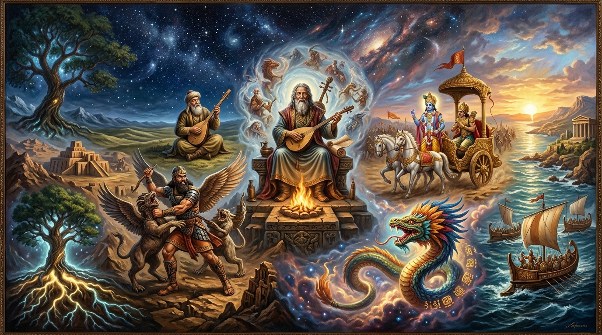

# 📜 Dünya Mitolojileri, Kurucu Destanlar ve Sözlü Edebiyat Külliyatı

  

> *"Bir milletin tarihini ordular yazar, fakat ruhunu destanlar ve masallar yaşatır. Destanlar, bir toplumun ölüm, kader, kahramanlık ve Tanrı ile kurduğu ilk büyük hesaplaşmanın kutsal şiiridir."*

Dünya medeniyetleri, binlerce yıl boyunca varoluşlarını, ahlak yasalarını ve evrendeki yerlerini sözlü olarak aktarılan kurucu destanlar (epos) ve mitolojik anlatılarla inşa etmiştir. Bu dosya, dünya halklarının kolektif bilinçdışını (Jungian Archetypes) şekillendiren 14 büyük kurucu destanın felsefi ve edebi haritasıdır.

---

## 🏛️ Medeniyetlerin Kurucu Destanları ve Mitolojik Matrisi

| Destan & Epos | Medeniyet & Dil | Baş Kahraman / Figür | Temel Varoluşsal İkilem & Felsefe | Edebi & Manevi Miras |
| :--- | :--- | :--- | :--- | :--- |
| **Gılgamış Destanı** | Mezopotamya (Sümer & Babil) | Gılgamış & Enkidu | Ölümsüzlük arayışı, insanın faniliği, dostluğun dönüştürücü gücü ve kibir. | Dünyanın bilinen en eski yazılı edebi eseri; Tufan anlatısının ilk kaynağı. |
| **Dede Korkut Kitabı** | Türk & Oğuz (Anadolu & Hazar) | Kazan Han, Bamsı Beyrek, Boğaç Han | Bozkır töresi, mertlik, aile onuru, misafirperverlik ve kadına hürmet. | UNESCO Somut Olmayan Kültürel Miras; Türk ahlak ve dil felsefesinin pınarı. |
| **Manas Destanı** | Kırgız & Orta Asya Bozkırı | Manas Han | Parçalanmış boyları birleştirme, vatan bağımsızlığı ve bozkır hürriyeti. | 500.000'i aşkın dizesiyle dünyanın en uzun yaşayan sözlü destanı. |
| **Şehnâme (Firdevsi)** | Fars & İran Yaylası | Rüstem, Keyhüsrev, Zühak | İyilik (Aydınlık) ile Kötülüğün (Karanlık) ebedi savaşı, adalet ve şahlık felsefesi. | Fars dilini Arap egemenliğine karşı kurtaran 60.000 beyitlik milli şaheser. |
| **Mahabharata** | Hindistan (Dharmik & Vedik) | Arjuna & Lord Krishna | Dharma (kutsal ödev), hakikat savaşı, karma ve nefis terbiyesi (Bhagavad Gita). | 100.000 beyit ile insanlık tarihinin en kapsamlı felsefi ve etik ansiklopedisi. |
| **Ramayana** | Hindistan & Güneydoğu Asya | Rama & Sita | İdeal kral, sadık eş, kardeşlik fedakarlığı ve şeytani kibre (Ravana) karşı zafer. | Tüm Güney ve Güneydoğu Asya dans, tapınak ve tiyatro sanatının omurgası. |
| **İlyada & Odysseia** | Antik Yunan & Akdeniz | Akhilleus, Hektor, Odysseus | Savaşın anlamsız vahşeti, kahramanlık onuru (Arete) ve sılaya dönüş hasreti (Nostos). | Batı hümanizmasının ve klasik edebiyatının kurucu başlangıç noktası. |
| **Kalevala (Elias Lönnrot)** | Fin & Kuzey Karpatlar | Väinämöinen, Ilmarinen | Kantele çalgısıyla yaratılan büyü, Sampo (bereket değirmeni) ve doğanın sırrı. | Fin milli bilincini uyandıran ve J.R.R. Tolkien'in Yüzüklerin Efendisi'ne ilham veren epos. |
| **Nibelungenlied** | Cermen & Ortaçağ Ren | Siegfried & Kriemhild | Sadakat, ihanet, lanetli altın hazinesi ve kaçınılmaz kanlı trajedi (Götterdämmerung). | Wagner'in Yüzük Operası'na kaynaklık eden Cermen şövalyelik trajedisi. |
| **Popol Vuh** | Maya & K'iche' (Mezoamerika) | İkiz Kahramanlar (Hunahpu & Xbalanque) | İnsanın mısırdan yaratılışı, yeraltı dünyası Xibalba'ya iniş ve kozmik denge. | Kolomb öncesi Amerika'nın günümüze ulaşan en derin kozmolojik kutsal metni. |
| **Sundiata Destanı** | Batı Afrika (Mali İmparatorluğu) | Sundiata Keita | Felçli bir çocuğun sabırla ayağa kalkıp imparatorluk kurması ve adalet nizamı. | Mandinka griot'larının (sözlü tarihçiler) Kora çalgısıyla kuşaktan kuşağa taşıdığı şaheser. |
| **Aborjin Düşzamanı (Dreamtime)** | Avustralya Yerlileri | Gökkuşağı Yılanı & Ata Ruhlar | Yeryüzünün mülk değil ata bedeni olduğu, Şarkı Hatları (Songlines) ile navigasyon. | 65.000 yıllık dünyanın kesintisiz en eski sözlü hafıza ve kozmoloji zinciri. |
| **Kral Arthur & Yuvarlak Masa** | Kelt & Britanya Adaları | Arthur, Lancelot, Guinevere | Kutsal Kase arayışı, adil krallık ideali, şövalyelik yemini ve insanın zaafları. | Eşitliğin simgesi olan köşesiz 'Yuvarlak Masa' kavramının doğduğu efsane. |
| **Kojiki & Nihon Shoki** | Japonya (Şinto Mitolojisi) | Amaterasu, Izanagi, Izanami | Güneş Tanrıçası'ndan türeyen imparatorluk soyu, doğadaki Kami ruhları ve saflık. | Japon estetik ve tapınak kültürünün (Şinto) kutsal kurucu metinleri. |

---

## 🔍 Destanların İnsan Ruhuna Tuttuğu Aynalar

### 1. Bozkır Töresi ve Türk Alp-Eren Ruhu (Dede Korkut & Manas)
Türk destan geleneğinde kahraman; yalnızca kılıç sallayan bir savaşçı değil, töreye bağlı, yetimleri gözeten, misafirine kapısını ardına kadar açan bir bilgedir. Dede Korkut'un kopuzu, kopan bağları birleştiren hakikat sesidir. Kadın, çadırın direğidir; kocasının yanında ata biner, ok atar ve devlet yönetir.

### 2. Dharma ve Bhagavad Gita: Vicdanın Savaş Meydanı (Mahabharata)
Kurukşetra savaş meydanında akrabalarına karşı savaşmaktan imtina eden Prens Arjuna'ya, arabacısı kılığındaki Tanrı Krishna'nın verdiği öğütler, dünya felsefesinin zirvelerindendir: *«Sen yalnızca eyleminden sorumlusun, eyleminin sonuçlarına bağlanma. Kendi kutsal görevini (Dharma) kusurlu da olsa yerine getirmek, başkasının görevini mükemmel yapmaktan evladır.»*

### 3. Nostos: Eve Dönüşün Varoluşsal Sancısı (Odysseia)
Truva Savaşı'ndan sonra 10 yıl boyunca denizlerde fırtınalarla boğuşan Odysseus'un hikayesi; insanın yabancı diyarlarda ne kadar büyülenirse büyülensin (Kirke, Kalypso), kendi vatanının ve yuvasının dumanını hiçbir şeye değişmeyeceğinin en büyük şiiridir. 'Nostalji' kelimesi bu destandan doğmuştur: *Nostos* (eve dönüş) + *Algos* (acı/sızı).

### 4. Afrika Griot Geleneği: Yaşayan Kütüphaneler (Sundiata)
Afrika'da bir yaşlı öldüğünde, bir kütüphane yanmış sayılır. Sundiata Destanı, kitaplara değil, Griot adı verilen ozanların kalplerine ve tellerine kazınmıştır. Bu destan, güçlünün değil, sabırlının ve adaleti gözetenin tarihe hükmedeceğini fısıldar.
