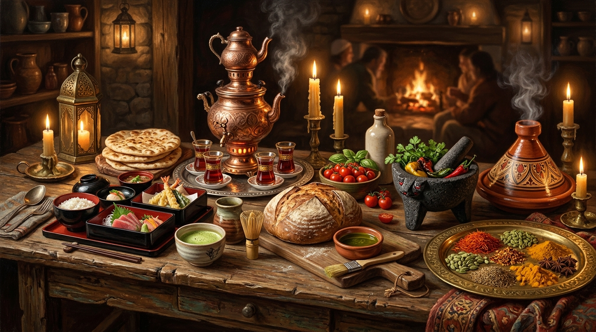

# 🍲 Dünya Mutfakları, Gastronomi Felsefesi ve Sofra Ritüelleri

  

> "Bana ne yediğini söyle, sana kim olduğunu söyleyeyim."  
> — **Jean Anthelme Brillat-Savarin** (*Le Physiologie du Goût*, 1825)

Yemek; yalnızca biyolojik bir karın doyurma eylemi değil, bir toplumun doğayla kurduğu ilişkinin, ikram geleneğinin ve medeniyet hafızasının en somut göstergesidir.

---

## 🍽️ 20 Medeniyetin Sofra ve Mutfak Felsefesi

| Ülke / Medeniyet | Gastronomi Felsefesi & Sofra Adabı |
| :--- | :--- |
| **Türkiye** (`TUR`) | Bereket sofrası. Ekmek nimettir ve kutsaldır; sofra bir karın doyurma aracı değil, ailenin ve dostların bir araya geldiği bir şölendir. Zengin zeytinyağlılar, kebap çeşitleri, taş fırın pidesi, baklava ve yoğurt merkezli kadim mutfak. |
| **Japonya** (`JPN`) | Doğal lezzeti değiştirmeden sunma sanatı (Washoku / UNESCO Mirası). Malzemenin tazeliği, mevsimselliği ve sunumun görsel geometrisi her şeyden önemlidir. Sushi, ramen, matcha ve dashi suyu. |
| **Almanya** (`DEU`) | Doyurucu, besleyici ve yerel. 3.000'den fazla ekmek çeşidi (Kültür Mirası), binlerce çeşit sosis (Wurst), patates yemekleri, lahana turşusu (Sauerkraut) ve Saflık Yasası'na (Reinheitsgebot) göre üretilen geleneksel biralar. |
| **İtalya** (`ITA`) | Kutsal gelenek. Her bölgenin, hatta her kasabanın kendine has makarna kesimi, peyniri ve zeytinyağı vardır. Reçetelere dışarıdan müdahale (örneğin pizzaya ananas koymak veya carbonaraya krema eklemek) kültürel saygısızlık sayılır. |
| **Amerika Birleşik Devletleri** (`USA`) | Hızlı, bol porsiyonlu ve füzyon. Dünyanın her mutfağından esinlenen, diners kültürü, hamburger, tütsülenmiş barbekü etleri, New York tarzı cheesecake ve her köşe başında devasa kahve bardakları. |
| **Birleşik Krallık** (`GBR`) | Geleneksel konfor yemekleri. Fish & Chips, Shepherd's Pie, scone ve reçelli krema, Cheddar peyniri ve zengin kahvaltı (Full English Breakfast). |
| **Fransa** (`FRA`) | UNESCO Somut Olmayan Mirası listesindeki Fransız Gastronomi Yemeği. Yemek aceleye getirilmez; başlangıç, ana yemek, peynir tabağı ve tatlı sırasıyla bir seremoni gibi icra edilir. |
| **Çin** (`CHN`) | Yemek hem şifa hem felsefedir (Tıbbi Beslenme - Yin ve Yang dengesi). Sekiz büyük mutfak geleneği (Siçuan, Kanton vb.); Pekin ördeği, Dim Sum, mantı (Jiaozi) ve wok ateşinde pişirme sanatı. |
| **Rusya** (`RUS`) | Kış şartlarına meydan okuyan doyurucu lezzetler. Borş çorbası, Pelmeni mantısı, havyar, çavdar ekmeği, ringa balığı ve semaverde demlenen koyu çay. |
| **Hindistan** (`IND`) | Baharatların simyası ve Ayurveda dengesi. Her baharatın bir sağlık ve ruhsal faydası olduğuna inanılır. Zengin vejetaryen mutfağı, köri çeşitleri, tandır ekmekleri (Naan/Roti), Biryani ve taze mercimek yahnisi (Dal). |
| **Güney Kore** (`KOR`) | Fermantasyon ve şifa. Her öğünde sofrada yer alan Kimchi (UNESCO Mirası), kırmızı biber salçası (Gochujang), zengin yan mezeler (Banchan), Bibimbap ve paylaşarak yenen Kore Barbeküsü. |
| **İspanya** (`ESP`) | Tazelik ve paylaşım. Büyük tavada pişirilip ortaya konan Paella, Jamón Ibérico (meşe palamuduyla beslenen domuz pastırması), Gazpacho soğuk çorbası, Churros ve zengin zeytinyağlı tapaslar. |
| **Brezilya** (`BRA`) | Topraktan ve ateşten gelen bereket. Siyah fasulye ve tütsülenmiş etlerle güveçte pişen ulusal yemek Feijoada, tapyoka krepleri, Açaí meyvesi ve kadeh kadeh Caipirinha. |
| **İran** (`IRN`) | Safran, nar ekşisi ve ceviz ahengi. Tencerenin dibinde çıtırlaşan altın sarısı pirinç kabuğu (Tahdig), fesencan yahnisi, safranlı kuzu kebapları (Çello Kebap) ve gülsuyu aromalı tatlılar. |
| **Mısır** (`EGY`) | Halkın doyurucu konfor yemekleri. Pirinç, makarna, mercimek, nohut ve kavrulmuş soğanla hazırlanan ulusal lezzet Koshari, bakla ezmesi (Ful Medames) ve sarımsaklı yeşil ot çorbası (Mulukhiyah). |
| **Güney Afrika** (`ZAF`) | Kültürlerin füzyonu. Biltong (kurutulmuş baharatlı et), Bobotie (baharatlı kıymalı güveç), Chakalaka acı sebze sosu, Boerewors sosisi ve Rooibos çayı. |
| **Meksika** (`MEX`) | UNESCO İnsanlık Mirası Meksika Mutfağı. Mısır (Maiz) kutsal varoluş unsurudur. Yüzlerce çeşit acı biber (Chili), kakao ve baharatlarla günlerce kaynatılan Mole sosu, Taco çeşitleri, Guacamole ve Tequila/Mezcal. |
| **İsveç** (`SWE`) | Kuzey doğasının sade lezzetleri. Yaban mersini reçeliyle sunulan İsveç köftesi (Köttbullar), marine ringa balığı (Sill), somon gravlax, çavdar gevreği (Knäckebröd) ve mayalanmış tuzlu balık (Surströmming). |
| **Yunanistan** (`GRC`) | Güneşin ve zeytinin bereketi. Sızma zeytinyağı, Feta peyniri, Yunan salatası (Horiatiki), Musakka, Souvlaki ve denizden taze çıkmış ızgara ahtapot. |
| **Arjantin** (`ARG`) | Ateş ve etin mükemmel dansı. Pampa sığırlarının odun kömüründe piştiği Asado, Chimichurri sosu, kıymalı Empanadas böreği, Dulce de Leche (süt reçeli) ve Malbec şarapları. |

---

## 🌾 Temel Mutfak Ekolleri ve Kültürel Kutsallar

1. **Ekmek ve Bereket Kültürü (Anadolu & Akdeniz):** Ekmek nimettir; yere düşerse öpülüp başa konur. Sofra, ailenin ve misafirin ortak dualarla birleştiği kutsal bir çemberdir.
2. **Washoku & Doğallık (Japonya - UNESCO Mirası):** Malzemenin doğallığını bozmadan, mevsimselliğine (Shun) saygı duyarak sunma sanatı. Yemekte renk, koku ve geometrik sunum felsefesi.
3. **Ayurveda & Baharat Simyası (Hindistan):** Baharatlar tatlandırıcı değil, bedenin ve zihnin dengesini kuran tıbbi şifa kaynaklarıdır.
4. **Fermantasyon & Dayanıklılık (Kore):** Zorlu kış şartlarına karşı sebzeleri toprağın altında fermente ederek (Kimchi, Gochujang) yaşatma bilgeliği.
5. **Ateş & Paylaşım Kültürü (Latin Amerika & Afrika):** Asado ve Braai; etin açık ateşte saatlerce pişirilmesi bahanesiyle tüm mahallenin ve ailenin gün boyu bir arada şarkılarla toplanmasıdır.
