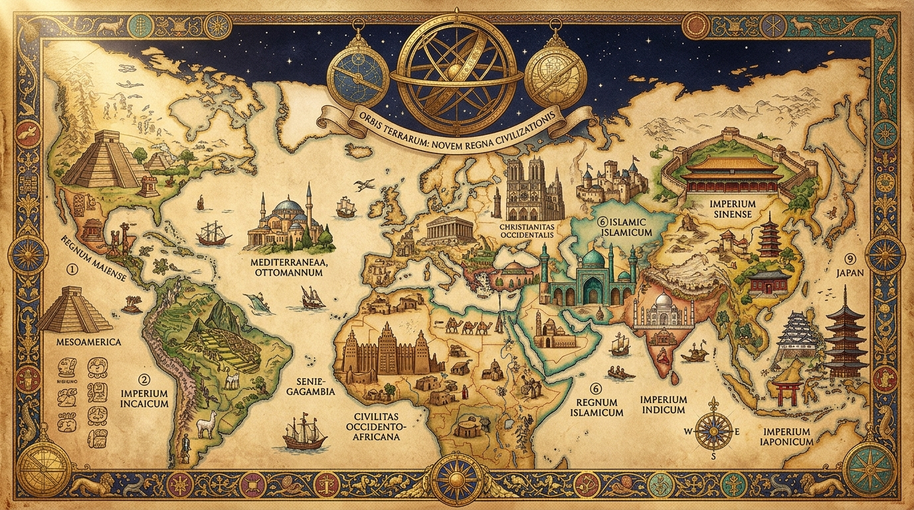

# 🏛️ Medeniyet Atlası: Kültür, Yaşam Felsefesi ve Medeniyetler Külliyatı (/culture)

  

Bu dizin, dünya uluslarının **kültürel kodlarını, çevrilemeyen ruh kavramlarını, mutfak felsefelerini, görgü kurallarını ve kadim medeniyet havzalarını** derinlemesine inceleyen ansiklopedik referans kütüphanesidir.

---

## 📑 Kültürel Dosya Dizini

| Dosya | Konu | Temel Kapsam & İçerik |
| :--- | :--- | :--- |
| 🧬 [**CULTURAL_DNA_MATRIX.md**](CULTURAL_DNA_MATRIX.md) | 205 Ülkenin Kültürel DNA Matrisi | 205 dünya ulusunun ulusal karakteri, temel ethosu, çevrilemeyen ruh kavramları, iletişim kodları ve mutfak felsefesi. |
| 📖 [**UNTRANSLATABLE_CONCEPTS_ENCYCLOPEDIA.md**](UNTRANSLATABLE_CONCEPTS_ENCYCLOPEDIA.md) | Çevrilemeyen Ruh Kavramları | Türkçe *Gönül, Hüzün, İmece*, Japonca *Ikigai, Wabi-sabi*, Almanca *Gemütlichkeit*, Portekizce *Saudade*, Zuluca *Ubuntu* dahil 205 ulustan 450+ derin kavram. |
| 🍲 [**GLOBAL_GASTRONOMY_AND_TABLE_RITUALS.md**](GLOBAL_GASTRONOMY_AND_TABLE_RITUALS.md) | Mutfaklar & Sofra Adabı | 205 dünya ulusunun mutfak felsefesi: Anadolu bereketi, Japon Washoku, Hint Ayurveda, Kore fermantasyonu ve Karayip-Afrika ritüelleri. |
| 🚫 [**WORLD_ETIQUETTE_AND_TABOOS_GUIDE.md**](WORLD_ETIQUETTE_AND_TABOOS_GUIDE.md) | Görgü Kuralları & Tabular | 205 ülkenin do's and don'ts listesi, ayakkabı kuralları, hediyeleşme adabı ve Yüksek Bağlam (High Context) vs Düşük Bağlam iletişimi. |
| 🏛️ [**CIVILIZATION_REALMS_AND_PHILOSOPHIES.md**](CIVILIZATION_REALMS_AND_PHILOSOPHIES.md) | 9 Büyük Medeniyet Havzası | Anadolu-Akdeniz, Doğu Asya, Cermen-İskandinav, Anglo-Sakson, Slav-Avrasya, Latin Amerika, Orta Doğu, Güney Asya ve Afrika medeniyet felsefeleri. |
| 📜 [**GLOBAL_FOLKLORE_MYTHOLOGY_AND_EPICS.md**](GLOBAL_FOLKLORE_MYTHOLOGY_AND_EPICS.md) | Mitolojiler & Kurucu Destanlar | Gılgamış, Dede Korkut, Manas, Şehnâme, Mahabharata, Ramayana, İlyada & Odysseia, Kalevala, Nibelungenlied, Popol Vuh, Sundiata ve Dreamtime dahil 14 kurucu epos. |
| 🏛️ [**WORLD_ARCHITECTURE_AND_SACRED_SPACES.md**](WORLD_ARCHITECTURE_AND_SACRED_SPACES.md) | Mimari & Şehir Felsefesi | İslam kubbe ve külliyeleri, Doğu Asya ahşap pagodaları (Douqong), Gotik ışık teolojisi (Lux Nova), Sahra Altı çamur mabetleri ve antik agora/piazza kamusal alan felsefeleri. |
| 🎵 [**GLOBAL_MUSIC_INSTRUMENTS_AND_SONIC_HERITAGE.md**](GLOBAL_MUSIC_INSTRUMENTS_AND_SONIC_HERITAGE.md) | Müzik Mirası & Geleneksel Çalgılar | Ney ve bağlamadan Koto ve Shakuhachi'ye, Afrika korasından Kelt gaydasına, And pan flütünden Aborjin didgeridoo'suna medeniyetlerin ses haritası. |
| 🎆 [**WORLD_FESTIVALS_CALENDARS_AND_RITUALS.md**](WORLD_FESTIVALS_CALENDARS_AND_RITUALS.md) | Festivaller & Kutsal Ritüeller | Nevruz, Diwali, Hanami, Ölüler Günü (Día de los Muertos), İntiraymi, Ramazan & Kurban, Çin Bahar Festivali, Midsommar, Songkran ve Venedik Karnavalı. |

---

> 💡 *Ayrıca her ülkenin kendi kültürel ve demografik dosyası için ilgili ülke klasöründeki `01_culture_demographics/society_history.md` dosyasını inceleyebilirsiniz.*
