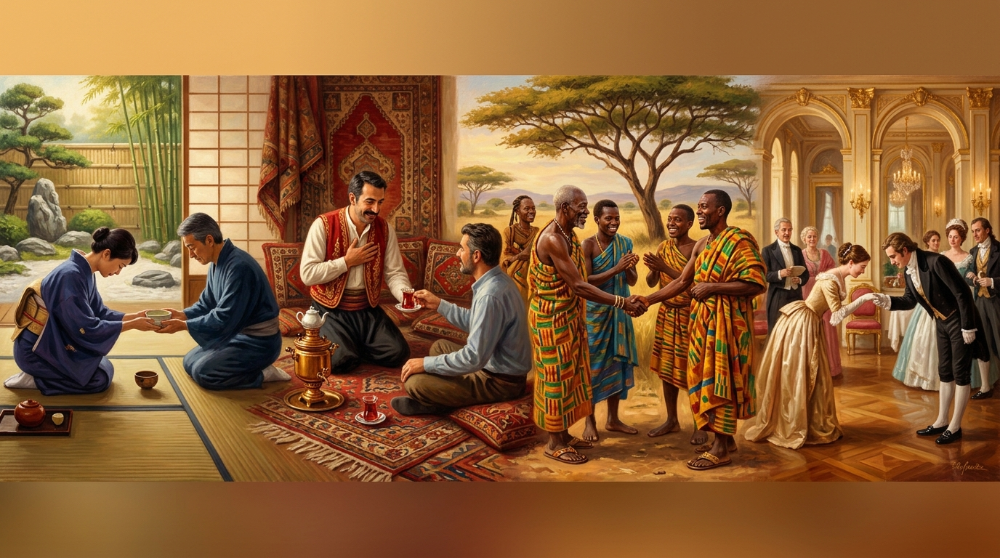

# 🚫 Küresel Görgü Kuralları, İletişim Kodları ve Sosyal Tabular (Do's & Don'ts)

  

Farklı kültürlerde saygı ifadesi olan bir davranış, başka bir coğrafyada en ağır hakaret sayılabilir. Yabancı bir ülkede saygın ve görgülü bir misafir olmanın altın anahtarları:

---

## 🌐 205 Ülkenin Sosyal Tabuları ve İletişim Kodları

| Ülke | Görgü Kuralları & Sosyal Tabular (Kaçınılması Gerekenler) | İletişim Tarzı (High/Low Context) |
| :--- | :--- | :--- |
| **Türkiye** (`TUR`) | Eve ayakkabıyla girmek kesinlikle tabudur; ekmeği yere atmak veya çöpe basmak günahtır; misafire ikram edilen çay/kahveyi geri çevirmek kırıcı kabul edilir; cenazelerde ve taziye evlerinde yüksek sesle konuşulmaz, komşular günlerce yemek taşır. | Yüksek Bağlamlı (High Context). Doğrudan 'Hayır' demek ayıp sayılır; beden dili, ses tonu, ikram ve jestler sözcüklerden daha derin anlam taşır. |
| **İran** (`IRN`) | Ta'arof yapmadan bir ikramı hemen ilk teklifte kabul etmek görgüsüzlük sayılır (en az 2-3 kez kibarca reddedilmelidir); ayakkabıyla halıya basılmaz; büyüklerin yanında ayak uzatılmaz. | Yüksek Düzeyde Metaforik, Şiirsel ve Dolaylı. Düşünceler doğrudan söylenmek yerine beyitlerle, mesellerle ve incelikli imalarla aktarılır. |
| **Suudi Arabistan** (`SAU`) | ["Bir erkeğe karısının veya kızlarının adını doğrudan sormak (mahremiyet ihlali kabul edilir; 'Aile nasıl?' denir).", 'Kahve fincanını sağ elle tutmamak veya kahveyi bitirdikten sonra fincanı hafifçe sallamadan masaya bırakmak.', 'İslam dininin kutsallarına karşı lakayt veya saygısız tavır sergilemek.'] | Yüksek Bağlamlı, iltifatlar, dualar ve şiirsel selamlaşmalarla yüklü; şeref ve aile mahremiyeti dokunulmazdır. |
| **İsrail** (`ISR`) | Şabat saatlerinde dindar mahallelerde araba kullanmak veya telefonla konuşmak tabudur; Koşer kurallarına göre süt ile et aynı öğünde bir arada tüketilmez. | Aşırı Düşük Bağlamlı, Doğrudan ve Dobra (Dugri). Lafı dolandırmak zaman kaybı sayılır; ses tonu yüksek, eleştiriler sert fakat kin gütmeyen tarzdadır. |
| **Birleşik Arap Emirlikleri** (`ARE`) | Gahwa fincanını sağ elle almamak kabalıktır; fincanı sallamadan geri verirseniz ev sahibi sürekli doldurmaya devam eder; ayak tabanını birine doğru uzatmak büyük saygısızlıktır. | Yüksek Bağlamlı ve Zarafet Odaklı. Misafire 'Ehlan ve Sehlan' ile yaklaşılır; 'Hayır' doğrudan denmez, vakarla ima edilir. |
| **Irak** (`IRQ`) | Misafirin önüne çay veya yemek koymamak Irak'ta hakaret sayılır; Dini türbelerde (Necef, Kerbela, Kazımiye) saygılı kıyafet mecburidir. | Yüksek Bağlamlı, Hitabet Gücü Yüksek ve Duygusal. 'Kahire yazar, Beyrut basar, Bağdat okur' sözü Irak'ın kitap aşkını anlatır. |
| **Suriye** (`SYR`) | Bir Şamlıya evindeki misafirperverliği övmeden ayrılmak ayıptır; ekmeği veya yemeği beğenmemek asla kabul edilemez. | Çok Yüksek Bağlamlı, Şiirsel ve İncelikli. Hitaplarda 'Tekram Aynak' (Gözlerin dert görmesin, emrin başım üstüne) gibi sevgi sözleri eksik olmaz. |
| **Katar** (`QAT`) | Geleneksel kıyafet giyen kadınların izinsiz fotoğrafını çekmek; kamuya açık alanlarda aşırı samimi davranışlar sergilemek. | Yüksek Bağlamlı, Kibar ve Ağırbaşlı. Meclis ortamında ses yükseltilmez; söz hakkı büyüklere verilir. |
| **Lübnan** (`LBN`) | Misafire ikram edilen yemeğin ilk teklifte hemen hepsi bitirilmez (ev sahibi daha fazla ikram etsin diye tabakta az bir miktar bırakılır); dini ve mezhepsel konularda uluorta tartışılmaz. | Çok Dilli, Diplomatik, İltifat Dolu ve Sıcak. Bir cümlede Arapça, Fransızca ve İngilizce doğal olarak harmanlanır («Bonjour, kifak, ça va?»). |
| **Ürdün** (`JOR`) | Mansaf yerken sol eli kullanmak veya tepsiden başkasının önündeki eti almak büyük görgüsüzlüktür; kahve ikramını geri çevirmek kabile reisine hakaret sayılır. | Yüksek Bağlamlı, Samimi ve Vakur. Tokalaşmalar uzun sürer, hal hatır sormak birkaç dakika boyunca devam eder. |
| **Kuveyt** (`KWT`) | Diwaniya'ya selam vermeden girmek veya meclisten izin istemeden ayrılmak ayıptır; ev sahibine teşekkür edilmeden kalkılmaz. | Yüksek Bağlamlı, Entelektüel ve İkna Edici. Siyasi ve sosyal münazaralar Diwaniya'larda hararetle ama saygıyla yapılır. |
| **Umman** (`OMN`) | Umman'da sokakta kavga etmek veya bağırmak yasal olarak da suçtur; camilere girerken geleneksel saygı kurallarına uyulur. | Yüksek Bağlamlı, İnanılmaz Kibar ve Dingin. Ummanlılar seslerini asla yükseltmez; trafikte bile korna çalmak kaba karşılanır. |
| **Bahreyn** (`BHR`) | Dini mekanlara ve yerel geleneklere saygısızlık edilmez; ada halkının köklü geçmişini hafife almak hoş karşılanmaz. | Yüksek Bağlamlı, Dost Canlısı ve Kozmopolit. Körfez'in en rahat ve misafirperver halklarından biridir. |
| **Yemen** (`YEM`) | Bir Yemenlinin Jambiya'sını kabzasından izinsiz çekmek büyük bir hakaret ve meydan okuma sayılır; kapıya gelen misafir üç gün boyunca sorgusuz baş tacı edilir. | Yüksek Bağlamlı, Hitabet Dolu ve Şiirsel. Selamlaşmalar derin dualarla bezelidir. |
| **Filistin** (`PSE`) | Toprağını satmak veya zeytin ağacına zarar vermek en büyük onursuzluktur; misafire ikram edilen acı mırra kahvesini içmemek ayıp sayılır. | Yüksek Bağlamlı, Tutkulu ve Sıcak. Hikaye anlatımı, direniş türküleri ve şiirle dolu bir hafıza dili. |
| **Kuzey Kıbrıs** (`TRNC`) | Eve gelen misafire macun tatlısı ve bir bardak su ikram etmemek ayıptır; komşunun selamını almamak hoş görülmez. | Yüksek Bağlamlı, Samimi ve Nüktedan. Kıbrıs Türkçesi kendine has şivesi, sıcak ünlemleri ve esprileriyle son derece renklidir. |
| **Almanya** (`DEU`) | Randevuya 5 dakika bile geç kalmak saygısızlık kabul edilir; kırmızı ışıkta yaya olarak dahi karşıya geçilmez; başkalarının özel alanına izinsiz müdahale edilmez; pazar günü çim biçmek veya tadilat yapmak komşuluk şikayetine yol açar. | Düşük Bağlamlı (Low Context). Düşünceler dolandırmadan, net, rasyonel ve gerçekçi şekilde söylenir. Fazla iltifat yapmacık bulunur; yapıcı eleştiri profesyonelliğin gereğidir. |
| **Birleşik Krallık** (`GBR`) | Kuyruğa kaynak yapmak (Queue jumping) ulusal bir suç derecesinde kınanır; metroda veya trende tanımadığın insanlarla göz teması kurmak veya sesli konuşmak uygunsuz bulunur; duygusal patlamalar ve taşkınlıklar ayıplanır. | Yüksek Düzeyde İroni ve Dolaylılık. Asla doğrudan kaba veya öfkeli konuşulmaz; aşırı derecede 'Please', 'Thank you' ve 'Sorry' (özür dilerim) kullanılır. |
| **Fransa** (`FRA`) | Dükkana veya restorana girerken 'Bonjour' (Günaydın) dememek büyük kabalıktır; ekmeği masada ters koymak uğursuzluk sayılır; yemeğe tuz veya ketçap istemek aşçının sanatına hakaret algılanabilir. | Zarif, Münazaracı ve Entelektüel. Fikir ayrılıkları ve hararetli tartışmalar dostluğu bozmaz, bilakis zihni diri tutan bir oyun olarak sevilir. |
| **Rusya** (`RUS`) | Kapı eşiğinde el sıkışmak veya bir şey vermek (şeytanın eşikte beklediğine inanıldığı için) uğursuzluk sayılır; boş şişe asla masanın üzerinde bırakılmaz, yere konur; tek sayıda çiçek hediye edilir (çift sayı yalnızca cenazelere götürülür). | Yüzeyde Soğuk ve Ciddi, İçeride Tutkulu ve Fedakar. Sokakta yabancılara sebepsizce gülümsemek 'samimiyetsizlik ve ahmaklık' olarak algılanır; ancak bir eve misafir olunduğunda ev sahibi son kuruşuna kadar her şeyini misafire ikram eder. |
| **Ukrayna** (`UKR`) | ["Ukrayna'nın başına İngilizce 'the' takısı getirilmesi ('the Ukraine') veya Rusya'nın bir uzantısı gibi görülmesi ağır hakarettir.", 'Holodomor (1932-33 Sovyet Büyük Kıtlığı) trajedisini inkar etmek veya küçümsemek.', 'Eşik üzerinden el sıkışmak veya bir şey alıp vermek uğursuzluk sayılır.'] | Yüksek Bağlamlı ve samimi. İnsan ilişkilerinde sıcak, duygulu, misafirperver; kriz anlarında sarsılmaz bir kararlılık. |
| **İtalya** (`ITA`) | Öğleden sonra veya yemek sonrasında asla cappuccino sipariş edilmez (yalnızca sabah içilir); spagetti asla bıçakla kesilmez veya kaşıkla sarılmaz; salaş veya özensiz kıyafetle sokağa çıkmak 'brutta figura' olarak kınanır. | Çok Yüksek Bağlamlı ve Zengin Beden Dili. Konuşurken eller, kollar ve yüz mimikleri cümlenin gramerinden daha fazla anlam ifade eder; ses tonu canlı ve teatraldir. |
| **İspanya** (`ESP`) | Akşam yemeğine erken (saat 19:00'da) gitmek ve aceleyle kalkmak tuhaf karşılanır; bir ortamdan selam vermeden veya vedalaşmadan ayrılmak ayıptır. | Sıcak, Doğrudan ve Yüksek Sesli. Konuşurken söz kesmek bir kabalık değil, konuya duyulan yüksek ilginin ve tutkunun göstergesi kabul edilir. |
| **Polonya** (`POL`) | ["Polonya'yı 'Doğu Avrupa' olarak adlandırmak; kendilerini kesin bir dille 'Orta Avrupa' (Central Europe) olarak tanımlarlar.", "Katolik Kilisesi'ne veya Papa II. Jean Paul'e hakaret etmek toplumun büyük kesiminde infial yaratır.", 'Eve girerken ayakkabıları çıkarmamak veya ev sahibinin terlik teklifini reddetmek kabalık sayılır.'] | Orta Bağlamlı. Samimi, duygusal, tarihsel konularda tutkulu; kadınlara karşı eski usul centilmenlik (el öpme geleneği) devam eder. |
| **Hollanda** (`NLD`) | ['Randevusuz bir Hollandalının evine akşam yemeği saatinde (18:00) çat kapı gitmek; yemeğe davet edilmezsiniz.', "Fikrini dolaylı yollardan ima etmeye çalışmak; 'Ne demek istiyorsan açıkça söyle' tepkisi alırsınız.", "Sosyal statü veya markalarla hava atmak 'Normal yap, zaten yeterince delisin' atasözüyle alaya alınır."] | Son derece Düşük Bağlamlı ve doğrudan (Dutch Directness). Kibarlık bahanesiyle gerçeği dolandırmak sahtekarlık sayılır; netlik dürüstlüğün zirvesidir. |
| **İsviçre** (`CHE`) | ["Pazar günleri veya akşam 22:00'den sonra gürültü yapmak (çim biçmek, cam şişe atmak) polis çağırma sebebidir.", 'Kişisel finansal varlıkları, banka hesaplarını veya maaş miktarını sormak aşırı kaba bir tabudur.', 'Trene veya otobüse binerken sırada bekleyenlerin önüne geçmek hoş karşılanmaz.'] | Düşük Bağlamlı, son derece kibar, mesafeli ve formel. Tartışmalarda ses yükseltilmez; konsensüs ve kompromis (uzlaşı) kutsaldır. |
| **Arnavutluk** (`ALB`) | Verilen söze (Besa) hıyanet etmek en affedilmez utançtır. Misafirin ikramını reddetmek ayıp sayılır; eve girerken ayakkabı çıkarmak yaygındır. | Yüksek Bağlamlı ve Sıcak. Karşılıklı göz teması ve el sıkışması içten bir güven bildirir; jestler canlıdır. |
| **Andorra** (`AND`) | Dağ doğasına çöp atmak veya zarar vermek ağır kınanır; komşuluk ilişkilerinde gürültü yapmak hoş karşılanmaz. | Düşük/Orta Bağlamlı. Katalanca konuşulur, kibar, sade ve mesafeli bir saygı esastır. |
| **Avusturya** (`AUT`) | ['Bir Viyana kahvehanesinde hesabı ister istemez hemen kalkıp gitmek; garsonu acele ettirmek görgüsüzlüktür.', "Avusturyalıları 'bir tür Alman' olarak nitelendirmek ulusal kimliğe hakaret sayılır.", 'Akademik veya mesleki unvanları hitapta kullanmamak kabalık kabul edilir.'] | Yüksek Bağlamlı ve son derece unvan odaklı. Karşındakine unvanıyla (Herr Doktor, Frau Magister) hitap etmek saygının ön şartıdır; doğrudan çatışmadan kaçınılır. |
| **Belarus** (`BLR`) | Ekmeği yere düşürmek veya sofrada ekmek kırıntılarını çöpe süpürmek günah sayılır; eve girerken dış ayakkabılar çıkarılır. | Yüksek Bağlamlı ve İhtiyatlı. Duygular dışarıya ölçülü yansıtılır; güven zamanla ve samimiyetle inşa edilir. |
| **Belçika** (`BEL`) | Birayı yanlış kadehte servis etmek o biranın ruhuna saygısızlık sayılır; Flaman ve Valon dil hassasiyetlerine dikkat edilmelidir; yemekte acele edilmez. | Kibar, Uzlaşmacı ve Çift Dilli. Çatışmalardan kaçınma ve orta yolu bulma ustalığı gelişmiştir; kültürel farklılıklara karşı esnektir. |
| **Bosna-Hersek** (`BIH`) | Savaş travmaları konusunda kaba ve duyarsız konuşmak; kahveyi aceleyle bir dikişte içip kalkmak görgüsüzlüktür. | Yüksek Bağlamlı, Nüktedan ve İçten. Kara mizah ve fıkralar (Mujo ve Suljo) en zor anlarda bile morali yüksek tutar. |
| **Bulgaristan** (`BGR`) | Kırmızı-beyaz Martenitsa'yı ilk leylek veya kırlangıç görülene kadar çıkarmamak esastır; boş kadehle kadeh kaldırmak uğursuzluk sayılır. | Yüksek Bağlamlı. Başın yukarı-aşağı sallanması 'Hayır', sağa-sola sallanması 'Evet' anlamına gelebilir (dikkat edilmesi gereken geleneksel jest). |
| **Hırvatistan** (`HRV`) | Balkan savaşları hakkında saygısız kıyaslamalar yapmak; kahveyi ayaküstü alelacele içip kalkmak (kahve sosyalleşme ayinidir). | Orta Bağlamlı. Sahil kesiminde canlı, sesli ve Akdenizli; başkent Zagreb ve kuzeyde ise daha kibar ve Orta Avrupalı. |
| **Kıbrıs Rum Kesimi** (`CYP`) | Ada bölünmüşlüğü ve siyasi ihtilaflar konusunda kaba konuşmak; ikram edilen kahveyi veya tatlıyı reddetmek. | Yüksek Bağlamlı ve Sıcak. Beden dili canlıdır, sohbetler kahkahalı ve samimidir. |
| **Çekya** (`CZE`) | Birahanede başkalarının masasına otururken 'Buraya oturabilir miyim?' diye sormamak kabalıktır; bira bardağının altına karton altlık koymadan masaya konmaz. | Ölçülü, Mütevazı ve İronik. Çekler büyük iddialardan ve gösterişten hoşlanmaz; sakin ve felsefi bir alaycılıkla hayatın zorluklarını göğüslerler. |
| **Danimarka** (`DNK`) | Zenginlikle veya statüyle böbürlenmek en büyük görgüsüzlüktür; başkalarının huzurunu yüksek sesle bozmak ayıptır; randevulara dakikası dakikasına uyulur. | Düşük Bağlamlı, Doğrudan ve İddiasız. Nezaket yapmacık süslerde değil, dürüstlükte aranır. Hiyerarşi minimumdur; genel müdürle stajyer aynı masada ismiyle konuşur. |
| **Estonya** (`EST`) | Saunada mayo giymek veya gürültü yapmak ayıptır; insanların kişisel alanına müdahale etmek ve yüksek sesle bağırmak hoş karşılanmaz. | Düşük Bağlamlı, Doğrudan ve Sessiz. Estonyalılar az konuşur; gereksiz sözler gürültü sayılır. Sessizlik bir huzur göstergesidir. |
| **Finlandiya** (`FIN`) | Saunaya mayo ile girmek veya saunada ses çıkarmak ayıptır (sauna mabet sayılır); başkasının sözünü kesmek büyük terbiyesizliktir; kişisel alana (en az 1.5 metre) yaklaşılmaz. | Son Derece Düşük Bağlamlı, Sessizliğe Saygılı. Fin kültüründe sessizlik bir gerginlik değil, saygı ve düşünme alanıdır; gevezelik ve yapmacık iltifatlar güvensizlik yaratır. |
| **Yunanistan** (`GRC`) | Misafire ikram edilen mezeleri veya uzoyu geri çevirmek; birinin yüzüne doğru avuç içini açık şekilde uzatmak (Moutza jesti - en ağır hakaret) büyük tabudur. | Yüksek Bağlamlı, Hararetli, Samimi ve Jestlerle Dolu. Politik ve felsefi tartışmalar bir kavga değil, Antik Agora geleneğinin günümüzdeki eğlenceli bir devamıdır. |
| **Macaristan** (`HUN`) | Bira kadehlerini tokuşturmak geleneksel olarak yapılmaz (1848 devriminde Avusturyalı generallerin kutlamasına tepki olarak doğan 150 yıllık yasa mirası); evlere ayakkabıyla girilmez. | Doğrudan, Entelektüel ve İronik. Macarlar olaylara zekice mizah ve kara mizahla yaklaşmayı sever; dost meclislerinde derin tarih ve felsefe tartışmaları normdur. |
| **İzlanda** (`ISL`) | Hassas yosun örtüsüne (moss) basmak veya off-road araçla doğayı tahrip etmek en büyük suçtur; havuza girmeden önce sabunla duş almamak tabudur. | Düşük Bağlamlı, Doğrudan ve Samimi. Herkes birbirine unvansız ilk ismiyle hitap eder (Başbakan dahil). |
| **İrlanda** (`IRL`) | ["Pub'da grup halinde içilirken 'sıra alma' (Buying your round) kuralını atlamak sosyal olarak aforoz edilme sebebidir.", "İrlanda'yı İngiltere'nin bir parçası gibi görmek veya 'British Isles' terimini dikkatsizce kullanmak derin rahatsızlık yaratır.", 'Büyük Kıtlık (Great Famine) travmasıyla alay etmek asla hoş görülmez.'] | Yüksek Bağlamlı, esprili ve hiciv dolu. Ciddiyet kisvesi altındaki kuruluktan nefret edilir; alaycı zeka (Banter) samimiyetin göstergesidir. |
| **Kosova** (`XKX`) | Ailenin büyüğüne saygısızlık etmek; eve girerken ayakkabı çıkarmamak; misafire çay veya kahve ikram etmemek. | Yüksek Bağlamlı ve Coşkulu. Sıcak selamlaşmalar, el sıkışmaları ve ikram odaklı diyalog. |
| **Letonya** (`LVA`) | Çavdar ekmeğine saygısızlık edilmez (ekmek düşerse öpülür); doğada kamp yaparken ateş açık bırakılmaz. | Orta/Düşük Bağlamlı. İnce bir nezaket, sakin ses tonu ve kişisel sınırlara mutlak hürmet. |
| **Lihtenştayn** (`LIE`) | Pazar günleri gürültü yapmak (çim biçmek vb.) kanunen ve ayıpla yasaktır; dakik olmamak büyük kabalıktır. | Düşük Bağlamlı ve Saygılı. Almancanın Allemannik lehçesi konuşulur; sakin, net ve dakiktir. |
| **Litvanya** (`LTU`) | Kapı eşiğinde el sıkışmak uğursuzluk sayılır (içeri girilmelidir); meşe ağacına zarar verilmez (pagan kutsalıdır). | Orta/Düşük Bağlamlı. Samimi ancak ilk etapta mesafeli; verilen söze sadakat esastır. |
| **Lüksemburg** (`LUX`) | Lüksemburgcayı basit bir Almanca lehçesi sanmak yerel halkı kırar; resmi kurallara ve randevu saatine harfiyen uyulur. | Düşük/Orta Bağlamlı. Lüksemburgca, Fransızca ve Almanca arasında zahmetsizce geçiş yapılır; nazik ve ölçülüdür. |
| **Malta** (`MLT`) | Kilise ve dini figürlere saygısızlık etmek; köyler arası 'Festa' rekabetinde diğer köyü yersiz yermek. | Yüksek Bağlamlı ve Tutkulu. Maltaca (Arapça gramerli Latin alfabesi) ve İngilizce konuşulur; jestler canlıdır. |
| **Moldova** (`MDA`) | Ev sahibinin ikram ettiği ev şarabını tatmayı reddetmek kırıcıdır; ekmek daima sofranın baş köşesinde tutulur. | Yüksek Bağlamlı ve Duygusal. Misafire evdeki en iyi yemek sunulur; sıcak kucaklaşmalar yaygındır. |
| **Monako** (`MCO`) | Sokakta mayoyla veya çıplak ayakla yürümek kesinlikle yasaktır ve para cezasına tabidir; kişisel mahremiyet ihlali hoş görülmez. | Düşük/Orta Bağlamlı. Fransızca konuşulur, son derece diplomatik, ölçülü ve protokol odaklıdır. |
| **Karadağ** (`MNE`) | Bir kimsenin onuruna ve ailesine laf uzatmak en ağır kavgayı başlatır; mezarlıklara ve savaş anıtlarına saygısızlık edilmez. | Yüksek Bağlamlı, Gururlu ve Doğrudan. Söz verildiğinde kanun sayılır; erkekler ve kadınlar vakur ve mert bir tavır sergiler. |
| **Kuzey Makedonya** (`MKD`) | Ajvar yapım sezonunda komşulara yardım etmemek ayıptır; ekmek kutsaldır, sofrada ekmeksiz oturulmaz. | Yüksek Bağlamlı ve Çok Sıcak. Sohbetlerde müzikal bir tonlama vardır, dostluk çabuk kurulur. |
| **Norveç** (`NOR`) | ['Maddi zenginlikle, lüks arabayla veya başarıyla övünmek aşırı derecede kınanır (Janteloven ihlali).', 'Randevulara dakikası dakikasına uyulmalıdır; 5 dakika geç kalmak derin bir saygısızlık sayılır.', 'Doğaya çöp bırakmak veya vahşi yaşama müdahale etmek affedilmez bir suç kabul edilir.'] | Düşük Bağlamlı (Low Context). Sakin, ölçülü, dolaysız ve yapmacık iltifatlardan uzak; gereksiz konuşmaktan ziyade sessizliğe saygı duyulur. |
| **Portekiz** (`PRT`) | ["Portekizlileri İspanyollarla karıştırmak veya Portekizceye 'İspanyolcanın bir lehçesi' muamelesi yapmak ulusal onura ağır hakarettir.", 'Fado söylenirken konuşmak veya gürültü yapmak kutsal bir ayini bozmak kadar büyük görgüsüzlüktür.', 'Yemeğin sonunda hesabı tek tek kuruşu kuruşuna bölüşmeye çalışmak kabalık kabul edilir.'] | Yüksek Bağlamlı ve duygusal. İspanyollara kıyasla çok daha yumuşak başlı, nezaketli, ses tonunu yükseltmeyen ve kırıcı olmaktan kaçınan zarif üslup. |
| **Romanya** (`ROU`) | Birinin evine giderken çift sayıda çiçek götürülmez (çift sayı yalnızca cenazeler içindir); kapı eşiğinden selamlaşılmaz. | Yüksek Bağlamlı, Sıcak ve Konuşkan. Latin kanı canlı beden dilinde ve hararetli entelektüel tartışmalarda hissedilir. |
| **San Marino** (`SMR`) | San Marino'yu İtalya'nın sıradan bir ili sanmak büyük kabalıktır; 1700 yıllık bağımsız cumhuriyet kimliğine saygı esastır. | Orta Bağlamlı. İtalyanca konuşulur; saygılı, ölçülü ve yerel tarihe derin saygı içeren bir üslup hakimdir. |
| **Sırbistan** (`SRB`) | Slava töreninde ayakta bekleyen aile reisine saygısızlık edilmez; ilk rakija kadehi gözlerin içine bakılarak 'Živeli' denmeden içilmez. | Yüksek Bağlamlı, Samimi ve Coşkulu. İnsanlar duygularını saklamaz; misafire ikramda sınır tanınmaz. |
| **Slovakya** (`SVK`) | Eve girerken ayakkabılar daima çıkarılır ve terlik giyilir; tabağa konan Halušky'yi bitirmemek ev sahibine saygısızlık sayılır. | Orta Bağlamlı. Kibar, ölçülü ve sakin. Aile ortamında çok sıcak ve cömerttir. |
| **Slovenya** (`SVN`) | Doğaya çöp atmak veya dağ patikalarını kirletmek en büyük ayıptır; randevulara bir dakika bile geç kalınmaz. | Orta/Düşük Bağlamlı. Sakin, diplomatik, yüksek eğitimli ve nezakete dayalı iletişim. |
| **İsveç** (`SWE`) | Kişisel alana fiziksel olarak fazla yaklaşmak; sıraya kaynak yapmak; fika davetini 'işim var' diyerek sürekli reddetmek asosyallik kabul edilir. | Düşük Bağlamlı, Aşırı Sakin, Ölçülü ve Mütevazı. Övünmek veya zenginliğini uluorta sergilemek 'Janteloven' kuralına göre büyük bir görgüsüzlüktür. |
| **Transdinyester** (`PMR`) | İkinci Dünya Savaşı gazilerine ve anıtlarına saygısızlık hoş karşılanmaz; resmi binaların izinsiz fotoğrafının çekilmesi tabudur. | Yüksek Bağlamlı ve Nostaljik. Rusça lingua franca'dır; samimiyet ve ortak anılar değerlidir. |
| **Vatikan** (`VAT`) | Bazilikaya omuzları veya dizleri açık kıyafetle girmek kesinlikle yasaktır; ibadet mekanlarında sessizliğe riayet edilir. | Çok Yüksek Bağlamlı, Protokoler ve Diplomatik. Latince ve İtalyanca kullanılır; her sözcük asırlık kanon hukukunun ağırlığını taşır. |
| **Çin** (`CHN`) | Yemek çubuklarını dikey olarak pirince saplamak (ölüm çağrışımı); saat veya beyaz çiçek hediye etmek (cenaze sembolü); hediye verilirken veya alınırken hemen kabul etmek yerine iki kez mütevazıca reddetmek adettendir. | Aşırı Dolaylı ve Nezaket Odaklı. Asla muhatabı mahcup edecek veya 'yüzünü düşürecek' sert eleştiriler uluorta yapılmaz. |
| **Hindistan** (`IND`) | Yemek yerken veya birine bir şey uzatırken sol el kullanılmaz (temizlik dışı sayılır); tapınaklara ve evlere ayakkabıyla girilmez; büyüklere saygı için ayaklarına dokunarak kutsanma istenir (Charan Sparsh); inekler kutsaldır ve sokaklarda serbestçe dolaşırlar. | Yüksek Bağlamlı ve Toleranslı. Başın iki yana sallanması (Indian Head Wobble) duruma göre 'anladım', 'katılıyorum' veya 'nezaketle dinliyorum' anlamına gelir. |
| **Japonya** (`JPN`) | Yürürken yemek yemek veya içmek hoş karşılanmaz; yemek çubuklarını (hashi) pirinç kasesine dik saplamak (cenaze ritüelini andırdığı için) büyük bir tabudur; ayakkabıyla tatamiye basılmaz; bahşiş bırakmak 'hizmetin değerine hakaret' sayılır. | Aşırı Yüksek Bağlamlı. 'Honne' (gerçek kişisel duygu ve fikirler) ile 'Tatemae' (kamuoyu önünde sergilenen uyumlu yüz) ayrımı esastır. Doğrudan reddetmek kabalıktır, 'Zor görünüyor' demek 'Hayır' anlamına gelir. |
| **Güney Kore** (`KOR`) | Büyüğün yanında içerken başı yana çevirmeden içmek saygısızlıktır; bir şeyi iki elle uzatmamak veya iki elle almamak kabalıktır; isimleri asla kırmızı mürekkeple yazılmaz (ölüm çağrışımı). | Çok Yüksek Bağlamlı ve Hiyerarşik. Karşındakinin yaşı bir yaş bile büyük olsa dilin hitap kipi (Jondaetmal - saygı dili) derhal değişir; göz teması ve beden dili saygı çerçevesinde kısıtlanır. |
| **Tayvan** (`TWN`) | Yemek çubuklarını dikey olarak pirinç kasesine saplamak cenaze ritüelidir ve büyük tabudur; hediye olarak saat vermek (ölüm iması) uğursuzluk sayılır. | Yüksek Bağlamlı, Nazik ve İncitmekten Kaçınan. Doğrudan 'Hayır' denmez; tebessüm ve dolaylı ifadelerle uyum korunur. |
| **Pakistan** (`PAK`) | ["Dini değerlere, Hz. Peygamber'e veya Kur'an'a karşı saygısızlık toplumda asla tolere edilmez.", 'Yaşlıların yanında bacak bacak üstüne atmak veya sigara içmek hürmetsizlik sayılır.', 'İkram edilen çayı veya yemeği hiçbir meşru sebep yokken geri çevirmek ev sahibini derinden yaralar.'] | Yüksek Bağlamlı, saygı ve hitap unvanlarıyla (Aap, Janab, Sahib) örülü, sıcakkanlı ve duygusal üslup. |
| **Afganistan** (`AFG`) | Misafiri korumasız bırakmak veya ikram etmeden göndermek kabilenin yüz karasıdır; ekmek kırıntısına basılmaz; büyüklerin yanında ayak uzatılmaz. | Yüksek Bağlamlı, Hitabet Dolu ve Gururlu. Aksakallıların (Cırga) sözü kanun hükmündedir; misafire sonsuz iltifat edilir. |
| **Ermenistan** (`ARM`) | Tamada kadeh kaldırıp konuşurken sözünü kesmek veya içkiyi konuşma bitmeden içmek ayıptır; ekmek asla ters konmaz. | Yüksek Bağlamlı ve Duygusal. Misafirperverlikte sınır tanınmaz; masada tostu (şerefe konuşmasını) yöneten bir 'Tamada' meclisi yönetir. |
| **Azerbaycan** (`AZE`) | Çay sofrasında şekeri veya reçeli çaya katmadan önce ilk yudumu almak adettir; eve ayakkabıyla girilmez; sofrada tuz yere dökülürse kavga çıkacağına inanılır, üzerine şeker atılır. | Yüksek Bağlamlı, Sıcak ve Şiirsel. Konuşmalarda sevgi ve hürmet hitapları ('Qurban olaram', 'Canım') çok doğaldır. |
| **Bangladeş** (`BGD`) | Yemek yerken sol eli kullanmak; birinin kafasına dokunmak (manevi merkez sayılır); kitaplara ayakla basmak veya yere düşürmek (bilgi tanrıçası Saraswati'ye saygısızlık). | Yüksek Bağlamlı, Saygılı ve Şairane. Sohbetlerde edebi ifadeler ve metaforlar bolca kullanılır. |
| **Bhutan** (`BTN`) | Dağ zirvelerine tırmanmak yasaktır (zirveler tanrıların kutsal mekanıdır); tapınaklara ayakkabıyla veya geleneksel şal (Kabney/Rachu) olmadan girilmez. | Yüksek Bağlamlı, Çok Kibar ve Alçakgönüllü. Bhutanlılar doğrudan övünmekten kaçınır; ses tonu daima huzur vericidir. |
| **Brunei** (`BRN`) | Kamusal alanda alkol ve tütün tüketimi kesinlikle yasaktır; kraliyet ailesini eleştirmek tabudur; karşı cinsten biri elini uzatmadıkça tokalaşılmaz. | Yüksek Bağlamlı ve Son Derece Saygılı. Ses tonu yumuşaktır; işaret parmağıyla birini göstermek ayıptır (başparmak kullanılır). |
| **Kamboçya** (`KHM`) | Bir çocuğun veya yetişkinin başına dokunmak büyük kabalıktır (baş ruhun merkezidir); ayak tabanlarını Budist keşişe veya heykeline çevirmek yasaktır. | Yüksek Bağlamlı ve Yumuşak. Avuçlar göğüs hizasında birleştirilip baş eğilerek (Sampeah) selam verilir; yaş ve statüye göre eller yukarı kalkar. |
| **Gürcistan** (`GEO`) | Tamada kadeh kaldırmadan (Sadgegrodzelo) içki yudumlamak saygısızlıktır; Hıngal mantısı asla çatalla yenmez, elle sapından tutulup suyu höpürdetilerek içilir; misafirin hesabı ödemesine asla izin verilmez. | Coşkulu, Sıcak ve Şiirsel. Gürcüler sofrada konuşmayı bir sanat olarak icra eder; kadeh kaldırmalar derin felsefi hikayelerle bezenir. |
| **Hong Kong** (`HKG`) | Çaydanlığın kapağını ters çevirip üstüne koymak 'demlik bitti, sıcak su ekleyin' demektir; çay dolduran kişiye masaya iki parmakla vurarak teşekkür edilir. | Orta/Yüksek Bağlamlı. Hızlı, pratik ve verimlilik odaklıdır; jestler ölçülü ama iş hayatında doğrudan netliğe önem verilir. |
| **Endonezya** (`IDN`) | ['Birinin başına dokunmak (çocuklar dahil) ruhun ikametgahına saygısızlık kabul edilir.', 'Yemek yerken veya bir şey verirken sol eli kullanmak pis kabul edilir; mutlaka sağ el kullanılır.', 'Topluluk içinde sesini yükseltmek veya birini utandırmak toplumsal uyumu dinamitlemek sayılır.'] | Aşırı Yüksek Bağlamlı. Doğrudan 'Hayır' denmez (Asam/Belum); çatışma ve öfke zafiyet sayılır, her durum tebessümle karşılanır. |
| **Kazakistan** (`KAZ`) | Misafire çayı tam doldurmak 'hemen kalk git' anlamına gelir; çay bardağı yarım doldurularak sık sık tazelenir (hürmet göstergesi). Ekmeği yere koymak veya ekmeğe basmak büyük günahtır; at kafatasına saygısızlık edilmez. | Yüksek Bağlamlı ve Saygılı. Sözlü hitapta ak sakallı büyüklere mutlak saygı, sabır ve dinginlik; doğrudan kabalık yerine bilgece meseller ve atasözleri tercih edilir. |
| **Kırgızistan** (`KGZ`) | Boz-üy'ün eşiğine basılmaz; Tündük'e saygısızlık edilmez; misafire koyunun başı sunulduğunda en yaşlı büyüğün dualarla paylaştırması adettir. | Yüksek Bağlamlı, Mert ve Doğal. Sözlü edebiyat ve atasözleri konuşmalara yön verir; büyüklere hürmet baş tacıdır. |
| **Laos** (`LAO`) | Budist keşişlerin bedenine özellikle kadınların dokunması tabudur; eve girerken ayakkabılar çıkarılır; birinin başını okşamak ayıptır. | Yüksek Bağlamlı, Sessiz ve Huzurlu. Laoslular acele etmekten veya ses yükseltmekten nefret eder; hayat nehir gibi kendi akışında akar. |
| **Makao** (`MAC`) | Kumar masalarında uğursuzluk getirecek sözler söylemek hoş karşılanmaz; tapınaklarda tütsü dumanına saygı gösterilir. | Orta/Yüksek Bağlamlı. Kantonca ve Portekizce harmanlanır; esnek ve kibar bir liman tüccarı nezaketi vardır. |
| **Malezya** (`MYS`) | Çocukların veya büyüklerin başına asla dokunulmaz (baş ruhun barındığı kutsal yerdir); bir şeyi işaret ederken işaret parmağı yerine başparmak kullanılır; camilere ve evlere ayakkabısız girilir. | Yüksek Bağlamlı, Nazik ve İmalı. Yüz kaybetmeme (saving face) esastır; 'Evet' demek bazen sadece 'Seni dinliyorum' anlamına gelir. |
| **Maldivler** (`MDV`) | Yerel adalarda kamuya açık alanlarda mayo ile dolaşmak yasaktır (turistik adalara mahsustur); mercan kayalıklarına basmak veya mercan koparmak tabudur. | Yüksek Bağlamlı, Dingin ve Alçakgönüllü. Dhivehi dili konuşulur; ses tonu yumuşak, bakışlar dostanedir. |
| **Moğolistan** (`MNG`) | Ger çadırının kapı eşiğine asla basılmaz (eşik ailenin onurudur, basmak boyun kesmek sayılır); çadırın merkezindeki iki direğin arasından geçilmez; ateşe su dökülmez veya çöp atılmaz. | Az Söz, Derin Anlam. Bozkır insanı gereksiz lakırdıdan kaçınır; doğanın sesini dinlemek konuşmaktan evladır. Söz verildiğinde kanun hükmündedir. |
| **Myanmar** (`MMR`) | Pagoda ve tapınaklara girerken çoraplar dahil tüm ayakkabılar çıkarılır (çıplak ayak şarttır); keşişlerin oturma yerinden daha yüksek bir yere oturulmaz. | Yüksek Bağlamlı, Nazik ve İhtiyatlı. İnsanlar birbirine saygıyla eğilerek yaklaşır; tartışmaktan veya öfke göstermekten utanılır. |
| **Nepal** (`NPL`) | Tapınaklara deri eşyalarla (kemer vb.) girilmez; ayaklar asla bir kutsal heykele, kitaba veya insana doğru uzatılmaz; sol elle yemek yenmez. | Yüksek Bağlamlı, Alçakgönüllü ve Dingin. Gülümseme evrensel dildir; eller göğüste birleştirilerek konuşulur. |
| **Kuzey Kore** (`PRK`) | Liderlerin resimlerini katlamak, yere düşürmek veya buruşturmak affedilmez suçtur; anıtların önünde saygısızca durulmaz; askeri alanların fotoğrafı çekilmez. | Çok Yüksek Bağlamlı, Protokoler ve Törensel. Resmi hitaplar, ideolojik saygı ifadeleri ve derin hiyerarşik reveranslar esastır. |
| **Filipinler** (`PHL`) | Birini işaret parmağıyla çağırmak köpek çağırmak sayıldığı için büyük hakarettir (el ayası aşağıya bakacak şekilde el sallanır); tabaktaki son lokmayı almak çekingenlikten ötürü ertelenir. | Çok Yüksek Bağlamlı ve Nezaket Dolu. Büyüklere hitap ederken her cümlenin sonuna saygı ifadesi olan 'Po' veya 'Opo' eklenir; doğrudan reddetmek kırıcı sayılır. |
| **Singapur** (`SGP`) | Yere sakız atmak veya çöp fırlatmak çok ağır para ve adli cezalara tabidir; toplu taşımada yemek yemek veya durian meyvesi taşımak yasaktır. | Düşük/Orta Bağlamlı. Singlish (İngilizce-Kantonca-Malayca kırması renkli sokak dili: 'Lah', 'Leh'); iş hayatında net, hızlı ve profesyonel. |
| **Sri Lanka** (`LKA`) | Buda heykellerine sırtını dönüp selfie çekmek yasal olarak suçtur ve saygısızlık kabul edilir; tapınaklara girerken omuz ve dizler örtülmelidir. | Yüksek Bağlamlı ve Sıcak. Başın hafifçe sağa sola sallanması onaylama, ilgi ve nezaket belirtisidir; ses tonu müşfiktir. |
| **Tacikistan** (`TJK`) | Ekmeği tek elle bölmek veya yere düşürmek büyük günahtır; misafire çay doldururken bardağın ağzına kadar doldurulması kabalıktır (çay yarım doldurulur ki hürmetle tazelensin). | Çok Yüksek Bağlamlı ve Zarafet Dolu. Farsça kökenli Tacik dili son derece lirik ve naziktir; hitaplarda 'Can' kelimesi eksik olmaz. |
| **Tayland** (`THA`) | ['Kraliyet ailesi hakkında en ufak bir eleştiri veya espri yapmak (Lèse-majesté kanunu gereği hapis cezasıdır).', 'Ayak tabanını bir insana veya Buda heykeline doğru uzatmak en ağır hakarettir (ayak bedenin en kirli yeridir).', 'Bir Budist keşişe (özellikle kadınlar tarafından) doğrudan dokunmak dini tabudur.'] | Yüksek Bağlamlı ve son derece yumuşak. Cümle sonlarına eklenen 'Krap/Kha' saygı ekleri ve iki elin göğüste birleştirildiği 'Wai' selamı. |
| **Doğu Timor** (`TLS`) | Uma Lulik kutsal evlerine izinsiz girmek veya kutsal nesnelere dokunmak büyük felaket getireceğine inanılan bir tabudur; timsahlara asla zarar verilmez. | Yüksek Bağlamlı, Alçakgönüllü ve Topluluk Odaklı. Tetum ve Portekizce konuşulur; köy meclislerinde yaşlıların rehberliğine başvurulur. |
| **Türkmenistan** (`TKM`) | Ekmeği yere koymak veya basmak günahların en büyüğüdür; ata kırbaçla vurulmaz veya kötü davranılmaz; misafirin önüne serilen 'Saçak' (sofra örtüsü) üzerinden adım atılmaz. | Yüksek Bağlamlı, Az Sözlü ve Ağırbaşlı. Aksakallara sınırsız hürmet edilir; söz verildiğinde kan yemininden farksızdır. |
| **Özbekistan** (`UZB`) | Tandır ekmeğini (Non) asla bıçakla kesilmez, elle bölünür; ekmek asla masaya ters konmaz. Çayhanede ilk fincan çay bardağa dökülüp tekrar demliğe geri boşaltılır (loy etme) ve misafire hürmetle sunulur. | Çok Yüksek Bağlamlı ve Zarafet Odaklı. Büyüklere sağ el göğse konularak hafifçe eğilerek selam verilir; hitapta 'Siz' ve hürmet unvanları (Aka, Opa) esastır. |
| **Vietnam** (`VNM`) | ['Yemek çubuklarını pirinç kasesine dik batırmak (cenaze tütsüsünü andırdığı için) ölümcül bir tabudur.', 'Birinin omzuna dokunmak veya üzerinden atlamak o kişinin şansını çalmak sayılır.', 'Yaşlılara iki elle bir şey uzatmamak veya başla selam vermemek saygısızlık kabul edilir.'] | Yüksek Bağlamlı. Tevazu, yumuşak ses tonu ve yüzü koruma (Mặt) refleksi hakimdir; anlaşmazlıklar tebessümün ardına gizlenir. |
| **Amerika Birleşik Devletleri** (`USA`) | Hizmet sektöründe bahşiş (tip - %18-%22) bırakmamak en büyük sosyal ayıptır; kişisel fiziksel alana (Personal Space) aşırı yaklaşmak rahatsızlık verir; yabancılara maaş veya oy tercihi doğrudan sorulmaz. | Düşük Bağlamlı, Doğrudan ve Rahat (Informal). Yabancılarla asansörde veya kuyrukta hemen samimi havadan sudan konuşma (Small Talk) başlatılır; resmi unvanlar yerine ilk isimle hitap yaygındır. |
| **Brezilya** (`BRA`) | Aşırı soğuk, mesafeli ve resmi davranmak 'kibirli' olarak damgalanır; partilere davet saatinden 30-45 dakika sonra gitmek sosyal bir normdur; aceleci olmak ve stres yaymak ayıplanır. | Son Derece Sıcak, Temas Odaklı ve Samimi. Konuşurken omuza dokunmak, sarılmak (Abraço) ve yanak yanağa öpüşmek gündelik selamlaşmanın doğal parçasıdır. |
| **Meksika** (`MEX`) | Bir annenin veya ev sahibinin hazırladığı acı yemeği veya tekilayı elinin tersiyle itmek; birinin annesine yönelik argo kullanmak ölümcül hakaret sayılır. | Dolaylı, Nezaket Yüklü ve Küçültme Ekleriyle (Diminutivos) Dolu. 'Ahorita' (hemen şimdi) demek aslında 'belki sonra veya hiçbir zaman' anlamına gelebilir. |
| **Kanada** (`CAN`) | Kuyruk kurallarına uymamak veya kabalık etmek toplumca ayıplanır; yerli halkların kutsal mirasına ve sembollerine saygısızlık kabul edilemez. | Yüksek Düzeyde Kibar, Kapsayıcı ve Dolaylı. Karşıt fikirler dile getirilirken bile kırmamaya özen gösterilir; özür dilemek bir zayıflık değil, sosyal uyum aracıdır. |
| **Arjantin** (`ARG`) | Sana uzatılan Mate çayını aldıktan sonra 'Gracias' (teşekkür ederim) demek 'daha fazla istemiyorum, doydum' anlamına gelir (içmeye devam etmek istiyorsan sessizce geri uzatmalısın); futbol kulübü tercihleriyle alay etmek kavga sebebidir. | İtalyan Tarzı Teatral El Hareketleri, Yüksek Özgüven ve Felsefi Derinlik. Arjantinliler dünyada kişi başına en çok psikanaliste giden halktır; kendi ruh hallerini analiz etmeyi bir sanat olarak severler. |
| **Antigua ve Barbuda** (`ATG`) | Şehir içinde ve kamu binalarında mayoyla dolaşmak kesinlikle yasaktır; kamuflaj desenli kıyafet giymek kanunen yasaktır. | Yüksek Bağlamlı, Samimi ve Neşeli. İngilizce ve Antiguan Kreolü konuşulur; jestler canlıdır. |
| **Bahamalar** (`BHS`) | Pazar günleri kilise saatinde saygısızlık etmek hoş görülmez; Bahamalılara 'Amerikalı' gibi muamele etmek kırıcıdır. | Yüksek Bağlamlı ve Sıcak. Bahama lehçesi ritmiktir; hikaye anlatımı ve kahkaha sohbetlerin merkezindedir. |
| **Barbados** (`BRB`) | Kamuflaj desenli kıyafet giymek yasaktır; yaşlılara ve kadınlara karşı kaba hitaplar Bajan terbiyesinde kabul görmez. | Orta/Yüksek Bağlamlı. Bajan İngilizcesi melodiktir; nüktedan, esprili ve saygılı bir üslup vardır. |
| **Belize** (`BLZ`) | Doğayı ve mercan resiflerini kirletmek hoş görülmez; selam vermeden doğrudan bir dükkana girmek kabalık sayılır. | Yüksek Bağlamlı, Rahat ve Çok Dilli. İngilizce resmi dildir ancak Belize Kreolü ve İspanyolca sokakta hakimdir. |
| **Bolivya** (`BOL`) | Yere Challa yapmadan içkiye başlamak Pachamama'ya saygısızlık sayılır; yerli kadınların fotoğraflarını izinsiz çekmek ruhlarını çalmak gibi algılanabilir. | Yüksek Bağlamlı, Mütevazı ve Ağırbaşlı. Yerli And insanı gürültüden hoşlanmaz; göz teması ve sessiz tefekkür sözlerden daha etkilidir. |
| **Şili** (`CHL`) | ['Pinochet diktatörlüğü ve askeri darbe dönemi hakkında taraflı ve hassasiyetsiz konuşmak toplumu derinden böler.', 'Yemek masasında ellerin masanın üzerinde tutulmaması kabalık sayılır.', 'Şili ile komşuları (Peru ve Bolivya) arasındaki Pasifik Savaşı mirası hakkında duyarsız şakalar yapmak.'] | Yüksek Bağlamlı, dünyanın en hızlı ve bol argo (Chilenismos - Weon, Cacha) içeren, metaforik ve melodik İspanyolcası. |
| **Kolombiya** (`COL`) | ["Pablo Escobar veya kokain kartelleri hakkında şaka yapmak veya Kolombiya'yı yalnızca uyuşturucuyla anmak derin bir hakarettir.", 'Birisi size kahve (Tinto) ikram ettiğinde geri çevirmek kırıcı kabul edilir.', 'Siyasetteki geçmiş şiddet dönemleri (La Violencia) hakkında yüzeysel ve yargılayıcı konuşmak tabudur.'] | Yüksek Bağlamlı ve son derece kibar. Bogota İspanyolcası dünyanın en temiz ve formel aksanı kabul edilir; 'Usted' saygı hitabı hakimdir. |
| **Kosta Rika** (`CRI`) | Yaban hayatına ve milli parklara zarar vermek veya hayvanları beslemek kesinlikle yasaktır; agresif ve kavgacı bir üslup sergilemek toplumdan dışlanma sebebidir. | Yüksek Bağlamlı, Kibar ve Yumuşak. 'Tico'lar doğrudan tartışmaktan ve karşı tarafı kırmaktan özenle kaçınır; 'Pura Vida' her türlü selam, teşekkür ve tesellidir. |
| **Küba** (`CUB`) | Soğuk ve mesafeli durmak kibir sayılır; ikram edilen kahveyi geri çevirmek kırıcıdır; sokakta müzik çalarken hareketsiz durmak bile garip karşılanır. | Sıcak, Dışa Dönük, Yüksek Sesli ve Müzikal. Kübalılar sokakta, balkondan balkona konuşur; jestler, dans ve kahkahalar günlük iletişimin doğal parçasıdır. |
| **Dominika** (`DMA`) | Kalinago yerli bölgesinde saygısız davranmak veya izinsiz ritüel fotoğrafları çekmek ayıptır; nehirleri ve yağmur ormanlarını kirletmek hoş görülmez. | Yüksek Bağlamlı ve Sakin. İngilizce ve Fransız kökenli Kwéyòl konuşulur; sıcak ve yardımseverdir. |
| **Dominik Cumhuriyeti** (`DOM`) | Müzik çalarken oturup somurtmak ayıp sayılır; beysbol milli takımını yersiz yermek tepki çeker. | Yüksek Bağlamlı, Çok Hızlı, Coşkulu ve Beden Diline Dayalı. Yüksek sesle ve kahkahalarla konuşulur; dostluklar ilk dakikada kurulur. |
| **Ekvador** (`ECU`) | Dünyaca ünlü Panama Şapkası'nın aslında Ekvador'a (Montecristi) ait olduğunu inkar etmek milli gururu incitir; yerli halka saygısızlık edilmez. | Yüksek Bağlamlı ve Saygılı. And bölgesinde sakin, alçak sesli ve 'Usted' hürmet dili hakimdir; kıyıda (Guayaquil) ise daha canlı ve hızlıdır. |
| **El Salvador** (`SLV`) | Pupusa'yı çatal bıçakla yemek büyük günahtır (kesinlikle elle yenir); geçmiş şiddet olayları konusunda kaba espriler yapılmaz. | Yüksek Bağlamlı, Sıcak ve Samimi. Salvadorlular birbirine hitap ederken 'Vos' ve sevgi dolu takma isimler kullanır. |
| **Grönland** (`GRL`) | Avlanan et asla israf edilmez veya çöpe atılmaz; doğanın şartlarını hafife alıp tek başına tedbirsizce buza çıkmak tabudur. | Yüksek Bağlamlı, Sakin ve Sözsüz. İnuit kültüründe kaşları kaldırmak 'Evet', burnu kırıştırmak 'Hayır' demektir; gereksiz kelimeler kullanılmaz. |
| **Grenada** (`GRD`) | Muskat ağacına ve baharat tarımına saygısızlık edilmez; ada genelinde kamuflaj desenli kıyafet giymek yasaktır. | Yüksek Bağlamlı, Canlı ve Esprili. Kreol İngilizcesi kullanılır; tebessüm ve el sallamak sokak adabıdır. |
| **Guatemala** (`GTM`) | Geleneksel kıyafetli yerli halkın izinsiz fotoğrafını çekmek hoş karşılanmaz; mısır tanesini yere düşürüp üstüne basmak günahtır. | Yüksek Bağlamlı, Nazik ve İnce. Maya topluluklarında ses tonu yumuşaktır; doğrudan göze dik bakmak yerine hürmetle baş eğilir. |
| **Guyana** (`GUY`) | Etnik ayrımcılık ima eden sözler derin kırgınlık yaratır; Pepperpot tepsisine kirli kaşık daldırılmaz (bozulmaması için). | Yüksek Bağlamlı, Coşkulu ve Melodiktir. Guyana Kreolü renkli metaforlarla doludur; sokak tartışmaları bile dostanedir. |
| **Haiti** (`HTI`) | Haiti'nin bağımsızlık mücadelesini ve tarihini küçümsemek; Vodou inancını Hollywood klişeleriyle şeytanlaştırmak büyük saygısızlıktır. | Yüksek Bağlamlı, Şiirsel, Tutkulu ve Mecazi. Haiti Kreolü (Kreyòl) atasözleriyle örülüdür ('Dèyè mòn, gen mòn' - Dağların ardında yine dağlar var). |
| **Honduras** (`HND`) | Baleada'yı beğenmemek Honduraslıyı derinden üzer; ailenin yaşlılarına saygısızca lakaplar takmak hoş karşılanmaz. | Yüksek Bağlamlı, İçten ve Arkadaş Canlısı. 'Catracho' (Honduraslı) kimliğiyle gurur duyulur; sıcak kucaklaşmalar adettir. |
| **Jamaika** (`JAM`) | Rastafari inancına ve 'Dreadlocks' saç örgülerine saygısızca dokunmak tabudur; Jamaika'da kaba ve aceleci davranmak ters teper. | Yüksek Bağlamlı, Coşkulu ve Melodiktir. Patois (Jamaika Kreolü) konuşulur; 'Irie' ve 'Respect' kelimeleriyle sevgi ve hürmet gösterilir. |
| **Nikaragua** (`NIC`) | Rubén Darío'ya veya şiire saygısızlık etmek hoş karşılanmaz; yerel halkın siyasi geçmişine karşı duyarsızca hüküm vermek kırıcıdır. | Yüksek Bağlamlı, Şiirsel ve Hararetli. Her Nikaragualı doğuştan şair kabul edilir; sokak tartışmaları bile edebi bir lezzettedir. |
| **Panama** (`PAN`) | Guna Yala adalarında kabile kurallarına uymamak tabudur; geleneksel Pollera elbisesine saygısızlık edilmez. | Yüksek Bağlamlı, Açık ve Girişimci. Çok kültürlü bir liman kenti rahatlığı hakimdir; insanlar dışa dönüktür. |
| **Paraguay** (`PRY`) | Kendisine uzatılan Tereré'yi geri çevirmek büyük kabalıktır; Tereré içerken 'Teşekkür ederim' derseniz bir daha size ikram edilmez ('doydum' anlamına gelir). | Yüksek Bağlamlı, Samimi ve Sıcak. Konuşmalar Guaraní ve İspanyolca kırması 'Jopará' ile yapılır; dost meclisinde Tereré bardağı elden ele gezer. |
| **Peru** (`PER`) | ['İnka mirasını küçümsemek veya yerli Quechua/Aymara halkına karşı ayrımcı tavır sergilemek.', "Peru yemeklerini başka bir ülkenin (özellikle Şili'nin) mutfağıyla kıyaslayıp küçümsemek.", "Toprak Ana'ya (Pachamama) sunulan sembolik adaklara veya kutsal mekanlara (Apu dağları) saygısızlık."] | Yüksek Bağlamlı, son derece kibar, And yerli dillerinin getirdiği yumuşak ve saygılı ses tonu. |
| **Porto Riko** (`PRI`) | Coquí kurbağasının sesini küçümsemek ayıptır (yalnızca bu adada yaşar ve milli semboldür); misafire ikram edilen yemeği geri çevirmek hoş görülmez. | Yüksek Bağlamlı, Çok Hızlı, Coşkulu ve Duygusal. 'R' harfleri yumuşak 'L' gibi telaffuz edilir; kollar açılarak coşkuyla selamlaşılır. |
| **Saint Kitts ve Nevis** (`KNA`) | Tarihi Brimstone Hill kalesinde çöp bırakmak ayıptır; kamuflaj kıyafetler kesinlikle yasaktır. | Yüksek Bağlamlı ve Nezaket Dolu. İngilizce ve yerel Kreol konuşulur; 'Good morning' demeden söze başlanmaz. |
| **Saint Lucia** (`LCA`) | Piton dağlarının kutsal silüetine ve doğasına saygısızlık edilmez; sokakta büyüklerle karşılaşınca selam vermemek kabalıktır. | Yüksek Bağlamlı ve Melodik. İngilizce ve Fransız kökenli Kwéyòl dili konuşulur; edebi ve bilgece diyaloglar sevilir. |
| **Saint Vincent ve Grenadinler** (`VCT`) | Milli kahraman Joseph Chatoyer'in mirasına saygısızlık edilmez; mercan kayalıklarına çapa atmak veya zarar vermek tabudur. | Yüksek Bağlamlı, Rahat ve Samimidir. Göz teması ve sıcak bir 'Vincy' tebessümü her kapıyı açar. |
| **Surinam** (`SUR`) | Farklı din ve ırkların kutsallarına laf söylemek toplumun en büyük tabusudur; ormanda yerli ve Maroon köylerine izinsiz girilmez. | Yüksek Bağlamlı, Çok Dilli ve Hoşgörülü. Felemenkçe resmi dildir; sokakta Sranan Tongo, Sarnami ve Cavaca barış içinde bir arada konuşulur. |
| **Trinidad ve Tobago** (`TTO`) | Bir 'Lime' meclisinde aceleci davranmak veya iş konuşmaya çalışmak ortamın büyüsünü bozar; karnaval alayına saygısızca müdahale edilmez. | Yüksek Bağlamlı, Son Derece Esprili, Hızlı ve Ritmiktir. Trinbagonian İngilizcesi canlı tezatlar ve nüktelerle doludur. |
| **Uruguay** (`URY`) | Mate ikram edildiğinde 'Teşekkür ederim' (Gracias) demek 'Artık istemiyorum, yeter' anlamına gelir; pipeti karıştırmak veya bardağı hızlıca geri vermek saygısızlıktır. | Sıcak, Rahat ve Saygılı. Arjantinlilere kıyasla daha yumuşak, alçakgönüllü ve dinlemeye açık bir üslup hakimdir. |
| **Venezuela** (`VEN`) | Arepa'ya 'tatsız ekmek' muamelesi yapmak milli bir hakaret sayılır; misafire kahve ikram etmeden bırakmak ayıptır. | Yüksek Bağlamlı, Çok Sıcak, Hararetli ve Duygusal. 'Chamo' (dostum) hitabı yaygındır; kucaklaşmalar içtendir. |
| **Mısır** (`EGY`) | Yemeğin tuzuna bakmadan masada ekstra tuz istemek aşçıya hakaret sayılır; sol el temiz kabul edilmez; yaşlıların yanında sigara içmek veya yüksek sesle gülmek ayıplanır. | Canlı, Esprili ve Tiyatral. Mısırlılar en büyük kriz anlarında dahi fıkra anlatarak ve şakalaşarak rahatlamayı bir yaşam refleksi haline getirmiştir. |
| **Nijerya** (`NGA`) | ['Bir büyüğe sol elle para veya hediye uzatmak en ağır hakaretlerden biridir; mutlaka iki el veya sağ el kullanılır.', "Büyüklere ismiyle hitap etmek yasaktır; mutlaka 'Auntie', 'Uncle' veya unvanıyla hitap edilir.", 'Gözünün içine dik dik bakmak bazı geleneksel topluluklarda küstahlık ve meydan okuma sayılır.'] | Yüksek Bağlamlı, beden dili ve mimiklerle zenginleştirilmiş, atasözleriyle örülü, enerjik ve etkileyici Nijerya Pidgin İngilizcesi. |
| **Güney Afrika** (`ZAF`) | Irkçı veya ayrımcı ima ve şakalar en ağır toplumsal tabudur; bir eve davet edildiğinde Braai için kendi içeceğini veya katkısını getirmemek görgüsüzlük sayılır. | Sıcak, Rahat ve 11 Resmi Dilin Zenginliğiyle Harmanlanmış. İnsanlar karşılaştıklarında mutlaka hal hatır sorar, aceleci iş konuşmaları kaba bulunur. |
| **Cezayir** (`DZA`) | Bağımsızlık şehitlerine ve kurtuluş savaşı hatırasına saygısızlık kabul edilemez; misafire ikram edilen nane çayını geri çevirmek ayıptır. | Yüksek Bağlamlı, Gururlu ve Tutkulu. Cezayir Déricesi (Arapça, Berberi ve Fransızca harmanı) hızlı ve hararetlidir. |
| **Angola** (`AGO`) | Aile büyüklerinin sözü üzerine söz söylemek saygısızlıktır; yemeği sol elle ikram etmek ayıptır. | Yüksek Bağlamlı, Sıcak ve Beden Diline Dayalı. Portekizce ve Kimbundu dili kullanılır; selamlaşmalar samimidir. |
| **Benin** (`BEN`) | Kutsal Vodun tapınaklarına veya ormanlarına izinsiz girmek felaket sayılır; sol elle yemek yemek veya hediye vermek tabudur. | Yüksek Bağlamlı, Saygılı ve Törensel. Fon ve Fransızca dilleri konuşulur; büyüklere eğilerek selam verilir. |
| **Botsvana** (`BWA`) | Kgotla meclisine şort veya saygısız kıyafetle girmek ayıptır; büyüklere bir şey uzatırken iki el birden kullanılır. | Orta/Yüksek Bağlamlı, Çok Nazik ve Sakin. Ses tonu yumuşaktır; 'Dumela' selamı günün her saatinde içtenlikle verilir. |
| **Burkina Faso** (`BFA`) | Bir Burkinabe'ye dürüst olmadığını ima etmek en ağır hakarettir; sol elle tokalaşılmaz veya yemek yenmez. | Yüksek Bağlamlı, Sıcak ve Hürmetkar. Mooré ve Fransızca konuşulur; büyüklere hitapta iki el göğüste birleştirilir. |
| **Burundi** (`BDI`) | Kutsal davullara saygısızca dokunmak veya dalga geçmek yasaktır; misafire ikram edilen muz birasını (Urwarwa) geri çevirmek ayıptır. | Yüksek Bağlamlı, Nazik ve İnce. Kirundi dili atasözleriyle doludur; doğrudan çatışma yerine hikayelerle mesaj verilir. |
| **Yeşil Burun Adaları** (`CPV`) | Acele etmek veya insanları telaşa sürüklemek hoş karşılanmaz; sokakta karşılaşılan birine selam vermemek kabalıktır. | Yüksek Bağlamlı, Melodik ve Çok Cana Yakın. Crioulo dili ve Portekizce kullanılır; şiir ve şarkı sözleri hayatın merkezindedir. |
| **Kamerun** (`CMR`) | Yiyeceği veya parayı sol elle uzatmak ayıptır; kabileler arası düşmanlık yaratacak sözler toplumda dışlanır. | Yüksek Bağlamlı, Coşkulu ve Hızlı. Fransızca ve İngilizce iki resmi dildir; sokakta 'Camfranglais' kırması renkli argo konuşulur. |
| **Orta Afrika Cumhuriyeti** (`CAF`) | Ormana ve yaşlılara saygısızlık edilmez; yemek yerken komşuyu davet etmemek görgüsüzlüktür. | Yüksek Bağlamlı ve Topluluk Odaklı. Sango dili konuşulur; jestler ve sözlü anlatımlar önemlidir. |
| **Çad** (`TCD`) | Misafire çay ikram etmeden göndermek kabilenin yüz karasıdır; ekmek ve su israf edilmez; büyüklerin huzurunda bacak bacak üstüne atılmaz. | Yüksek Bağlamlı ve Az Sözlü. Çad Arapçası ve Fransızca yaygındır; bakışlar vakur, sözler merttir. |
| **Komorlar** (`COM`) | Anda törenini tamamlamış büyüklere karşı gelmek ayıptır; camilere ve dini geleneklere uygunsuz kıyafetle yaklaşılmaz. | Yüksek Bağlamlı, Kibar ve Törensel. Şikomori (Svahili lehçesi), Fransızca ve Arapça konuşulur; saygı ön plandadır. |
| **Demokratik Kongo Cumhuriyeti** (`COD`) | Bir Kongo erkeğinin veya kadınının giyimine veya şıklığına saygısızlık etmek kırıcıdır; masada yemeği paylaşmamak ayıptır. | Yüksek Bağlamlı, Tiyatro Gibi Canlı, Nüktedan ve Ritmiktir. Lingala dili müziğin dilidir; kinaye ve zeka dolu sözler sevilir. |
| **Cibuti** (`DJI`) | İssa ve Afar kabile dengelerine saygısızlık etmek hoş görülmez; kutsal günlerde misafire ikramda kusur edilmez. | Yüksek Bağlamlı, Sıcak ve İki Dillidir. Somali, Afar, Arapça ve Fransızca bir arada akar. |
| **Ekvator Ginesi** (`GNQ`) | Ata heykellerine (Byeri) saygısızca yaklaşılmaz; kabile reisinin izni olmadan köy sınırlarına girilmez. | Yüksek Bağlamlı ve Saygılı. İspanyolca resmi dildir; sokakta Fang ve Bubi dillerinin sıcak tonlamaları hakimdir. |
| **Eritre** (`ERI`) | Kahve seremonisinde ilk tur olan 'Awel'i içmeden masadan kalkmak kabalıktır; Injera ekmeği elle bölünür ve asla ayak altına atılmaz. | Yüksek Bağlamlı, Ağırbaşlı ve Saygılı. Tigrinya ve Arapça konuşulur; 'Selam' kelimesiyle derin bir sükunetle selamlaşılır. |
| **Esvatini** (`SWZ`) | Kraliyet ailesini veya geleneksel kıyafetleri alaya almak kesinlikle yasaktır; Incwala döneminde kutsal alanlara yabancılar giremez. | Yüksek Bağlamlı, Çok Hürmetkar ve Yumuşak. siSwati dili konuşulur; krallık sembollerine derin bir vakarla yaklaşılır. |
| **Etiyopya** (`ETH`) | Yemekte sol el asla kullanılmaz; Gursha ikramını reddetmek derin bir hakarettir; din adamlarına ve yaşlılara eğilerek hürmet gösterilir. | Yüksek Bağlamlı, Ağırbaşlı ve Şiirsel. Ses tonu yumuşaktır; doğrudan tartışmalardan kaçınılır ve saygı ifadeleri kelimelerin başında yer alır. |
| **Gabon** (`GAB`) | Bwiti kutsal eşyalarına veya İboga bitkisine saygısızca yaklaşmak tabudur; yağmur ormanlarına zarar vermek kınanır. | Yüksek Bağlamlı ve Dingin. Fransızca ve Fang dilleri konuşulur; ses tonu sakin, tabiata saygılıdır. |
| **Gambiya** (`GMB`) | Griot ozanına saygısızlık edilmez; yiyeceği sol elle almak veya sokakta yürürken uluorta bir şey çiğnemek hoş karşılanmaz. | Yüksek Bağlamlı, Çok Cana Yakın ve Şairane. Selamlaşmalar uzun sürer; ailenin sağlığı tek tek sorulmadan konuya girilmez. |
| **Gana** (`GHA`) | Birine işaret etmek veya bir şey uzatmak için sol el kullanılmaz; yaşlıların yanında bacak bacak üstüne atılmaz; selam vermeden bir soru sormak kabalıktır. | Dolaylı, Nezaket Dolu ve Güleryüzlü. Karşısındakini mahcup edecek sözlerden özenle kaçınılır; selamlaşma uzun hal hatır sormalarla başlar. |
| **Gine** (`GIN`) | Milli gururu ve bağımsızlık tarihini küçümsemek; yaşlı bir Griot konuşurken sözünü kesmek kaba sayılır. | Yüksek Bağlamlı, Gururlu ve Ritmik. Fransızca resmi dildir; sokakta Susu, Pular ve Maninka dilleriyle coşkulu diyaloglar kurulur. |
| **Gine-Bissau** (`GNB`) | Bijagós adalarındaki kutsal ormanlara (Mato Sagrado) izinsiz ayak basmak yasaktır; kadın dini liderlerin sözü sorgulanmaz. | Yüksek Bağlamlı, Samimi ve İçten. Gine-Bissau Kreolü (Kriol) herkesi birleştiren sıcak dildir. |
| **Fildişi Sahili** (`CIV`) | Maquis lokantasında otururken başkasının tabağına izinsiz dokunmak ayıptır; Baoulé altın maskelerine saygısızlık edilmez. | Yüksek Bağlamlı, Çok Esprili, Hızlı ve Hareketli. Nouchi sokak argosu (Fransızca ve yerel dillerin karışımı) tüm gençliği birleştirir. |
| **Kenya** (`KEN`) | ['Selamlaşırken acele etmek veya el sıkışmayı hemen bırakmak soğukluk ve düşmanlık belirtisi sayılır.', 'Sol elle selam vermek veya yemek yemek temiz kabul edilmez.', 'Kabileler arası hassas dengeler hakkında saygısız ve önyargılı genellemeler yapmak tabudur.'] | Yüksek Bağlamlı ve son derece saygılı. Svahili dilinde selamlaşma dakikalarca sürebilir; hal hatır sormadan konuya girmek kabalıktır. |
| **Lesoto** (`LSO`) | Basotho battaniyesini yere sermek veya saygısızca kullanmak ayıptır; Kurucu Kral Moshoeshoe'nun Thaba Bosiu'daki mezarına hürmetsizlik edilmez. | Yüksek Bağlamlı, Vakur ve Saygılı. Sesotho dili konuşulur; 'Khotso, Pula, Nala' (Barış, Yağmur, Bereket) milli parolasıdır. |
| **Liberya** (`LBR`) | Kadın barış hareketinin hatırasına ve kabile dengelerine saygısızlık edilmez; sol elle selam verilmez. | Yüksek Bağlamlı, Canlı ve Amerikan İngilizcesi ile Afrika tonlamalarını harmanlayan Liberian English ile doludur. |
| **Libya** (`LBY`) | Bazeen yerken sol eli kullanmak veya tabağın ortasındaki kubbeyi tek başına yıkmak ayıptır; Ömer Muhtar'a ve milli değerlere saygısızlık kabul edilmez. | Yüksek Bağlamlı, Gururlu, Mert ve Şiirsel. Libya Arapçası edebiyat ve kabile atasözleriyle bezenmiştir. |
| **Madagaskar** (`MDG`) | Her köyün kendine has kutsal tabuları (Fady) vardır; mezarlara işaret parmağıyla doğrudan işaret etmek yasaktır (bükülü parmak kullanılır); ata mezarlarına saygısızlık edilmez. | Yüksek Bağlamlı, Kibar ve Dolaylı. Malgaşça konuşulur; doğrudan 'Hayır' demek kabalık sayılır, atasözleri (Ohabolana) rehberdir. |
| **Malavi** (`MWI`) | Yemeği tek başına saklayarak yemek ayıptır; Gule Wamkulu dansçılarının maskelerine dokunulmaz veya sırları sorulmaz. | Yüksek Bağlamlı, Çok Nazik ve Müşfik. Chichewa dili konuşulur; 'Muli bwanji' selamı daima iki el göğüste birleşerek verilir. |
| **Mali** (`MLI`) | Dogon falezlerindeki kutsal mağaralara ve Timbuktu türbelerine saygısızca yaklaşılmaz; Griot ozanlarının sözü kesilmez. | Yüksek Bağlamlı, Şiirsel ve Derin. Bambara dili yaygındır; Griot'ların sözleri barışın ve diplomasinin anahtarıdır. |
| **Moritanya** (`MRT`) | Atay çayının üç bardağını da içmeden meclisten ayrılmak ayıptır; kutsal kitap ve el yazmalarına abdestsiz veya saygısızca dokunulmaz. | Yüksek Bağlamlı, Çok Ağırbaşlı ve Şiirsel. Konuşmalar edebi Arapça ve Hasaniye lehçesiyle örülüdür; şiir okumak en büyük prestijdir. |
| **Mauritius** (`MUS`) | Farklı dinlerin mabetlerine saygısızlık toplumun en büyük tabusudur; mercan resiflerini tahrip etmek hoş görülmez. | Yüksek Bağlamlı, Çok Sıcak ve Dilli. Morisien Kreolü herkesi birleştirir; Fransızca ve İngilizce zahmetsizce harmanlanır. |
| **Fas** (`MAR`) | ['İkram edilen nane çayını reddetmek misafirperverliğe hakaret sayılır (En az üç bardak içmek adettendir).', 'Ortak tabaktan yemek yerken kendi önünden değil de başkasının önünden lokma almak görgüsüzlüktür.', 'Kraliyet ailesini veya devletin toprak bütünlüğünü (Batı Sahra meselesi) sorgulamak kesin tabudur.'] | Yüksek Bağlamlı, Fransızca, Arapça ve Berberice karışımı (Darija), şiirsel metaforlar ve dualarla bezeli sıcak üslup. |
| **Mozambik** (`MOZ`) | Ata mezarlarına ve Mapiko maskelerine saygısızlık edilmez; sol elle yemek yemek ayıptır. | Yüksek Bağlamlı, Cana Yakın ve Ritmik. Portekizce ve Bantu dilleri konuşulur; sokaklar müzikle nefes alır. |
| **Namibya** (`NAM`) | Himba halkının kutsal ateşi ile şefin evi arasından geçmek kesinlikle yasaktır; San halkının kaya resimlerine dokunulmaz. | Orta Bağlamlı ve Saygılı. İngilizce, Oshiwambo, Khoekhoe (tıklama sesli dil) ve Almanca konuşulur; sakin ve mesafeli bir saygı vardır. |
| **Nijer** (`NER`) | Bir Tuareg erkeğine peçesini (Tagelmust) açmasını söylemek veya onu yüzü açık görmeye çalışmak büyük ayıptır; yiyecek israf edilmez. | Yüksek Bağlamlı, Ağırbaşlı ve Az Sözlü. Tuareg erkekleri yüzlerini 'Tagelmust' peçesiyle örter; gözler konuşur, ses daima fısıltı gibi alçaktır. |
| **Kongo Cumhuriyeti (Brazzaville)** (`COG`) | Bir Sapeur'ün ayakkabısına basmak veya takım elbisesini kirletmek saygısızlıktır; büyüklere iki elle selam verilir. | Yüksek Bağlamlı, Fransızca ve Lingala'nın lirik uyumuyla çok kibar ve nüktedan bir iletişim. |
| **Ruanda** (`RWA`) | Yere çöp atmak veya plastik poşet kullanmak kanunen yasaktır ve büyük ayıptır; etnik ayrımcılık ima eden sözler kesinlikle tabudur. | Yüksek Bağlamlı, Çok Kibar, Ölçülü ve Dingin. Kinyarwanda dili konuşulur; geçmiş acılar karşısında asil bir sükunet ve saygı hakimdir. |
| **Sao Tome ve Principe** (`STP`) | Adada aceleci olmak veya insanları zorlamak ayıptır; doğaya ve okyanusa saygı gösterilir. | Yüksek Bağlamlı, Çok Sakin ve Şefkatli. Forro Kreolü ve Portekizce kullanılır; 'Leve-Leve' her cümlenin başı ve sonudur. |
| **Senegal** (`SEN`) | Yolda yürürken tek başına yemek yemek ayıplanır (yiyecek paylaşılmalıdır); sol elle yemek yenmez veya selam verilmez; büyüklere ismiyle hitap edilmez. | Zarif, Şiirsel ve Saygılı. Wolof dilinde selamlaşma dakikalarca aile, sağlık ve esenlik sorularıyla devam eder; doğrudan konuya girmek görgüsüzlük sayılır. |
| **Seyşeller** (`SYC`) | Coco de Mer tohumunu izinsiz koparmak veya kaçak çıkarmak ağır suçtur; mercanlara basılmaz. | Yüksek Bağlamlı, Güleryüzlü ve Rahattır. Seselwa (Seyşeller Kreolü), Fransızca ve İngilizce bir arada konuşulur. |
| **Sierra Leone** (`SLE`) | Savaş travmaları konusunda kaba konuşmak ayıptır; Sande ve Poro gizli cemiyetlerinin kutsallarına saygı gösterilir. | Yüksek Bağlamlı, Çok Sıcak ve Coşkulu. Krio dili tüm etnik grupları birleştiren kardeşlik dilidir; selamlar kucaklaşmayla biter. |
| **Somali** (`SOM`) | Yemeğin yanında sunulan muzu yemeyi reddetmek şaşkınlıkla karşılanır; büyüklere ve şairlere saygısızlık edilmez. | Yüksek Bağlamlı, Şiirsel ve Hitabet Gücü Yüksek. Bir mesele tartışılırken mutlaka bir 'Gabay' şiiri okunur; kelimeler zırhtan güçlüdür. |
| **Somaliland** (`SOMX`) | Laas Geel antik mağara resimlerine dokunulmaz; misafire ikram edilen çay veya deve eti geri çevrilmez. | Yüksek Bağlamlı, Hitabet Odaklı ve Mert. 'Ma nabad baa?' (Barış içinde misin?) selamıyla söze başlanır. |
| **Güney Sudan** (`SSD`) | Bir Dinka veya Nuer'in sığırına zarar vermek veya hakaret etmek savaş sebebidir; kabile büyüklerinin huzurunda saygısızca durulmaz. | Yüksek Bağlamlı, Gururlu ve Doğrudan. Dinka ve Nuer dilleri konuşulur; insanlar son derece uzun boylu ve vakurdur. |
| **Sudan** (`SDN`) | Ramazan'da yoldan geçerken sofraya davet edildiğinde oturmamak ev sahibini derinden yaralar; Nil Nehri'ne saygısızlık edilmez. | Yüksek Bağlamlı, Son Derece Nazik ve Şairane. 'Hayırlı sabahlar' demek bile dakikalarca süren hayır dualarıyla yapılır. |
| **Tanzanya** (`TZA`) | Yaşlı birine 'Shikamoo' demeden söze başlamak kabalıktır; yiyeceği sol elle almak veya sokakta öfkeyle bağırmak ayıptır. | Yüksek Bağlamlı, Çok Kibar ve Müşfik. Svahili dili inceliklerle örülüdür; 'Shikamoo' ile büyüklere hürmet gösterilir. |
| **Togo** (`TGO`) | Takienta kule evlerinin kutsal kapı girişine saygısızca basılmaz; sol elle hediye verilmez veya yemek yenmez. | Yüksek Bağlamlı ve Saygılı. Ewe, Kabiye ve Fransızca konuşulur; misafire su ikram edilmeden söze başlanmaz. |
| **Tunus** (`TUN`) | Masadaki Harissa acısını beğenmemek Tunusluya hakaret sayılır; camilere ve tarihi medreselere saygısız kıyafetle girilmez. | Yüksek Bağlamlı, Çok Zarif ve Entelektüel. Tunus Déricesi Arapça, Fransızca ve İtalyanca kelimelerin melodik bir harmanıdır. |
| **Uganda** (`UGA`) | Kasubi Kraliyet Mezarları'na ve krallık sembollerine saygısızlık edilmez; yiyeceği sol elle almak kabalıktır. | Yüksek Bağlamlı, Güleryüzlü ve Çok Saygılı. Luganda ve İngilizce konuşulur; diz bükerek yapılan 'Kanzu' selamı hürmet göstergesidir. |
| **Batı Sahra** (`ESH`) | Çadıra girerken ayakkabılar çıkarılır; ikram edilen çayın üç bardağını da içmemek ev sahibine saygısızlık sayılır. | Yüksek Bağlamlı, Ağırbaşlı, Şiirsel ve Vakur. Hassaniye lehçesiyle çöl meselleri anlatılır. |
| **Zambiya** (`ZMB`) | Yemeği tek elle veya sol elle yemek ayıptır; Viktorya Şelaleleri'nin kutsal sularına ve ata ruhlarına saygısızlık edilmez. | Yüksek Bağlamlı, Çok Nazik ve Alçakgönüllü. Bemba, Nyanja ve İngilizce konuşulur; 'Muli bwanji' selamı sıcaktır. |
| **Zimbabve** (`ZWE`) | Büyük Zimbabve taş harabelerinden taş almak veya saygısızlık etmek tabudur; büyüklere bir şey verirken iki el birden uzatılır. | Yüksek Bağlamlı, Saygılı ve Törensel. Shona ve Ndebele dilleri konuşulur; 'Mhoro' selamı saygıyla iki el çırpılarak verilir. |
| **Avustralya** (`AUS`) | ["Kendini başkalarından üstün görüp böbürlenmek ('Tall Poppy' olmak); toplum hemen o kişiyi alaya alarak hizaya çeker.", 'Taksiye tek başına binerken arka koltuğa oturmak (şoförü hizmetkar gibi görmek sayılır; ön koltuğa oturulur).', 'Aborjin halkının kutsal mekanlarına (Uluru gibi) saygısızca tırmanmak veya yerli mirası hiçe saymak.'] | Düşük Bağlamlı, gayriresmi ve kelimeleri kısaltmaya dayalı (Aussie Slang - Arvo, Brekkie, Maccas). Herkese 'Mate' denir; yapay saygı ifadelerinden hoşlanılmaz. |
| **Yeni Zelanda** (`NZL`) | Marae kutsal alanına davet edilmeden ve ayakkabılar çıkarılmadan girilmez; Māori dövmelerine (Tā Moko) saygısızca dokunulmaz; masaya oturulmaz (yemek yenilen yere oturmak tabudur). | Orta/Düşük Bağlamlı, Alçakgönüllü ve Doğrudan. 'Tall poppy syndrome' (böbürlenenleri yadırgama); alçakgönüllülük ve 'Kia Ora' samimiyeti esastır. |
| **Fiji** (`FJI`) | Bir Fijilinin başına dokunmak veya köyde şapka takmak ayıptır (yalnızca köy şefi şapka takabilir); Kava sunulduğunda bir kez el çırpıp 'Bula' diyerek tek dikişte içilir. | Yüksek Bağlamlı, Çok Güleryüzlü ve Barışçıl. 'Bula!' haykırışı her selamın başıdır; kaba sözlerden kaçınılır. |
| **Kiribati** (`KIR`) | Maneaba'nın orta sütununa saygısızca yaslanmak veya aykırı davranmak meclise hakaret sayılır; köy yaşlılarının sözü kesilmez. | Yüksek Bağlamlı, Dingin ve Alçakgönüllü. Maneaba kurallarına göre konuşulur; ses tonu yumuşak, kelimeler özenle seçilir. |
| **Marshall Adaları** (`MHL`) | Kadınların mülkiyet ve toprak mirasındaki kutsal yerine saygısızlık edilmez; mezarlıklara basılmaz ve gürültü yapılmaz. | Yüksek Bağlamlı, Nazik ve İnce. Göz kırpmak veya baş hafifçe yukarı kaldırmak 'Evet' ve karşılama işaretidir. |
| **Mikronezya Federal Devletleri** (`FSM`) | Yap adasında geleneksel köylere girerken saygı ifadesi olarak yeşil bir yaprak dalı taşımak adettir; şeflerin huzurunda ayakta dikilmez, oturulur. | Yüksek Bağlamlı, Çok Yumuşak ve Ölçülü. Dört adanın da kendine ait dili vardır; kaba veya aceleci sözlerden kaçınılır. |
| **Nauru** (`NRU`) | Kabile büyüklerinin kararlarına karşı gelmek kınanır; çevre tahribatını yüzlerine vurarak adalıları kırmak hoş görülmez. | Yüksek Bağlamlı, Çok Samimi ve Doğal. Nauruca ve İngilizce konuşulur; adada hemen herkes birbirini tanır. |
| **Palau** (`PLW`) | Mercanlara basmak, deniz kabuklarını veya kumları toplamak yasaktır; Bai toplantı evine izinsiz girilmez; kadın klan liderlerine hürmetsizlik edilmez. | Yüksek Bağlamlı, Kibar ve Doğa Odaklı. Palauan dili melodiktir; çevreye ve yerel geleneklere saygı her cümlenin temelidir. |
| **Papua Yeni Gine** (`PNG`) | Bir kabilenin kutsal 'Tambu' alanına girmek tehlikelidir; cennet kuşu tüylerine veya kabile süslerine izinsiz dokunulmaz. | Yüksek Bağlamlı, Mecazi ve Kabile Odaklı. Tok Pisin ortak dildir; yüz boyaları, beden dili ve şarkılar kelimelerden daha güçlü konuşur. |
| **Samoa** (`WSM`) | Akşam Sa (dua vakti) çanı çaldığında sokakta yürümek veya araba kullanmak yasaktır; Fale evinde otururken ayaklar açıkta bırakılmaz, bağdaş kurulur veya örtülür. | Yüksek Bağlamlı, Saygı Dolu ve Hiyerarşik. Hitaplarda unvanlara özen gösterilir; ses tonu müşfik ve alçakgönüllüdür. |
| **Solomon Adaları** (`SLB`) | Kutsal 'Tambu' adalarına veya mağaralarına izinsiz girmek tabudur; kabileler arası meselelere yabancıların saygısızca karışması kınanır. | Yüksek Bağlamlı ve Sakin. Pijin dili konuşulur; gülümseme ve sessizce dinleme nezaketin esasıdır. |
| **Tonga** (`TON`) | Pazar günleri gürültü yapmak, spor yapmak veya çalışmak yasaktır; resmi dairelere veya kiliseye Ta'ovala giymeden gitmek büyük saygısızlıktır. | Yüksek Bağlamlı, Son Derece Nazik ve Hiyerarşik. Konuşurken ses asla yükseltilmez; kraliyet ve soylular için özel saygı dili kullanılır. |
| **Tuvalu** (`TUV`) | Falekaupule meclisine ayakkabıyla girmek yasaktır; adanın dar kara parçalarına ve tatlı su kaynaklarına zarar verilmez. | Yüksek Bağlamlı, Çok Kibar ve Topluluk Odaklı. Tuvaluca konuşulur; 'Talofa' sıcaklığıyla herkes kucaklanır. |
| **Vanuatu** (`VUT`) | Nakamal kava mekanında yüksek sesle konuşmak veya ışık yakmak ayıptır (kava sessizlik ve loşluk ister); Kastom köylerine izinsiz girilmez. | Yüksek Bağlamlı, Alçakgönüllü ve Dingin. Bislama (Melanezya Pijini) konuşulur; gülümseme ve göz selamı güven verir. |

---

## 🧭 İletişim Tarzı Ayrımı: Yüksek Bağlam (High Context) vs Düşük Bağlam (Low Context)

* **Yüksek Bağlamlı Toplumlar (Japonya, Türkiye, Çin, İran, Arap Dünyası):**
  - Sözcüklerin doğrudan anlamından ziyade beden dili, ses tonu, ortamın havası ve geçmiş ilişkiler önemlidir.
  - "Hayır" doğrudan denmez; dolaylı yollardan ima edilir. Muhatabın yüzünü kaybetmemesi (Mianzi) esastır.
* **Düşük Bağlamlı Toplumlar (Almanya, İsveç, ABD, Hollanda):**
  - Mesaj doğrudan, net, rasyonel ve şeffaftır. Ne söyleniyorsa anlamı odur.
  - İmalı konuşmak belirsizlik ve amatörlük sayılır; doğrudan geri bildirim saygının gereğidir.
