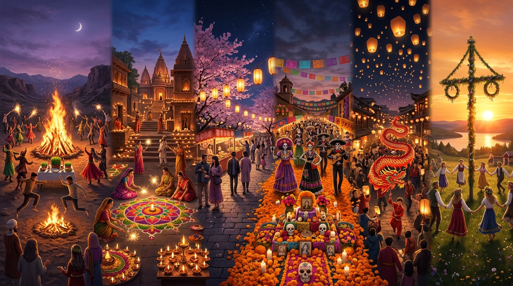

# 🎆 Dünya Festivalleri, Takvim Döngüleri ve Kutsal Ritüeller Külliyatı

  

> *"Festivaller, zamanın sıradan akışını durduran, insanı kutsal başlangıç anına geri götüren ve bir toplumu müşterek sevinçte eşitleyen kolektif arınma bayramlarıdır."*

İnsan toplulukları; mevsimlerin dönüşümünü, ekinlerin hasadını, ataların anısını ve karanlığa karşı ışığın zaferini binlerce yıldır şenlikler, danslar, ateşler ve kutsal ritüellerle kutlamıştır. Bu dosya, dünya halklarının takvim döngülerini şekillendiren en köklü 12 küresel festivalin antropolojik haritasıdır.

---

## 🎭 Medeniyetlerin Kurucu Festivalleri ve Ritüel Matrisi

| Festival / Bayram | Medeniyet & Coğrafya | Takvim Zamanı & Süre | Temel Anlam & Varoluşsal Felsefe | Kutsal Ritüel & İcra Biçimi |
| :--- | :--- | :--- | :--- | :--- |
| **Nevruz (Yeni Gün)** | Türk, Fars, Kürt & Orta Asya | 21 Mart (İlkbahar Ekinoksu) | **Yeniden Doğuş & Diriliş:** Kışın ölüm uykusundan sonra tabiatın uyanışı; Ergenekon'dan çıkış ve demir dövme töresi. | Ateş üzerinden atlama (arınma), 'Haft Sin' yedi kutsal sembol sofrası, Semeni yeşertme ve barışma ziyaretleri. |
| **Diwali (Işık Festivali)** | Hindistan (Hindu, Cayn, Sih) | Ekim - Kasım (Yeniay gecesi / 5 Gün) | **Işığın Karanlığa, Bilginin Cehalete Zaferi:** Lord Rama'nın 14 yıllık sürgünden dönüşü ve Tanrıça Lakshmi'nin bereketi. | Evlerin önüne yakılan yüzlerce küçük kil kandil (Diyas), renkli tozlarla yapılan Rangoli desenleri ve tatlı paylaşımı. |
| **Hanami (Sakura Seyri)** | Japonya (Şinto & Zen Felsefesi) | Mart sonu - Nisan başı (2 Hafta) | **Geçiciliğin Dingin Güzelliği (Mono no Aware):** Bir iki haftada dökülen kiraz çiçeklerinin faniliği hatırlatması. | Kiraz ağaçlarının altında aile ve dostlarla piknik yapma, sake içme ve anın kıymetini tefekkür etme. |
| **Día de los Muertos (Ölüler Günü)** | Meksika & Mezoamerika | 1 - 2 Kasım (2 Gün) | **Ölüm Bir Veda Değil, Atalarla Vuslattır:** Yaşayanlar ile göçüp gidenlerin mezarlıkta neşeyle kucaklaşması. | Kadife çiçeği (Cempasúchil) patikaları, şekerden kuru kafalar (Calaveras), mezarlarda kurulan ziyafet sofraları. |
| **İntiraymi (Güneş Şenliği)** | And Dağları (İnka Medeniyeti / Peru) | 24 Haziran (Güney Yarımküre Kış Gündönümü) | **Güneş Tanrısı İnti'ye Şükran:** Tarımsal döngünün başlangıcı ve Pachamama'dan bereket dilenmesi. | Sacsayhuamán kalesinde altın taht üzerinde İnka İmparatoru canlandırması, koka yaprağı ve Chicha sunusu. |
| **Ramazan & Kurban Bayramı** | İslam Medeniyeti (Küresel) | Hicri Takvim (12 Ay döngüsü) | **Nefis Terbiyesi, Dayanışma & Fedakarlık:** Açın halinden anlama, zekat ve kurban etiyle toplumda kimsesiz bırakmama. | Toplu iftar sofraları, bayram sabahı namazı, büyüklerin elini öpme ve küskünlerin barışması. |
| **Çin Yeni Yılı (Bahar Festivali)** | Çin & Doğu Asya (Sinik Havza) | Ocak sonu - Şubat ortası (15 Gün) | **Yenilenme, Aile Birliği & Uğur:** Kötü canavar Nian'ı kovma ve atalara hürmetle yeni yıla temiz girme. | Kırmızı zarfta para (Hongbao), ejderha ve aslan dansları, ailecek mantı (Jiaozi) bükme ve Fener Festivali. |
| **Midsommar (Yaz Dönencesi)** | İsveç & İskandinavya | Haziran ortası (En Uzun Gün) | **Kuzey Işığının Zaferi & Bereket:** Dondurucu kış karanlığından sonra hiç batmayan güneşin kutsanması. | Çiçekli Maypole direği etrafında halk dansları, ringa balığı, taze patates ve çilekli pasta ziyafeti. |
| **Songkran (Su Festivali)** | Tayland, Laos & Myanmar | 13 - 15 Nisan (Budist Yeni Yılı) | **Eski Yılın Günahlarından ve Kederinden Arınma:** Su ile ruhun, bedenin ve niyetlerin temizlenmesi. | Tapınaklardaki Buda heykellerine kokulu su dökme; sokaklarda tüm halkın birbirine su fışkırttığı dev su savaşı. |
| **Venedik Karnavalı** | İtalya (Rönesans & Katolik Mirası) | Şubat (Büyük Perhiz / Lent öncesi) | **Sosyal Sınıfların Eşitlenmesi & Maskeli Özgürlük:** Birkaç günlüğüne kölenin efendi, efendinin köle olabildiği hiciv bayramı. | İpek kumaşlar, porselen maskeler (Bauta, Volto), San Marco Meydanı'nda teatral geçitler ve gondol şenlikleri. |
| **Holi (Renkler Festivali)** | Hindistan & Nepal | Mart (Bahar Dolunayı) | **Aşk, Bağışlama ve Yeni Başlangıç:** İyiliğin kötülüğe galibiyeti (Holika efsanesi) ve kast sınırlarının kalkması. | Sokaklarda herkesin birbirine rengarenk organik boya tozları (Gulal) fırlatması ve kucaklaşması. |
| **Rio Karnavalı** | Brezilya (Afro-Latin Sentezi) | Şubat - Mart (Kırk Günlük Oruç öncesi) | **Toplu Katharsis & Bedenin Özgürlüğü:** Kölelik acılarının, favela yoksulluğunun samba ritmiyle neşeye dönüşmesi. | Sambadrome pistinde devasa kostümlü kortejler, sokak blokları (Blocos) ve gece gündüz süren samba dansı. |

---

## 🕯️ Ritüellerin Sosyolojik İşlevi

### 1. Zamanın Kutsanması ve Döngüsel Şuur
Modern insan zamanı tek yönlü akan doğrusal bir çizgi (kronos) olarak yaşar ve tükenme kaygısı taşır. Kadim festivaller ise zamanı **döngüsel (kairos)** kılar: Her bahar Nevruz'la yeniden doğulur, her kış gündönümünde ışık yeniden kazanır. Ölüm ve kış mutlak son değil, yeni bir baharın eşiğidir.

### 2. Sosyal Sınıfların Eşitlenmesi
Venedik Karnavalı'nın maskeleri veya Holi festivalinin rengarenk boyaları; zengin ile yoksulun, soylu ile halkın arasındaki hiyerarşik sınırları geçici olarak siler. Herkes aynı boyaya boyanır, herkes aynı maskenin ardında eşitlenir.
