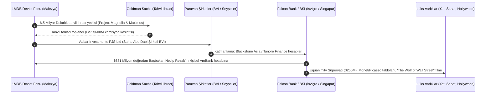

# 🕵️ Vaka Analizi: 1MDB - Küresel Finans Tarihinin En Büyük Egemen Varlık Fonu Soygunu

> "This is one of the greatest financial heists in history... Money that belonged to the people of Malaysia was used to buy luxury yachts, Van Gogh paintings, Beverly Hills mansions, and finance Hollywood films."  
> — **Loretta Lynch**, *ABD Adalet Bakanı (DOJ Basın Açıklaması, 2016)*

> "If you owe the bank $100, that's your problem. If you steal $4.5 billion from a national development fund with the help of Wall Street bankers, that's geopolitics."  
> — **Tom Wright & Bradley Hope**, *Billion Dollar Whale* (2018)

---

## 1. Yönetici Özeti ve Olayın Anatomisi

**1MDB (1Malaysia Development Berhad)**; Malezya halkının refahını artırmak, doğrudan yabancı yatırım çekmek ve yeşil enerji projelerini finanse etmek amacıyla 2009 yılında dönemin Başbakanı **Necip Rezak (Najib Razak)** tarafından kurulan bir stratejik kalkınma fonudur.

Ancak fon; Malezyalı finansör **Jho Low** ve Başbakan Necip Rezak'ın koordinasyonunda, tarihin en karmaşık ulusötesi kara para aklama makinesine dönüştürülmüştür. 2009-2014 yılları arasında fondan **4.5 milyar dolardan fazla kamu kaynağı** sahte ortak girişimler, offshore paravan şirketler ve İsviçre banka hesapları üzerinden hortumlanmıştır.

---

## 2. Finansal Akış ve Katmanlama Şeması

---

## 3. Temel Soruşturma Bulguları ve OSINT Metodolojisi

1. **İsim Benzerliğiyle Dolandırıcılık (The Clone Company Technique):**
   - Abu Dabi devlet fonu olan meşru *Aabar Investments PJS* yerine, Britanya Virjin Adaları'nda (BVI) aynı isimle sahte bir kabuk şirket (*Aabar Investments PJS Limited*) tescil ettirilerek fonlar buraya aktarıldı.
2. **Wall Street Suç Ortaklığı (Goldman Sachs):**
   - Goldman Sachs Güneydoğu Asya Başkanı **Tim Leissner** ve ortağı **Roger Ng**, piyasa faizinin iki katı komisyon ($600 milyon) karşılığında şüpheli fon transferlerine göz yumdu. Goldman Sachs, DOJ ve Malezya hükümetine $3.9 milyar ceza ödemeyi kabul etti.
3. **Medya ve Muhalefetin Susturulması:**
   - Skandalı haberleştiren *The Edge* gazetesi kapatıldı, Başsavcı Abdul Gani Patail görevden alındı ve MACC (Malezya Yolsuzlukla Mücadele Komisyonu) dedektifleri tasfiye edildi.
   - Hakikat; bağımsız araştırmacı gazeteci **Clare Rewcastle Brown** (*The Sarawak Report*) ve sızdırılan 227.000 e-posta arşivi sayesinde deşifre edildi.

---

## 4. Çıkarılan İstihbari Dersler

* **Egemen Varlık Fonları (SWF) Denetim Boşluğu:** Devlet başkanının tek imza yetkisine sahip olduğu fonlar, parlamenter denetimden muaf tutulduğunda kleptokratik avlanma sahasına dönüşür.
* **Muhabir Bankacılık Zaafı:** JPMorgan, Deutsche Bank, Standard Chartered ve BSI gibi küresel bankalar, milyarlarca dolarlık uyumsuz transferleri sırf işlem ücreti kazanmak uğruna raporlamamıştır.
