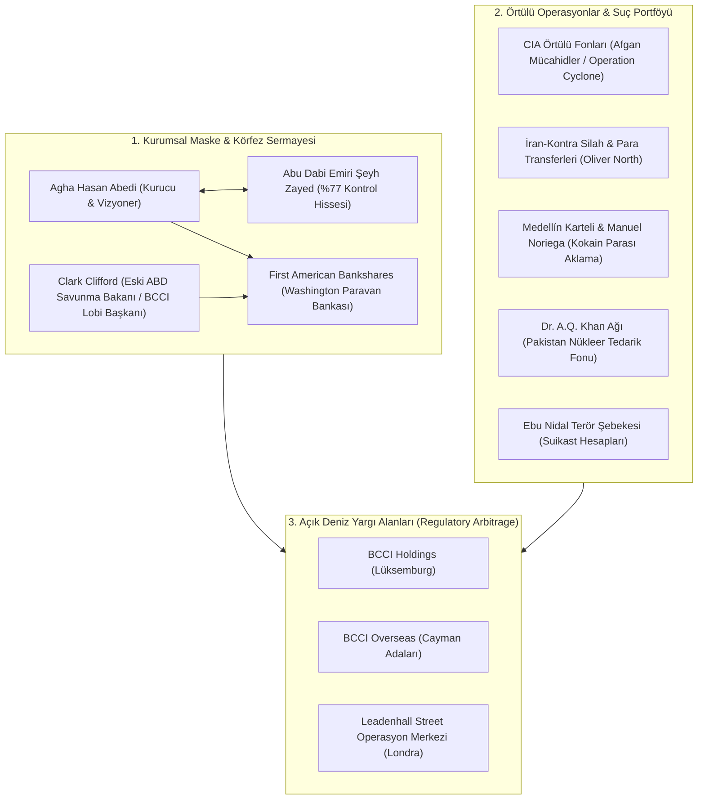

# 🕵️ Vaka Analizi: BCCI - İstihbarat Teşkilatlarının, Kartellerin ve Nükleer Kaçakçıların Küresel Bankası

> "BCCI was not just a bank; it was an elaborate corporate fraud, an intelligence asset, and a global criminal enterprise operating with sovereign impunity across 78 countries."  
> — **Senator John Kerry & Senator Hank Brown**, *U.S. Senate Committee on Foreign Relations Report ("The BCCI Affair", 1992)*

> "The CIA utilized BCCI for a simple reason: if you want to conduct deniable covert operations, finance proxy insurgencies, and move millions in untraceable cash, you do not use Chase Manhattan. You use a bank designed from its inception to evade sovereign regulation."  
> — **Robert Morgenthau**, *Manhattan District Attorney (Leading Prosecutor in the BCCI Indictment)*

---

## 1. Yönetici Özeti ve Bankanın Anatomisi

**Bank of Credit and Commerce International (BCCI)**; 1972 yılında Pakistanlı finansör **Agha Hasan Abedi** tarafından Abu Dabi Emiri Şeyh Zayed bin Sultan El Nahyan'ın finansmanıyla kurulan ve küresel finans tarihinin gelmiş geçmiş en büyük adli bankacılık skandalına dönüşen uluslararası bir finans devidir.

BCCI, zirve noktasında **78 ülkede 400'den fazla şubeye ve $20 milyardan fazla varlığa** hükmetmiştir. Bankanın kurumsal yapısı, hiçbir ulusal merkez bankasının veya finansal denetim otoritesinin tam denetim yetkisine sahip olamayacağı şekilde tasarlanmıştır: Ana holding Lüksemburg'da, operasyonel merkez Londra'da, iştirakler ise Cayman Adaları'nda tescil ettirilerek **"düzenleyici körlük" (regulatory arbitrage)** yaratılmıştır.

1991 yılında İngiltere Merkez Bankası (Bank of England), ABD Federal Reserve ve 7 ülkenin kolluk kuvvetleri tarafından tarihin en büyük eşzamanlı polis baskınıyla kapatılan banka; CIA örtülü operasyonlarından Medellín kartelinin kokain parasına, Pakistan'ın nükleer silah finansmanından Ebu Nidal terör örgütüne kadar uzanan bir suç konsorsiyumu olarak tescillenmiştir.

---

## 2. BCCI Çok Katmanlı Fon ve İstihbarat Ağı

---

## 3. Temel Soruşturma Bulguları ve Kerry Komitesi Raporu

1. **CIA ve İstihbarat Servislerinin Kullanımı:**
   - CIA Direktörü **William Casey**, 1980'lerde Sovyetler Birliği'ne karşı savaşan Afgan mücahitlerine yüz milyonlarca dolarlık örtülü silah finansmanı sağlamak (Operation Cyclone) için BCCI'ın Pakistan ve Körfez şubelerini kullandı.
   - Banka, İran'a gizli silah satışı ve Nikaragualı Kontralara para aktarılmasını içeren **İran-Kontra Skandalı**'nda (Oliver North ve Manucher Ghorbanifar) merkezi takas merkezi olarak hizmet verdi.
   - BCCI içinde CIA'in gizli hesaplarının yanı sıra, Fransız DGSE, İngiliz MI6 ve Suudi İstihbaratı'nın (GIP - Kemal Edhem) operasyonel fonları bulundu.
2. **Narkotik Parası Aklama (Operation C-Chase):**
   - 1988 yılında ABD Gümrük Servisi ve DEA tarafından yürütülen örtülü soruşturmada (*Operation C-Chase*), Medellín Karteli liderleri ve Panama diktatörü **Manuel Noriega**'nın kokain gelirlerinin BCCI Tampa ve Panama şubeleri üzerinden sahte kredi mekanizmalarıyla aklandığı kanıtlandı.
3. **Nükleer Silah Yayılması (A.Q. Khan Ağı):**
   - Pakistan nükleer programının babası kabul edilen Dr. Abdülkadir Han'ın, Avrupa'dan uranyum zenginleştirme santrifüj parçaları satın almak için kullandığı gizli şirketlerin finansmanı BCCI üzerinden sağlandı.
4. **Washington Nüfuz Casusluğu:**
   - BCCI, ABD bankacılık yasalarını çiğneyerek Washington'ın en büyük bankası olan *First American Bankshares*'i gizlice satın aldı. Bankanın başına eski ABD Savunma Bakanı ve Demokrat Parti'nin kıdemli ismi **Clark Clifford** getirildi; bu sayede ABD federal denetleyicilerinin soruşturmaları yıllarca engellendi.

---

## 4. Çıkarılan Adli ve Jeopolitik Dersler

* **Çok Yargı Alanlı Düzenleyici Boşluk:** Bir finans kuruluşu operasyonlarını, merkezini ve iştiraklerini denetim mekanizması olmayan offshore adalara böldüğünde, ulusal düzenleyicilerin münferit olarak suçu ortaya çıkarması imkansızdır.
* **İstihbarat Teşkilatlarının Finansal Körlüğü:** Bir banka istihbarat servislerine örtülü kolaylıklar sağladığında, bu servisler bankayı kapatmak yerine koruma altına alma refleksi gösterir; bu durum organize suçun devlet eliyle dokunulmaz kılınmasına yol açar.
* **Modern Bankacılık Regülasyonlarının Doğuşu:** BCCI'ın çöküşü; 1991 sonrasında **FATF (Mali Eylem Görev Gücü)** standartlarının küreselleşmesine, AML (Kara Para ile Mücadele) protokollerine ve "Müşterini Tanı" (KYC) yasalarının uluslararası zorunluluk haline gelmesine zemin hazırlamıştır.
