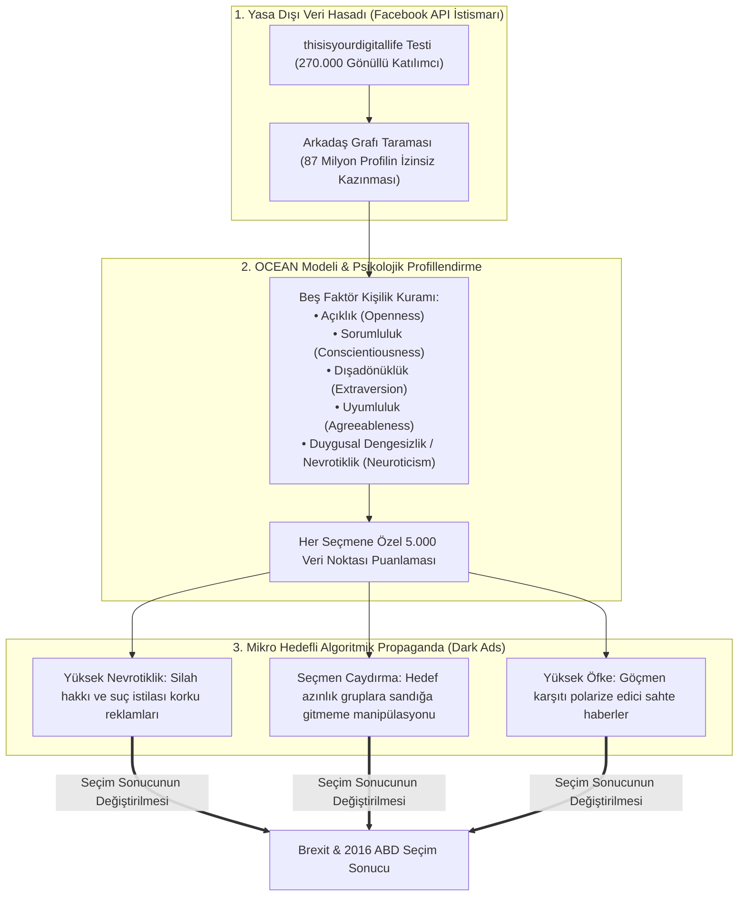

# 🕵️ Vaka Analizi: Cambridge Analytica ve Psikografik Algoritmik Harp

> "We broke Facebook. We used the personal data of 87 million people to build psychological profiles of voters and target them with algorithmic propaganda tailored to their deepest inner demons and neuroses."  
> — **Christopher Wylie**, *Cambridge Analytica İfşaatçısı (Mindf*ck: Cambridge Analytica and the Plot to Break America, 2019)*

> "If you know a voter is high in neuroticism and low in agreeableness, you don't send them an economic policy white paper. You feed them a dark ad showing an immigrant breaking into a suburban home with a crowbar."  
> — **Alexander Nix**, *CEO, Cambridge Analytica / SCL Group (Gizli Kamera Kayıtları, Channel 4 News, 2018)*

---

## 1. Yönetici Özeti ve Operasyonun Anatomisi

2018 yılında ifşa olan **Cambridge Analytica Skandalı**; askeri psikolojik harekât (PSYOP) yöntemlerinin, büyük veri madenciliğinin ve algoritmik sosyal mühendisliğin egemen demokratik seçimleri manipüle etmek amacıyla kitlelere karşı bir silah olarak nasıl kullanıldığını kanıtlayan modern tarihin en kritik bilişsel harp vakasıdır.

İngiliz askeri istihbarat yüklenicisi **SCL Group (Strategic Communication Laboratories)** bünyesinde kurulan ve milyarder hedge-fon yöneticisi **Robert Mercer** ile **Steve Bannon** tarafından finanse edilen Cambridge Analytica; Cambridge Üniversitesi akademisyeni Aleksandr Kogan'ın geliştirdiği bir kişilik testi uygulaması (*thisisyourdigitallife*) üzerinden **87 milyondan fazla Facebook kullanıcısının ve onların tüm arkadaşlarının gizli verilerini izinsiz olarak ele geçirmiştir**.

Bu veriler; 2016 Birleşik Krallık **Brexit Referandumu (Leave.EU)** ve 2016 **ABD Başkanlık Seçimleri**'nde (Trump Kampanyası - Project Alamo) seçmenlerin korku, öfke ve paranoyalarını tetikleyen kişiselleştirilmiş "karanlık reklamlarla" (dark ads) hedef alınmasında kullanılmıştır.

---

## 2. Psikometrik Algoritmik Silah Mimarisi

---

## 3. Temel Soruşturma Bulguları ve Harekât Taktikleri

1. **Askeri PSYOP Doktrininin Sivillere Karşı Kullanılması:**
   - SCL Group; daha önce Afganistan'da Taliban'a karşı, Kenya ve Nijerya'da seçim manipülasyonlarında NATO ve İngiltere Savunma Bakanlığı için yürüttüğü algoritmik kitle psikolojisi yöntemlerini doğrudan Batı demokrasilerine uyarladı.
2. **Karanlık Reklamlar (Dark Ads) ve Algoritmik İz Silme:**
   - Facebook üzerinde yalnızca hedef alınan spesifik bireyin gördüğü, kamuya açık akışta yer almayan ve yayınlandıktan sonra kaybolan hedefli reklamlar kullanıldı.
   - Bu sayede muhalif kampanyaların veya denetleyici otoritelerin yalan haberi veya manipülasyonu tespit edip tekzip etmesi imkansız hale getirildi.
3. **Seçmen Sandıktan Soğutma (Deterrence Campaigns):**
   - Özellikle kilit eyaletlerde (Wisconsin, Michigan, Pennsylvania) Afro-Amerikan ve genç seçmenlerin sandığa gitmesini engellemek için, Hillary Clinton'ın 1996'daki "Superpredator" konuşması gibi parçalanmış ses ve video içerikleri hedefli reklam olarak pompalandı.
4. **İfşaat ve Hukuki Hesaplaşma:**
   - 2018 yılında veri bilimci **Christopher Wylie**'ın *The Guardian* (Carole Cadwalladr) ve *The New York Times*'a sızdırdığı şirket içi belgeler, küresel bir infiale yol açtı.
   - ABD Federal Ticaret Komisyonu (FTC), kullanıcı gizliliğini ihlal ettiği gerekçesiyle Facebook'a **5 milyar dolarlık tarihi bir ceza** kesti. Cambridge Analytica iflasını ilan etti ancak kurucuları ve veri varlıkları *Emerdata* adı altında yeni kabuk şirketlere aktarıldı.

---

## 4. Çıkarılan Bilişsel ve Jeopolitik Dersler

* **Veri Gözetim Kapitalizminin Demokratik Maliyeti:** Dijital platformların ücretsiz hizmet karşılığında topladığı insan davranış verileri, yabancı istihbarat servisleri ve oligarklar tarafından satın alınabilir siyasal silahlar üretmek için kullanılmaktadır.
* **Bilişsel Egemenliğin Çöküşü:** Bir toplumun oy verme davranışı ve siyasal tercihleri, dışarıdan algoritmik parametrelerle manipüle edilebildiği anda, o ulusun anayasal egemenliği bir illüzyona dönüşür.
* **Yapay Zeka ve Üretken Model Tehdidi:** Cambridge Analytica döneminde ilkel gözetim ve istatistiksel modellerle yapılan psikolojik harekât; günümüzde LLM'ler (Büyük Dil Modelleri) ve Deepfake sentetik videolar ile gerçek zamanlı ve otonom olarak yürütülebilir hale gelmiştir.
