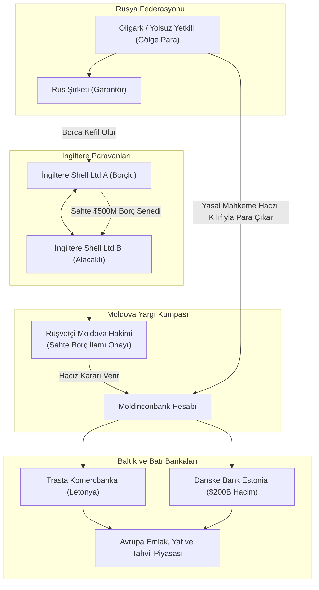

# 🕵️ Vaka Analizi: Magnitsky Vakası & Rus/Troika Laundromat Aklama Çarkı

> "Sergei Magnitsky died because he uncovered the theft of $230 million of Russian taxpayers' money by corrupt police officers and tax officials. They tortured him for 358 days to make him withdraw his testimony, and when he refused, they beat him to death with rubber batons."  
> — **Bill Browder**, *Red Notice: A True Story of High Finance, Murder, and One Man's Fight for Justice* (2015)

> "The Russian Laundromat was not an accident; it was an industrial-scale public utility for moving stolen state wealth into London penthouses and French Riviera villas."  
> — **OCCRP (Organized Crime and Corruption Reporting Project)**

---

## 1. Yönetici Özeti: 20 Milyar Dolarlık Aklama Boru Hattı

**Rus Çamaşırhanesi (The Russian Laundromat)** ve **Troika Laundromat**; 2011 ile 2014 yılları arasında Rusya'daki organize suç örgütleri, FSB görevlileri ve oligarklar tarafından hortumlanan **20.8 milyar doların** Moldova mahkemeleri ve Letonya/Estonya bankaları üzerinden Avrupa Birliği finans sistemine sokulduğu devasa bir aklama şebekesidir.

Bu düzenek, vergi müfettişi **Sergei Magnitsky**'nin 2008 yılında 230 milyon dolarlık bir vergi iadesi dolandırıcılığını ortaya çıkarması ve ardından Moskova'daki Butyrka Cezaevi'nde işkenceyle katledilmesiyle küresel bir jeopolitik kırılmaya yol açmıştır. Olay, ABD Kongresi'nin insan hakları ihlalcilerine yönelik küresel yaptırım yasası olan **Global Magnitsky Act**'i kabul etmesini sağlamıştır.

---

## 2. Aklama Döngüsünün Hukuki Hilesi: "Moldova Mahkeme Kararı Modeli"

---

## 3. OCCRP Tarafından Deşifre Edilen Temel Bulgular

1. **Sahte Borç Senetleri:** İngiltere'de kayıtlı iki paravan şirket aralarında hiçbir mal alımı olmaksızın 500 milyon dolarlık hayali bir borç sözleşmesi imzalamakta, Rusya'daki bir şirket de bu borca kefil olmaktaydı.
2. **Moldovalı Hakimlerin İcrası:** Borç ödenmediği gerekçesiyle Moldovalı rüşvetçi bir hakime başvurulmakta; hakim birkaç saat içinde Rus garantörün Rusya'daki banka hesaplarına resmi haciz kararı çıkarmaktaydı.
3. **Meşrulaştırılmış Para Kaçışı:** Para, Rusya Merkez Bankası denetiminden "yabancı mahkeme ilamı" gereğince yasal olarak çıkmakta, Moldova üzerinden Letonya (Trasta Komercbanka) ve Estonya (Danske Bank) hesaplarına aktarılmaktaydı.

---

## 4. Jeopolitik Miras: Global Magnitsky Yaptırım Rejimi

* Sergei Magnitsky'nin ölümü sonrasında ABD'de kabul edilen yasa, günümüzde AB, İngiltere, Kanada ve Avustralya tarafından benimsenmiştir.
* Bu rejim; devletler yerine doğrudan bireysel insan hakları ihlalcilerinin, işkencecilerin ve kleptokratların mal varlıklarını dondurma ve vize iptali uygulama yetkisi tanımaktadır.
