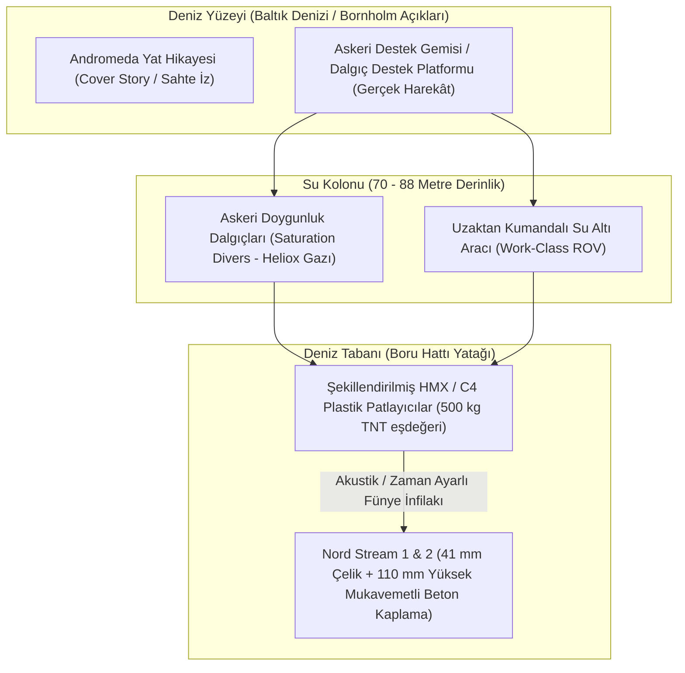

# 🕵️ Vaka Analizi: Kuzey Akım (Nord Stream) Sabotajı ve Enerji Harbi

> "If Russia invades... then there will be no longer a Nord Stream 2. We will bring an end to it... I promise you, we will be able to do that."  
> — **Joe Biden**, *ABD Başkanı (Beyaz Saray Basın Toplantısı, 7 Şubat 2022)*

> "The destruction of the Nord Stream pipelines was not merely an act of terrorism against critical infrastructure; it was a geopolitical amputation that permanently severed the industrial heart of Germany from Russian natural gas."  
> — **Küresel Röntgen Jeopolitik Analiz Doktrini**

---

## 1. Yönetici Özeti ve Olayın Kronolojisi

**26 Eylül 2022** tarihinde, Baltık Denizi'nde Danimarka'nın Bornholm Adası yakınlarında uluslararası sularda ve münhasır ekonomik bölgede (MEB), Rusya'dan Almanya'ya doğal gaz taşıyan **Nord Stream 1 ve Nord Stream 2** boru hatlarında dört ayrı noktada şiddetli patlamalar meydana gelmiştir.

Patlamalar sonucunda, yıllık 110 milyar metreküp taşıma kapasitesine sahip çelik ve beton takviyeli yüksek basınçlı doğal gaz boru hatları tahrip edilmiş; tarihin en büyük metan gazı sızıntısı gerçekleşmiştir. Olay, modern tarihte kritik enerji altyapısına yönelik gerçekleştirilmiş **en yıkıcı devlet destekli deniz tabanı sabotajı (seabed sabotage)** olarak kayıtlara geçmiştir.

---

## 2. Deniz Tabanı Saldırı Mimarisi ve Adli Veriler

---

## 3. Sismik, Akustik ve Radar (AIS) Bulguları

1. **Sismik Kayıtlar:**
   - İsveç Ulusal Sismoloji Ağı (SNSN) ve Danimarka Jeolojik Araştırma Enstitüsü (GEUS), 26 Eylül günü saat 02:03 ve 19:03'te **Richter ölçeğine göre 2.3 büyüklüğünde** yapay sismik patlama dalgaları kaydetmiştir.
   - Sinyal analizi, olayın doğal bir deprem değil, doğrudan deniz tabanına temas eden yüksek brizanslı bir patlayıcı infilakı olduğunu teyit etmiştir.
2. **Derinlik ve Operasyonel Zorluk:**
   - Boru hatları 70 ila 88 metre derinlikte yer almaktadır. Bu derinlikte serbest tüplü dalış ölümcüldür; dekompresyon odaları, helyum-oksijen (Heliox) gaz karışımı ve profesyonel saturasyon dalış sistemleri gerektirir.
   - 4.1 cm kalınlığında mangan alaşımlı çeliği ve 11 cm kalınlığında ağır betonu parçalayabilmek için yönlendirilmiş patlayıcı mühendisliği (shaped charges) kullanılmıştır.
3. **AIS Karartma ve Şüpheli Deniz Hareketliliği:**
   - Patlamadan önceki günlerde bölgede transponder'larını (AIS) kapatan askeri gemilerin seyir yaptığı açık kaynak uydu görüntüleriyle tespit edilmiştir.
   - Baltık Denizi'nde haziran ayında icra edilen **NATO BALTOPS 22** tatbikatı sırasında ABD 6. Filosu'na bağlı patlayıcı mühimmat imha (EOD) dalgıçlarının aynı lokasyonda insansız su altı araçlarıyla (UUV) tatbikat yaptığı doğrulanmıştır.

---

## 4. Jeopolitik Sonuçlar ve Enerji Haritasının Yeniden Çizilmesi

* **Almanya'nın Sanayisizleşmesi:** Ucuz Rus doğal gazı tedarikinin kalıcı olarak son bulması, Alman kimya, çelik ve otomotiv devlerinin (BASF, ThyssenKrupp) üretim maliyetlerini katlamış ve üretimi ABD/Çin'e kaydırma sürecini hızlandırmıştır.
* **ABD LNG İhracat Patlaması:** Avrupa'nın Rus gazından kopmasıyla birlikte ABD, dünyanın en büyük Sıvılaştırılmış Doğal Gaz (LNG) ihracatçısı konumuna yükselmiş ve Avrupa enerji pazarının ana tedarikçisi haline gelmiştir.
* **Baltık Boru Hattı (Baltic Pipe):** Sabotajdan tam bir gün sonra Norveç gazını Polonya'ya taşıyan Baltık Boru Hattı törenle açılmış; Orta ve Doğu Avrupa'nın enerji akış mimarisi kuzeye kaydırılmıştır.
