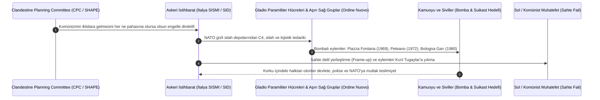

# 🕵️ Vaka Analizi: Gladio Operasyonu ve NATO Stay-Behind Gizli Orduları

> "The invisible government was not a conspiracy theory; it was a formal military directive approved by the highest levels of the Atlantic Alliance."  
> — **Daniele Ganser**, *NATO's Secret Armies: Operation GLADIO and Terrorism in Western Europe* (2005)

> "The secret services, having become a state within the state, carried out massacres to prevent the political left from coming to power."  
> — **Ferdinando Imposimato**, *İtalyan Onursal Yüksek Mahkeme Yargıcı ve Aldo Moro Cinayeti Başsavcısı*

---

## 1. Yönetici Özeti ve Tarihsel Kökenler

**Operation Gladio (Kılıç Operasyonu)**; II. Dünya Savaşı'nın hemen ardından CIA (Merkezi İstihbarat Teşkilatı) ve İngiliz MI6 koordinasyonunda, olası bir Sovyetler Birliği işgali durumunda cephe gerisinde gayrinizami harp, sabotaj ve istihbarat faaliyetleri yürütmek amacıyla kurulan gizli bir **"Stay-Behind" (Geride Kalan)** paramiliter şebekesidir.

İtalya Başbakanı **Giulio Andreotti**'nin 24 Ekim 1990 tarihinde İtalyan Parlamentosu'nda Gladio'nun varlığını resmen itiraf etmesiyle ifşa olan ağ; yalnızca İtalya ile sınırlı kalmamış, tüm NATO üyesi ve tarafsız Avrupa ülkelerinde (Türkiye'de *Özel Harp Dairesi / Kontrgerilla*, Belçika'da *SDRA8*, Yunanistan'da *Kızıl Post / Sheepskin*, Almanya'da *Stay-Behind*, Avusturya'da *Schwurbruderschaft*) paralel hücreler halinde örgütlenmiştir.

---

## 2. Gerginlik Stratejisi (Strategy of Tension) Mimarisi

Gladio ağları, Sovyet işgali tehdidi gerçekleşmeyince lağvedilmek yerine; iç siyasette sol ve komünist partilerin demokratik yollarla iktidara gelmesini engellemek amacıyla **"Gerginlik Stratejisi" (Strategia della tensione)** doktrini çerçevesinde kullanılmıştır.

---

## 3. Temel Eylemler, İddianameler ve Deşifre Olan Ağlar

1. **Bologna Tren Garı Katliamı (2 Ağustos 1980):**
   - 85 sivilin hayatını kaybettiği, 200'den fazla kişinin yaralandığı patlamada kullanılan patlayıcının askeri tipte T4 (RDX) olduğu adli tıp tarafından kanıtlanmıştır.
   - İtalyan mahkemeleri, saldırının aşırı sağcı militanlar (*NAR*) tarafından yapıldığını, ancak askeri istihbarat (*SISMI*) şeflerinin soruşturmayı saptırmak için tren kompartımanına sahte kanıt yerleştirdiğini hükme bağlamıştır.
2. **Propaganda Due (P2) Mason Locası ve Finansal Ayak:**
   - Eski faşist **Licio Gelli** liderliğindeki P2 Locası; 3 bakan, 43 general, 8 amiral, istihbarat başkanları, bankacılar ve medya patronlarını (Silvio Berlusconi dahil) içeren gizli bir gölge hükümet konseyiydi.
   - Locanın finansörü olan Vatikan Bankası (IOR) bağlantılı Banco Ambrosiano başkanı **Roberto Calvi**, Gladio ve mafya hesaplarının deşifre olması üzerine 1982'de Londra Blackfriars Köprüsü altında asılı bulunmuştur.
3. **Aldo Moro Suikastı (1978):**
   - İtalya'da Hristiyan Demokratlar ile Komünist Parti arasında "Tarihsel Uzlaşma" (Compromesso Storico) koalisyonunu kurmaya çalışan Başbakan Aldo Moro kaçırılarak öldürülmüştür. Soruşturma hakimi Ferdinando Imposimato, Moro'nun tutulduğu hücre evinin İtalyan istihbaratı ve P2 bağlantılı odaklarca bilindiğini ancak kurtarılmadığını belgelemiştir.
4. **Türkiye'de Kontrgerilla ve Özel Harp Dairesi:**
   - 1974 yılında Başbakan **Bülent Ecevit**'in bütçeden habersiz örtülü ödenek talebi üzerine öğrendiği Özel Harp Dairesi; 1 Mayıs 1977 Taksim Katliamı, Maraş ve Çorum olayları gibi gerginlik stratejisi operasyonlarında sorgulanmış, 1996 **Susurluk Skandalı** ile devlet-mafya-istihbarat üçgeni adli kayıtlara geçmiştir.

---

## 4. İstihbari ve Anayasal Çıkarımlar

* **Paralel Devletin Yasallık Yanılsaması:** Gladio operasyonları, meclis denetiminden kaçırılmış gizli bütçeler ve NATO askeri koordinasyonu ile yürütülmüş; anayasal düzen "devleti koruma" gerekçesiyle bizzat devlet organlarınca askıya alınmıştır.
* **Silah Depolarının Dokunulmazlığı:** Avrupa genelinde dağlara, kiliselere ve mezarlıklara gizlenen yüzlerce gizli silah ve patlayıcı sığınağının bir kısmı hiçbir zaman resmi makamlara teslim edilmemiş; organize suç şebekelerinin eline geçmiştir.
