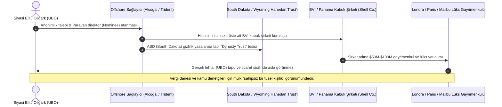

# 🕵️ Vaka Analizi: Pandora Belgeleri ve Küresel Offshore Gizlilik Ağları

> "The offshore world isn't a secret side room in global finance; it is the central operating system of the modern global elite."  
> — **Bastian Obermayer & Frederik Obermaier**, *International Consortium of Investigative Journalists (ICIJ)*

> "If you are a working-class citizen, every dollar of your income is automatically reported to the tax authorities. If you are an oligarch or head of state, you hire an offshore provider to make your wealth legally non-existent."  
> — **Gabriel Zucman**, *The Hidden Wealth of Nations* (2015)

---

## 1. Yönetici Özeti ve Sızıntının Boyutu

2021 yılında Uluslararası Araştırmacı Gazeteciler Konsorsiyumu (ICIJ) tarafından yayımlanan **Pandora Belgeleri (Pandora Papers)**; 117 ülkeden 600'den fazla gazetecinin katıldığı, tarihin en kapsamlı küresel finansal sızıntısıdır.

Sızıntı; Britanya Virjin Adaları, Panama, Seyşeller, Belize, Kıbrıs, Lüksemburg, Singapur, Samoa ve İsviçre gibi yargı alanlarında faaliyet gösteren **14 offshore kurumsal hizmet sağlayıcısına ait 11.9 milyon gizli belgeyi (2.94 Terabayt)** gün yüzüne çıkarmıştır. Belgeler, **35'ten fazla görevdeki ve eski devlet başkanı**, 330'dan fazla üst düzey siyasetçi, 130 Forbes milyarderi ve organize suç şebekelerinin trilyonlarca dolarlık kayıt dışı servetini ortaya koymuştur.

---

## 2. Offshore Katmanlama ve Varlık Gizleme Mekanizması

---

## 3. Temel Soruşturma Bulguları ve Öne Çıkan Aktörler

1. **Güney Dakota ve ABD'nin Yeni Küresel Vergi Cenneti Olması:**
   - Soruşturma, ABD'nin (özellikle South Dakota, Nevada ve Delaware) İsviçre ve Karayipler'i geride bırakarak dünyanın en büyük finansal gizlilik sığınağı haline geldiğini kanıtlamıştır.
   - ABD, yabancı ülkelerle otomatik bankacılık veri paylaşımı sağlayan **CRS (Ortak Raporlama Standardı)** sözleşmesine taraf olmayı reddederek, küresel diktatörlerin ve rüşvet çarklarının parasını koruyan bir kara delik oluşturmuştur.
2. **Kraliyet Servetleri ve Siyasi İkiyüzlülük:**
   - **Ürdün Kralı II. Abdullah:** Uluslararası yardımlarla ayakta duran ülkesinde tasarruf tedbirleri uygularken, BVI ve Panama paravan şirketleri üzerinden Malibu, Washington ve Londra'da **100 milyon dolardan fazla lüks gayrimenkul** biriktirmiştir.
   - **Çekya Başbakanı Andrej Babiš:** Yolsuzlukla mücadele vaadiyle iktidara gelmesine rağmen, Monako ve Washington paravan şirketleri aracılığıyla Fransa'nın güneyinde 22 milyon dolarlık şato satın almıştır.
   - **Tony Blair (Eski İngiltere Başbakanı):** Londra'da 8.8 milyon dolarlık ticari mülk alırken, mülkü doğrudan almak yerine mülkün sahibi olan BVI şirketini satın alarak **312.000 sterlin damga vergisinden (Stamp Duty)** kaçınmıştır.
   - **Volodymyr Zelensky:** Cumhurbaşkanı seçilmeden önce prodüksiyon şirketi Kvartal 95 ortaklarıyla birlikte kurduğu BVI, Kıbrıs ve Belize kabuk şirketleri ağını (Maltex Multicapital Ltd) yönettiği; hisselerini seçim öncesi ortağına devrettiği belgelenmiştir.

---

## 4. Çıkarılan Adli ve Jeopolitik Dersler

* **Tüzel Kişilik Peçesi (Corporate Veil):** Paravan yöneticiler (nominee directors) ve karmaşık trust yapıları arkasına saklanan gerçek faydalanıcılar (Ultimate Beneficial Owner - UBO), şeffaf merkezi sicil kayıtları olmadan tespit edilemez.
* **Hukuk ve Muhasebe Sektörünün Rolü (The Enablers):** Küresel kleptokrasi, Batılı "saygın" hukuk firmaları, vergi danışmanları ve uluslararası denetim şirketleri olmaksızın işletilemez. Yolsuzluk, çevre ülkelerde üretilip merkez batı başkentlerinde kurumsallaştırılmaktadır.
