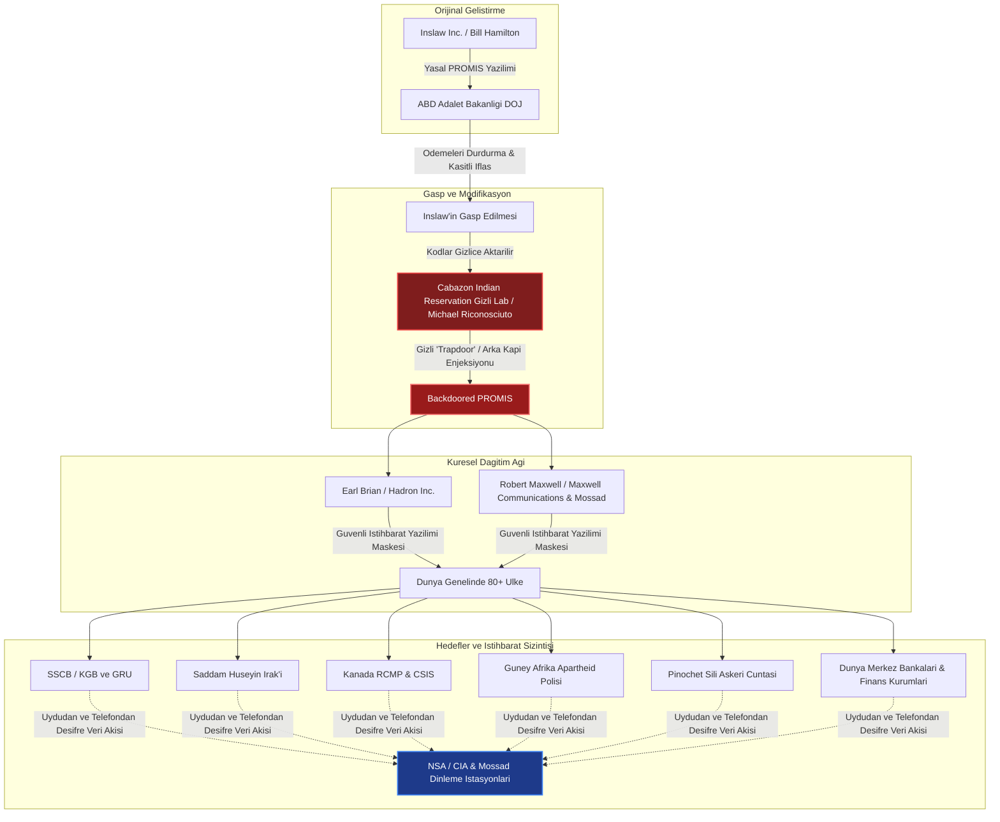

# 🕵️ Vaka Analizi: PROMIS Yazılımı ve Inslaw Skandalı - Küresel Arka Kapı İstihbaratı ve "Ahtapot" (The Octopus) Komplosu

> "The theft of PROMIS was not just a commercial crime or an intellectual property dispute; it was the mother of all global intelligence operations. By putting a backdoored surveillance brain inside every foreign intelligence agency, police force, and central bank, they created an invisible panopticon."  
> — **Jack Brooks**, *ABD Temsilciler Meclisi Adalet Komitesi Başkanı (Inslaw Soruşturma Raporu, 1992)*

> "I have traced the tentacles of an entity I call 'The Octopus'. It links the theft of the Inslaw software, the October Surprise, the BCCI money laundering apparatus, and the covert funding of the Contras. If I don't make it back, know that I didn't commit suicide."  
> — **Danny Casolaro**, *Araştırmacı Gazeteci (10 Ağustos 1991'de Martinsburg, West Virginia'da şüpheli şekilde ölü bulundu)*

---

## 1. Yönetici Özeti ve Skandalın Özü

**Inslaw & PROMIS Olayı**; 1980'lerin başında eski bir NSA analisti olan **William A. Hamilton** ve eşi Nancy Hamilton tarafından kurulan Inslaw Inc. şirketinin geliştirdiği **PROMIS (Prosecutor's Management Information System)** adlı devrim niteliğindeki veri tabanı ve takip yazılımının ABD Adalet Bakanlığı (DOJ) tarafından hileli yöntemlerle gasp edilmesiyle başlayan, ardından Soğuk Savaş ve modern siber istihbarat tarihinin en karanlık operasyonuna dönüşen küresel bir casusluk skandalıdır.

PROMIS; farklı dillerdeki ve uyumsuz formatlardaki devasa istihbarat, polis ve finans kayıtlarını birbirine bağlayabilen, bireylerin hareketlerini, finansal transferlerini ve telefon görüşmelerini çapraz sorgularla haritalandırabilen ilk modern ilişkisel veri madenciliği yazılımıydı. 

ABD istihbarat aygıtı (CIA, NSA ve Reagan yönetimi müttefikleri), yazılıma **gizli bir "arka kapı" (trapdoor / backdoor)** entegre ederek, yazılımı İngiliz medya baronu ve Mossad ajanı **Robert Maxwell** ile Dr. **Earl Brian** aracılığıyla dünya genelinde 80'den fazla ülkenin gizli servislerine, polis teşkilatlarına, merkez bankalarına ve nükleer komuta merkezlerine satmıştır. Bu sayede hedef ülkelerin tüm ulusal güvenlik ve istihbarat veritabanları anlık olarak Langley (CIA) ve Fort Meade'e (NSA) akıtılmıştır.

---

## 2. PROMIS Arka Kapı ve Dağıtım Mimarisi

---

## 3. "Ahtapot" (The Octopus) Ağının Bileşenleri

Araştırmacı gazeteci Danny Casolaro'nun ölümünden önce ortaya çıkardığı ve 8 ana koldan oluşan suç/istihbarat sindikası ("The Octopus") şu yapıları kapsıyordu:

| Bileşen | Aktörler ve Kurumlar | Operasyonel Rolü ve PROMIS Bağlantısı |
| :--- | :--- | :--- |
| **Yazılım Gaspı** | ABD Adalet Bakanlığı (Edwin Meese, Peter Videnieks) | Inslaw'ın 10 milyon dolarlık sözleşme ödemelerini durdurup şirketi iflasa zorlayarak kaynak kodları telifsiz ele geçirmek. |
| **Arka Kapı Enjeksiyonu** | Michael Riconosciuto, Wackenhut Corp, Cabazon Rezervasyonu | Kaliforniya'daki yerli arazisinde kurulan yasa dışı silah ve elektronik harp merkezinde PROMIS'e telekom dinleme mikroçipleri ve arka kapı kodları yazmak. |
| **Uluslararası Dağıtım** | Dr. Earl Brian (Hadron Inc.), Robert Maxwell | Robert Maxwell'in Doğu Bloku ve Orta Doğu'daki bağlantıları kullanılarak "kırılamaz şifreli savunma yazılımı" adıyla düşman ülkelere satılması. |
| **Kara Para Aklama** | BCCI (Bank of Credit and Commerce International) | PROMIS satışından, İran-Kontra silah kaçakçılığından ve uyuşturucu ticaretinden gelen milyarlarca doların gizli off-shore hesaplarda aklanması. |
| **Ekim Sürprizi (October Surprise)** | William Casey, George H. W. Bush çevresi | 1980 seçimlerinde Jimmy Carter'ın kazanmasını engellemek için Tahran'daki Amerikalı rehinelerin serbest bırakılmasını geciktirme rüşvetleri. |
| **Yabancı İstihbarat Teşkilatlarının İzlenmesi** | Mossad, MI6, NSA, CIA | Mossad ajanı Rafi Eitan ve Robert Maxwell işbirliği ile Sovyet nükleer tesislerinin ve Arap ordularının lojistik hareketlerinin izlenmesi. |

---

## 4. Kritik Aktörler ve Gizemli Ölümler

### Michael Riconosciuto'nun İtirafı
1991 yılında Inslaw davasında yeminli ifade veren bilgisayar dehası ve istihbarat taşeronu Michael Riconosciuto; Adalet Bakanlığı yetkilisi Peter Videnieks'in talimatıyla Cabazon arazisinde PROMIS yazılımına yabancı hükümetlerin veri tabanlarını gizlice NSA'ya ileten bir arka kapı yerleştirdiğini açıkladı. Bu ifadeyi verdikten yalnızca 8 gün sonra uyuşturucu suçlamasıyla tutuklandı ve uzun yıllar hapis yattı.

### Danny Casolaro Cinayeti (Ağustos 1991)
Casolaro; Inslaw, BCCI, Kontralar ve Ekim Sürprizi'ni tek bir şemada birleştiren kitabını tamamlamak ve gizli bir muhbirle buluşmak üzere Martinsburg, West Virginia'daki Sheraton Oteli'ne gitti. 10 Ağustos 1991'de otel odasının küvetinde bilekleri 10-12 kez derin şekilde kesilmiş olarak bulundu. Olay yeri alelacele "intihar" olarak kapatıldı, ancak yanındaki kalın araştırma dosyası ve kasetler tamamen kaybolmuştu.

### Robert Maxwell'in Ölümü (Kasım 1991)
PROMIS'i Doğu Bloku ülkelerine, Bulgaristan'a, Çin'e ve Arap rejimlerine satan ve Mossad adına çalışan medya baronu Robert Maxwell, emeklilik fonlarını yağmaladığı ve çift taraflı ajanlık şüpheleri doğduğu bir dönemde Kanarya Adaları açıklarında yatı *Lady Ghislaine*'den denize "düşerek" hayatını kaybetti. Kudüs'te Zeytin Dağı'nda devlet töreniyle ve İsrail'in en üst düzey istihbarat liderlerinin katılımıyla defnedildi.

---

## 5. Hukuki ve Jeopolitik Sonuçlar

1. **Kongre Soruşturması ve Adalet Bakanlığı Mahkumiyeti:**
   - Washington D.C. İflas Mahkemesi Yargıcı George Bason; Adalet Bakanlığı'nın Inslaw'a karşı *"hile, sahtekarlık ve kamu gücünü kötüye kullanma"* yoluyla yazılımı çaldığını hükmetti ve Inslaw'a tazminat ödenmesine karar verdi (Karar daha sonra üst mahkemelerde usulden bozuldu ve Yargıç Bason görevden alındı).
   - 1992 yılında Temsilciler Meclisi Adalet Komitesi Başkanı Jack Brooks liderliğinde yayımlanan resmi kongre raporunda; üst düzey Adalet Bakanlığı yetkililerinin komplo kurarak yazılımı ele geçirdiği doğrulandı.
2. **Modern İstihbarat Tedarik Zinciri Operasyonlarının Atası:**
   - PROMIS operasyonu; günümüzdeki SolarWinds, PRISM, Pegasus ve donanım düzeyinde arka kapı yerleştirme operasyonlarının (Interdiction / Tailored Access Operations) ilk küresel ölçekli tarihi öncülü kabul edilir.
3. **Casus Yazılımların Kurumsallaşması:**
   - Özel şirketlerin geliştirdiği çift kullanımlı (dual-use) ticari analiz yazılımlarının devlet eliyle silahlaştırılması ve dost/düşman ayrımı yapılmaksızın küresel müttefiklere dahi satılarak istihbarat çekilmesi pratiği bu olayla kurumsallaşmıştır.

---

## 6. Araştırma ve Teftiş Kaynakları

* **ABD Temsilciler Meclisi Raporu (1992):** *The INSLAW Affair: Investigative Report by the Committee on the Judiciary*, House Report 102-857.
* **Kitap:** Fabrizio Calvi & Thierry Pfister, *L'Oeil de Washington* (Washington'ın Gözü: PROMIS Skandalı), 1996.
* **Kitap:** Cheri Seymour, *The Last Circle: Danny Casolaro's Investigation into the Octopus and the Promis Software Scandal*, Trine Day (2010).
* **Kitap:** Gordon Thomas & Martin Dillon, *Robert Maxwell, Israel's Superspy: The Life and Murder of a Media Mogul*, Carroll & Graf (2002).
* **Arşiv Dosyaları:** Wired Magazine (1993), *"The Inslaw Affair - The Software That Launched a Thousand Conspiracies"*.
