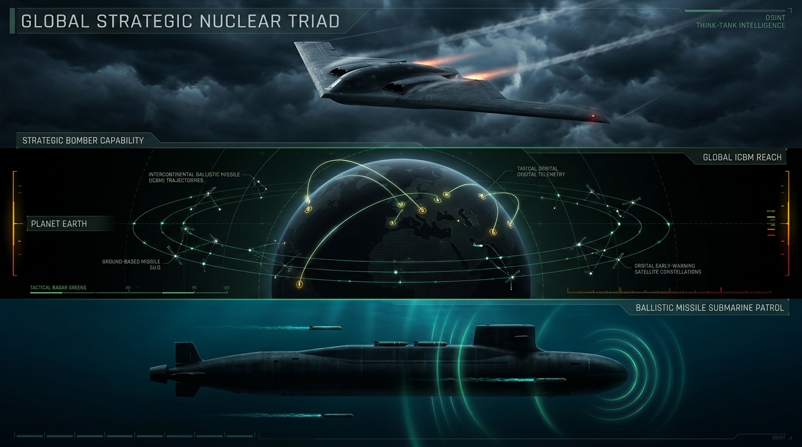

# 🌐 Medeniyet Atlası: Jeopolitik Güç, Savunma ve İstihbarat Külliyatı (/geopolitics_and_intelligence)

  

Bu dizin, egemen devletlerin kültürel kimliklerinin arkasında işleyen **askeri, nükleer, istihbari, siber ve jeoekonomik güç mimarisini** adli bilişim ve OSINT disipliniyle belgeleyen stratejik araştırma dosyalarını içerir.

---

## 📑 Stratejik Dosya Dizini

| Dosya | Konu | Temel Kapsam & Veri Seti |
| :--- | :--- | :--- |
| ☢️ [**NUCLEAR_TRIAD_AND_STRATEGIC_ARSENALS.md**](NUCLEAR_TRIAD_AND_STRATEGIC_ARSENALS.md) | Stratejik Nükleer Triad | 9 Nükleer gücün 12.121 savaş başlığı, ICBM, SSBN denizaltıları, Rus Perimeter (Ölü El) ve NATO nükleer paylaşım üsleri. |
| ⚔️ [**GLOBAL_ARMS_TRADE_AND_MIC_OLIGOPOLY.md**](GLOBAL_ARMS_TRADE_AND_MIC_OLIGOPOLY.md) | Silah Ticareti & MIC Tekelleri | $2.44T savunma bütçesi, en büyük 12 savunma tröstü (Lockheed, Raytheon, Rostec vb.) ve SIPRI ihracat/ithalat dengeleri. |
| 🛡️ [**DEFENSE_ALLIANCES_AND_SECURITY_PACTS.md**](DEFENSE_ALLIANCES_AND_SECURITY_PACTS.md) | Savunma Paktları & İttifaklar | NATO Madde 5, CSTO, AUKUS, QUAD, ŞİÖ karşılıklı yardım maddeleri ve askeri güç dengesi. |
| ⚠️ [**SANCTIONS_REGIMES_AND_BYPASS_CORRIDORS.md**](SANCTIONS_REGIMES_AND_BYPASS_CORRIDORS.md) | Finansal Yaptırımlar & Bypass | $300B+ dondurulan rezervler, SWIFT ambargoları, Hawala ve kripto kaçınma koridorları. |
| ⛏️ [**CRITICAL_RAW_MATERIALS_AND_REFINING_MONOPOLIES.md**](CRITICAL_RAW_MATERIALS_AND_REFINING_MONOPOLIES.md) | Kritik Madenler & Çin Tekeli | Kobalt, lityum, nadir toprak elementleri madenciliği ve %60-90 Çin rafinaj tekeli. |
| 🌐 [**SUBSEA_CABLES_AND_GLOBAL_SIGINT_STATIONS.md**](SUBSEA_CABLES_AND_GLOBAL_SIGINT_STATIONS.md) | Denizaltı Fiber Hatları & SIGINT | Dünya internet trafiğinin %97'sini taşıyan okyanus altı kablolar ve Five Eyes dinleme istasyonları. |
| 💰 [**SOVEREIGN_WEALTH_FUNDS_AND_STATE_CAPITALISM.md**](SOVEREIGN_WEALTH_FUNDS_AND_STATE_CAPITALISM.md) | Egemen Varlık Fonları (SWF) | Norveç NBIM, Çin CIC, Suudi PIF dahil $12+ Trilyonluk devlet sermayesi ve jeopolitik kaldıraç. |
| 🚢 [**SHADOW_FLEET_MARITIME_AND_STS_HUBS.md**](SHADOW_FLEET_MARITIME_AND_STS_HUBS.md) | Gölge Tanker Filosu (Dark Fleet) | Yaptırım kaçıran ~850 hayalet tanker, kolaylık bayrakları (Gabon, Cook Adaları) ve açık deniz STS aktarma noktaları. |
| ⚓ [**MARITIME_CHOKEPOINTS_AND_TRANSIT_VULNERABILITIES.md**](MARITIME_CHOKEPOINTS_AND_TRANSIT_VULNERABILITIES.md) | Deniz Darboğazları & Kilit Noktalar | Hürmüz, Malakka, Babülmendep, Süveyş ve Türk Boğazları petrol ve ticaret transiti risk haritası. |
| 🪖 [**PMC_MERCENARY_GROUPS_AND_PROXY_WARFARE.md**](PMC_MERCENARY_GROUPS_AND_PROXY_WARFARE.md) | Özel Askeri Şirketler (PMC) | Wagner/Afrika Kolordusu, Constellis/Blackwater, Sadat, Executive Outcomes ve vekil savaşları. |
| 🕵️ [**GLOBAL_INTELLIGENCE_AGENCIES_AND_BLACK_BUDGETS.md**](GLOBAL_INTELLIGENCE_AGENCIES_AND_BLACK_BUDGETS.md) | İstihbarat Teşkilatları & Bütçeler | CIA, MI6, Mossad, MİT, GRU, MSS operasyonel doktrinleri ve gizli kara bütçeler. |

---

> 💡 *Ayrıca tarihi derin devlet operasyonları ve siber istihbarat sabotajları için:* [**dossiers/**](../dossiers/README.md)
