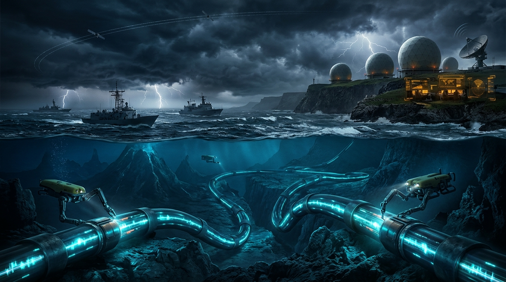

# 🌐 Küresel Denizaltı Fiber Optik Kabloları ve SIGINT Dinleme İstasyonları

  

Dünya internet trafiğinin ve finansal transferlerinin (SWIFT) %97'si uydulardan değil, okyanus tabanındaki fiber kablolardan akar.

---

## 1. Kritik Denizaltı Kablo Koridorları
| Koridor Adı | Bağlanan Bölgeler | Kilit Kablo Hatları | Fiziksel Zaafiyet & Tehdit | Risk Seviyesi |
| :--- | :--- | :--- | :--- | :---: |
| **Mısır Kara Köprüsü & Kızıldeniz Koridoru** | Avrupa - Ortadoğu - Güney Asya - Uzak Doğu | AAE-1, SEA-ME-WE 3, 4, 5, Europe India Gateway (EIG) | Tek Noktadan Arıza Riski (Single Point of Failure): Mısır Telekom teke... | `Kritik / Azami` |
| **Kuzey Atlantik Koridoru (Bude / Cornwall - New York / Virginia)** | Kuzey Amerika - Batı Avrupa | Apollo, Grace Hopper, Amitié | Soğuk Savaş dönemi 'Operation Ivy Bells' benzeri gizli su altı dinleme... | `Yüksek` |
| **Malakka Boğazı & Singapur Dijital Hub'ı** | Güneydoğu Asya - Doğu Asya - Hint Okyanusu | Asia-America Gateway (AAG), APCN-2, SeaMeWe-5 | Dünyanın en yoğun gemi trafiği; sığ sularda atılan gemi demirlerinin k... | `Yüksek` |
| **Luzon Boğazı (Tayvan - Filipinler)** | Tayvan - Hong Kong - Filipinler - ABD | Trans-Pacific Express (TPE), EAC-C2C, SJC | Yüksek sismik aktivite (depremler ve denizaltı heyelanları) ve Çin Hal... | `Kritik / Çatışma Alanı` |

---

## 2. Küresel SIGINT Dinleme ve Casusluk İstasyonları
Five Eyes (FVEY) ve müttefik istihbarat servislerinin denizaltı kablolarını doğrudan dinleme tesisleri:

| İstasyon Adı | Ev Sahibi Ülke | Operatör Teşkilat | Stratejik Coğrafi Konum |
| :--- | :--- | :--- | :--- |
| **GCHQ Bude (Cleave Camp)** | Birleşik Krallık | Government Communications Headquarters (GCHQ) / NSA Ortaklığı | Cornwall, İngiltere |
| **Pine Gap (Joint Defence Facility Pine Gap)** | Avustralya | Avustralya ASD / ABD CIA & NSA | Alice Springs, Avustralya |
| **RAF Menwith Hill** | Birleşik Krallık | ABD Ulusal Güvenlik Ajansı (NSA) / RAF | Harrogate, Kuzey Yorkshire, İngiltere |
| **NSA Fort Meade (National Cryptologic Center)** | Amerika Birleşik Devletleri | National Security Agency (NSA) / US Cyber Command | Maryland, ABD |
| **Diego Garcia Naval Support Facility** | Britanya Hint Okyanusu Toprakları (Diego Garcia) | ABD Donanması / Birleşik Krallık Savunma Bakanlığı | Chagos Takımadaları, Hint Okyanusu |
