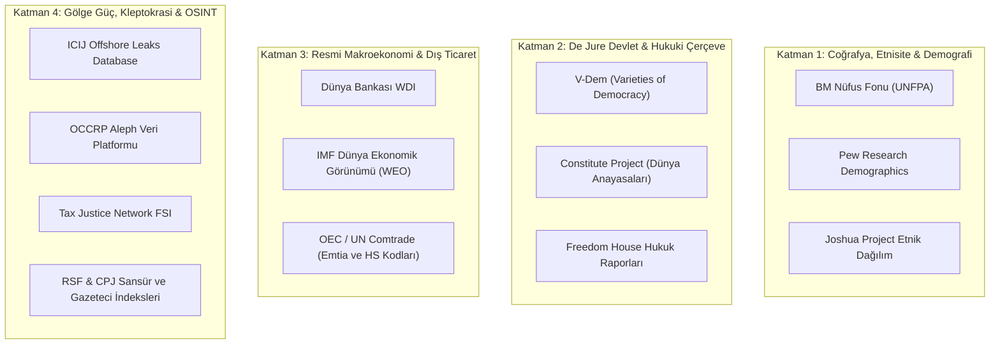

# 📚 Kapsamlı OSINT Veri Toplama ve İstihbarat Protokolü

> "Knowledge itself is power." (*Scientia potentia est.*)  
> — **Sir Francis Bacon**, *Meditationes Sacrae* (1597)

> "There is no such thing as an innocent piece of information. Everything connects if you look deep enough."  
> — **Umberto Eco**, *Foucault's Pendulum* (1988)

---

## 1. Giriş ve Operasyonel Doktrin

Bu kılavuz, **Küresel Röntgen (Global X-Ray)** projesinin 205 egemen ve jeopolitik varlık üzerindeki açık kaynak istihbaratı (OSINT) toplama ve doğrulama süreçlerini yöneten temel saha yönergesidir.

Geleneksel siyaset bilimi devletleri resmi anayasal kurumları üzerinden tanımlarken, Global X-Ray devletleri **maddi kaynakların, silahlı kuvvetlerin, istihbarat servislerinin ve kayıt dışı sermayenin çatışma alanı** olarak modeller.

---

## 2. 4 Katmanlı Veri Toplama Mimarisi ve Veri Tabanı Kaynakları

### 2.1 Katman 1: Sosyolojik ve Demografik Fay Hatları
* **Tarihsel Kırılmalar:** Kolonyal sınırlar, iç savaşlar, etnik soykırımlar, mezhepsel bölünmeler.
* **Demografik Risk Göstergeleri:** Genç işsizlik oranı (Youth Bulge teorisi), kentleşme hızı, mülteci/sığınmacı akımları.

### 2.2 Katman 2: Resmi Anayasal Vitrin
* **Rejim Tipi:** Başkanlık, Yarı-Başkanlık, Parlamenter Monarşi, Askeri Cunta, Teokrasi, Tek Parti Devleti.
* **Güvenlik Mimarisi:** Resmi savunma bütçesi, NATO/KGAÖ/AUKUS gibi savunma paktı üyelikleri.

### 2.3 Katman 3: Resmi Makroekonomi
* **Makro Göstergeler:** Nominal GSYİH, SAGP GSYİH, Cari Denge / GSYİH, Kamu Borcu / GSYİH, Enflasyon ve Döviz Rezervleri.
* **Ticaret Haritası:** İlk 5 ihraç ve ithal kalemi (HS 2/4-hane sınıflandırması), kritik emtia ithalat bağımlılığı (gıda, ham petrol, yarı iletkenler).

### 2.4 Katman 4: Gölge Güç, Kleptokrasi ve Derin Yapılar
* **De Facto Karar Alıcılar:** Seçimle gelmeyen askeri şuralar, hanedan aile meclisleri, istihbarat başkanları, tekelci holding patronları.
* **Oligarşi Ağı:** Kamu ihalelerinden aslan payını alan sermaye grupları, vergi afları ve imtiyazlı maden ruhsatları.
* **Sermaye Kaçışı & Offshore:** Paravan şirketler (BVI, Panama, Cayman, Delaware), Londra ve Dubai gayrimenkul varlıkları.
* **Medya & Bilgi Kontrolü:** İktidar yanlısı medya konsorsiyumları, dijital gözetim araçları (Pegasus vb.), internet kapatmaları.
