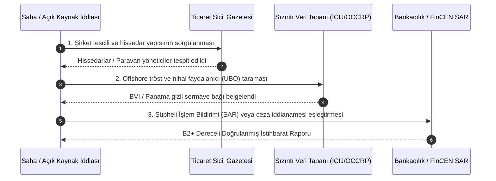

# 🔍 OSINT Doğrulama Protokolü & Admiralty Standartları

> "Trust, but verify." (*Доверяй, но проверяй.*)  
> — **Rus Atasözü** *(Ronald Reagan tarafından Soğuk Savaş zirvelerinde popülerleştirilmiştir)*

> "Falsehood flies, and truth comes limping after it, so that when men come to be undeceived, it is too late; the jest is over, and the tale has had its effect."  
> — **Jonathan Swift**, *The Examiner* (1710)

---

## 1. Admiralty Kod Doğrulama Matrisi (NATO STANAG 2022)

Medeniyet Atlası projesindeki her istihbarat iddiası aşağıdaki 6x6'lık değerlendirme matrisine göre derecelendirilir:

| Kaynak Güvenilirliği (Source Reliability) | Bilgi Doğruluğu (Information Credibility) |
| :--- | :--- |
| **A - Tamamen Güvenilir:** Kaynağın dürüstlüğü ve geçmiş performansı kusursuzdur; resmi mahkeme tutanağı, Sayıştay raporu, bağımsız uluslararası denetim. | **1 - Teyit Edilmiş:** Bağımsız ve farklı yöntemler kullanan birden fazla kaynakça doğrulanmış. |
| **B - Genellikle Güvenilir:** Kaynağın geçmiş performansı sağlamdır; ICIJ, OCCRP, Reuters Araştırma Masası, hakemli akademik çalışma. | **2 - Muhtemelen Doğru:** Mevcut durum ve bilinen olay akışıyla mantıksal uyum içindedir. |
| **C - Kısmen Güvenilir:** Kaynak zaman zaman taraflı veya eksik bilgi vermiştir; yerel muhalif yayın organı, tek taraflı STK bülteni. | **3 - Mümkün / Olası:** Doğrulayıcı kanıt yoktur ancak bilinen koşullarla çelişmez. |
| **D - Genellikle Güvenilmez:** Kaynağın geçmişte yanıltıcı bilgi verdiği bilinmektedir; anonim sosyal medya sızıntısı. | **4 - Şüpheli:** Mantıksal tutarsızlıklar taşır veya bilinen başka doğrularla çelişir. |
| **E - Güvenilmez:** Kaynağın kasıtlı dezenformasyon ürettiği kanıtlanmıştır; devlet güdümlü propaganda bülteni. | **5 - Olanaksız:** Mantıksal ve fiziksel olarak imkansızdır, çürütülmüştür. |
| **F - Güvenilirlik Yargılanamaz:** Kaynağın geçmişine veya güvenilirliğine dair hiçbir veri yoktur. | **6 - Doğruluk Yargılanamaz:** Bilginin doğruluğunu ölçecek hiçbir veri yoktur. |

> [!IMPORTANT]
> **Medeniyet Atlası Standart Eşiği:** Repoda 4. Katman (Gölge Güç ve Kleptokrasi) altında yer alan tüm bulgular **en az B2** (Genellikle Güvenilir Kaynak + Muhtemelen Doğru Bilgi) veya **A1** standardında olmak zorundadır.

---

## 2. Şirket ve Para İzi Takibi: 3 Adımlı Teyit Döngüsü

---

## 3. Metadata Adli Bilişimi ve Sayısal Doğrulama

İncelemeye alınan tüm sızıntı belgeler ve dijital deliller aşağıdaki kontrollerden geçirilir:
1. **Kriptografik Bütünlük:** Orijinal sızıntı arşivinin `SHA-256` veya `BLAKE3` özeti alınarak değiştirilmediği mühürlenir.
2. **Metadata İncelemesi:** Belge yazar adı, oluşturulma tarihi, yazılım sürümü (`exiftool`, `pdfid`, `oletools`) taranır.
3. **Yazıcı Sarı Nokta Analizi (Machine Identification Codes):** Renkli lazer yazıcılardan basılan belgelerdeki seri numarası ve tarih desenleri çözümlenir.
