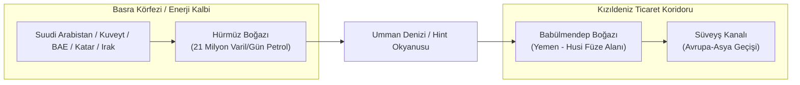

# 🕌 Ortadoğu Jeopolitik İstihbarat Dosyası (Middle East Strategic Dossier)

> "The Middle East is a region where the past is never dead; it's not even past. It is a chessboard where religions, empires, and pipelines collide in an eternal struggle for primacy."  
> — **Geopolitical Maxim of the Levant**

> "Whoever controls the oil of the Persian Gulf controls the economic lifeblood of the industrialized world."  
> — **Zbigniew Brzezinski**, *The Grand Chessboard* (1997)

---

## 1. Stratejik Giriş ve Güç Mimarisi

Ortadoğu; küresel hidrokarbon rezervlerinin %48'ine, kanıtlanmış doğal gaz rezervlerinin %40'ına ve dünya deniz ticaretinin iki kritik boğazına (Hürmüz ve Babülmendep) ev sahipliği yapan, tarihin en yoğun jeopolitik rekabet sahasıdır.

Bölgesel güç mimarisi, geleneksel Arap milliyetçiliğinin çöküşü sonrasında **dört ana hegemonik eksen** etrafında kutuplaşmıştır:
1. **İran Önderliğindeki Direniş Ekseni (Axis of Resistance):** Tahran-Bağdat-Şam-Beyrut-Sana karasal koridoru; asimetrik füze ve vekil güç şebekesi (Hizbullah, Haşdi Şabi, Ensarullah).
2. **Körfez-İsrail İttifakı (İbrahim Anlaşmaları Ekseni):** BAE, Suudi Arabistan, Bahreyn ve İsrail arasındaki teknolojik, istihbari ve finansal entegrasyon; İran çevreleme doktrini.
3. **Türkiye ve Neo-Osmanlı / Stratejik Özerklik Ekseni:** İHA/SİHA diplomasisi, Katar ile mali-askeri ittifak, Doğu Akdeniz (Mavi Vatan) ve Kuzey Irak/Suriye güvenlik kuşağı.
4. **Küresel Süper Güçlerin Müdahalesi:** ABD 5. Filosu (Bahreyn) ve CENTCOM üsleri; Rusya'nın Akdeniz varlığı (Tartus ve Hmeymim); Çin'in Kuşak-Yol ve enerji aracılığı (Suudi-İran uzlaşması).

---

## 2. Bölgesel Darboğazlar ve Enerji Güvenliği

---

## 3. Bölge Ülkeleri ve Karşılaştırmalı İstihbarat Atlası

Aşağıdaki tabloda Ortadoğu bölgesinde analiz edilen tüm egemen devletler ve kritik jeopolitik varlıklar listelenmiştir:

| Ülke / Bölge | ISO | Başkent | Nominal GSYİH | Gölge Ekonomi (%) | Fiili Güç Odakları & Rejim Tipi | Rapor Bağlantısı |
| :--- | :---: | :--- | :---: | :---: | :--- | :--- |
| **Bahreyn** | `BHR` | Manama | $44.0B | %19.0 | Kral Hamad bin İsa el-Halife / Veliaht Prens Selman (Başbakan) | [Bahreyn Raporu](bahrain/README.md) |
| **Birleşik Arap Emirlikleri** | `ARE` | Abu Dabi | $504.0B | %18.0 | Muhammed bin Zayid el-Nahyan (BAE Devlet Başkanı / Abu Dabi Emiri) | [Birleşik Arap Emirlikleri Raporu](united_arab_emirates/README.md) |
| **Filistin** | `PSE` | Kudüs (Ramallah idari merkez) | $18.0B | %38.0 | Mahmud Abbas (Devlet Başkanı) / Muhammed Mustafa (Başbakan) | [Filistin Raporu](palestine/README.md) |
| **Irak** | `IRQ` | Bağdat | $250.8B | %38.0 | Muhammed Şiya es-Sudani (Başbakan) / Abdüllatif Reşid (Cumhurbaşkanı) | [Irak Raporu](iraq/README.md) |
| **Katar** | `QAT` | Doha | $235.5B | %12.5 | Şeyh Temim bin Hamad el-Sani (Emir) / Şeyh Muhammed bin Abdurrahman (Başbakan) | [Katar Raporu](qatar/README.md) |
| **Kuveyt** | `KWT` | Kuveyt | $160.0B | %14.2 | Şeyh Mişal el-Ahmed el-Cabir el-Sabah (Emir) / Şeyh Ahmed Abdullah (Başbakan) | [Kuveyt Raporu](kuwait/README.md) |
| **Kuzey Kıbrıs** | `TRNC` | Lefkoşa | $4.2B | %42.0 | Ersin Tatar (Cumhurbaşkanı) / Ünal Üstel (Başbakan) | [Kuzey Kıbrıs Raporu](northern_cyprus/README.md) |
| **Lübnan** | `LBN` | Beyrut | $17.9B | %45.0 | Necip Mikati (Geçici Başbakan) / Cumhurbaşkanlığı Makamı Boş | [Lübnan Raporu](lebanon/README.md) |
| **Suriye** | `SYR` | Şam | $12.5B | %65.0 | Beşar Esad (Devlet Başkanı) / Muhammed Gazi el-Celali (Başbakan) | [Suriye Raporu](syria/README.md) |
| **Suudi Arabistan** | `SAU` | Riyad | $1,069.0B | %16.2 | Kral Selman bin Abdülaziz / Veliaht Prens Muhammed bin Selman (MBS) | [Suudi Arabistan Raporu](saudi_arabia/README.md) |
| **Türkiye** | `TUR` | Ankara | $1,154.0B | %28.4 | Recep Tayyip Erdoğan (Cumhurbaşkanı) | [Türkiye Raporu](turkey/README.md) |
| **Umman** | `OMN` | Maskat | $108.0B | %17.5 | Heysem bin Tarık (Sultan ve Başbakan) | [Umman Raporu](oman/README.md) |
| **Yemen** | `YEM` | Sana (Aden geçici başkent) | $21.0B | %60.0 | Mehdi el-Meşat (Sana/Husi Yüksek Siyasi Konsey) / Reşad el-Alimi (Aden/Başkanlık Liderlik Konseyi) | [Yemen Raporu](yemen/README.md) |
| **Ürdün** | `JOR` | Amman | $50.8B | %26.0 | Kral II. Abdullah / Cafer Hassan (Başbakan) | [Ürdün Raporu](jordan/README.md) |
| **İran** | `IRN` | Tahran | $403.5B | %36.5 | Ali Hamaney (Dini Lider) / Mesud Pezeşkiyan (Cumhurbaşkanı) | [İran Raporu](iran/README.md) |
| **İsrail** | `ISR` | Kudüs (Tel Aviv idari/uluslararası) | $509.9B | %18.5 | Binyamin Netanyahu (Başbakan) / Isaac Herzog (Cumhurbaşkanı) | [İsrail Raporu](israel/README.md) |

---

## 4. Bölgesel Yeraltı Sermaye Akışları ve Kara Para Rotaları
* **Dubai Serbest Bölgeleri (DMCC/DIFC):** Altın ticareti, Rus yaptırım sermayesi kaçışı, İran takas ağları (Hawala).
* **Körfez Hanedan Tröstleri:** Kamu petrol gelirlerinin aile servetlerine aktarılması ve Londra gayrimenkul yatırımları.
* **Captagon Uyuşturucu Karteli:** Suriye rejimi ve müttefik milislerin yıllık $5-10 milyar hacmindeki uyuşturucu finansmanı.
