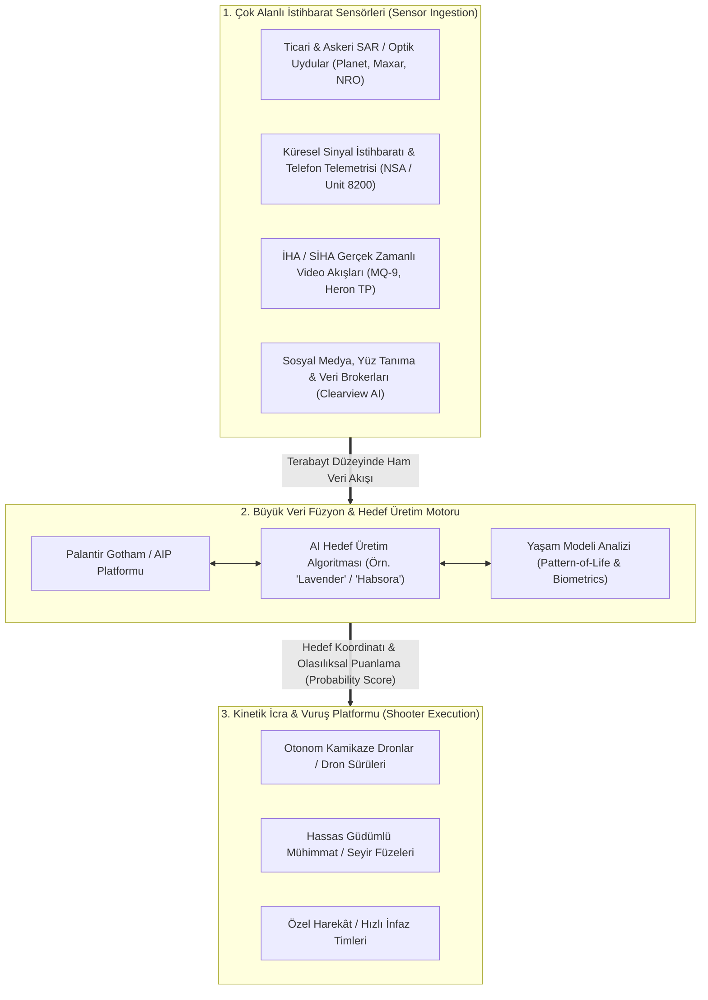
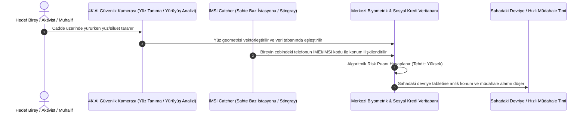

# Algorithmic Warfare, Autonomous Targeting & The Surveillance State: The AI-Military Nexus

> "Whoever becomes the leader in this sphere [Artificial Intelligence] will become the ruler of the world."  
> — **Vladimir Putin**, *Address to Russian Students (September 1, 2017)*

> "We are moving from an era of human-in-the-loop to human-on-the-loop, and inevitably toward human-out-of-the-loop warfare. When hyperspeed hypersonic missiles and drone swarms engage in combat, machine algorithms must make the kinetic kill decision, because human biological synapses are simply too slow."  
> — **Dr. Christian Brose**, *The Kill Chain: Defending America in the Future of High-Tech Warfare* (2020)

> "Palantir is the operating system of the modern intelligence state. We don't make weapons; we make the software that decides where the weapon goes."  
> — **Alexander Karp**, *CEO, Palantir Technologies (Congressional Testimony & Public Addresses)*

---

## 1. Executive Summary & The Shift to Algorithmic Statecraft

The nature of sovereign state power has undergone a profound revolution: the primary source of military and intelligence superiority is no longer physical firepower or naval tonnage, but the speed, fidelity, and autonomy of algorithmic decision cycles (**The OODA Loop: Observe, Orient, Decide, Act**).

Where 20th-century warfare relied on human analysts reviewing aerial photography and SIGINT transcripts, 21st-century warfare relies on **deep convolutional neural networks, automated sensor-to-shooter target generation algorithms, and mass biometric predictive profiling engines**.

This research dossier examines the structural convergence of high-tech defense contractors, big data platforms (exemplified by **Palantir Technologies, Project Maven, and Israeli Unit 8200 AI systems**), and authoritarian surveillance grids, mapping how machine learning algorithms have become the ultimate instruments of sovereign control.

---

## 2. The Algorithmic Kill Chain Architecture

---

## 3. Deep Case Investigations: Operational AI Systems

### 3.1 Project Maven (DoD Algorithmic Warfare Cross-Functional Team)
Initiated by the U.S. Department of Defense in 2017:
* **Mission:** Automate the processing of thousands of hours of high-definition Full-Motion Video (FMV) captured by Reaper and Predator drones over the Middle East and Africa.
* **Computer Vision at Scale:** Using customized neural network models to identify vehicles, weapons systems, individual human postures, and compound entrances without human operator fatigue.
* **Corporate Integration:** Despite employee protests at Google that led to the termination of its direct Maven contract in 2018, the architecture was seamlessly absorbed and deployed at scale by **Palantir Technologies, Amazon Web Services (AWS C2S Cloud), and Microsoft Defense Systems**.

### 3.2 The Lavender & Habsora (The Gospel) Systems (Israel / Unit 8200)
Exposed in investigative reporting by *+972 Magazine* and *Local Call* (2023–2024), Israeli military intelligence deployed proprietary AI systems in the Gaza theater:
* **The Gospel (Habsora):** An automated target recommendation system designed to process massive SIGINT, cellular tracking, and drone surveillance feeds to identify high-value buildings, rocket launch sites, and command posts at a rate of dozens per day—far exceeding human analytical capacity.
* **Lavender AI Profiling:** An algorithmic database that analyzed multi-dimensional behavioral metadata of 2.3 million residents to assign a probabilistic rating (1 to 100) determining whether an individual was a militant operative.
* **"Where's Daddy?" Automated Tracking:** Software designed to alert military strike planners when identified individuals returned to their family residences, facilitating kinetic missile strikes when targets were collocated with family members.

### 3.3 Palantir Technologies: The Private Intelligence Hegemon
Founded by Peter Thiel, Alex Karp, and funded initially by the CIA's venture capital arm **In-Q-Tel**:
* **Palantir Gotham:** Integrates siloed government datasets—tax records, bank transactions, cell tower dumps, facial recognition scans, and criminal databases—into an intuitive graph database visualization mapping human social networks and hidden associations.
* **Palantir AIP (Artificial Intelligence Platform):** Integrates Large Language Models (LLMs) and generative AI directly into military command-and-control operations, enabling field commanders to ask natural language queries ("Deploy two Reaper drones to coordinates X and conduct battle damage assessment on target Y") and receive legally and doctrinally checked tactical execution plans.

---

## 4. Mass Biometric Surveillance & The Police State Architecture

### 4.1 China's IJOP (Integrated Joint Operations Platform)
Deployed in the Xinjiang Uyghur Autonomous Region:
* **Omnipresent Sensor Grid:** Millions of Hikvision and Dahua facial recognition cameras, automated checkpoints scanning smartphone contents, and DNA profile registries.
* **Predictive Policing Algorithms:** Flags individuals for detention based on non-criminal behavioral deviations, such as purchasing excess fertilizer, traveling abroad, using encrypted messaging apps (Telegram, Signal), or abruptly ceasing electricity consumption.

### 4.2 Clearview AI and Global Biometric Scraping
A U.S.-based private contractor that scraped over **30 billion images** from public social media platforms (Facebook, Instagram, LinkedIn, VKontakte) without user consent:
* **Mass Commercial Surveillance:** Enables any law enforcement officer, military intelligence operative, or private client to upload a photograph of an unknown person and instantly retrieve their real identity, family connections, and online profile history.

---

## 5. Strategic, Ethical & Legal Voids

1. **The Automation of Capital Punishment:** When AI systems generate target lists with probabilistic error rates (e.g., 10% false positive rates), algorithmic targeting effectively functions as automated extrajudicial assassination without due process.
2. **Elimination of Moral Injunction:** Physical distance, screen-mediated interfaces, and algorithmic target recommendations remove the psychological friction of lethal state violence.
3. **Black Box Epistemology:** Machine learning models operating through billions of weights and deep neural layers cannot provide human-explainable reasoning for why an individual was classified as a legitimate military target, making war crimes accountability legally impossible under the Geneva Conventions.
