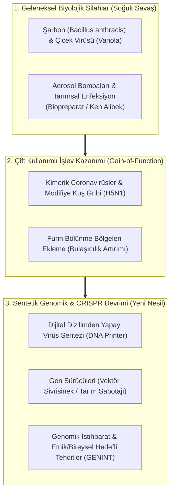
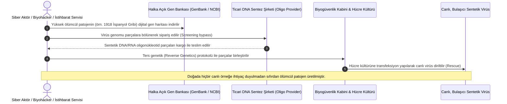

# Biological Warfare, Synthetic Genomics & Deep Biosecurity: Dual-Use Pathogen Espionage

> "The most terrifying aspect of biological weapons is not that they are weapons of mass destruction, but that they are weapons of mass disruption. A biological event can paralyze an entire civilization's economy without detonating a single gram of high explosives."  
> — **Dr. Tara O'Toole**, *Former Under Secretary for Science and Technology, U.S. Department of Homeland Security*

> "With synthetic biology and CRISPR gene editing, the barrier to entry has collapsed. You no longer need an industrial fermentation complex or a massive state program to synthesize a pandemic pathogen; you just need a digital DNA sequencer and a credit card."  
> — **Bipartisan Commission on Biodefense**, *A National Blueprint for Biodefense* (2021)

> "The Biological Weapons Convention of 1972 is a paper tiger. It contains no verification protocol, no mandatory declaration of dual-use research facilities, and zero inspection mechanisms. In biological security, trust without verification is collective suicide."  
> — **Ambassador Richard Butler**, *Former Executive Chairman of the United Nations Special Commission (UNSCOM)*

---

## 1. Executive Summary & The Dual-Use Biosecurity Paradigm

The realm of biological security (biosecurity) is characterized by an inherent, inescapable paradox known as **Dual-Use Research of Concern (DURC)**: virtually every scientific technique, laboratory instrument, and genetic engineering protocol developed to cure disease, produce vaccines, and understand viral evolution can be simultaneously repurposed to engineer catastrophic, weaponized biological agents.

Unlike nuclear weapons—which require massive, highly visible industrial enrichment cascades (centrifuge halls, heavy water reactors, plutonium reprocessing plants) detectable by satellite reconnaissance and IAEA inspectors—**biological pathogen synthesis can be executed in a generic university laboratory, a commercial pharmaceutical facility, or a mobile containment container occupying less than 200 square meters**.

This intelligence dossier examines the geopolitical landscape of modern biosecurity: **Gain-of-Function (GoF) viral engineering, global BSL-4 high-containment networks, synthetic genomics, DNA harvesting as a tool of Genomic Intelligence (GENINT), and the structural failure of the 1972 Biological Weapons Convention (BWC)**.

---

## 2. The Biosecurity Threat Spectrum

---

## 3. High-Containment Infrastructure: The Global BSL-4 Network

Biosafety Level 4 (BSL-4) represents the maximum containment standard, designed to handle airborne pathogens that cause severe to fatal disease in humans and for which no reliable vaccines or treatments exist.

| Tesis Adı | Lokasyon | İşleten Teşkilat | Bilinen Odak Alanları & Dual-Use Kapasite |
| :--- | :--- | :--- | :--- |
| **USAMRIID (Fort Detrick)** | Maryland, ABD | U.S. Army Medical Research Command | Soğuk Savaş dönemi biyolojik savunma programının merkezi; Ebola, Şarbon, Marburg ve aerosol immünoloji çalışmaları. |
| **Wuhan Institute of Virology (WIV)** | Hubei, Çin | Çin Bilimler Akademisi (CAS) / Askeri İşbirlikleri | Güneydoğu Asya yarasa kaynaklı koronavirüslerinin genetik haritalanması ve kimerik başak proteini işlev kazanımı araştırmaları. |
| **SRC VB VECTOR** | Koltsovo, Novosibirsk, Rusya | Rospotrebnadzor / Eski Biopreparat | Dünyada canlı Çiçek Virüsü (Smallpox) stoklarına sahip iki resmi tesisten biri; Marburg, Ebola ve Sovyet dönemi silah suşları arşivi. |
| **DSTL Porton Down** | Salisbury, İngiltere | UK Ministry of Defence | Kimyasal ve biyolojik savunma, Novichok tespiti ve yüksek riskli viral patojenlerin aerosol yayılım simülasyonları. |
| **Spiez Laboratory** | Spiez, İsviçre | İsviçre Federal Savunma Bakanlığı | OPCW ve WHO onaylı bağımsız nükleer, biyolojik ve kimyasal (NBC) adli referans laboratuvarı. |

---

## 4. The Synthetic Biology Revolution: De Novo Pathogen Creation

### 4.1 Reverse Genetics and the Revival of Extinct Viruses
In 2017, Canadian researchers synthesized a viable **Horsepox virus** (an extinct relative of smallpox) from scratch, purchasing commercial genetic fragments through the mail for approximately $100,000. This demonstrated that any moderately equipped laboratory can synthesize a poxvirus without possessing an original physical sample.

### 4.2 CRISPR-Cas9 and Enhanced Lethality
Gene-editing technologies allow researchers to:
* **Overcome Vaccine Immunity:** Introduce minor point mutations in viral surface glycoproteins that render existing antibodies and mRNA vaccines ineffective.
* **Aerosol Stability Enhancements:** Modify viral lipid envelopes to resist desiccation, allowing airborne pathogens to remain infectious in aerosolized droplets for extended periods outdoors.

---

## 5. Genomic Intelligence (GENINT) & Mass DNA Harvesting

National security agencies increasingly view population genomics as a strategic domain of sovereign intelligence:

### 5.1 Mass DNA Profiling & BGI Group
U.S. intelligence warnings and congressional investigations have highlighted how companies like **BGI Group (Beijing Genomics Institute)** operate internationally:
* **NIFTY Prenatal Tests:** Millions of non-invasive prenatal tests (NIPT) taken by pregnant women across 50+ countries were sequenced on BGI platforms, with genomic data stored in China's National GeneBank.
* **Ethnic Population Variation Studies:** The collection of genomic markers across diverse ethnic populations provides the foundational database necessary to analyze targeted vulnerability models.

### 5.2 The Theoretical Frontier: Targeted Pathogens
While the scientific consensus maintains that designing a virus capable of killing only a specific race or ethnic group is biologically unfeasible due to overlapping human genetic diversity, **genomically informed targeting of specific population cohorts with high prevalence of particular HLA (Human Leukocyte Antigen) alleles or enzyme deficiencies is theoretically possible in advanced genetic research**.

---

## 6. Regulatory & Institutional Vulnerabilities

1. **The Absence of a BWC Verification Protocol:** The 1972 Biological Weapons Convention lacks an enforcement arm equivalent to the IAEA (Nuclear) or the OPCW (Chemical Weapons). State parties can operate secret military biological research facilities under the guise of medical and agricultural defense with zero inspection liability.
2. **DNA Synthesis Screening Gaps:** Although international organizations like the International Gene Synthesis Consortium (IGSC) enforce voluntary customer and sequence screening protocols, non-compliant regional vendors exist globally, allowing unscreened orders of regulated pathogen sequences.
3. **Information Hazards & Open Access Virome Databases:** Publishing the complete genetic blueprints of weaponizable pathogens in open-access academic journals (*Science*, *Nature*, *PNAS*) creates an asymmetric information hazard, effectively distributing the design specs of biological weapons to any malicious actor with basic molecular biology training.
