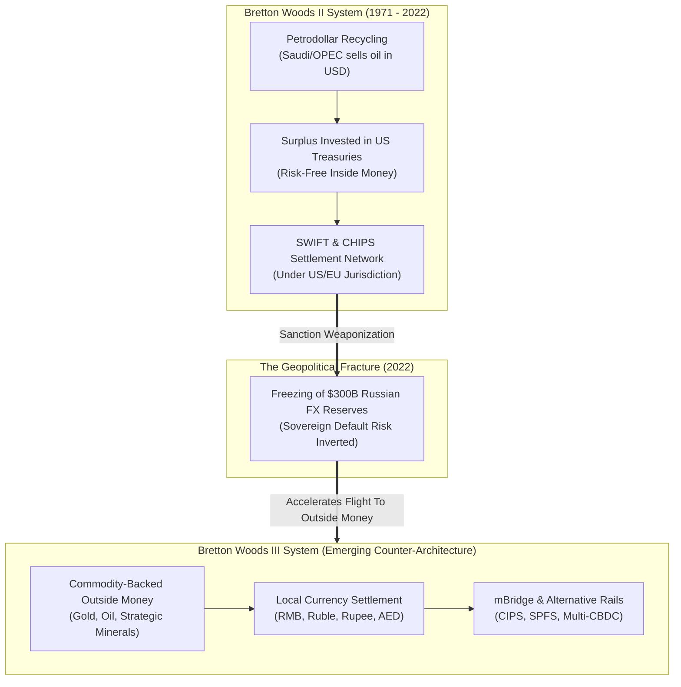

# De-Dollarization, Currency Weaponization & Bretton Woods III: A Forensic Geo-Economic Dossier

> "The dollar is our currency, but it's your problem."  
> — **John Connally**, *U.S. Treasury Secretary (Addressing European Finance Ministers, Rome, 1971)*

> "When the United States froze $300 billion of the Russian Central Bank's foreign exchange reserves in March 2022, the music stopped. Every sovereign central bank in the Global South suddenly understood that reserve assets denominated in G7 currencies are not risk-free storehouses of value, but political IOUs subject to immediate seizure."  
> — **Zoltan Pozsar**, *Credit Suisse Global Investment Strategy (War and Commodity Currency, 2022)*

> "Gold is money. Everything else is credit."  
> — **J.P. Morgan**, *Testimony before the U.S. House Banking and Currency Committee (Pujo Committee, 1912)*

---

## 1. Executive Summary & The Architecture of Weaponized Interdependence

For eight decades following the 1944 Bretton Woods Agreement, the global economic order has rested upon the undisputed hegemony of the United States Dollar (USD). This system conferred upon Washington what French Finance Minister Valéry Giscard d'Estaing termed the **"exorbitant privilege"** (*privilège exorbitant*): the unique ability to run persistent balance-of-payments deficits, finance global military deployment, and import real goods and services simply by issuing fiat debt obligations denominated in its own sovereign currency.

However, the aggressive weaponization of this financial infrastructure—accelerated by post-9/11 Patriot Act provisions, secondary sanctions, SWIFT disconnection mechanisms, and culminating in the historic **March 2022 confiscation and freeze of $300 billion in Russian Central Bank sovereign assets**—has precipitated a systemic counter-reaction across the Global South.

This dossier provides a forensic intelligence analysis of **De-Dollarization, the emergence of the "Petroyuan", central bank sovereign gold hoarding, cross-border multi-CBDC rails (mBridge), and the paradigm shift toward what monetary analysts term "Bretton Woods III"**.

---

## 2. Theoretical Framework: The Weaponization of the Global Financial Plumbing



### 2.1 Inside Money vs. Outside Money (The Pozsar Formulation)

In macroeconomic and monetary theory, assets are divided into two fundamental classes:
1. **Inside Money (Financial Claims):** Bank deposits, sovereign bonds (US Treasuries, German Bunds), and derivative contracts. Inside money is always someone else's liability. Its redemption depends on the legal jurisdiction and political goodwill of the issuing state.
2. **Outside Money (Physical Assets):** Physical gold bars held in sovereign domestic vaults, crude oil reserves, copper, and grains. Outside money has no counterparty risk and cannot be canceled by executive order or foreign court injunctions.

The post-1971 petrodollar order operated almost exclusively on **Inside Money**. When the G7 demonstrated that reserve claims can be frozen overnight, central banks worldwide began a structural rotation into **Outside Money**, driving central bank gold purchases to unprecedented historic records (>1,000 metric tons annually).

---

## 3. Key Vector Analysis: The Mechanisms of De-Dollarization

### 3.1 Bilateral Currency Clearing & Local Currency Settlement
* **RMB-Ruble Clearing:** Over 90% of Sino-Russian bilateral trade ($240+ billion annually) is settled in Yuan and Rubles, completely bypassing SWIFT and Western clearing banks.
* **Rupee-Dirham & Yuan-Riyal Oil Accords:** India's purchase of discounted Russian and Gulf crude settled via UAE Dirhams, and Saudi Arabia's formal acceptance of Chinese Renminbi for crude shipments delivered to Sinopec refineries.
* **China's CIPS (Cross-Border Interbank Payment System):** Processing daily transactions across 100+ countries, CIPS acts as a sovereign messaging and settlement fallback if SWIFT access is severed.

### 3.2 Central Bank Sovereign Gold Repatriation & Accumulation
Central banks—led by the People's Bank of China (PBOC), the Reserve Bank of India (RBI), the National Bank of Poland, and the Central Bank of Turkey—have systematically increased the physical gold share of their foreign reserves:
* **PBOC Gold Accumulation:** Consistent multi-month bullion purchases, shifting reserves out of US Treasury paper into vault-secured physical gold.
* **Repatriation Movements:** European and emerging market central banks withdrawing gold reserves previously stored at the Federal Reserve Bank of New York and the Bank of England to domestic sovereign territory to eliminate seizure risk.

### 3.3 Project mBridge: The Multi-CBDC Settlement Threat
Co-developed by the **Bank for International Settlements (BIS) Innovation Hub, Hong Kong Monetary Authority (HKMA), People's Bank of China (PBOC), Bank of Thailand, and the Central Bank of the UAE**, **mBridge** utilizes a custom distributed ledger technology (DLT) consensus mechanism:
* **Bypassing Correspondent Banking:** Direct peer-to-peer real-time cross-border settlements between commercial banks using central bank digital currencies (CBDCs).
* **Elimination of Dollar Intermediation:** Settlement takes seconds without routing through New York (CHIPS/Fedwire), rendering unilateral financial sanctions technologically unexecutable on the platform.

---

## 4. Geopolitical Fallout & The Future of Global Reserve Status

```mermaid
sequenceDiagram
    autonumber
    actor Importer as Petrol İthalatçısı (Çin / Hindistan)
    participant LocalBank as Ulusal Ticaret Bankası (PBOC / RBI)
    participant DLT as mBridge / CIPS Dağıtık Takas Defteri
    participant ExporterBank as İhracatçı Bankası (BAE / Suudi Arabistan)
    actor Exporter as Petrol Üreticisi (Aramco / ADNOC)

    Importer->>LocalBank: Yerel Para Birimi (Yuan / Rupi) ile ödeme talimatı
    LocalBank->>DLT: Akıllı Sözleşme: Dijital Para (CBDC) tokenizasyonu
    DLT->>ExporterBank: Mikrosaniye Düzeyinde Doğrudan Takas (Fedwire / SWIFT Yok)
    ExporterBank->>Exporter: Yerel Para / Altın Karşılığı Bakiye Aktarımı
    Note over Importer,Exporter: İşlem hiçbir ABD bankasına uğramaz; OFAC yaptırım denetiminden muaftır.
```

### 4.1 The Triffin Dilemma in Reverse
Economist Robert Triffin argued in 1960 that the issuer of the global reserve currency must supply the world with liquidity by running chronic trade deficits. However, when the issuer weaponizes its currency:
* Foreign nations reduce their willingness to absorb US debt issuance.
* Higher long-term interest rates become structural in the United States, raising the cost of servicing $34+ trillion in federal debt.
* The global financial system bifurcates into a **Western G7 bloc** operating on dollar-clearing standards and an **Eurasian/BRICS+ bloc** operating on commodity-backed bilateral networks.

---

## 5. Strategic Intelligence Conclusions

1. **Irreversible Geoeconomic Fragmentation:** The era of a single, uncontested global reserve currency is coming to a close; it is being replaced by a multi-polar, multi-currency reserve basket anchored in physical commodities.
2. **Gold as the Ultimate Sovereign Hedge:** Physical bullion reasserts its primacy as the premier neutral asset immune to digital cyber-sabotage and legal jurisdiction seizures.
3. **The Rise of Parallel Financial Infrastructure:** Platforms like mBridge, CIPS, and national payment rails (UPI, Mir, Troy) represent non-kinetic deterrence mechanisms designed to neutralize Western economic warfare before kinetic conflict occurs.
