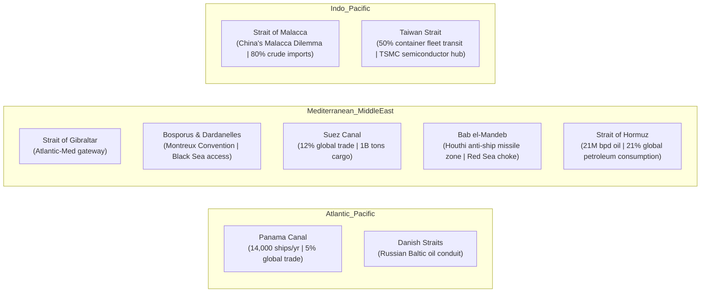

# Geopolitical Chokepoints, Maritime Corridors & Undersea Infrastructure: The Arteries of Global Dominance

> "He who rules the sea, rules the trade; he who rules trade, rules the world's wealth, and hence the world itself."  
> — **Sir Walter Raleigh**, *A Discourse of the Invention of Ships, and the Means to Prevent the Evils of Piracy* (c. 1610)

> "The sea has been the great highway of history, and the power that commands the sea has always exercised a decisive influence upon the destinies of mankind."  
> — **Alfred Thayer Mahan**, *The Influence of Sea Power Upon History, 1660–1783* (1890)

> "Who rules East Europe commands the Heartland; who rules the Heartland commands the World-Island; who rules the World-Island commands the world."  
> — **Halford John Mackinder**, *Democratic Ideals and Reality* (1919)

---

## 1. Executive Summary: The Physics of Global Hegemony

While digital economies appear immaterial, physical globalization is constrained by strict geographical bottlenecks. Over **80% of global merchandise trade by volume** and **60% of all maritime petroleum** transit through just eight narrow maritime choke points.

A naval blockade, asymmetric mining operation, or kinetic missile barrage at any of these nodes triggers instantaneous systemic shocks to the world economy: supply chain paralysis, hyperinflation in commodity pricing, and sovereign debt defaults.

This dossier analyzes the strategic geography of the primary global transit corridors, undersea communications cables, and overland trade corridors.

---

## 2. The Eight Critical Maritime Chokepoints



### 2.1 Strait of Hormuz: The Jugular Vein of Global Hydrocarbons
* **Geography:** Narrow waterway separating Iran from Oman and the UAE (21 miles wide at narrowest point; navigable shipping lane is only 2 miles wide in each direction).
* **Strategic Throughput:** Approximately **20.5 to 21 million barrels of petroleum and refined products per day** (~$1.2 billion daily value).
* **Vulnerabilities:** Iranian anti-ship cruise missile (ASCM) batteries (Noor, Ghader, Abu Mahdi), midget submarine fleet (Ghadir-class), and swarm fast-attack boats (IRGC Navy). Closure of Hormuz for 30 days would drive crude oil past $200/barrel, crashing global equity markets.

### 2.2 Bab el-Mandeb & The Red Sea: Asymmetric Sea Denial
* **Geography:** Strait connecting the Red Sea to the Gulf of Aden between Yemen, Djibouti, and Eritrea (18 miles wide).
* **Strategic Reality (2023–2026):** Ansar Allah (Houthi movement) operationalized low-cost anti-ship ballistic missiles (ASBMs) and loitering munitions to disrupt Western commercial shipping, forcing over 60% of global container traffic to reroute around the Cape of Good Hope (+10 to 14 days transit, +$1M fuel per round trip).
* **Geopolitical Lesson:** Billion-dollar naval destroyers using $2.1M SM-2 missiles to intercept $20,000 drones creates an unsustainable economic attritional exchange ratio.

### 2.3 Strait of Malacca & "The Malacca Dilemma"
* **Geography:** Waterway between the Malay Peninsula and the Indonesian island of Sumatra (longest strait used for international navigation: 550 miles).
* **Chinese Vulnerability:** Over **80% of China's imported crude oil** and substantial bulk mineral trade passes through Malacca. In a conflict scenario, the US Navy and allied forces (Quad: US, Japan, Australia, India) could institute an offshore distant blockade at the Malacca, Sunda, and Lombok straits, strangling China's industrial energy supply within 90 days.

---

## 3. The Digital Chokepoints: Undersea Fiber-Optic Cables

While public discourse focuses on satellite constellations (Starlink), over **99% of all international internet and interbank financial data** travels through ~550 undersea fiber-optic cable systems.

```
[West Coast US] ===(Pacific Light Cable)===> [Guam / Taiwan / Japan]
[East Coast US] ===(Transatlantic Cables)===> [Bude, UK / Bilbao, Spain]
[Europe] ===(SEA-ME-WE / AAE-1)===> [Suez / Egypt Land Corridor] ===> [Asia / India]
```

### 3.1 The Egyptian Terrestrial Chokepoint
* Nearly all internet traffic connecting Europe to Asia and the Middle East funnels through a narrow 100-mile terrestrial land strip between Alexandria and the Red Sea in Egypt.
* Telecom Egypt charges monopoly transit fees and retains the technical capability to physically sever or inspect transcontinental digital traffic.

### 3.2 SIGINT Interception Operations on Undersea Cables
* **Operation Ivy Bells (1970s):** USS *Halibut* submarines placed induction recording pods directly onto Soviet military communication cables in the Sea of Okhotsk.
* **Modern Five Eyes Interception:** NSA and GCHQ access landing stations directly (e.g., GCHQ Bude in Cornwall tapping transatlantic cables TAT-14, Apollo) under the legal authorities of TEMPORA and UPSTREAM.

---

## 4. Overland Corridors: The Eurasian Heartland Counter-Offensive

To neutralize Anglo-American maritime chokepoints, Eurasian continental powers are constructing overland rail, pipeline, and highway corridors:

1. **Belt and Road Initiative (BRI):** China's overland economic corridors (CPEC through Pakistan to Gwadar, China-Central Asia-West Asia corridor).
2. **International North-South Transport Corridor (INSTC):** 7,200 km multimodal freight route connecting St. Petersburg (Russia) to Mumbai (India) via Azerbaijan and Iran, bypassing European waters and the Suez Canal.
3. **Northern Sea Route (NSR):** Arctic route controlled by Russia's nuclear icebreaker fleet, reducing transit time from East Asia to Europe by 35% compared to Suez.

---

## 5. Master Quotes on Geography, Space and Power

> "Geography is the most fundamental factor in the foreign policy of states because it is the most permanent. Ministers come and ministers go, even dictators die, but mountain ranges stand unperturbed."  
> — **Nicholas J. Spykman**, *The Geography of the Peace* (1944)

> "The destiny of nations depends on the manner wherein they take their food."  
> — **Anthelme Brillat-Savarin**, *The Physiology of Taste* (1825)

> "Space is an instrument of power. He who commands space commands destiny."  
> — **Karl Haushofer**, *Geopolitik des Pazifischen Ozeans* (1924)

> "Control oil and you control nations; control food and you control the people."  
> — **Henry Kissinger** *(Attributed / Realpolitik Doctrine)*

> "There are three kinds of lies: lies, damned lies, and statistics. But geography does not lie."  
> — **Mark Twain** *(Adapted geopolitical aphorism)*\n