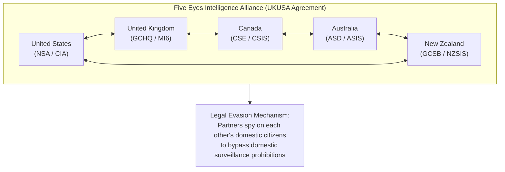

# Intelligence Agencies, Covert Operations & Plausible Deniability: The Architecture of Shadow Statecraft

> "For by wise counsel thou shalt make thy war: and in multitude of counsellors there is safety."  
> — **Motto of the Israeli Mossad** (*Proverbs 24:6 / formerly Proverbs 11:14: "Where no counsel is, the people fall"*)

> "And ye shall know the truth, and the truth shall make you free."  
> — **Inscribed in the foyer of the CIA Headquarters, Langley, Virginia** (*John 8:32*)

> "Intelligence work is not about discovering the truth; it is about acquiring information that can be leveraged to compel an adversary to act against their own interests."  
> — **Allen Dulles**, *The Craft of Intelligence* (1963)

---

## 1. Executive Summary: The Covert Action Continuum

State intelligence services operate along a recognized spectrum of activity:
1. **Collection & Analysis (Passive):** OSINT, SIGINT (signals), HUMINT (human), GEOINT (geospatial), MASINT (measurement).
2. **Counter-Intelligence:** Neutralizing foreign penetration and safeguarding national secrets.
3. **Covert Action (Active):** Influencing political, military, or economic conditions abroad where the role of the sponsoring government is not acknowledged:
   * *Propaganda / Disinformation*
   * *Political Subversion & Election Interference*
   * *Economic Sabotage & Sanctions Enforcement*
   * *Paramilitary & Regime-Change Operations*
   * *Targeted Assassinations (*Wetwork / Targeted Killings*)

---

## 2. Landmark Declassified Covert Operations (1950–Present)

```
[1953: Operation Ajax]  ---> Overthrow of Mossadegh (Iran / Anglo-Iranian Oil)
[1954: Operation PBSUCCESS] -> Overthrow of Arbenz (Guatemala / United Fruit)
[1961: Operation Mongoose] --> Covert War & Assassination Plots against Cuba
[1970: Project FUBELT] ------> Overthrow of Salvador Allende in Chile (1973 Coup)
[1980s: Operation Cyclone] --> $3B Covert Arms to Afghan Mujahideen (Birth of Al-Qaeda)
[1985: Iran-Contra Affair] --> Secret arms to Iran, illegal funding to Nicaraguan Contras
```

### 2.1 Operation Ajax (Iran, 1953)
* **Objective:** Depose democratically elected Prime Minister Mohammad Mossadegh after he nationalized the Anglo-Iranian Oil Company (now BP).
* **Execution:** Orchestrated by CIA officer Kermit Roosevelt Jr. and MI6. Bribed journalists, hired street gangs to stage fake communist riots, paid religious clerics to turn against Mossadegh, and mobilized royalist army factions.
* **Consequence:** Restored the authoritarian autocracy of Mohammad Reza Pahlavi (The Shah), leading directly to the 1979 Islamic Revolution and decades of anti-Western hostilities.

### 2.2 Operation Condor (South America, 1970s)
* **Scope:** Transnational campaign of political repression and state terror coordinated by intelligence agencies of Chile (DINA), Argentina (SIDE), Uruguay, Paraguay, Bolivia, and Brazil, with CIA technical and communications assistance.
* **Casualties:** Over **60,000 extrajudicial executions**, 30,000 disappearances, and 400,000 political prisoners. Special assassination teams operated worldwide (e.g., assassination of Orlando Letelier in Washington, DC, 1976).

### 2.3 The Church Committee Investigations (US Senate, 1975–1976)
Led by Senator Frank Church, the committee exposed systematic illegal operations by US intelligence agencies against American citizens and foreign leaders:
* **MKUltra:** CIA mind control and behavior modification experiments using LSD, hypnosis, and sensory deprivation on unwitting subjects.
* **COINTELPRO:** FBI domestic covert operations to infiltrate, discredit, and neutralize civil rights and anti-war movements (Martin Luther King Jr., Black Panther Party).
* **Foreign Assassinations:** CIA assassination attempts against Fidel Castro (exploding cigars, toxic diving suits), Patrice Lumumba (Congo), Rafael Trujillo (Dominican Republic), and Ngo Dinh Diem (South Vietnam).

---

## 3. The Five Eyes Intelligence Alliance (FVEY)

The most comprehensive intelligence-sharing partnership in world history, originating from the 1946 UKUSA Agreement:



* **The Reciprocal Evasion Loop:** Under domestic law, the NSA is generally prohibited from warrantless surveillance of US citizens without a FISA warrant. Under the FVEY arrangement, Britain's GCHQ or Australia's ASD monitors US targets and shares the intercepted telemetry directly with NSA analysts, legally bypassing 4th Amendment protections.

---

## 4. Master Quotes on Espionage, Secrecy and Treason

> "I think that I can say that of all the people who have served their country well, none has served it with such devotion as the secret service man, and none has been so ill rewarded."  
> — **W. Somerset Maugham**, *Ashenden: Or the British Agent* (1928)

> "A traitor is everyone who reveals state secrets to the public, regardless of whether those secrets reveal a crime."  
> — **Paraphrasing the Espionage Act Paradigm**

> "We lied, we cheated, we stole. We had entire training courses. It reminds you of the glory of the American experiment."  
> — **Mike Pompeo**, *Former CIA Director & Secretary of State, Texas A&M University* (April 15, 2019)

> "The first rule of covert operations is: If you get caught, we never heard of you."  
> — **Intelligence Field Maxim**

> "Man is not what he thinks he is, he is what he hides."  
> — **André Malraux**, *Antimémoires* (1967)

> "Secrecy is the beginning of tyranny."  
> — **Robert A. Heinlein**, *Citizen of the Galaxy* (1957)\n