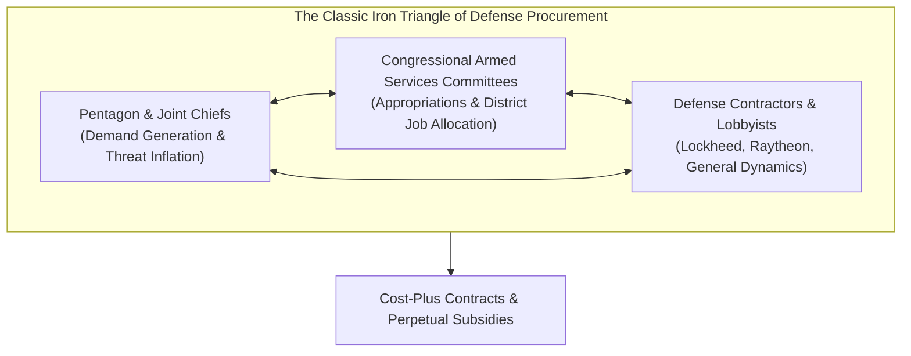

# The Military-Industrial Complex & Privatized Warfare: Capital, Mercenaries & Endless War

> "Every gun that is made, every warship launched, every rocket fired signifies, in the final sense, a theft from those who hunger and are not fed, those who are cold and are not clothed. This world in arms is not spending money alone. It is spending the sweat of its laborers, the genius of its scientists, the hopes of its children."  
> — **Dwight D. Eisenhower**, *The Chance for Peace Speech* (April 16, 1953)

> "War is a racket. It always has been. It is possibly the oldest, easily the most profitable, surely the most vicious. It is the only one international in scope. It is the only one in which the profits are reckoned in dollars and the losses in lives."  
> — **Major General Smedley Butler**, *War is a Racket* (1935)

> "The business of war is profitable, and the peace dividend is an existential threat to the defense contractor."  
> — **Investigative Maxim of Post-Cold War Geopolitics**

---

## 1. Executive Summary: The Political Economy of Permanent War

The global arms industry generates over **$600 billion in annual revenue**, anchored by an oligopoly of mega-defense contractors (Lockheed Martin, RTX/Raytheon, General Dynamics, Boeing, Northrop Grumman, BAE Systems, Rostec, AVIC).

Modern warfare has undergone two profound structural transformations:
1. **Financialization of Procurement:** Cost-plus contracting guarantees corporate profitability regardless of weapons performance or cost overruns (e.g., the F-35 program exceeding $1.7 trillion in lifetime cost).
2. **Privatization of Lethality:** Sovereign states increasingly outsource logistics, security, combat operations, and intelligence collection to Private Military and Security Companies (PMSCs), providing plausible deniability, evading casualty reporting, and avoiding democratic debate.

---

## 2. The Mechanics of the Defense Procurement Cartel



### 2.1 The "Job Political Engineering" Strategy
To ensure that weapons programs cannot be canceled by Congress:
* Defense contractors deliberately disperse manufacturing across hundreds of congressional districts.
* *Example:* The F-35 Lightning II program sources parts from 45 of 50 US states and hundreds of subcontractors. Any senator attempting to cut funding faces immediate accusations of destroying thousands of local manufacturing jobs.

### 2.2 The "Revolving Door"
According to Government Accountability Office (GAO) audits:
* Over **1,700 former Pentagon generals, admirals, and senior procurement officials** transitioned directly into senior executive or board positions at top defense contractors within two years of retiring from active duty.
* Conversely, defense executives (e.g., former Raytheon board member Lloyd Austin) routinely serve as Secretaries of Defense, regulating their former employers.

---

## 3. Evolution of Private Military Contractors (PMCs)

```
[1990s: Post-Colonial Interventions] -> [2000s: War on Terror Contractor Boom] -> [2020s: State-Proxies & Gray Zone]
     (Executive Outcomes in Angola)          (Blackwater, Dyncorp in Iraq)            (Wagner / Africa Corps, Sadat)
```

| Company / Entity | Operational Base | Primary Theatre | Notorious Incidents & Doctrine |
| :--- | :---: | :--- | :--- |
| **Executive Outcomes** | South Africa | Angola, Sierra Leone (1990s) | Pioneer of modern corporate combat intervention; traded military defeat of rebels for mineral concessions (diamonds, oil). |
| **Blackwater (Academi / Constellis)** | USA | Iraq, Afghanistan | Nisour Square Massacre (2007: 17 Iraqi civilians killed); operated under CPA Order 17 granting total immunity from Iraqi law. |
| **Wagner Group (Africa Corps)** | Russia | Syria, Ukraine, Mali, CAR, Sudan, Libya | Extracted gold and diamond mining rights in exchange for regime survival; mutiny led by Yevgeny Prigozhin (June 2023). |
| **Frontier Services Group** | Hong Kong / UAE | Africa, Central Asia (BRI corridor) | Founded by Erik Prince (former Blackwater CEO) to secure Chinese Belt & Road extractive operations. |
| **SADAT International Defense** | Turkey | Syria, Libya, Azerbaijan | Paramilitary training and security consultancy established by former Turkish military officers with Islamist alignment. |

---

## 4. Algorithmic Warfare and Autonomous Weapons Systems

Warfare in the 2020s has transitioned toward autonomous and algorithmic targeting:
* **Project Maven (US):** AI-driven computer vision processing drone video telemetry for automated object and personnel classification.
* **Habsora (The Gospel) & Lavender (Israel):** AI-driven target generation systems processing mass surveillance data to produce thousands of kinetic strike coordinates at unprecedented speeds, reducing human verification to rubber-stamping.
* **Drone Saturation & Electronic Attrition:** Low-cost FPV (First Person View) suicide drones costing $400 disabling $10M main battle tanks (M1 Abrams, T-90M, Leopard 2), fundamentally upending traditional armored doctrine.

---

## 5. Master Quotes on Militarism, Profiteering and Empire

> "I spent 33 years and four months in active military service... And during that period I spent most of my time being a high-class muscle man for Big Business, for Wall Street and for the bankers. In short, I was a racketeer, a gangster for capitalism."  
> — **Major General Smedley Butler**, *Common Sense* (1935)

> "War is the continuation of politics by other means." (*Der Krieg ist eine bloße Fortsetzung der Politik mit anderen Mitteln.*)  
> — **Carl von Clausewitz**, *Vom Kriege* (1832)

> "The supreme art of war is to subdue the enemy without fighting."  
> — **Sun Tzu**, *The Art of War* (c. 5th century BC)

> "Calamity will come upon you from that direction which you considered safe."  
> — **Kautilya**, *Arthashastra* (c. 300 BC)

> "War makes the state, and the state makes war."  
> — **Charles Tilly**, *Coercion, Capital, and European States, AD 990–1992* (1990)\n