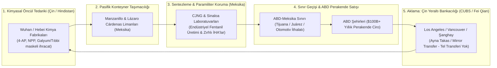

# Narco-Kleptocracy, Cartel-State Convergence & Transnational Drug Corridors: A Forensic OSINT Investigation

> "The drug trade is not an aberration of modern capitalism; it is its purest, most ruthless expression. It operates with zero regulatory drag, perfect consumer addiction, and total integration between street-level violence and offshore private banking."  
> — **Roberto Saviano**, *ZeroZeroZero* (2013)

> "In a narco-state, the cartels do not corrupt the police and military. The military and political elite own and franchise the cartels."  
> — **Guillermo Valdés Castellanos**, *Former Director of CISEN (Mexican National Intelligence Agency)*

> "Syria is no longer just a war-torn country; it is a narco-state whose single largest export is Captagon, operated directly by the dictator's brother and his elite military division."  
> — **U.S. State Department & DEA Forensic Briefing** (2023)

---

## 1. Executive Summary & The Concept of Cartel-State Convergence

Traditional criminological frameworks conceptualize transnational drug trafficking organizations (DTOs) as illicit non-state actors operating in opposition to sovereign governments. However, contemporary Open Source Intelligence (OSINT) and adli forensic financial tracking demonstrate that this paradigm is obsolete.

In numerous jurisdictions across Latin America, the Middle East, West Africa, and Southeast Asia, the boundary between organized crime and the sovereign state has dissolved entirely. We define this phenomenon as **"Cartel-State Convergence"**: a governance model wherein the coercive apparatus of the state (military commands, intelligence directorates, port authorities, and presidential cabinets) directly controls, protects, and profits from transnational narcotics trafficking corridors.

This dossier analyzes the geopolitical cartography of the modern drug trade, focusing on the **Synthetic Fentanyl Revolution, the Syrian Captagon Empire, the Venezuelan Cartel de los Soles, Chinese Underground Banking Systems (CUBS), and Transatlantic Narco-Submarine pipelines**.

---

## 2. The Transnational Illicit Value Chain



---

## 3. Structural Theaters of Cartel-State Convergence

### 3.1 Mexico: The Paramilitarization of the Cartels (CJNG vs. Sinaloa)
The Mexican drug landscape has evolved from familial smuggling clans into heavily militarized, corporate syndicates:
* **Cártel de Jalisco Nueva Generación (CJNG):** Commanded by Nemesio Oseguera Cervantes ("El Mencho"), the CJNG deploys commercial drones modified to drop C4 and fragmentation grenades, homemade armored fighting vehicles ("monstruos"), Barrett .50 BMG anti-materiel rifles, and rocket-propelled grenades (RPGs).
* **State Capture at the Municipal and Federal Level:** The 2020 arrest in Los Angeles of former Mexican Defense Secretary General Salvador Cienfuegos (indicted by the U.S. DOJ for protecting the H-2 cartel under the alias "El Padrino") highlighted how senior defense leadership shields favored trafficking factions while deploying the army to neutralize rival competitors.
* **The Synthetic Fentanyl Paradigm:** Moving away from plant-based heroin and cocaine, synthetic fentanyl requires no agricultural land, no rainfall, and no peasant labor. Synthesized in clandestine urban kitchens using imported Chinese precursors, a 1-kilogram brick costing $3,000 to manufacture yields up to $1.5 million in retail profit in North American cities.

### 3.2 Syria: The Assad Regime's Captagon Monopoly
Facing total economic collapse and crushing Western sanctions under the Caesar Act, the Syrian government transformed the country into the world's premier producer of **Captagon** (fenethylline):
* **Command Structure:** The trade is orchestrated by **Maher al-Assad**, brother of President Bashar al-Assad and commander of the elite **4th Armoured Division** of the Syrian Army.
* **Industrial Scale:** Laboratories concentrated in the Latakia port zone, the Qalamoun mountains along the Lebanese border, and Homs produce billions of pills annually.
* **Export Corridors:** Hidden in commercial shipments of pomegranate seeds, paper rolls, industrial machinery, and frozen fish, pills are shipped through the port of Latakia to Saudi Arabia, the United Arab Emirates, Jordan, and Europe, generating **an estimated $5 to $10 billion in annual revenue**—dwarfing Syria's entire legal GDP.

### 3.3 Venezuela: The Cartel de los Soles (Cartel of the Suns)
The name refers to the sun insignia worn on the uniforms of Venezuelan generals (*Generales de División*):
* **State-Controlled Logistics:** The Venezuelan military high command controls commercial airports, sea terminals (Puerto Cabello), and riverways along the Orinoco and Apure rivers.
* **Strategic Alliance with Colombian Guerrillas:** Collaborating directly with the National Liberation Army (ELN) and dissident factions of the FARC, the Venezuelan military provides safe passage and sovereign airspace clearance for hundreds of metric tons of cocaine moving toward Central America, the Caribbean, and West Africa.

---

## 4. Financial Innovation: Chinese Underground Banking Systems (CUBS)

```mermaid
sequenceDiagram
    autonumber
    actor Cartel as Meksika Karteli (CJNG / Sinaloa)
    participant Broker as Los Angeles Çinli Broker (CUBS)
    participant Elite as Zengin Çinli Yatırımcı (Sermaye Kaçırmak İsteyen)
    participant ChinaBank as Çin Yurtiçi Bankası (WeChat Pay / Alipay)
    participant PrecursorSupplier as Wuhan Kimya Şirketi Sahibi

    Cartel->>Broker: ABD sokaklarından toplanan $10 Milyon nakit dolar teslim edilir
    Broker->>Elite: Dolar nakit olarak ABD'de teslim edilir (Ev / Üniversite harcı için)
    Elite->>ChinaBank: Çin içinde kendi Yuan hesabından Broker'ın Çin hesabına Yuan havale eder
    Broker->>PrecursorSupplier: Fentanil kimyasal öncülü bedeli Çin içinde Yuan olarak ödenir
    PrecursorSupplier-->>Cartel: Kimyasal konteyneri Meksika'ya sevk edilir
    Note over Cartel,PrecursorSupplier: Sınırlar arası tek bir dolar veya banka havalesi geçmez; SWIFT/OFAC kördür.
```

The DEA and international financial task forces have documented how Chinese underground banking networks revolutionized money laundering:
1. **The Mirror Transaction (Fei Qian):** Cartels amass mountains of physical dollar bills in Chicago, New York, and Los Angeles. Wealthy Chinese citizens, facing China's strict $50,000 annual foreign exchange capital export cap, desperately need dollars in North America to buy luxury real estate.
2. **Zero Cross-Border Wire Transfers:** The broker gives the cartel's dollars to the Chinese buyer in Los Angeles. Simultaneously, the buyer transfers equivalent Yuan within China to the broker's domestic bank account.
3. **Closing the Loop:** The cartel uses the Yuan accumulated in China to pay chemical companies in Wuhan for fentanyl precursors. **No funds ever cross an international border or touch the SWIFT wire system**, rendering traditional Anti-Money Laundering (AML) monitoring useless.

---

## 5. Maritime Stealth: Transatlantic Narco-Submarines

To evade radar and naval patrols, cartels employ sophisticated naval engineering:
* **Low-Profile Vessels (LPVs):** Semi-submersible boats sitting with only a few inches of cabin above the waterline, painted in matte marine blue or gray, powered by quiet diesel engines with underwater exhaust cooling to minimize infrared heat signatures.
* **Fully Submersible Electric Submarines:** Discovered in Colombia's mangrove jungles, utilizing banks of lithium-ion batteries and ballast tanks, capable of operating submerged for long distances.
* **The Transatlantic Route:** Vessels carrying 3 to 6 metric tons of cocaine ($100M+ street value) embark from the Amazon delta or the Orinoco, navigating 4,000 nautical miles across the Atlantic to the remote rías of Galicia, Spain, or West African transit hubs (Guinea-Bissau, Cape Verde).

---

## 6. Strategic Intelligence Implications

1. **The Obsolescence of Traditional Law Enforcement:** Interdiction focused on seizures at border checkpoints fails to address the root systemic problem: sovereign state militaries functioning as logistics managers.
2. **Geopolitical Weaponization of Addiction:** The supply of synthetic opioids and stimulants serves as an asymmetric tool of geopolitical friction, imposing tens of billions of dollars in public healthcare, societal destabilization, and policing costs on targeted Western nations.
3. **The Rise of Sovereign Criminal Enclaves:** When sovereign diplomatic immunity, national central banks, and military divisions are integrated into global trafficking syndicates, conventional international law and extradition treaties become functionally impotent.
