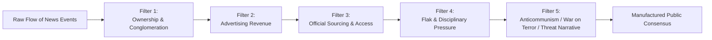

# Propaganda, Cognitive Warfare & Algorithmic Mass Control: The Engineering of Consent

> "The engineering of consent is the very essence of the democratic process, the freedom to persuade and suggest."  
> — **Edward L. Bernays**, *The Engineering of Consent* (1947)

> "Until they became conscious they would never rebel, and until after they have rebelled they cannot become conscious."  
> — **George Orwell**, *1984* (1949)

> "The purpose of modern propaganda is not to convince, but to exhaust your critical thinking, to obscure truth, and to make you believe that nothing is true and everything is possible."  
> — **Peter Pomerantsev**, *Nothing Is True and Everything Is Possible* (2014)

---

## 1. Executive Summary: The Transition to 5th Generation Warfare (5GW)

Information warfare has evolved through distinct evolutionary epochs:
1. **1st & 2nd GW:** Line and column kinetics, massed firepower.
2. **3rd GW:** Maneuver warfare, blitzkrieg, mechanized disruption.
3. **4th GW:** Asymmetric insurgency, guerrilla warfare, non-state actors blurring civilian lines.
4. **5th Generation Warfare (5GW):** Warfare conducted primarily through non-kinetic cognitive manipulation, cybernetic operations, perceptual distortion, and social engineering where the targeted population does not even realize a war is being waged against them.

In 5GW, the human mind is the primary battlespace (*Cognitive Battlespace*). This dossier dissects the mechanisms through which intelligence services, algorithmic platforms, and media conglomerates manufacture political reality.

---

## 2. Theoretical Paradigms of Mass Conditioning

### 2.1 The Herman-Chomsky "Propaganda Model" (1988)

In *Manufacturing Consent*, Edward S. Herman and Noam Chomsky demonstrated that democratic news media operate not as watchdogs, but as systematic filters serving institutional interests.



1. **Ownership:** Major news networks are subsidiaries of multi-billion-dollar conglomerates with defense, banking, and pharmaceutical ties (Comcast, Disney, News Corp, Warner Bros. Discovery).
2. **Advertising:** News is the bait; the audience's attention is the commodity sold to corporate advertisers. Investigative reporting that harms advertiser interests is suppressed.
3. **Sourcing:** Journalists rely on "official sources" (Pentagon press briefings, White House statements, corporate spokesmen) to retain access, turning the press into stenographers of state power.
4. **Flak:** Coordinated campaigns to punish, smear, and deplatform dissident reporters or media outlets that question foundational premises.
5. **Fear / Ideological Enemy:** A permanent external threat narrative (Communism, Islamism, Russian Disinformation, Rogue Regimes) to enforce patriotic conformity.

### 2.2 Walter Lippmann: The "Bewildered Herd" and Pseudo-Environment

> "The public must be put in its place... So that we may live free of the trampling and the roar of a bewildered herd."  
> — **Walter Lippmann**, *Public Opinion* (1922)

Lippmann observed that citizens do not react to the real world, but to a *pseudo-environment* constructed by media representations. The specialized class ("elites") must direct public affairs, while the majority acts merely as interested spectators.

---

## 3. Declassified Intelligence Covert Media Programs

### 3.1 Operation Mockingbird (CIA, 1950s–1970s)
* **Origins:** Established by Frank Wisner under Allen Dulles at the Office of Policy Coordination (OPC) / CIA.
* **Mechanism:** Recruited leading American journalists, publishers, and network executives (CBS, *The New York Times*, *Time*, *Newsweek*, Associated Press).
* **Church Committee Exposure (1975):** Senator Frank Church revealed that the CIA had maintained over 400 American journalists on its payroll to plant stories, suppress unfavorable investigations, and guide editorial boards on foreign interventions.

### 3.2 Soviet Active Measures (*Aktivnye Meropriyatiya*)
* **Doctrinal Definition:** Covert operations designed to influence foreign governments, disrupt alliances, discredit adversaries, and polarize foreign societies.
* **Operation INFEKTION (1980s):** KGB campaign that planted articles in Indian publications alleging HIV/AIDS was genetically engineered by the US military at Fort Detrick, which subsequently spread to news outlets in over 80 countries.
* **Reflexive Control Theory (*Refleksivnoe Upravlenie*):** Developed by Vladimir Lefebvre; providing an adversary with deliberately selected information to compel them to voluntarily make decisions predetermined by the manipulator.

---

## 4. The Modern Surveillance-Cyber Offensive Ecosystem

Modern information control has transcended legacy print and television; it is executed through micro-targeted algorithmic conditioning and invasive spyware:

```
[Commercial Exploits] -> [Zero-Click Injection] -> [Full Telemetry Access] -> [Target Neutralization]
   (NSO Pegasus)         (iMessage / WhatsApp)      (Mic, Camera, Signal)       (Blackmail / Prison)
```

| Surveillance Vector | Origin | Primary Operators | Capability & Real-World Exploitation |
| :--- | :---: | :--- | :--- |
| **Pegasus** | Israel (NSO Group) | Saudi Arabia, UAE, Mexico, India, Hungary, Morocco | Zero-click iPhone exploit via WebKit/CoreGraphics. Used against Jamal Khashoggi's inner circle, 180+ journalists globally. |
| **Predator** | North Macedonia / Greece (Cytrox/Intellexa) | Greece (EYP scandal), Egypt, Madagascar | One-click Trojan malware targeting high-profile dissidents and European politicians. |
| **PRISM / UPSTREAM** | USA (NSA / FBI) | Five Eyes Intelligence Alliance (FVEY) | Direct access to central servers of Google, Apple, Microsoft, Meta, Yahoo; bulk taps on undersea fiber cables. |
| **Cambridge Analytica** | UK (SCL Group) | Trump Campaign 2016, Brexit Leave.EU | Harvested 87M Facebook profiles; applied OCEAN psychometric profiling for cognitive voter suppression. |

---

## 5. Quotes on Truth, Propaganda and Thought Control

> "The smart way to keep people passive and obedient is to strictly limit the spectrum of acceptable opinion, but allow very lively debate within that spectrum—even encourage the more critical and dissident views. That gives people the sense that there's free thinking going on, while all the time the presuppositions of the system are being reinforced by the limits put on the range of the debate."  
> — **Noam Chomsky**, *The Common Good* (1998)

> "In an age of universal deceit, telling the truth is a revolutionary act."  
> — **George Orwell** *(Attributed / Common Epigraph of Information Freedom)*

> "If thought corrupts language, language can also corrupt thought."  
> — **George Orwell**, *Politics and the English Language* (1946)

> "People demand freedom of speech as a compensation for the freedom of thought which they seldom use."  
> — **Søren Kierkegaard**, *Either/Or* (1843)

> "It is the mark of an educated mind to be able to entertain a thought without accepting it."  
> — **Aristotle**, *Metaphysics*

> "Journalism is printing what someone else does not want printed: everything else is public relations."  
> — **George Orwell** *(Attributed)*\n