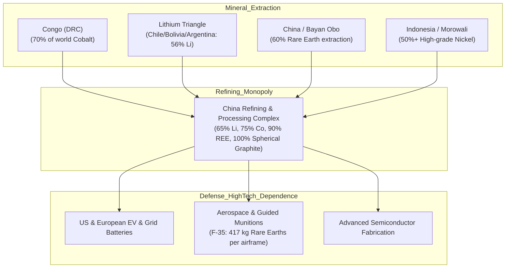

# Resource Wars, Critical Minerals & Commodity Trading Cartels: The Material Foundations of Hegemony

> "The nations of the world are dividing themselves into two camps: those who own the soil and its resources, and those who must buy them or take them by force."  
> — **Brooks Adams**, *The Law of Civilization and Decay* (1895)

> "Control oil and you control nations; control food and you control the people; control money and you control the world."  
> — **Henry Kissinger** *(Attributed Geopolitical Maxim)*

> "The true rulers of global commodity markets are not the sovereign states that produce the oil or copper, but the secretive trading houses of Switzerland that finance and route the cargo."  
> — **Javier Blas & Jack Farchy**, *The World for Sale: Money, Power and the Traders Who Barter the Earth's Resources* (2021)

---

## 1. Executive Summary: From Energy Transition to Geoeconomic Conflict

The 21st century's geopolitical conflict is transitioning from a hydrocarbon-dominated regime (crude oil, natural gas) to a critical minerals and electro-chemical supply regime (lithium, cobalt, nickel, rare earth elements, copper, and graphite).

While oil reserves are distributed across roughly 30 major nations, the processing and refining of energy-transition minerals is vastly more concentrated:
* **China** controls **60% to 70% of world rare earth mining** and **85% to 90% of global rare earth processing and magnet production**.
* Over **70% of the world's cobalt** originates in the Democratic Republic of the Congo (DRC), with Chinese entities owning or financing 15 of the 19 largest industrial cobalt concessions.
* The **Lithium Triangle** (Chile, Bolivia, Argentina) holds over 56% of global lithium brine reserves.

---

## 2. The Secretive Commodity Trading Oligopoly

Global physical commodity flows are dominated not by public stock exchanges, but by privately held, opaque trading houses headquartered primarily in Switzerland (Geneva, Zug) and Singapore:

```
[Resource Extraction / Mines] -> [Swiss Commodity House] -> [Offshore Trade Financing] -> [Global Refineries]
    (DRC, Zambia, Russia)         (Glencore, Trafigura,         (BNP Paribas, ING,          (China, EU, US)
                                      Vitol, Gunvor)                 Credit Agricole)
```

| Trading House | Headquarters | Primary Commodities | Annual Revenue Profile | Notorious Exposures & Sanctions Dynamics |
| :--- | :---: | :--- | :--- | :--- |
| **Glencore plc** | Baar, Switzerland | Copper, Cobalt, Coal, Zinc, Oil | $215B+ | Pleaded guilty (2022) to foreign bribery and market manipulation across 7 countries; paid $1.1B in DOJ/UK penalties. |
| **Trafigura Group** | Geneva / Singapore | Non-ferrous Metals, Crude Oil, LNG | $244B+ | Probo Koala toxic waste dumping scandal (Ivory Coast 2006); massive physical nickel fraud loss (2023). |
| **Vitol Group** | Geneva / Rotterdam | Crude Oil, Refined Products (8M bpd) | $505B+ | Largest independent energy trader in the world; traded Iranian, Russian, and Libyan crude during embargo regimes. |
| **Gunvor Group** | Geneva / Cyprus | Oil, LNG, Refined Products | $127B+ | Co-founded by Gennady Timchenko (inner circle Vladimir Putin); sold shares hours before US sanctions in 2014. |
| **Cargill / ADM / Bunge / Dreyfus (ABCD)** | USA / Switzerland / Netherlands | Grain, Soy, Corn, Fertilizer | $350B+ (Combined) | Controls over 75% to 90% of global agricultural grain trade; price discovery oligopoly. |

---

## 3. Critical Mineral Chokepoints and Strategic Bottlenecks



### 3.1 The Defense Procurement Vulnerability
Modern precision-guided munitions and stealth aircraft are completely dependent on Chinese mineral processing:
* Every **F-35 Lightning II** fighter jet contains **417 kg (920 lbs) of rare earth elements**, specifically neodymium-iron-boron (NdFeB) permanent magnets for avionics and actuators.
* Virginia-class nuclear attack submarines require over 4,200 kg of rare earth alloys for electric propulsion systems.
* An export embargo on heavy rare earths (Dysprosium, Terbium) would paralyze Western defense production within 6 to 12 months.

---

## 4. The Petrodollar Recycle & The Emergence of the Petroyuan

### 4.1 The 1974 US-Saudi Petrodollar Compact
* Orchestrated by Henry Kissinger and Treasury Secretary William Simon following the 1973 Yom Kippur War.
* **The Deal:** The Kingdom of Saudi Arabia agreed to price all crude oil sales exclusively in US Dollars (USD) and invest surplus revenues into US Treasury securities. In return, the US guaranteed total military security and arms supplies to the House of Saud.
* **The Consequence:** Created artificial, structural global demand for USD. Every country on earth had to accumulate US dollar reserves simply to import energy, allowing the US to run perpetual twin deficits without currency collapse (*"exorbitant privilege"*).

### 4.2 The Petroyuan Transition & De-Dollarization
* **Bilateral Currency Swaps:** China, Russia, India, Brazil, and Saudi Arabia settling oil and gas trades in Renminbi (RMB), Rubles, and UAE Dirhams.
* **Shanghai Petroleum and Natural Gas Exchange (SHPGX):** Sells energy contracts settled in RMB with potential gold convertibility via the Shanghai Gold Exchange.

---

## 5. Quotes on Resources, Imperial Conquest and Soil

> "The first man who, having enclosed a piece of ground, bethought himself of saying 'This is mine', and found people simple enough to believe him, was the real founder of civil society."  
> — **Jean-Jacques Rousseau**, *Discourse on Inequality* (1754)

> "The struggle for existence is essentially a struggle for free energy."  
> — **Ludwig Boltzmann**, *The Second Law of Thermodynamics* (1886)

> "Imperialism is capitalism at that stage of development at which the dominance of monopolies and finance capital is established; in which the export of capital has acquired pronounced importance; in which the division of the world among the international trusts has begun."  
> — **Vladimir Lenin**, *Imperialism, the Highest Stage of Capitalism* (1917)

> "Civilization exists by geological consent, subject to change without notice."  
> — **Will Durant**, *The Story of Civilization* (1935)\n