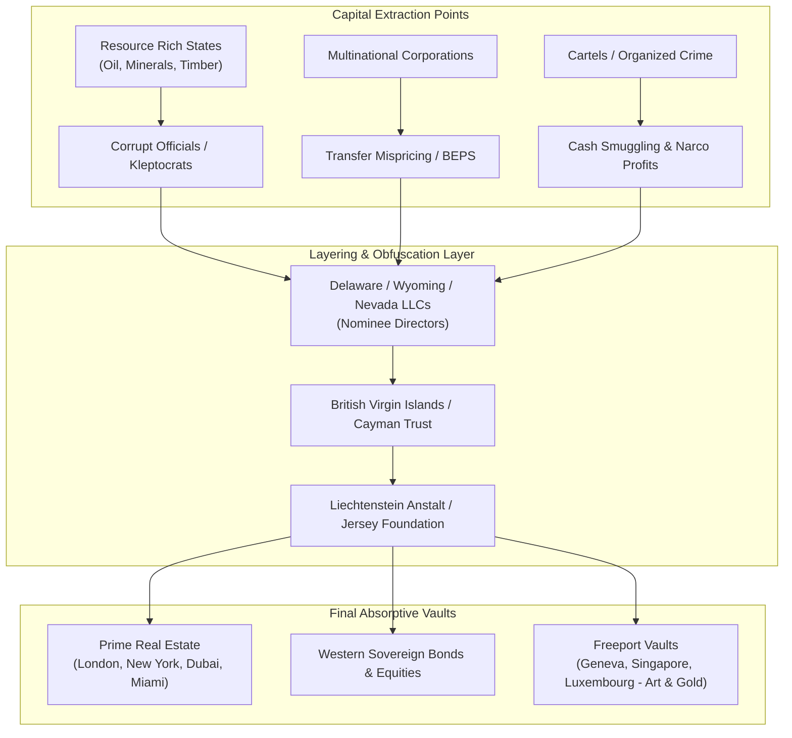

# Global Kleptocracy, Offshore Havens & Illicit Capital Flight: The Financial Architecture of Empire

> "The greatest trick the devil ever pulled was convincing the world he didn't exist. The greatest trick the offshore financial system ever pulled was convincing the world it was an exotic fringe, rather than the core engine of globalized capital."  
> — **Nicholas Shaxson**, *Treasure Islands: Tax Havens and the Men who Stole the World* (2011)

> "Give me control of a nation's money supply, and I care not who makes its laws."  
> — **Mayer Amschel Rothschild** *(Foundational Maxim of Financial Sovereign Monopoly)*

> "The offshore world does not exist in some distant Caribbean archipelago; its true capitals are the City of London, Wall Street, Zurich, and the state of Delaware."  
> — **Brooke Harrington**, *Capital without Borders: Wealth Managers and the One Percent* (2016)

---

## 1. Executive Summary: The $32 Trillion Shadow Vault

According to conservative estimates by the Tax Justice Network and the International Monetary Fund (IMF), between **$21 trillion and $36 trillion** in private financial wealth is held in secrecy jurisdictions and tax havens worldwide. This volume represents approximately 10% to 12% of global GDP, effectively untaxed, unmonitored, and immune to democratic redistributive policies.

Offshore finance is not a byproduct of globalization; it is its command-and-control infrastructure. It facilitates:
* **Kleptocratic Looting:** Extraction of mineral and oil wealth from the Global South (Sub-Saharan Africa alone loses over $88.6 billion annually in illicit capital flight).
* **Sanctions Evasion:** Multi-jurisdictional shell architectures enabling rogue regimes and sanctioned oligarchs to access global trade.
* **Corporate Tax Arbitrage:** Base Erosion and Profit Shifting (BEPS) by multinational conglomerates (Apple, Google, Microsoft, Glencore).
* **Intelligence Slush Funds:** Unregulated conduits through which security services finance covert proxy warfare without legislative appropriation.

---

## 2. Anatomy of the Global Offshore Web

### 2.1 The "Spider's Web": The British Empire's Second Incarnation

The British Empire did not dissolve; it financialized. As political colonies gained independence, the Bank of England and the City of London erected the modern offshore Eurodollar system:
1. **The Core:** The City of London (Square Mile)—a sovereign municipal corporation with ancient medieval privileges, outside the regulatory purview of Parliament.
2. **The Inner Ring (Crown Dependencies):** Jersey, Guernsey, Isle of Man (zero corporate tax, ultra-discreet trusts).
3. **The Outer Ring (Overseas Territories):** Cayman Islands (world's hedge fund hub), British Virgin Islands (world's company incorporation hub with 400,000+ active shell companies), Bermuda, Gibraltar, Turks & Caicos.

### 2.2 The United States: The World's Biggest Secrecy Jurisdiction

While the US enacted FATCA (Foreign Account Tax Compliance Act) forcing international banks to disclose US citizen accounts, the US itself refuses to join the OECD's Common Reporting Standard (CRS).
* **Delaware:** Incorporates over 68% of Fortune 500 firms. Requires less personal identification to register an anonymous shell company than to obtain a public library card.
* **South Dakota:** The "Switzerland of the Great Plains." Its perpetual dynasty trusts allow billionaires to shield assets for centuries with zero state income or capital gains tax.
* **Nevada & Wyoming:** Prohibit charging orders and protect assets from international court judgments.

---

## 3. Techniques of Illicit Financial Engineering

### 3.1 Trade-Based Money Laundering (TBML)
The deliberate mis-invoicing of import and export prices to move capital across borders:
$$	ext{Capital Transferred} = (	ext{Invoice Price} - 	ext{Fair Market Value}) 	imes 	ext{Volume}$$
* *Example:* Exporting $100 worth of copper cathodes invoiced at $10 to an offshore shell in BVI, which resells to the end buyer at $100. The $90 profit remains untaxed in BVI.

### 3.2 Mirror Trading
A financial mechanism exploited by Russian oligarchs to move over $10 billion through Deutsche Bank (Moscow to London/New York):
1. A client buys Russian blue-chip equities in Moscow for Rubles.
2. Simultaneously, a related counterparty sells the identical stock in London for US Dollars or British Pounds.
3. No cross-border wire transfer occurs, yet capital successfully leaves the jurisdiction completely laundered.

### 3.3 Freeports: The Black Hole of Global Cultural Heritage
High-security bonded warehouses located in special tax zones (Geneva Freeport, Luxembourg Freeport, Singapore Freeport):
* Over 1.2 million museum-quality artworks, master paintings (Picasso, Monet, Da Vinci), gold bullion, and ancient antiquities reside in perpetual transit.
* Ownership shares transfer between offshore trusts without the art ever moving physically, evading all capital gains, inheritance, and value-added taxes.

---

## 4. Landmark Leaks and Investigative Revelations

| Investigation | Year | Leaked Data Size | Primary Targets & Revelations |
| :--- | :---: | :---: | :--- |
| **Panama Papers** | 2016 | 11.5M files (Mossack Fonseca) | Hidden assets of 12 world leaders, Petro Poroshenko, Vladimir Putin's inner circle (Sergei Roldugin), Nawaz Sharif, Sigmundur Gunnlaugsson. |
| **Paradise Papers** | 2017 | 13.4M files (Appleby) | Queen Elizabeth II private estate offshore trusts, Wilbur Ross, Glencore resource extraction contracts in DR Congo. |
| **FinCEN Files** | 2020 | 2,100+ SARs ($2 Trillion) | Documented major banks (JPMorgan, HSBC, Standard Chartered, Deutsche Bank) knowingly processing terror and cartel transactions. |
| **Pandora Papers** | 2021 | 11.9M files (14 offshore providers) | King Abdullah II of Jordan's $100M secret real estate, Tony Blair's stamp duty evasion, Ilham Aliyev family property empire. |
| **Suisse Secrets** | 2022 | 18,000 Credit Suisse accounts | Accounts of corrupt despots, spies, human traffickers, and sanctioned kleptocrats held for decades. |

---

## 5. Epistemological Quotes on Financial Subversion

> "The few who understand the system will either be so interested from its profits or so dependent on its favors, that there will be no opposition from that class."  
> — **Rothschild Brothers of London**, *Letter to New York associates* (June 25, 1863)

> "Permit me to issue and control the money of a nation, and I care not who makes its laws."  
> — **Attributed to Baron Nathan Mayer Rothschild**

> "Bankers own the earth. Take it away from them, but leave them the power to create money, and with a flick of the pen they will create enough deposits to buy it back again."  
> — **Sir Josiah Stamp**, *Director of the Bank of England* (1927)

> "When plundering becomes a way of life for a group of men in a society, over the course of time they create for themselves a legal system that authorizes it and a moral code that glorifies it."  
> — **Frédéric Bastiat**, *Economic Sophisms* (1845)

> "The secret of great fortunes without apparent cause is a forgotten crime, for which the perpetrator was never punished because it was neatly done."  
> — **Honoré de Balzac**, *Le Père Goriot* (1835)\n