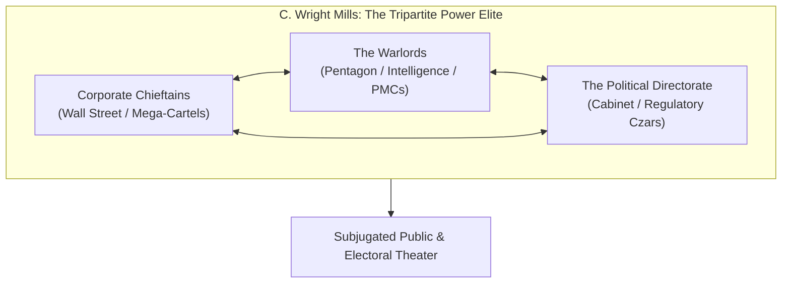

# Deep State, Shadow Governance & Power Elite Theories: A Comprehensive OSINT Framework

> "The conscious and intelligent manipulation of the organized habits and opinions of the masses is an important element in democratic society. Those who manipulate this unseen mechanism of society constitute an invisible government which is the true ruling power of our country."  
> — **Edward L. Bernays**, *Propaganda* (1928)

> "Behind the ostensible government sits enthroned an invisible government owing no allegiance and acknowledging no responsibility to the people. To destroy this invisible government, to dissolve the unholy alliance between corrupt business and corrupt politics is the first task of the statesmanship of the day."  
> — **Theodore Roosevelt**, *Progressive Party Platform Speech* (1912)

> "In the councils of government, we must guard against the acquisition of unwarranted influence, whether sought or unsought, by the military-industrial complex. The potential for the disastrous rise of misplaced power exists and will persist."  
> — **Dwight D. Eisenhower**, *Farewell Address* (1961)

---

## 1. Executive Summary & Epistemological Foundations

Modern political science traditionally models governance through legal-constitutional frameworks: legislatures pass statutes, executives enforce them, and judiciaries interpret them. However, Open Source Intelligence (OSINT) and empirical sociology reveal that sovereign decision-making frequently diverges from public constitutional mandates.

The concept of the **"Deep State"** (derived from the Turkish *Derin Devlet*, originally institutionalized in Cold War-era stay-behind networks such as Operation Gladio) describes the persistent, institutional nexus of national security agencies, financial oligarchies, defense procurement cartels, and covert intelligence apparatuses that operate beyond the electoral cycle and constitutional oversight.

This dossier synthesizes the foundational theoretical models of shadow power, providing an analytical diagnostic toolkit for researchers tracking illicit governance, state capture, and systemic corruption.

---

## 2. Foundational Theoretical Models

### 2.1 C. Wright Mills: The Power Elite Model (1956)

> "The power elite is composed of men whose positions enable them to transcend the ordinary environments of ordinary men and women; they are in positions to make decisions having major consequences... For they are in command of the major hierarchies and organizations of modern society."  
> — **C. Wright Mills**, *The Power Elite* (1956)

Mills identified the structural convergence of three institutional pillars:
1. **The Corporate Chieftains:** Directors of mega-corporations controlling investment, credit allocation, and employment.
2. **The Warlords:** High-ranking military brass and intelligence directors orchestrating geopolitical deployment and procurement budgets.
3. **The Political Directorate:** Senior executive officials who increasingly rotate between corporate boardrooms, K-Street lobbying firms, and cabinet posts (*the "revolving door"*).

### 2.2 Peter Dale Scott: "Deep Politics" and the War on Drugs

> "A deep political system or system of deep politics is one where the political life of a country is fundamentally conditioned by decisions and actions made outside the public constitutional process, involving covert agencies and organized crime."  
> — **Peter Dale Scott**, *Deep Politics and the Death of JFK* (1993)

Peter Dale Scott, former Canadian diplomat and UC Berkeley professor, pioneered the rigorous academic study of deep politics:
* **Structural Convergence:** Intelligence agencies (CIA, MI6, DGSE, SVR) frequently interface with transnational narcotics syndicates (e.g., Air America in the Golden Triangle, Contra cocaine funding, BCCI banking scandal) to generate off-the-books operational liquidity ("black budgets").
* **Denial and Deception:** Official investigations (e.g., Warren Commission, 9/11 Commission) operate within strict epistemological boundaries, intentionally omitting operational nexus points between intelligence assets and criminal syndicates.

### 2.3 Carl Schmitt & Giorgio Agamben: The State of Exception (*Ausnahmezustand*)

> "Sovereign is he who decides on the exception." (*Souverän ist, wer über den Ausnahmezustand entscheidet.*)  
> — **Carl Schmitt**, *Political Theology* (1922)

> "The state of exception, which was meant to be a provisional measure, becomes in the course of the twentieth century a normal technique of government."  
> — **Giorgio Agamben**, *State of Exception* (2005)

When a state declares a national emergency (war on terror, financial collapse, public health crisis, cyber crisis):
* Constitutional safeguards are suspended.
* Executive decrees replace deliberative legislation.
* Intelligence agencies and sovereign wealth funds obtain unchecked discretion.
* The "exception" becomes permanent institutional architecture (e.g., USA PATRIOT Act, UK Investigatory Powers Act, Russian Anti-Terror Laws).

### 2.4 Michael J. Glennon: The "Dual State" and the National Security Apparatus

> "The national security architecture—the CIA, FBI, NSA, Pentagon, and executive national security staff—continues to govern regardless of who sits in the Oval Office. The visible government provides the illusion of democracy, while the Trumanite network exercises actual power."  
> — **Michael J. Glennon**, *National Security and Double Government* (2014)

Glennon draws on Walter Bagehot's 19th-century distinction between:
1. **Dignified Institutions:** The President, Congress, and Courts (performative, symbolic, maintaining public legitimacy).
2. **Efficient Institutions:** The CIA, NSA, Joint Chiefs, DIA, and Defense Logistics Agency (actual executors of foreign, military, and surveillance policy).

---

## 3. Historical Precedents & Empirical Case Studies

### 3.1 The Roman Transition: *Res Publica* to *Principate*
> "They create a desolation and call it peace." (*Solitudinem faciunt, pacem appellant.*)  
> — **Tacitus**, *Agricola* (98 AD)

Augustus maintained the outward forms of the Roman Republic—Senate meetings, consular elections, tribunary vetoes—while concentrating absolute military command (*imperium proconsulare maius*) and control over the public treasury (*fiscus*) in his private household. This represents the classical archetypal double government.

### 3.2 Cold War Gladio: Europe's Secret Stay-Behind Armies
> "The existence of a secret clandestine organization operating under the codename Gladio within the Italian military intelligence service (SISMI) is confirmed... Its purpose went far beyond resisting Soviet invasion, actively influencing domestic political life."  
> — **Giulio Andreotti**, *Italian Prime Minister, Parliamentary Testimony* (October 24, 1990)

* **Scope:** Coordinated across NATO member states (Italy, Greece, Turkey, Belgium, Germany, France, Switzerland).
* **Strategy of Tension (*Strategia della Tensione*):** False-flag terror bombings (e.g., Piazza Fontana 1969, Peteano 1972, Bologna Station 1980) blamed on left-wing militants to terrify the public into accepting authoritarian security legislation and blocking Communist electoral participation.
* **Turkish Counterpart (*Özel Harp Dairesi / Kontrgerilla*):** Implicated in the 1977 Taksim Square massacre, 1980 coup d'état, and the 1996 Susurluk scandal exposing the direct nexus between police chiefs, parliamentarians, and ultranationalist mafia hitmen.

---

## 4. Analytical Methodology for OSINT Investigators

To detect deep governance structures, researchers should abandon ideological rhetoric and track material transactions:

1. **Follow the Revolving Door:** Map corporate filings (SEC Form 10-K, proxy statements) of defense contractors, intelligence tech firms (Palantir, Booz Allen Hamilton), and private equity giants (Carlyle Group, Blackstone) against former defense/intelligence personnel.
2. **Audit Procurement Non-Disclosure:** Scrutinize classified budget annexes ("Black Budgets") that avoid line-item audit requirements.
3. **Trace Corporate Beneficial Ownership:** Intersect offshore corporate registers with sovereign wealth fund co-investments.
4. **Monitor Institutional Inaction:** Notice which financial institutions avoid criminal prosecution despite documented money laundering (e.g., HSBC Mexico cartel settlement, Wachovia drug money laundering).

---

## 5. Master Quotes on Power and Statecraft

> "The real division is not between conservatives and revolutionaries but between authoritarian and libertarian."  
> — **George Orwell**, *Letter to Malcolm Muggeridge* (1940)

> "The great masses of the people will more easily fall victims to a big lie than to a small one."  
> — **Adolf Hitler**, *Mein Kampf* (1925) *(Analyzed by OSS Psychological Profile, 1943)*

> "If you want to know who rules over you, simply find out who you are not allowed to criticize."  
> — **Voltaire** *(Attributed / Popular Maxim of Political Realism)*

> "The lion cannot protect himself from traps, and the fox cannot defend himself from wolves. One must therefore be a fox to recognize traps, and a lion to frighten wolves."  
> — **Niccolò Machiavelli**, *The Prince* (1532)

> "There is no subtler, no surer means of overturning the existing basis of society than to debauch the currency. The process engages all the hidden forces of economic law on the side of destruction, and does it in a manner which not one man in a million is able to diagnose."  
> — **John Maynard Keynes**, *The Economic Consequences of the Peace* (1919)\n