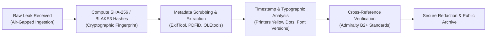

# Whistleblower Leaks, Cryptographic Verification & OSINT Forensic Standards

> "If you want to keep a secret, you must also hide it from yourself."  
> — **George Orwell**, *1984* (1949)

> "Privacy is necessary for an open society in the electronic age... We cannot expect governments, corporations, or other large, faceless organizations to grant us privacy... We must defend our own privacy if we expect to have any."  
> — **Eric Hughes**, *A Cypherpunk's Manifesto* (1993)

> "Courage is contagious."  
> — **Edward Snowden**, *Permanent Record* (2019)

> "If wars can be started by lies, peace can be started by truth."  
> — **Julian Assange**, *Address at Trafalgar Square* (2011)

---

## 1. Executive Summary: The Epistemology of Leaked Intelligence

In an era of deepfakes, cognitive warfare, and synthetic media generation, Open Source Intelligence (OSINT) investigations cannot accept documents at face value. A document leaked to the public may represent:
1. **Genuine Whistleblowing:** Public interest disclosure of illegal state activity (e.g., Daniel Ellsberg, Chelsea Manning, Edward Snowden).
2. **Selective Declassification / Controlled Leak:** State apparatus leaking genuine documents with specific redactions to damage a political rival.
3. **Disinformation / Forgery:** Fabricated documents planted to misinform investigators or discredit legitimate leaks.

This dossier codifies the forensic methodologies required to verify primary-source leaks, analyze metadata, and preserve cryptographic chains of custody.

---

## 2. Landmark Leaks Comparative Analysis Matrix

| Leak Archive | Year | Key Figure | Volume / Format | Primary Technical Significance | Legal & Geopolitical Impact |
| :--- | :---: | :--- | :--- | :--- | :--- |
| **Pentagon Papers** | 1971 | Daniel Ellsberg, Anthony Russo | 7,000 pages (Xerox copies) | First landmark whistleblower exposure of systematic government deception regarding the Vietnam War. | US Supreme Court *New York Times Co. v. United States* affirmed prior restraint prohibition. |
| **Iraq & Afghan War Logs** | 2010 | Chelsea Manning / WikiLeaks | 400,000+ SIGACTS files | Documented uncounted civilian deaths, torture at Iraqi detention centers, and the "Collateral Murder" Apache cockpit footage. | Sparked international debates on civilian casualty accountability and Espionage Act overreach. |
| **State Dept. Cables (Cablegate)** | 2010 | WikiLeaks (Julian Assange) | 251,287 diplomatic cables | Unfiltered insight into US bilateral coercion, espionage against UN officials, and corrupt Arab dictatorships. | Catalyzed the 2011 Arab Spring uprisings (particularly in Tunisia after cables on Ben Ali's family were published). |
| **NSA Mass Surveillance Archive** | 2013 | Edward Snowden / Laura Poitras / Glenn Greenwald | 1.7M classified documents | Exposed PRISM, XKeyscore, MUSCULAR, BULLRUN, showing direct bulk collection of global internet communications without warrant. | Sparked global encryption adoption (Signal protocol, HTTPS Everywhere) and invalidation of EU-US Safe Harbor. |
| **Vault 7 / Vault 8** | 2017 | Joshua Schulte / WikiLeaks | CIA cyber weapons code | Exposed CIA Center for Cyber Intelligence toolkits: weeping angel smart TV exploits, zero-days, and marble framework obfuscation. | Resulted in major CIA internal security overhaul and historic criminal prosecution. |

---

## 3. Cryptographic Chain-of-Custody & Metadata Forensics

### 3.1 Metadata Forensic Indicators
1. **Exif & Document Streams:** Extracting internal creation dates, author usernames, GUIDs, and software build numbers using tools like `exiftool`, `pdf-parser`, and `oletools`.
2. **Printer Tracking Dots (Machine Identification Codes):** Yellow dots printed by color laser printers encoding serial number, date, and timestamp (led to the identification of Reality Winner in the 2017 NSA leak).
3. **Typography & Word Frequency:** Stylometric analysis matching syntactic quirks against official government style manuals (e.g., GPO Style Manual, DoD Dictionary of Military Terms).

### 3.2 The Admiralty Source Reliability Matrix (STANAG 2022)

All evidence integrated into Global X-Ray must meet a minimum rating of **B2**:

| Source Evaluation | Information Credibility |
| :--- | :--- |
| **A** - Completely reliable (No doubt of authenticity) | **1** - Confirmed by other independent sources |
| **B** - Usually reliable (Minor doubt, good history) | **2** - Probably true (Fits established patterns) |
| **C** - Fairly reliable (Doubtful source, but plausible) | **3** - Possibly true (Unconfirmed, but not improbable) |
| **D** - Not usually reliable (Past record of errors) | **4** - Doubtful (Contradicts known facts) |
| **E** - Unreliable (Demonstrated falsehoods) | **5** - Improbable (Highly unlikely, contradicts physics/history) |
| **F** - Reliability cannot be judged | **6** - Truth cannot be judged |

---

## 4. Master Quotes on Whistleblowing, Conscience and State Secrets

> "Can you really believe that the United States has the right to kill 3 million people in Vietnam in order to maintain its reputation as a credible military threat?"  
> — **Daniel Ellsberg**, *Secrets: A Memoir of Vietnam and the Pentagon Papers* (2002)

> "I do not want to live in a world where everything that I do and say is recorded. That is not something I am willing to support or live under."  
> — **Edward Snowden**, *Interview in Hong Kong* (June 2013)

> "The first step in saving an individual from totalitarianism is to protect their right to know what their government is doing."  
> — **Hannah Arendt**, *The Origins of Totalitarianism* (1951)

> "One of the best ways to achieve justice is to expose injustice."  
> — **Julian Assange**, *WikiLeaks Manifesto* (2006)

> "Power concedes nothing without a demand. It never did and it never will."  
> — **Frederick Douglass**, *West India Emancipation Address* (1857)\n